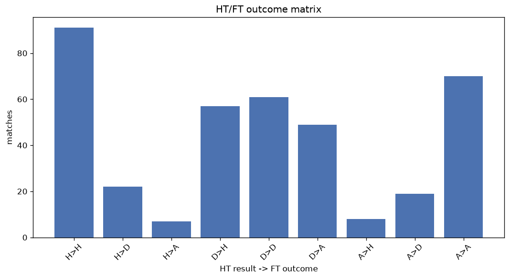
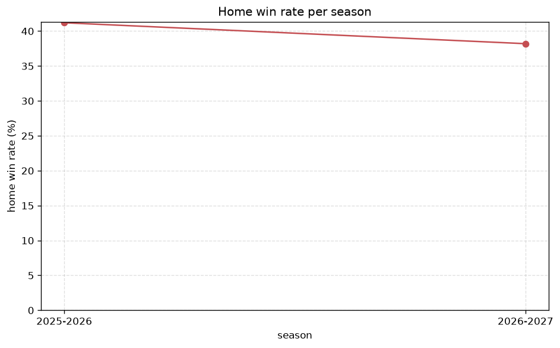

# Match Analysis
- Report: `matches_analysis`
- Generated: 2026-10-26T01:42:56+00:00
- Script: `backend/scripts/analyze_matches.py` v1.0.0
- League: Liga Portugal (Portugal)
- Scope: league `portugal1`

## 1. Overall summary
| metric | value |
|---|---|
| Matches | 384 |
| Home wins | 156 (40.6%) |
| Draws | 102 (26.6%) |
| Away wins | 126 (32.8%) |
| Total goals | 1030 |
| Average goals per match | 2.682 |
| Goalless matches | 25 (6.5%) |

## 2. Per-season breakdown
| season | matches | home wins | draws | away wins | total goals | avg goals | goalless |
|---|---|---|---|---|---|---|---|
| 2025-2026 | 308 | 127 (41.2%) | 84 (27.3%) | 97 (31.5%) | 823 | 2.672 | 21 (6.8%) |
| 2026-2027 | 76 | 29 (38.2%) | 18 (23.7%) | 29 (38.2%) | 207 | 2.724 | 4 (5.3%) |

## 3. HT/FT outcome matrix
| HT result \ FT result | Home | Draw | Away | total |
|---|---|---|---|---|
| HT home lead | 91 (75.8%) | 22 (18.3%) | 7 (5.8%) | 120 |
| HT draw | 57 (34.1%) | 61 (36.5%) | 49 (29.3%) | 167 |
| HT away lead | 8 (8.2%) | 19 (19.6%) | 70 (72.2%) | 97 |

## 4. Comeback matches
- Home comebacks (trailing at HT, won at FT): **8** (2.1%)
- Away comebacks (trailing at HT, won at FT): **7** (1.8%)

### Home comebacks
| season | home | away | HT | FT |
|---|---|---|---|---|
| 2025-2026 | Vitoria Guimaraes | Santa Clara | 0-1 | 2-1 |
| 2025-2026 | Estoril | Vitoria Guimaraes | 1-2 | 4-2 |
| 2025-2026 | Arouca | Vitoria Guimaraes | 1-2 | 3-2 |
| 2025-2026 | Vitoria Guimaraes | Estrela | 0-1 | 2-1 |
| 2025-2026 | Gil Vicente | Braga | 0-1 | 2-1 |
| 2025-2026 | Alverca | Casa Pia | 0-1 | 3-1 |
| 2025-2026 | Santa Clara | Braga | 0-1 | 2-1 |
| 2025-2026 | Moreirense | Estrela | 1-2 | 3-2 |

### Away comebacks
| season | home | away | HT | FT |
|---|---|---|---|---|
| 2025-2026 | Nacional | Sporting CP | 1-0 | 1-4 |
| 2025-2026 | Estrela | Rio Ave | 1-0 | 1-2 |
| 2025-2026 | Arouca | Benfica | 1-0 | 1-2 |
| 2025-2026 | Estoril | Rio Ave | 1-0 | 1-2 |
| 2026-2027 | Alverca | Braga | 1-0 | 1-2 |
| 2026-2027 | Braga | Sporting CP | 1-0 | 1-3 |
| 2026-2027 | Braga | Gil Vicente | 1-0 | 1-2 |

## 5. HT lead conversion
| HT state | matches | converted to win | held as draw | collapsed to loss |
|---|---|---|---|---|
| Home lead | 120 | 91 (75.8%) | 22 (18.3%) | 7 (5.8%) |
| Away lead | 97 | 70 (72.2%) | 19 (19.6%) | 8 (8.2%) |

### Matches level at half-time
| FT result | count | pct |
|---|---|---|
| Home win | 57 | 34.1% |
| Draw | 61 | 36.5% |
| Away win | 49 | 29.3% |

## 6. First-goal timing
- Matches with a first-goal time recorded: `359` of `384` (93.5%)

Outcome distribution by first-goal timing bucket:
| bucket | matches | % of matches | home | draw | away |
|---|---|---|---|---|---|
| 1-15 | 122 | 31.8% | 55 (45.1%) | 28 (23.0%) | 39 (32.0%) |
| 16-30 | 71 | 18.5% | 31 (43.7%) | 16 (22.5%) | 24 (33.8%) |
| 31-45 | 69 | 18.0% | 29 (42.0%) | 16 (23.2%) | 24 (34.8%) |
| 46-60 | 44 | 11.5% | 15 (34.1%) | 10 (22.7%) | 19 (43.2%) |
| 61-75 | 31 | 8.1% | 15 (48.4%) | 3 (9.7%) | 13 (41.9%) |
| 76-90 | 17 | 4.4% | 9 (52.9%) | 4 (23.5%) | 4 (23.5%) |
| 91-120 | 5 | 1.3% | 2 (40.0%) | 0 (0.0%) | 3 (60.0%) |

## 7. Goalless matches
- Overall: **25** of `384` (6.5%)

| season | matches | goalless | pct |
|---|---|---|---|
| 2025-2026 | 308 | 21 | 6.8% |
| 2026-2027 | 76 | 4 | 5.3% |

---
*All statistics are computed from PostgreSQL tables (read-only). Run with `python backend/scripts/analyze_matches.py` to regenerate.*

## Charts

