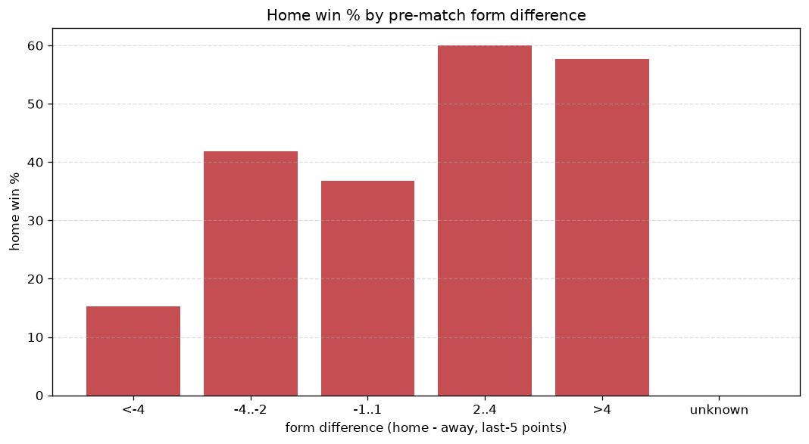
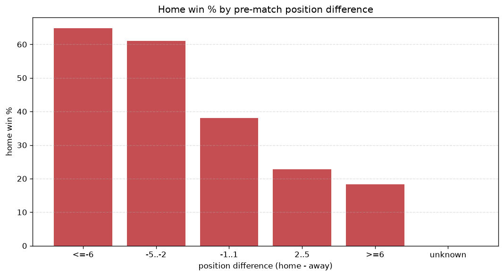

# Relationships Analysis
- Report: `relationships`
- Generated: 2026-10-26T01:43:04+00:00
- Script: `backend/scripts/analyze_relationships.py` v1.0.0
- League: Liga Portugal (Portugal)
- Scope: league `portugal1`

- Matches analysed: **308** (23 leakage-safe pre-match features).

## 1. Correlation matrix
_Pearson correlation of each pre-match feature with observed goals; sorted by |corr(total goals)|._

| feature | corr(home) | corr(away) | corr(total) |
|---|---|---|---|
| home_team_goals_scored_last_5 | 0.229 | -0.087 | 0.131 |
| home_position_before_match | -0.293 | 0.179 | -0.118 |
| home_team_points_last_5 | 0.226 | -0.135 | 0.093 |
| home_team_wins_last_5 | 0.223 | -0.141 | 0.086 |
| position_difference | -0.364 | 0.318 | -0.079 |
| home_team_home_goals_avg | 0.186 | -0.116 | 0.073 |
| home_points_before_match | 0.210 | -0.146 | 0.072 |
| rest_days_difference | -0.054 | -0.034 | -0.070 |
| points_difference | 0.323 | -0.290 | 0.064 |
| away_rest_days | 0.017 | 0.069 | 0.064 |
| home_team_home_win_rate | 0.186 | -0.155 | 0.046 |
| home_team_goals_conceded_last_5 | -0.166 | 0.141 | -0.038 |
| home_team_home_conceded_avg | -0.182 | 0.173 | -0.029 |
| away_team_goals_conceded_last_5 | 0.145 | -0.210 | -0.029 |
| away_team_points_last_5 | -0.151 | 0.217 | 0.028 |
| away_team_wins_last_5 | -0.153 | 0.216 | 0.026 |
| away_team_away_conceded_avg | 0.181 | -0.178 | 0.025 |
| home_rest_days | -0.013 | 0.048 | 0.024 |
| away_team_goals_scored_last_5 | -0.138 | 0.189 | 0.020 |
| away_team_away_win_rate | -0.210 | 0.225 | -0.015 |
| away_team_away_goals_avg | -0.153 | 0.199 | 0.014 |
| away_points_before_match | -0.097 | 0.131 | 0.012 |
| away_position_before_match | 0.208 | -0.258 | -0.010 |

## 2. Form vs outcome
_Home win/draw/away % per bucket of `home_team_points_last_5 - away_team_points_last_5`._

| bucket | matches | home | draw | away | home % | draw % | away % |
|---|---|---|---|---|---|---|---|
| <-4 | 59 | 9 | 13 | 37 | 15.3% | 22.0% | 62.7% |
| -4..-2 | 55 | 23 | 13 | 19 | 41.8% | 23.6% | 34.5% |
| -1..1 | 87 | 32 | 29 | 26 | 36.8% | 33.3% | 29.9% |
| 2..4 | 55 | 33 | 13 | 9 | 60.0% | 23.6% | 16.4% |
| >4 | 52 | 30 | 16 | 6 | 57.7% | 30.8% | 11.5% |
| unknown | 0 | 0 | 0 | 0 | - | - | - |

## 3. Position vs outcome
_Home win/draw/away % per bucket of `position_difference` (home position - away position; negative favours the home team)._

| bucket | matches | home | draw | away | home % | draw % | away % |
|---|---|---|---|---|---|---|---|
| <=-6 | 71 | 46 | 16 | 9 | 64.8% | 22.5% | 12.7% |
| -5..-2 | 59 | 36 | 15 | 8 | 61.0% | 25.4% | 13.6% |
| -1..1 | 50 | 19 | 14 | 17 | 38.0% | 28.0% | 34.0% |
| 2..5 | 57 | 13 | 20 | 24 | 22.8% | 35.1% | 42.1% |
| >=6 | 71 | 13 | 19 | 39 | 18.3% | 26.8% | 54.9% |
| unknown | 0 | 0 | 0 | 0 | - | - | - |

## 4. Rest advantage
_Home win/draw/away % per bucket of `rest_days_difference` (home rest - away rest). Matches with unknown rest are bucketed separately._

| bucket | matches | home | draw | away | home % | draw % | away % |
|---|---|---|---|---|---|---|---|
| <-1 | 34 | 15 | 6 | 13 | 44.1% | 17.6% | 38.2% |
| -1..0 | 73 | 33 | 17 | 23 | 45.2% | 23.3% | 31.5% |
| 0 | 83 | 36 | 23 | 24 | 43.4% | 27.7% | 28.9% |
| 1..2 | 94 | 31 | 31 | 32 | 33.0% | 33.0% | 34.0% |
| >2 | 13 | 7 | 4 | 2 | 53.8% | 30.8% | 15.4% |
| unknown | 11 | 5 | 3 | 3 | 45.5% | 27.3% | 27.3% |
- *11 match(es) had unknown rest difference (missing rest data on at least one side).*

## 5. Home team quality
_Home win rate by `home_team_home_win_rate` tier (split at 0.5)._

- `< 0.5` tier: **36.1%** home win (73/202)
- `>= 0.5` tier: **50.9%** home win (54/106)
- Home-win gap (>= split minus < split): **+14.8 pp**

| tier | label | matches | home | draw | away | home % |
|---|---|---|---|---|---|---|
| low | < 0.5 | 202 | 73 | 50 | 79 | 36.1% |
| high | >= 0.5 | 106 | 54 | 34 | 18 | 50.9% |

## 6. Feature averages by result
_Mean feature value per outcome; `range` is home-minus-away spread of the group means._

| feature | home mean | draw mean | away mean | range |
|---|---|---|---|---|
| points_difference | 7.559 | -1.524 | -8.505 | 16.064 |
| home_points_before_match | 27.362 | 21.762 | 16.979 | 10.383 |
| position_difference | -3.205 | 0.571 | 3.928 | 7.133 |
| away_points_before_match | 19.803 | 23.286 | 25.485 | 5.681 |
| away_position_before_match | 11.126 | 10.024 | 7.536 | 3.590 |
| home_position_before_match | 7.921 | 10.595 | 11.464 | 3.543 |
| home_team_points_last_5 | 7.181 | 6.024 | 4.856 | 2.325 |
| away_team_goals_conceded_last_5 | 6.874 | 6.060 | 4.825 | 2.049 |
| away_team_points_last_5 | 5.598 | 5.833 | 7.526 | 1.927 |
| home_team_goals_scored_last_5 | 6.850 | 5.869 | 5.041 | 1.809 |
| away_team_goals_scored_last_5 | 5.661 | 5.750 | 7.299 | 1.638 |
| away_rest_days | 8.369 | 7.578 | 9.202 | 1.624 |
| home_team_goals_conceded_last_5 | 5.567 | 6.571 | 6.814 | 1.248 |
| home_rest_days | 8.320 | 7.988 | 9.011 | 1.023 |
| home_team_wins_last_5 | 2.000 | 1.631 | 1.175 | 0.825 |
| away_team_wins_last_5 | 1.480 | 1.488 | 2.134 | 0.654 |
| away_team_away_conceded_avg | 1.594 | 1.401 | 1.067 | 0.527 |
| rest_days_difference | -0.049 | 0.370 | -0.149 | 0.519 |
| home_team_home_goals_avg | 1.516 | 1.377 | 1.148 | 0.368 |
| away_team_away_goals_avg | 1.018 | 1.190 | 1.337 | 0.319 |
| home_team_home_conceded_avg | 1.009 | 1.225 | 1.297 | 0.288 |
| away_team_away_win_rate | 0.247 | 0.339 | 0.448 | 0.201 |
| home_team_home_win_rate | 0.426 | 0.365 | 0.270 | 0.156 |

---
*All features are leakage-safe pre-match values built by `ml.features.build_features.build_rows` from strictly prior matches. Run with `python backend/scripts/analyze_relationships.py` to regenerate.*

## Charts

