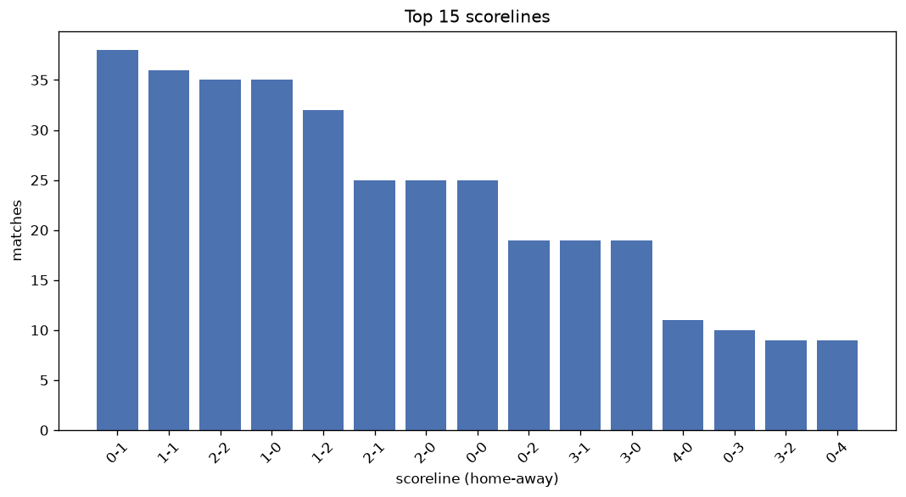
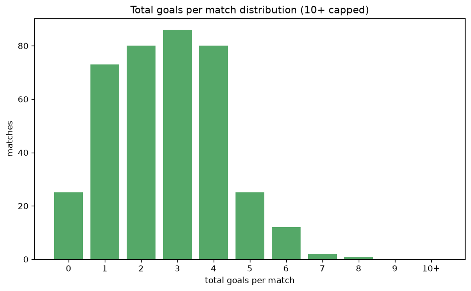

# Scoreline Analysis
- Report: `scoreline_analysis`
- Generated: 2026-10-26T01:43:02+00:00
- Script: `backend/scripts/analyze_scorelines.py` v1.0.0
- League: Liga Portugal (Portugal)
- Scope: league `portugal1`

## 1. Scoreline frequency
- Matches analysed: **384** across **2** seasons.
- Distinct scorelines seen: **29**.

| scoreline | count | pct |
|---|---|---|
| 0-1 | 38 | 9.9% |
| 1-1 | 36 | 9.4% |
| 2-2 | 35 | 9.1% |
| 1-0 | 35 | 9.1% |
| 1-2 | 32 | 8.3% |
| 2-1 | 25 | 6.5% |
| 2-0 | 25 | 6.5% |
| 0-0 | 25 | 6.5% |
| 0-2 | 19 | 4.9% |
| 3-1 | 19 | 4.9% |
| 3-0 | 19 | 4.9% |
| 4-0 | 11 | 2.9% |
| 0-3 | 10 | 2.6% |
| 3-2 | 9 | 2.3% |
| 0-4 | 9 | 2.3% |
| 1-4 | 6 | 1.6% |
| 3-3 | 6 | 1.6% |
| 1-3 | 6 | 1.6% |
| 5-0 | 5 | 1.3% |
| 6-0 | 2 | 0.5% |

## 2. Scoreline frequency per season

### 2025-2026
| scoreline | count | pct |
|---|---|---|
| 1-1 | 31 | 10.1% |
| 0-1 | 30 | 9.7% |
| 2-2 | 27 | 8.8% |
| 1-0 | 27 | 8.8% |
| 1-2 | 26 | 8.4% |

### 2026-2027
| scoreline | count | pct |
|---|---|---|
| 1-0 | 8 | 10.5% |
| 0-1 | 8 | 10.5% |
| 2-2 | 8 | 10.5% |
| 2-0 | 6 | 7.9% |
| 1-2 | 6 | 7.9% |

## 3. Total-goal histogram
_10+ groups all matches with 10 or more total goals._

| total goals | matches | pct |
|---|---|---|
| 0 | 25 | 6.5% |
| 1 | 73 | 19.0% |
| 2 | 80 | 20.8% |
| 3 | 86 | 22.4% |
| 4 | 80 | 20.8% |
| 5 | 25 | 6.5% |
| 6 | 12 | 3.1% |
| 7 | 2 | 0.5% |
| 8 | 1 | 0.3% |
| 9 | 0 | 0.0% |
| 10+ | 0 | 0.0% |

## 4. Extreme scorelines
- Matches with 7+ total goals: **3**

| season | date | scoreline | total goals |
|---|---|---|---|
| 2025-2026 | 2025-11-01 | 3-5 | 8 |
| 2025-2026 | 2025-11-07 | 4-3 | 7 |
| 2026-2027 | 2026-08-17 | 0-7 | 7 |

## 5. Margin-of-victory distribution (decided matches)
- Decided matches: **282** (draws: **102**)
- Average winning margin: **1.89**

| margin | matches | pct |
|---|---|---|
| 1 | 142 | 50.4% |
| 2 | 73 | 25.9% |
| 3+ | 67 | 23.8% |

## 6. Margin by outcome

### Home wins
- Matches: **156** | avg margin: **1.99** | max margin: **6**
| margin | matches | pct |
|---|---|---|
| 1 | 70 | 44.9% |
| 2 | 46 | 29.5% |
| 3+ | 40 | 25.6% |
- *Full match-by-match list available in `scoreline_analysis.json`.*

### Away wins
- Matches: **126** | avg margin: **1.76** | max margin: **7**
| margin | matches | pct |
|---|---|---|
| 1 | 72 | 57.1% |
| 2 | 27 | 21.4% |
| 3+ | 27 | 21.4% |
- *Full match-by-match list available in `scoreline_analysis.json`.*

## 7. Most common exact score by outcome type
| outcome | matches | most common score | count | pct |
|---|---|---|---|---|
| home | 156 | 1-0 | 35 | 22.4% |
| draw | 102 | 1-1 | 36 | 35.3% |
| away | 126 | 0-1 | 38 | 30.2% |

---
*All statistics are computed from PostgreSQL tables (read-only). Run with `python backend/scripts/analyze_scorelines.py` to regenerate.*

## Charts

