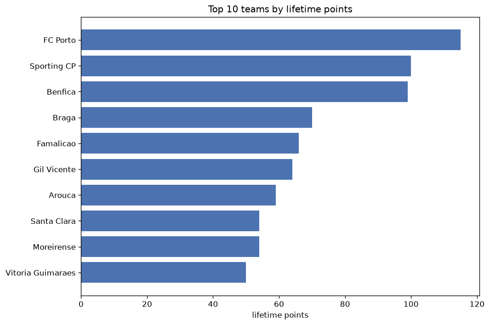
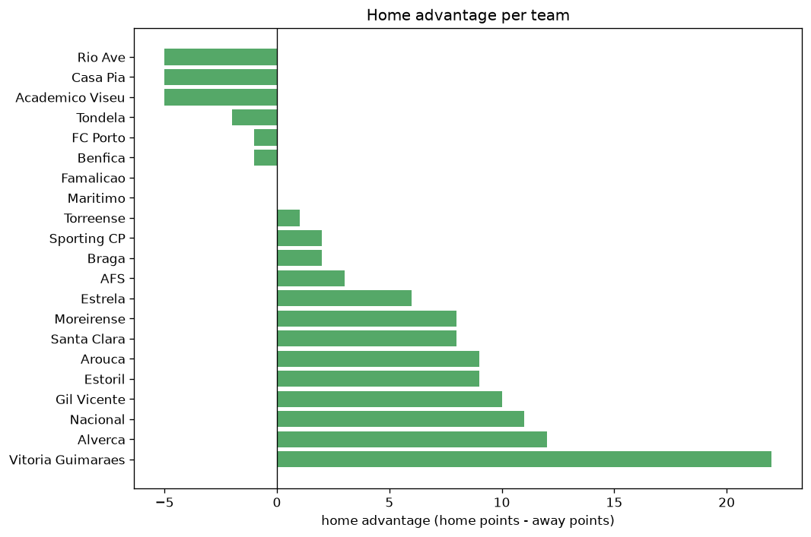

# Team Analysis
- Report: `teams_analysis`
- Generated: 2026-10-27T02:25:03+00:00
- Script: `backend/scripts/analyze_teams.py` v1.0.0
- League: Liga Portugal (Portugal)
- Scope: league `portugal1`

- Teams: **21** | Seasons: **2** | Matches: **388**

## 1. Team standings (lifetime)
| team | seasons | played | W | D | L | pts | GF | GA | GD | avg pts/season | best pos | worst pos | titles |
|---|---|---|---|---|---|---|---|---|---|---|---|---|---|
| FC Porto | 2 | 43 | 37 | 4 | 2 | 115 | 87 | 22 | 65 | 57.5 | 1 | 1 | 2 |
| Sporting CP | 2 | 43 | 30 | 10 | 3 | 100 | 110 | 35 | 75 | 50.0 | 2 | 3 | 0 |
| Benfica | 2 | 42 | 29 | 12 | 1 | 99 | 98 | 32 | 66 | 49.5 | 2 | 3 | 0 |
| Braga | 2 | 43 | 19 | 13 | 11 | 70 | 73 | 47 | 26 | 35.0 | 4 | 9 | 0 |
| Famalicao | 2 | 43 | 17 | 15 | 11 | 66 | 56 | 40 | 16 | 33.0 | 5 | 11 | 0 |
| Gil Vicente | 2 | 43 | 17 | 13 | 13 | 64 | 55 | 45 | 10 | 32.0 | 6 | 7 | 0 |
| Arouca | 2 | 43 | 17 | 8 | 18 | 59 | 59 | 71 | -12 | 29.5 | 5 | 9 | 0 |
| Santa Clara | 2 | 42 | 14 | 12 | 16 | 54 | 44 | 45 | -1 | 27.0 | 4 | 12 | 0 |
| Moreirense | 2 | 43 | 15 | 9 | 19 | 54 | 48 | 65 | -17 | 27.0 | 7 | 10 | 0 |
| Vitoria Guimaraes | 2 | 43 | 14 | 8 | 21 | 50 | 49 | 61 | -12 | 25.0 | 8 | 13 | 0 |
| Alverca | 2 | 43 | 13 | 11 | 19 | 50 | 48 | 65 | -17 | 25.0 | 8 | 11 | 0 |
| Rio Ave | 2 | 43 | 10 | 13 | 20 | 43 | 43 | 78 | -35 | 21.5 | 13 | 17 | 0 |
| Estoril | 2 | 43 | 10 | 11 | 22 | 41 | 59 | 72 | -13 | 20.5 | 10 | 18 | 0 |
| Nacional | 2 | 43 | 11 | 8 | 24 | 41 | 47 | 63 | -16 | 20.5 | 14 | 15 | 0 |
| Casa Pia | 2 | 45 | 9 | 14 | 22 | 41 | 38 | 74 | -36 | 20.5 | 15 | 16 | 0 |
| Estrela | 2 | 43 | 8 | 16 | 19 | 40 | 52 | 73 | -21 | 20.0 | 12 | 16 | 0 |
| Tondela | 1 | 34 | 6 | 10 | 18 | 28 | 27 | 55 | -28 | 28.0 | 17 | 17 | 0 |
| AFS | 1 | 34 | 3 | 12 | 19 | 21 | 27 | 67 | -40 | 21.0 | 18 | 18 | 0 |
| Academico Viseu | 1 | 9 | 5 | 2 | 2 | 17 | 13 | 11 | 2 | 17.0 | 6 | 6 | 0 |
| Maritimo | 1 | 9 | 2 | 2 | 5 | 8 | 9 | 19 | -10 | 8.0 | 14 | 14 | 0 |
| Torreense | 1 | 2 | 0 | 1 | 1 | 1 | 0 | 2 | -2 | 1.0 | 19 | 19 | 0 |

## 2. Home vs away split
| team | home P | H-W | H-D | H-L | H-pts | away P | A-W | A-D | A-L | A-pts | adv |
|---|---|---|---|---|---|---|---|---|---|---|---|
| Vitoria Guimaraes | 22 | 10 | 6 | 6 | 36 | 21 | 4 | 2 | 15 | 14 | 22 |
| Alverca | 22 | 8 | 7 | 7 | 31 | 21 | 5 | 4 | 12 | 19 | 12 |
| Nacional | 22 | 8 | 2 | 12 | 26 | 21 | 3 | 6 | 12 | 15 | 11 |
| Gil Vicente | 22 | 11 | 4 | 7 | 37 | 21 | 6 | 9 | 6 | 27 | 10 |
| Arouca | 21 | 10 | 4 | 7 | 34 | 22 | 7 | 4 | 11 | 25 | 9 |
| Estoril | 22 | 6 | 7 | 9 | 25 | 21 | 4 | 4 | 13 | 16 | 9 |
| Moreirense | 21 | 9 | 4 | 8 | 31 | 22 | 6 | 5 | 11 | 23 | 8 |
| Santa Clara | 21 | 9 | 4 | 8 | 31 | 21 | 5 | 8 | 8 | 23 | 8 |
| Estrela | 22 | 5 | 8 | 9 | 23 | 21 | 3 | 8 | 10 | 17 | 6 |
| AFS | 17 | 2 | 6 | 9 | 12 | 17 | 1 | 6 | 10 | 9 | 3 |
| Sporting CP | 22 | 16 | 3 | 3 | 51 | 21 | 14 | 7 | 0 | 49 | 2 |
| Braga | 21 | 10 | 6 | 5 | 36 | 22 | 9 | 7 | 6 | 34 | 2 |
| Torreense | 1 | 0 | 1 | 0 | 1 | 1 | 0 | 0 | 1 | 0 | 1 |
| Famalicao | 21 | 9 | 6 | 6 | 33 | 22 | 8 | 9 | 5 | 33 | 0 |
| Maritimo | 4 | 1 | 1 | 2 | 4 | 5 | 1 | 1 | 3 | 4 | 0 |
| FC Porto | 21 | 18 | 3 | 0 | 57 | 22 | 19 | 1 | 2 | 58 | -1 |
| Benfica | 21 | 14 | 7 | 0 | 49 | 21 | 15 | 5 | 1 | 50 | -1 |
| Tondela | 17 | 2 | 7 | 8 | 13 | 17 | 4 | 3 | 10 | 15 | -2 |
| Rio Ave | 22 | 4 | 7 | 11 | 19 | 21 | 6 | 6 | 9 | 24 | -5 |
| Casa Pia | 22 | 3 | 9 | 10 | 18 | 23 | 6 | 5 | 12 | 23 | -5 |
| Academico Viseu | 4 | 2 | 0 | 2 | 6 | 5 | 3 | 2 | 0 | 11 | -5 |

## 3. Top performers
### Best points per game (PPG)
| rank | team | PPG |
|---|---|---|
| 1 | FC Porto | 2.67 |
| 2 | Benfica | 2.36 |
| 3 | Sporting CP | 2.33 |
| 4 | Academico Viseu | 1.89 |
| 5 | Braga | 1.63 |

### Most goals scored
| rank | team | goals |
|---|---|---|
| 1 | Sporting CP | 110 |
| 2 | Benfica | 98 |
| 3 | FC Porto | 87 |
| 4 | Braga | 73 |
| 5 | Arouca | 59 |

### Best goal difference
| rank | team | GD |
|---|---|---|
| 1 | Sporting CP | 75 |
| 2 | Benfica | 66 |
| 3 | FC Porto | 65 |
| 4 | Braga | 26 |
| 5 | Famalicao | 16 |

### Best defence (goals against per match, standings)
| rank | team | GA/match |
|---|---|---|
| 1 | FC Porto | 0.512 |
| 2 | Benfica | 0.762 |
| 3 | Sporting CP | 0.814 |
| 4 | Famalicao | 0.930 |
| 5 | Torreense | 1.000 |

## 4. Team consistency
- Teams present in all **2** seasons: **16**

Alverca, Arouca, Benfica, Braga, Casa Pia, Estoril, Estrela, FC Porto, Famalicao, Gil Vicente, Moreirense, Nacional, Rio Ave, Santa Clara, Sporting CP, Vitoria Guimaraes

## 5. Head-to-head dominance
- Distinct fixtures: **171** (showing the 15 most frequent)

| fixture | meetings | home wins | draws | away wins | home pct | draw pct | away pct |
|---|---|---|---|---|---|---|---|
| Arouca vs Estrela | 3 | 3 | 0 | 0 | 100.0% | 0.0% | 0.0% |
| Vitoria Guimaraes vs Nacional | 3 | 3 | 0 | 0 | 100.0% | 0.0% | 0.0% |
| Alverca vs Nacional | 3 | 2 | 0 | 1 | 66.7% | 0.0% | 33.3% |
| Arouca vs Alverca | 3 | 2 | 0 | 1 | 66.7% | 0.0% | 33.3% |
| Arouca vs Estoril | 3 | 2 | 1 | 0 | 66.7% | 33.3% | 0.0% |
| Benfica vs Estoril | 3 | 2 | 0 | 1 | 66.7% | 0.0% | 33.3% |
| Benfica vs Gil Vicente | 3 | 2 | 0 | 1 | 66.7% | 0.0% | 33.3% |
| Benfica vs Vitoria Guimaraes | 3 | 2 | 0 | 1 | 66.7% | 0.0% | 33.3% |
| Braga vs Estoril | 3 | 2 | 1 | 0 | 66.7% | 33.3% | 0.0% |
| Braga vs Santa Clara | 3 | 2 | 1 | 0 | 66.7% | 33.3% | 0.0% |
| Braga vs Vitoria Guimaraes | 3 | 2 | 1 | 0 | 66.7% | 33.3% | 0.0% |
| FC Porto vs Alverca | 3 | 2 | 0 | 1 | 66.7% | 0.0% | 33.3% |
| FC Porto vs Arouca | 3 | 2 | 0 | 1 | 66.7% | 0.0% | 33.3% |
| FC Porto vs Casa Pia | 3 | 2 | 0 | 1 | 66.7% | 0.0% | 33.3% |
| FC Porto vs Moreirense | 3 | 2 | 0 | 1 | 66.7% | 0.0% | 33.3% |

## 6. Position per season (classic view)
_Cells show final position; '-' when the team was absent from that season._

| team | 2025-2026 | 2026-2027 |
|---|---|---|
| FC Porto | 1 | 1 |
| Sporting CP | 2 | 3 |
| Benfica | 3 | 2 |
| Braga | 4 | 9 |
| Famalicao | 5 | 11 |
| Gil Vicente | 6 | 7 |
| Arouca | 9 | 5 |
| Santa Clara | 12 | 4 |
| Moreirense | 7 | 10 |
| Vitoria Guimaraes | 8 | 13 |
| Alverca | 11 | 8 |
| Rio Ave | 13 | 17 |
| Estoril | 10 | 18 |
| Nacional | 14 | 15 |
| Casa Pia | 15 | 16 |
| Estrela | 16 | 12 |
| Tondela | 17 | - |
| AFS | 18 | - |
| Academico Viseu | - | 6 |
| Maritimo | - | 14 |
| Torreense | 19 | - |

---
*All statistics are computed from PostgreSQL tables (read-only). Run with `python backend/scripts/analyze_teams.py` to regenerate.*

## Charts

