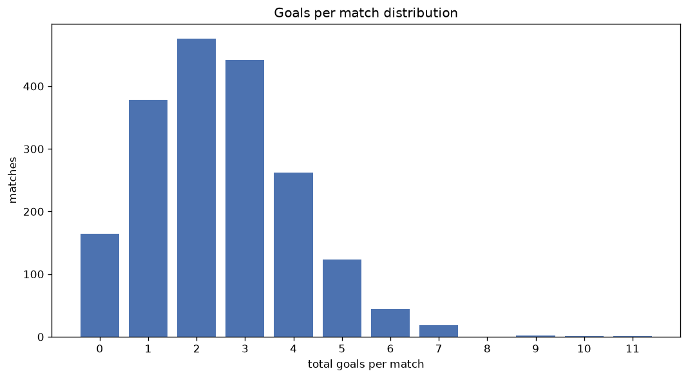
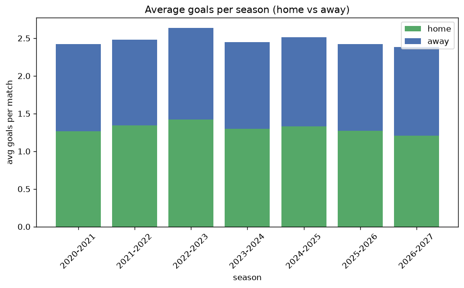

# Goal Analysis
- Report: `goals_analysis`
- Generated: 2026-10-30T04:05:28+00:00
- Script: `backend/scripts/analyze_goals.py` v1.0.0
- League: Liga Portugal 2 (Portugal)
- Scope: league `portugal2`

## 1. Goals per match distribution
| goals | matches | pct |
|---|---|---|
| 0 | 164 | 8.6% |
| 1 | 379 | 19.8% |
| 2 | 476 | 24.9% |
| 3 | 442 | 23.1% |
| 4 | 262 | 13.7% |
| 5 | 123 | 6.4% |
| 6 | 44 | 2.3% |
| 7 | 18 | 0.9% |
| 8 | 0 | 0.0% |
| 9 | 2 | 0.1% |
| 10 | 1 | 0.1% |
| 11 | 1 | 0.1% |

## 2. Goals per match per season
| season | matches | total goals | avg home | avg away | avg total |
|---|---|---|---|---|---|
| 2020-2021 | 306 | 741 | 1.265 | 1.157 | 2.422 |
| 2021-2022 | 306 | 760 | 1.346 | 1.137 | 2.484 |
| 2022-2023 | 306 | 807 | 1.422 | 1.216 | 2.637 |
| 2023-2024 | 306 | 749 | 1.297 | 1.15 | 2.448 |
| 2024-2025 | 306 | 769 | 1.333 | 1.18 | 2.513 |
| 2025-2026 | 310 | 751 | 1.274 | 1.148 | 2.423 |
| 2026-2027 | 72 | 172 | 1.222 | 1.167 | 2.389 |

## 3. Home vs away goal share
- Home goals: **2522** (53.1%)
- Away goals: **2227** (46.9%)
- Home/away ratio: **1.132**

| season | home goals | away goals | total | home pct | away pct |
|---|---|---|---|---|---|
| 2020-2021 | 387 | 354 | 741 | 52.2% | 47.8% |
| 2021-2022 | 412 | 348 | 760 | 54.2% | 45.8% |
| 2022-2023 | 435 | 372 | 807 | 53.9% | 46.1% |
| 2023-2024 | 397 | 352 | 749 | 53.0% | 47.0% |
| 2024-2025 | 408 | 361 | 769 | 53.1% | 46.9% |
| 2025-2026 | 395 | 356 | 751 | 52.6% | 47.4% |
| 2026-2027 | 88 | 84 | 172 | 51.2% | 48.8% |

## 4. BTTS (Both Teams To Score)
- Overall: **1001** of `1912` (52.4%)

| season | matches | BTTS | pct |
|---|---|---|---|
| 2020-2021 | 306 | 164 | 53.6% |
| 2021-2022 | 306 | 164 | 53.6% |
| 2022-2023 | 306 | 171 | 55.9% |
| 2023-2024 | 306 | 163 | 53.3% |
| 2024-2025 | 306 | 165 | 53.9% |
| 2025-2026 | 310 | 142 | 45.8% |
| 2026-2027 | 72 | 32 | 44.4% |

## 5. Clean sheets
- Home clean sheets: **585** (30.6%)
- Away clean sheets: **490** (25.6%)
- Total clean sheets recorded: **1075**
- Matches with at least one clean sheet: **911** (47.6%)
- Both teams kept clean sheets (0-0): **164**

| season | matches | home CS | away CS | total CS | matches w/ CS |
|---|---|---|---|---|---|
| 2020-2021 | 306 | 88 | 83 | 171 | 142 (46.4%) |
| 2021-2022 | 306 | 97 | 71 | 168 | 142 (46.4%) |
| 2022-2023 | 306 | 82 | 75 | 157 | 135 (44.1%) |
| 2023-2024 | 306 | 88 | 79 | 167 | 143 (46.7%) |
| 2024-2025 | 306 | 91 | 75 | 166 | 141 (46.1%) |
| 2025-2026 | 310 | 113 | 88 | 201 | 168 (54.2%) |
| 2026-2027 | 72 | 26 | 19 | 45 | 40 (55.6%) |

## 6. Scoring intensity
- First-half goals: **2145** (45.2%)
- Second-half goals: **2604** (54.8%)
- Avg first-half goals per match: **1.122**
- Avg second-half goals per match: **1.362**
- Second-half-only scoring (HT 0-0, FT goals >= 1): **446** (23.3%)

| season | matches | 1st half | 2nd half | 1st half pct | 2nd half pct |
|---|---|---|---|---|---|
| 2020-2021 | 306 | 341 | 400 | 46.0% | 54.0% |
| 2021-2022 | 306 | 336 | 424 | 44.2% | 55.8% |
| 2022-2023 | 306 | 354 | 453 | 43.9% | 56.1% |
| 2023-2024 | 306 | 349 | 400 | 46.6% | 53.4% |
| 2024-2025 | 306 | 365 | 404 | 47.5% | 52.5% |
| 2025-2026 | 310 | 321 | 430 | 42.7% | 57.3% |
| 2026-2027 | 72 | 79 | 93 | 45.9% | 54.1% |

## 7. First-goal timing
- Matches with first-goal time recorded: `1748` of `1912` (91.4%)
- Goalless matches: `164`
- Min `1` | Max `101` | Mean `31.72` | Median (p50) `26.0`

| bucket | count | % of matches | % of scoring matches |
|---|---|---|---|
| 1-15 | 547 | 28.6% | 31.3% |
| 16-30 | 430 | 22.5% | 24.6% |
| 31-45 | 288 | 15.1% | 16.5% |
| 46-60 | 244 | 12.8% | 14.0% |
| 61-75 | 137 | 7.2% | 7.8% |
| 76-90 | 72 | 3.8% | 4.1% |
| 91-120 | 30 | 1.6% | 1.7% |

---
*All statistics are computed from PostgreSQL tables (read-only). Run with `python backend/scripts/analyze_goals.py` to regenerate.*

## Charts

