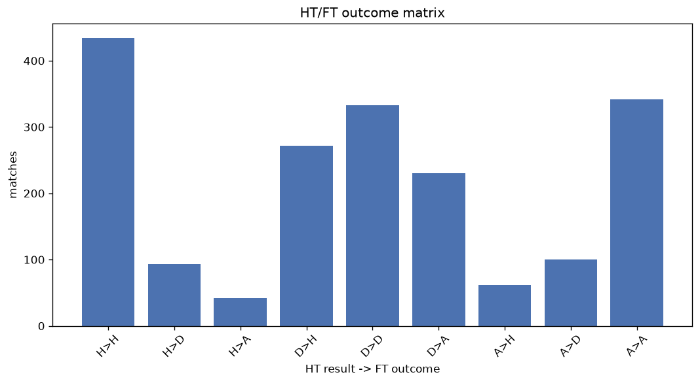
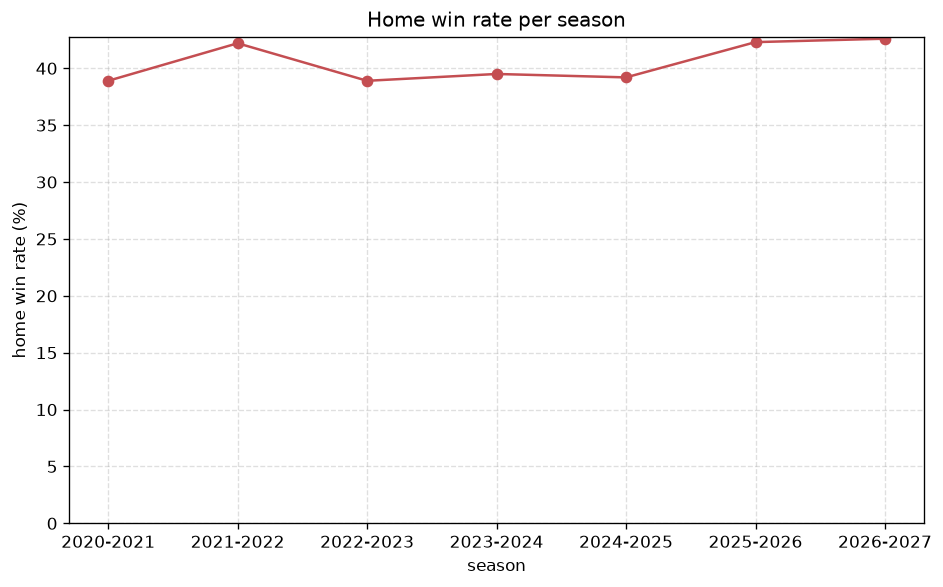

# Match Analysis
- Report: `matches_analysis`
- Generated: 2026-10-26T01:43:12+00:00
- Script: `backend/scripts/analyze_matches.py` v1.0.0
- League: Liga Portugal 2 (Portugal)
- Scope: league `portugal2`

## 1. Overall summary
| metric | value |
|---|---|
| Matches | 1908 |
| Home wins | 768 (40.3%) |
| Draws | 526 (27.6%) |
| Away wins | 614 (32.2%) |
| Total goals | 4739 |
| Average goals per match | 2.484 |
| Goalless matches | 164 (8.6%) |

## 2. Per-season breakdown
| season | matches | home wins | draws | away wins | total goals | avg goals | goalless |
|---|---|---|---|---|---|---|---|
| 2020-2021 | 306 | 119 (38.9%) | 93 (30.4%) | 94 (30.7%) | 741 | 2.422 | 29 (9.5%) |
| 2021-2022 | 306 | 129 (42.2%) | 82 (26.8%) | 95 (31.0%) | 760 | 2.484 | 26 (8.5%) |
| 2022-2023 | 306 | 119 (38.9%) | 87 (28.4%) | 100 (32.7%) | 807 | 2.637 | 22 (7.2%) |
| 2023-2024 | 306 | 121 (39.5%) | 84 (27.5%) | 101 (33.0%) | 749 | 2.448 | 24 (7.8%) |
| 2024-2025 | 306 | 120 (39.2%) | 90 (29.4%) | 96 (31.4%) | 769 | 2.513 | 25 (8.2%) |
| 2025-2026 | 310 | 131 (42.3%) | 76 (24.5%) | 103 (33.2%) | 751 | 2.423 | 33 (10.6%) |
| 2026-2027 | 68 | 29 (42.6%) | 14 (20.6%) | 25 (36.8%) | 162 | 2.382 | 5 (7.4%) |

## 3. HT/FT outcome matrix
| HT result \ FT result | Home | Draw | Away | total |
|---|---|---|---|---|
| HT home lead | 434 (76.3%) | 93 (16.3%) | 42 (7.4%) | 569 |
| HT draw | 272 (32.6%) | 333 (39.9%) | 230 (27.5%) | 835 |
| HT away lead | 62 (12.3%) | 100 (19.8%) | 342 (67.9%) | 504 |

## 4. Comeback matches
- Home comebacks (trailing at HT, won at FT): **62** (3.2%)
- Away comebacks (trailing at HT, won at FT): **42** (2.2%)

### Home comebacks
| season | home | away | HT | FT |
|---|---|---|---|---|
| 2020-2021 | Feirense | Casa Pia | 0-1 | 2-1 |
| 2020-2021 | Vizela | Covilha | 0-1 | 2-1 |
| 2020-2021 | Covilha | Varzim | 0-1 | 2-1 |
| 2020-2021 | Leixoes | Benfica B | 1-2 | 3-2 |
| 2020-2021 | Academico Viseu | Chaves | 0-1 | 2-1 |
| 2020-2021 | Feirense | Vilafranquense | 0-1 | 2-1 |
| 2020-2021 | Estoril | Benfica B | 1-2 | 3-2 |
| 2020-2021 | Academica | Chaves | 0-1 | 2-1 |
| 2020-2021 | Covilha | Estoril | 1-2 | 3-2 |
| 2020-2021 | Benfica B | FC Porto B | 0-1 | 2-1 |
| 2021-2022 | Academico Viseu | Casa Pia | 0-1 | 2-1 |
| 2021-2022 | Estrela | SC Farense | 0-1 | 3-1 |
| 2021-2022 | Leixoes | Academica | 0-1 | 2-1 |
| 2021-2022 | Nacional | Varzim | 0-1 | 2-1 |
| 2021-2022 | Chaves | FC Porto B | 0-2 | 4-2 |
| 2021-2022 | Rio Ave | Vilafranquense | 0-1 | 2-1 |
| 2021-2022 | Chaves | Penafiel | 0-1 | 3-1 |
| 2021-2022 | SC Farense | Academica | 0-1 | 3-1 |
| 2021-2022 | Penafiel | Chaves | 0-1 | 2-1 |
| 2021-2022 | FC Porto B | Feirense | 0-1 | 2-1 |
| 2021-2022 | Rio Ave | Benfica B | 0-1 | 2-1 |
| 2022-2023 | Oliveirense | Mafra | 0-1 | 3-1 |
| 2022-2023 | Trofense | BSAD | 0-1 | 3-2 |
| 2022-2023 | SC Farense | Vilafranquense | 0-1 | 2-1 |
| 2022-2023 | Feirense | Oliveirense | 0-1 | 3-2 |
| 2022-2023 | Mafra | Covilha | 1-2 | 3-2 |
| 2022-2023 | Moreirense | Mafra | 0-1 | 4-2 |
| 2022-2023 | Moreirense | Tondela | 0-1 | 2-1 |
| 2022-2023 | Mafra | Vilafranquense | 0-1 | 2-1 |
| 2022-2023 | Nacional | Academico Viseu | 0-2 | 3-2 |
| 2023-2024 | Santa Clara | AFS | 0-1 | 2-1 |
| 2023-2024 | Benfica B | Nacional | 0-1 | 2-1 |
| 2023-2024 | Vilaverdense | Feirense | 0-1 | 2-1 |
| 2023-2024 | Torreense | AFS | 0-1 | 2-1 |
| 2023-2024 | Leiria | Os Belenenses | 0-1 | 4-2 |
| 2023-2024 | Os Belenenses | Feirense | 0-1 | 3-1 |
| 2023-2024 | Maritimo | Feirense | 0-1 | 3-2 |
| 2023-2024 | Vilaverdense | Penafiel | 0-1 | 2-1 |
| 2024-2025 | Penafiel | Oliveirense | 2-3 | 4-3 |
| 2024-2025 | Chaves | Torreense | 0-1 | 2-1 |
| 2024-2025 | Tondela | Leixoes | 0-1 | 2-1 |
| 2024-2025 | FC Porto B | Mafra | 0-1 | 2-1 |
| 2024-2025 | Penafiel | Felgueiras | 0-1 | 2-1 |
| 2024-2025 | Felgueiras | Vizela | 0-1 | 2-1 |
| 2024-2025 | Leixoes | Mafra | 0-1 | 2-1 |
| 2024-2025 | Vizela | Maritimo | 1-2 | 3-2 |
| 2024-2025 | Portimonense | Leixoes | 0-1 | 2-1 |
| 2024-2025 | Tondela | Feirense | 0-1 | 2-1 |
| 2024-2025 | Feirense | Leiria | 0-1 | 2-1 |
| 2024-2025 | Leixoes | Penafiel | 0-1 | 3-1 |
| 2024-2025 | Torreense | Leixoes | 1-2 | 3-2 |
| 2024-2025 | Felgueiras | Oliveirense | 0-1 | 2-1 |
| 2025-2026 | Torreense | Academico Viseu | 0-1 | 2-1 |
| 2025-2026 | Torreense | Oliveirense | 0-1 | 3-2 |
| 2025-2026 | SC Farense | Benfica B | 0-3 | 4-3 |
| 2025-2026 | Leiria | Chaves | 0-1 | 2-1 |
| 2025-2026 | Academico Viseu | Lusitania FC | 1-2 | 3-2 |
| 2025-2026 | FC Porto B | Sporting CP B | 0-1 | 2-1 |
| 2025-2026 | Lusitania FC | Felgueiras | 0-1 | 2-1 |
| 2025-2026 | Sporting CP B | Portimonense | 1-2 | 4-3 |
| 2025-2026 | Leixoes | Pacos Ferreira | 1-2 | 3-2 |
| 2026-2027 | Chaves | Vizela | 0-1 | 2-1 |

### Away comebacks
| season | home | away | HT | FT |
|---|---|---|---|---|
| 2020-2021 | Vizela | Academica | 1-0 | 1-3 |
| 2020-2021 | CD Cova da Piedade | Estoril | 2-0 | 2-3 |
| 2020-2021 | Penafiel | Academico Viseu | 1-0 | 1-2 |
| 2020-2021 | Leixoes | Academica | 1-0 | 1-2 |
| 2021-2022 | Feirense | Penafiel | 1-0 | 1-2 |
| 2021-2022 | Estrela | Feirense | 1-0 | 1-2 |
| 2021-2022 | Trofense | Leixoes | 1-0 | 1-2 |
| 2021-2022 | Vilafranquense | Benfica B | 1-0 | 1-2 |
| 2021-2022 | Benfica B | Feirense | 1-0 | 1-2 |
| 2021-2022 | FC Porto B | Benfica B | 2-1 | 2-3 |
| 2022-2023 | Covilha | Nacional | 1-0 | 1-2 |
| 2022-2023 | BSAD | SC Farense | 2-1 | 2-3 |
| 2022-2023 | Trofense | Benfica B | 1-0 | 1-2 |
| 2022-2023 | Benfica B | Feirense | 3-1 | 3-6 |
| 2022-2023 | Trofense | Tondela | 1-0 | 1-2 |
| 2022-2023 | Oliveirense | Estrela | 1-0 | 1-2 |
| 2022-2023 | Estrela | Moreirense | 1-0 | 2-4 |
| 2022-2023 | Penafiel | Estrela | 2-0 | 2-4 |
| 2023-2024 | Leixoes | FC Porto B | 1-0 | 1-3 |
| 2023-2024 | Leiria | Mafra | 2-0 | 2-3 |
| 2023-2024 | Feirense | Benfica B | 1-0 | 1-2 |
| 2023-2024 | Feirense | Tondela | 1-0 | 1-3 |
| 2023-2024 | Os Belenenses | Benfica B | 2-1 | 2-3 |
| 2023-2024 | Tondela | Nacional | 1-0 | 2-3 |
| 2024-2025 | Benfica B | Tondela | 1-0 | 1-3 |
| 2024-2025 | Chaves | Benfica B | 1-0 | 1-2 |
| 2024-2025 | Portimonense | Oliveirense | 1-0 | 2-3 |
| 2024-2025 | Benfica B | Maritimo | 1-0 | 1-2 |
| 2024-2025 | Academico Viseu | Torreense | 1-0 | 1-2 |
| 2024-2025 | Pacos Ferreira | Felgueiras | 1-0 | 1-2 |
| 2025-2026 | Pacos Ferreira | Vizela | 1-0 | 1-2 |
| 2025-2026 | Portimonense | Sporting CP B | 1-0 | 1-2 |
| 2025-2026 | FC Porto B | Torreense | 2-0 | 2-3 |
| 2025-2026 | Maritimo | Leiria | 1-0 | 1-3 |
| 2025-2026 | Leiria | Felgueiras | 2-1 | 2-3 |
| 2025-2026 | Portimonense | Leixoes | 1-0 | 1-2 |
| 2025-2026 | Chaves | Maritimo | 2-1 | 2-3 |
| 2025-2026 | Oliveirense | Feirense | 2-1 | 3-4 |
| 2025-2026 | Portimonense | Pacos Ferreira | 2-0 | 2-3 |
| 2025-2026 | Sporting CP B | Penafiel | 1-0 | 1-2 |
| 2025-2026 | Feirense | Oliveirense | 1-0 | 1-2 |
| 2025-2026 | Lusitania FC | Torreense | 1-0 | 1-2 |

## 5. HT lead conversion
| HT state | matches | converted to win | held as draw | collapsed to loss |
|---|---|---|---|---|
| Home lead | 569 | 434 (76.3%) | 93 (16.3%) | 42 (7.4%) |
| Away lead | 504 | 342 (67.9%) | 100 (19.8%) | 62 (12.3%) |

### Matches level at half-time
| FT result | count | pct |
|---|---|---|
| Home win | 272 | 32.6% |
| Draw | 333 | 39.9% |
| Away win | 230 | 27.5% |

## 6. First-goal timing
- Matches with a first-goal time recorded: `1744` of `1908` (91.4%)

Outcome distribution by first-goal timing bucket:
| bucket | matches | % of matches | home | draw | away |
|---|---|---|---|---|---|
| 1-15 | 545 | 28.6% | 242 (44.4%) | 125 (22.9%) | 178 (32.7%) |
| 16-30 | 428 | 22.4% | 187 (43.7%) | 81 (18.9%) | 160 (37.4%) |
| 31-45 | 288 | 15.1% | 132 (45.8%) | 56 (19.4%) | 100 (34.7%) |
| 46-60 | 244 | 12.8% | 109 (44.7%) | 58 (23.8%) | 77 (31.6%) |
| 61-75 | 137 | 7.2% | 54 (39.4%) | 34 (24.8%) | 49 (35.8%) |
| 76-90 | 72 | 3.8% | 29 (40.3%) | 6 (8.3%) | 37 (51.4%) |
| 91-120 | 30 | 1.6% | 15 (50.0%) | 2 (6.7%) | 13 (43.3%) |

## 7. Goalless matches
- Overall: **164** of `1908` (8.6%)

| season | matches | goalless | pct |
|---|---|---|---|
| 2020-2021 | 306 | 29 | 9.5% |
| 2021-2022 | 306 | 26 | 8.5% |
| 2022-2023 | 306 | 22 | 7.2% |
| 2023-2024 | 306 | 24 | 7.8% |
| 2024-2025 | 306 | 25 | 8.2% |
| 2025-2026 | 310 | 33 | 10.6% |
| 2026-2027 | 68 | 5 | 7.4% |

---
*All statistics are computed from PostgreSQL tables (read-only). Run with `python backend/scripts/analyze_matches.py` to regenerate.*

## Charts

