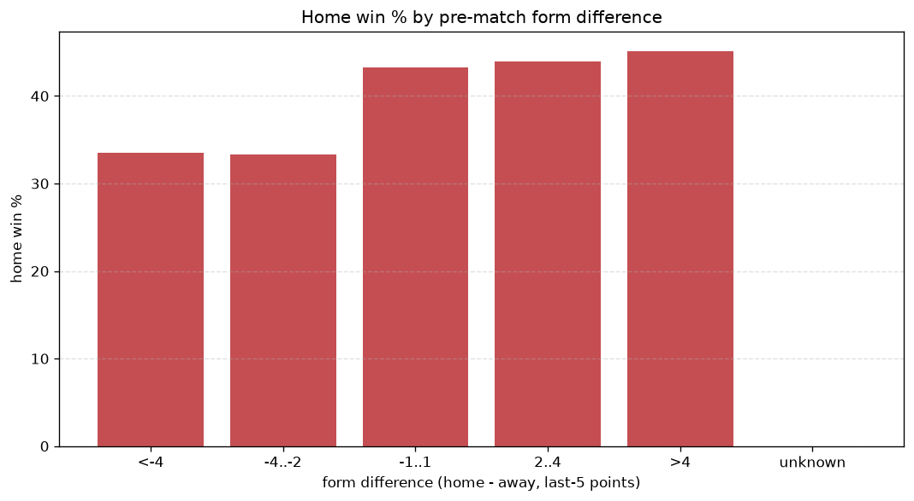
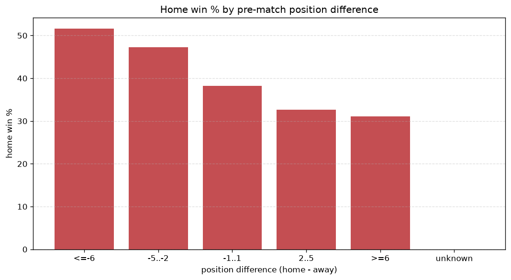

# Relationships Analysis
- Report: `relationships`
- Generated: 2026-10-26T01:43:21+00:00
- Script: `backend/scripts/analyze_relationships.py` v1.0.0
- League: Liga Portugal 2 (Portugal)
- Scope: league `portugal2`

- Matches analysed: **1840** (23 leakage-safe pre-match features).

## 1. Correlation matrix
_Pearson correlation of each pre-match feature with observed goals; sorted by |corr(total goals)|._

| feature | corr(home) | corr(away) | corr(total) |
|---|---|---|---|
| home_position_before_match | -0.133 | 0.072 | -0.048 |
| home_team_home_goals_avg | 0.070 | -0.006 | 0.046 |
| rest_days_difference | 0.006 | 0.052 | 0.040 |
| points_difference | 0.165 | -0.126 | 0.034 |
| home_team_home_win_rate | 0.082 | -0.039 | 0.033 |
| home_rest_days | -0.005 | 0.053 | 0.033 |
| home_points_before_match | 0.085 | -0.049 | 0.028 |
| position_difference | -0.156 | 0.129 | -0.025 |
| away_team_away_goals_avg | -0.019 | 0.055 | 0.023 |
| home_team_goals_scored_last_5 | 0.060 | -0.031 | 0.022 |
| home_team_points_last_5 | 0.059 | -0.036 | 0.018 |
| home_team_home_conceded_avg | -0.066 | 0.044 | -0.018 |
| away_team_away_win_rate | -0.028 | 0.056 | 0.018 |
| away_team_points_last_5 | -0.045 | 0.072 | 0.017 |
| away_team_goals_scored_last_5 | -0.028 | 0.054 | 0.016 |
| home_team_wins_last_5 | 0.053 | -0.035 | 0.015 |
| away_team_wins_last_5 | -0.037 | 0.058 | 0.012 |
| away_position_before_match | 0.084 | -0.108 | -0.012 |
| away_team_away_conceded_avg | 0.033 | -0.025 | 0.007 |
| away_rest_days | -0.009 | 0.020 | 0.007 |
| home_team_goals_conceded_last_5 | -0.050 | 0.044 | -0.006 |
| away_points_before_match | -0.030 | 0.039 | 0.005 |
| away_team_goals_conceded_last_5 | 0.045 | -0.054 | -0.004 |

## 2. Form vs outcome
_Home win/draw/away % per bucket of `home_team_points_last_5 - away_team_points_last_5`._

| bucket | matches | home | draw | away | home % | draw % | away % |
|---|---|---|---|---|---|---|---|
| <-4 | 263 | 88 | 78 | 97 | 33.5% | 29.7% | 36.9% |
| -4..-2 | 387 | 129 | 121 | 137 | 33.3% | 31.3% | 35.4% |
| -1..1 | 586 | 254 | 149 | 183 | 43.3% | 25.4% | 31.2% |
| 2..4 | 369 | 162 | 100 | 107 | 43.9% | 27.1% | 29.0% |
| >4 | 235 | 106 | 64 | 65 | 45.1% | 27.2% | 27.7% |
| unknown | 0 | 0 | 0 | 0 | - | - | - |

## 3. Position vs outcome
_Home win/draw/away % per bucket of `position_difference` (home position - away position; negative favours the home team)._

| bucket | matches | home | draw | away | home % | draw % | away % |
|---|---|---|---|---|---|---|---|
| <=-6 | 438 | 226 | 112 | 100 | 51.6% | 25.6% | 22.8% |
| -5..-2 | 328 | 155 | 84 | 89 | 47.3% | 25.6% | 27.1% |
| -1..1 | 262 | 100 | 77 | 85 | 38.2% | 29.4% | 32.4% |
| 2..5 | 365 | 119 | 110 | 136 | 32.6% | 30.1% | 37.3% |
| >=6 | 447 | 139 | 129 | 179 | 31.1% | 28.9% | 40.0% |
| unknown | 0 | 0 | 0 | 0 | - | - | - |

## 4. Rest advantage
_Home win/draw/away % per bucket of `rest_days_difference` (home rest - away rest). Matches with unknown rest are bucketed separately._

| bucket | matches | home | draw | away | home % | draw % | away % |
|---|---|---|---|---|---|---|---|
| <-1 | 246 | 99 | 75 | 72 | 40.2% | 30.5% | 29.3% |
| -1..0 | 390 | 159 | 100 | 131 | 40.8% | 25.6% | 33.6% |
| 0 | 484 | 192 | 145 | 147 | 39.7% | 30.0% | 30.4% |
| 1..2 | 543 | 217 | 148 | 178 | 40.0% | 27.3% | 32.8% |
| >2 | 119 | 45 | 27 | 47 | 37.8% | 22.7% | 39.5% |
| unknown | 58 | 27 | 17 | 14 | 46.6% | 29.3% | 24.1% |
- *58 match(es) had unknown rest difference (missing rest data on at least one side).*

## 5. Home team quality
_Home win rate by `home_team_home_win_rate` tier (split at 0.5)._

- `< 0.5` tier: **37.2%** home win (464/1246)
- `>= 0.5` tier: **46.3%** home win (275/594)
- Home-win gap (>= split minus < split): **+9.1 pp**

| tier | label | matches | home | draw | away | home % |
|---|---|---|---|---|---|---|
| low | < 0.5 | 1246 | 464 | 359 | 423 | 37.2% |
| high | >= 0.5 | 594 | 275 | 153 | 166 | 46.3% |

## 6. Feature averages by result
_Mean feature value per outcome; `range` is home-minus-away spread of the group means._

| feature | home mean | draw mean | away mean | range |
|---|---|---|---|---|
| points_difference | 2.222 | -0.650 | -2.569 | 4.791 |
| home_points_before_match | 24.011 | 20.760 | 21.421 | 3.251 |
| position_difference | -1.380 | 0.420 | 1.672 | 3.053 |
| away_points_before_match | 21.789 | 21.410 | 23.990 | 2.580 |
| home_position_before_match | 9.072 | 10.100 | 10.650 | 1.579 |
| away_position_before_match | 10.452 | 9.680 | 8.978 | 1.474 |
| home_team_points_last_5 | 6.424 | 5.859 | 6.020 | 0.564 |
| away_team_points_last_5 | 6.009 | 6.209 | 6.545 | 0.536 |
| home_rest_days | 8.162 | 8.317 | 8.649 | 0.487 |
| home_team_goals_scored_last_5 | 5.793 | 5.320 | 5.433 | 0.473 |
| away_team_goals_conceded_last_5 | 5.793 | 5.365 | 5.409 | 0.428 |
| home_team_goals_conceded_last_5 | 5.452 | 5.592 | 5.861 | 0.409 |
| rest_days_difference | -0.084 | -0.170 | 0.172 | 0.342 |
| away_team_goals_scored_last_5 | 5.540 | 5.520 | 5.856 | 0.336 |
| away_rest_days | 8.255 | 8.488 | 8.483 | 0.233 |
| home_team_wins_last_5 | 1.702 | 1.525 | 1.572 | 0.177 |
| away_team_wins_last_5 | 1.587 | 1.648 | 1.725 | 0.138 |
| home_team_home_conceded_avg | 1.065 | 1.123 | 1.167 | 0.102 |
| home_team_home_goals_avg | 1.290 | 1.192 | 1.214 | 0.097 |
| away_team_away_goals_avg | 1.095 | 1.095 | 1.163 | 0.068 |
| away_team_away_conceded_avg | 1.266 | 1.239 | 1.209 | 0.057 |
| home_team_home_win_rate | 0.390 | 0.345 | 0.348 | 0.045 |
| away_team_away_win_rate | 0.281 | 0.290 | 0.313 | 0.032 |

---
*All features are leakage-safe pre-match values built by `ml.features.build_features.build_rows` from strictly prior matches. Run with `python backend/scripts/analyze_relationships.py` to regenerate.*

## Charts

