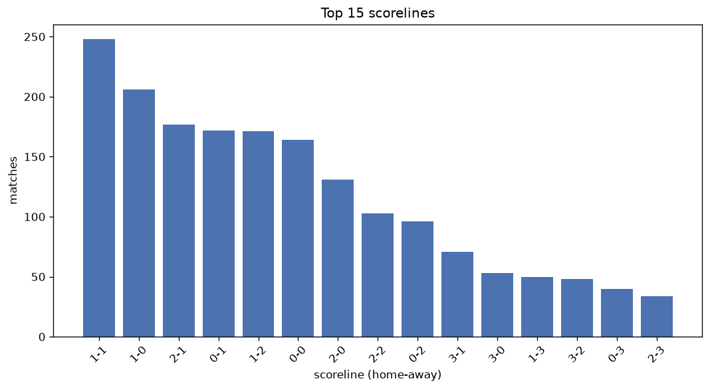
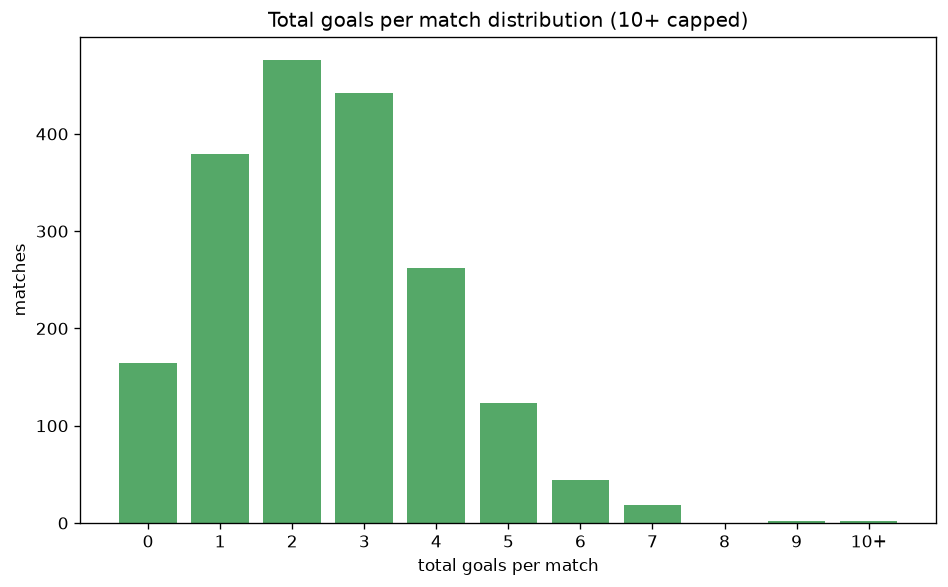

# Scoreline Analysis
- Report: `scoreline_analysis`
- Generated: 2026-10-30T04:05:37+00:00
- Script: `backend/scripts/analyze_scorelines.py` v1.0.0
- League: Liga Portugal 2 (Portugal)
- Scope: league `portugal2`

## 1. Scoreline frequency
- Matches analysed: **1912** across **7** seasons.
- Distinct scorelines seen: **34**.

| scoreline | count | pct |
|---|---|---|
| 1-1 | 249 | 13.0% |
| 1-0 | 207 | 10.8% |
| 2-1 | 178 | 9.3% |
| 0-1 | 172 | 9.0% |
| 1-2 | 171 | 8.9% |
| 0-0 | 164 | 8.6% |
| 2-0 | 131 | 6.9% |
| 2-2 | 104 | 5.4% |
| 0-2 | 96 | 5.0% |
| 3-1 | 71 | 3.7% |
| 3-0 | 53 | 2.8% |
| 1-3 | 50 | 2.6% |
| 3-2 | 48 | 2.5% |
| 0-3 | 40 | 2.1% |
| 2-3 | 34 | 1.8% |
| 4-0 | 23 | 1.2% |
| 4-1 | 16 | 0.8% |
| 1-4 | 15 | 0.8% |
| 0-4 | 14 | 0.7% |
| 4-2 | 13 | 0.7% |

## 2. Scoreline frequency per season

### 2020-2021
| scoreline | count | pct |
|---|---|---|
| 1-1 | 42 | 13.7% |
| 2-1 | 37 | 12.1% |
| 1-0 | 31 | 10.1% |
| 0-0 | 29 | 9.5% |
| 0-1 | 27 | 8.8% |

### 2021-2022
| scoreline | count | pct |
|---|---|---|
| 1-1 | 38 | 12.4% |
| 1-0 | 38 | 12.4% |
| 1-2 | 31 | 10.1% |
| 2-1 | 28 | 9.2% |
| 0-0 | 26 | 8.5% |

### 2022-2023
| scoreline | count | pct |
|---|---|---|
| 1-1 | 45 | 14.7% |
| 0-1 | 29 | 9.5% |
| 1-2 | 29 | 9.5% |
| 1-0 | 26 | 8.5% |
| 2-1 | 24 | 7.8% |

### 2023-2024
| scoreline | count | pct |
|---|---|---|
| 1-1 | 47 | 15.4% |
| 0-1 | 32 | 10.5% |
| 1-0 | 29 | 9.5% |
| 2-1 | 28 | 9.2% |
| 0-0 | 24 | 7.8% |

### 2024-2025
| scoreline | count | pct |
|---|---|---|
| 1-1 | 44 | 14.4% |
| 2-1 | 32 | 10.5% |
| 1-0 | 29 | 9.5% |
| 1-2 | 28 | 9.2% |
| 0-1 | 27 | 8.8% |

### 2025-2026
| scoreline | count | pct |
|---|---|---|
| 1-0 | 42 | 13.5% |
| 0-0 | 33 | 10.6% |
| 0-1 | 29 | 9.4% |
| 1-1 | 28 | 9.0% |
| 1-2 | 27 | 8.7% |

### 2026-2027
| scoreline | count | pct |
|---|---|---|
| 1-0 | 12 | 16.7% |
| 2-1 | 8 | 11.1% |
| 0-2 | 7 | 9.7% |
| 1-2 | 6 | 8.3% |
| 2-2 | 6 | 8.3% |

## 3. Total-goal histogram
_10+ groups all matches with 10 or more total goals._

| total goals | matches | pct |
|---|---|---|
| 0 | 164 | 8.6% |
| 1 | 379 | 19.8% |
| 2 | 476 | 24.9% |
| 3 | 442 | 23.1% |
| 4 | 262 | 13.7% |
| 5 | 123 | 6.4% |
| 6 | 44 | 2.3% |
| 7 | 18 | 0.9% |
| 8 | 0 | 0.0% |
| 9 | 2 | 0.1% |
| 10+ | 2 | 0.1% |

## 4. Extreme scorelines
- Matches with 7+ total goals: **22**

| season | date | scoreline | total goals |
|---|---|---|---|
| 2022-2023 | 2023-04-16 | 7-4 | 11 |
| 2022-2023 | 2023-05-25 | 6-4 | 10 |
| 2021-2022 | 2021-11-29 | 3-6 | 9 |
| 2022-2023 | 2023-01-08 | 3-6 | 9 |
| 2020-2021 | 2020-09-23 | 3-4 | 7 |
| 2020-2021 | 2021-05-22 | 5-2 | 7 |
| 2021-2022 | 2021-09-10 | 2-5 | 7 |
| 2021-2022 | 2022-01-15 | 4-3 | 7 |
| 2021-2022 | 2022-01-22 | 4-3 | 7 |
| 2021-2022 | 2022-03-11 | 3-4 | 7 |
| 2022-2023 | 2023-01-15 | 5-2 | 7 |
| 2022-2023 | 2023-05-28 | 4-3 | 7 |
| 2023-2024 | 2023-11-05 | 4-3 | 7 |
| 2023-2024 | 2024-05-17 | 5-2 | 7 |
| 2024-2025 | 2024-08-11 | 4-3 | 7 |
| 2024-2025 | 2025-01-05 | 4-3 | 7 |
| 2025-2026 | 2025-11-02 | 4-3 | 7 |
| 2025-2026 | 2026-01-11 | 3-4 | 7 |
| 2025-2026 | 2026-02-15 | 4-3 | 7 |
| 2025-2026 | 2026-03-15 | 4-3 | 7 |
| 2025-2026 | 2026-04-11 | 4-3 | 7 |
| 2025-2026 | 2026-04-18 | 4-3 | 7 |

## 5. Margin-of-victory distribution (decided matches)
- Decided matches: **1384** (draws: **528**)
- Average winning margin: **1.59**

| margin | matches | pct |
|---|---|---|
| 1 | 824 | 59.5% |
| 2 | 370 | 26.7% |
| 3+ | 190 | 13.7% |

## 6. Margin by outcome

### Home wins
- Matches: **770** | avg margin: **1.62** | max margin: **5**
| margin | matches | pct |
|---|---|---|
| 1 | 444 | 57.7% |
| 2 | 216 | 28.1% |
| 3+ | 110 | 14.3% |
- *Full match-by-match list available in `scoreline_analysis.json`.*

### Away wins
- Matches: **614** | avg margin: **1.56** | max margin: **6**
| margin | matches | pct |
|---|---|---|
| 1 | 380 | 61.9% |
| 2 | 154 | 25.1% |
| 3+ | 80 | 13.0% |
- *Full match-by-match list available in `scoreline_analysis.json`.*

## 7. Most common exact score by outcome type
| outcome | matches | most common score | count | pct |
|---|---|---|---|---|
| home | 770 | 1-0 | 207 | 26.9% |
| draw | 528 | 1-1 | 249 | 47.2% |
| away | 614 | 0-1 | 172 | 28.0% |

---
*All statistics are computed from PostgreSQL tables (read-only). Run with `python backend/scripts/analyze_scorelines.py` to regenerate.*

## Charts

