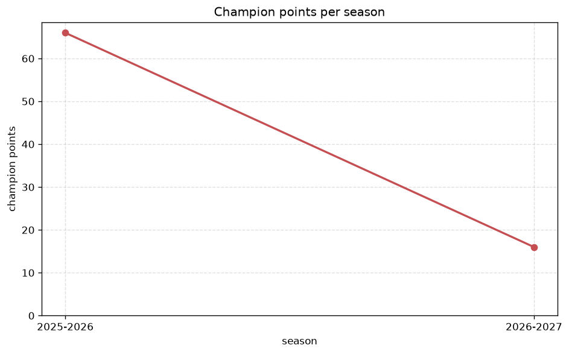
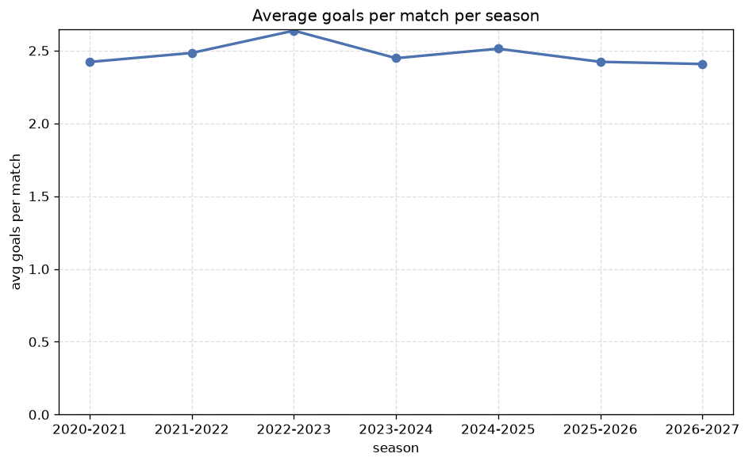

# Season Trends Analysis
- Report: `season_trends`
- Generated: 2026-10-27T02:25:28+00:00
- Script: `backend/scripts/analyze_seasons.py` v1.0.0
- League: Liga Portugal 2 (Portugal)
- Scope: league `portugal2`

## 1. Champions per season
| season | champion | pts | runner-up | margin |
|---|---|---|---|---|
| 2020-2021 | Estoril | 70 | Vizela | 4 pts |
| 2021-2022 | Rio Ave | 70 | Casa Pia | 2 pts |
| 2022-2023 | Moreirense | 79 | SC Farense | 10 pts |
| 2023-2024 | Santa Clara | 73 | Nacional | 2 pts |
| 2024-2025 | Tondela | 64 | Alverca | 1 pts |
| 2025-2026 | Maritimo | 66 | Torreense | 6 pts |
| 2026-2027 | Lusitania FC | 18 | Sporting CP B | 0 pts |

## 2. Title-race tightness
- Tight races (margin <= 3 pts): **4** of 7 seasons
- Tightest race: **2026-2027** - Lusitania FC beat Sporting CP B by **0** pts

| season | margin | tight |
|---|---|---|
| 2020-2021 | 4 pts |  |
| 2021-2022 | 2 pts | yes |
| 2022-2023 | 10 pts |  |
| 2023-2024 | 2 pts | yes |
| 2024-2025 | 1 pts | yes |
| 2025-2026 | 6 pts |  |
| 2026-2027 | 0 pts | yes |

## 3. Points thresholds
_Position-specific points per season. Key: 1 = champion, 2 = runner-up, 4 = CL line, 6 = Europa, 15 = last safe, 18 = bottom._

| season | pos 1 | pos 2 | pos 4 | pos 6 | pos 15 | pos 18 |
|---|---|---|---|---|---|---|
| 2020-2021 | 70 | 66 | 62 | 57 | 33 | 31 |
| 2021-2022 | 70 | 68 | 58 | 51 | 37 | 17 |
| 2022-2023 | 79 | 69 | 53 | 47 | 38 | 28 |
| 2023-2024 | 73 | 71 | 64 | 49 | 34 | 26 |
| 2024-2025 | 64 | 63 | 55 | 52 | 34 | 27 |
| 2025-2026 | 66 | 60 | 51 | 50 | 41 | 34 |
| 2026-2027 | 18 | 18 | 15 | 14 | 7 | 2 |

## 4. Relegation battle
| season | safe pos | safe pts | drop pos | drop pts | gap |
|---|---|---|---|---|---|
| 2020-2021 | 15 | 33 | 16 | 32 | 1 pts |
| 2021-2022 | 15 | 37 | 16 | 36 | 1 pts |
| 2022-2023 | 15 | 38 | 16 | 35 | 3 pts |
| 2023-2024 | 15 | 34 | 16 | 31 | 3 pts |
| 2024-2025 | 15 | 34 | 16 | 33 | 1 pts |
| 2025-2026 | 15 | 41 | 16 | 40 | 1 pts |
| 2026-2027 | 15 | 7 | 16 | 6 | 1 pts |

## 5. League-level trends
| season | matches | total goals | avg goals | home win | draw | away win | goalless | avg pts/team |
|---|---|---|---|---|---|---|---|---|
| 2020-2021 | 306 | 741 | 2.422 | 38.9% | 30.4% | 30.7% | 9.5% | 45.83 |
| 2021-2022 | 306 | 760 | 2.484 | 42.2% | 26.8% | 31.0% | 8.5% | 46.44 |
| 2022-2023 | 306 | 807 | 2.637 | 38.9% | 28.4% | 32.7% | 7.2% | 46.17 |
| 2023-2024 | 306 | 749 | 2.448 | 39.5% | 27.5% | 33.0% | 7.8% | 46.33 |
| 2024-2025 | 306 | 769 | 2.513 | 39.2% | 29.4% | 31.4% | 8.2% | 46.0 |
| 2025-2026 | 310 | 751 | 2.423 | 42.3% | 24.5% | 33.2% | 10.6% | 42.7 |
| 2026-2027 | 71 | 171 | 2.408 | 42.3% | 22.5% | 35.2% | 7.0% | 10.94 |

## 6. View divergence
- Largest divergence: **2023-2024** (goals view, avg abs position diff = 6.000)

_Avg absolute position difference between classic view and alternative view per season._

| season | classic vs luck | classic vs goals |
|---|---|---|
| 2020-2021 | 2.222 | 5.667 |
| 2021-2022 | 2.444 | 5.111 |
| 2022-2023 | 2.111 | 5.111 |
| 2023-2024 | 1.667 | 6.000 |
| 2024-2025 | 1.778 | 5.444 |
| 2025-2026 | 5.600 | 5.200 |
| 2026-2027 | 1.556 | 4.667 |

---
*All statistics are computed from PostgreSQL tables (read-only). Run with `python backend/scripts/analyze_seasons.py` to regenerate.*

## Charts

