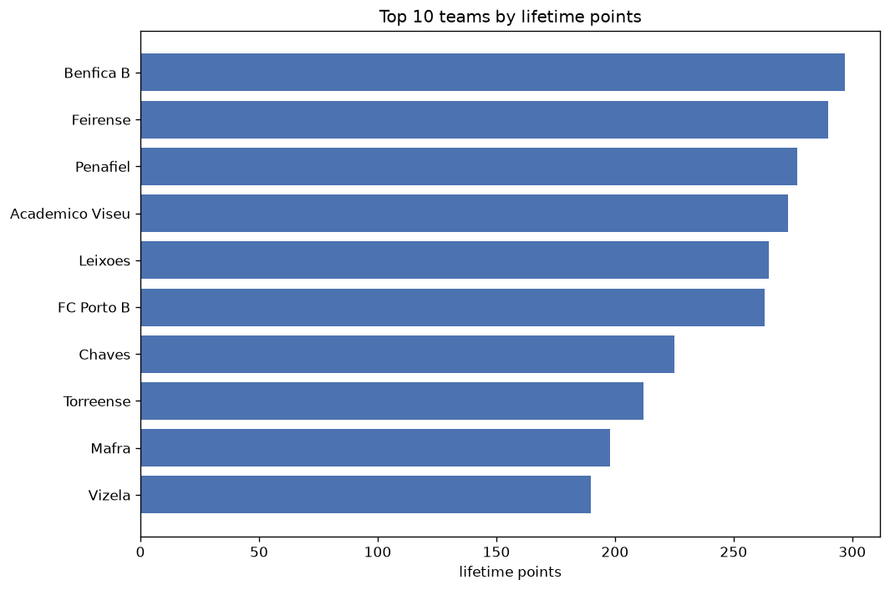
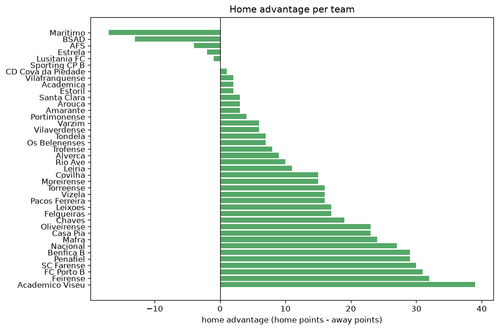

# Team Analysis
- Report: `teams_analysis`
- Generated: 2026-10-27T02:25:26+00:00
- Script: `backend/scripts/analyze_teams.py` v1.0.0
- League: Liga Portugal 2 (Portugal)
- Scope: league `portugal2`

- Teams: **40** | Seasons: **7** | Matches: **1911**

## 1. Team standings (lifetime)
| team | seasons | played | W | D | L | pts | GF | GA | GD | avg pts/season | best pos | worst pos | titles |
|---|---|---|---|---|---|---|---|---|---|---|---|---|---|
| Benfica B | 7 | 212 | 81 | 54 | 77 | 297 | 317 | 280 | 37 | 42.43 | 4 | 15 | 0 |
| Feirense | 7 | 212 | 78 | 56 | 78 | 290 | 246 | 240 | 6 | 41.43 | 4 | 18 | 0 |
| Penafiel | 7 | 212 | 74 | 55 | 83 | 277 | 247 | 260 | -13 | 39.57 | 3 | 15 | 0 |
| Academico Viseu | 6 | 204 | 70 | 63 | 71 | 273 | 251 | 251 | 0 | 45.5 | 3 | 15 | 0 |
| Leixoes | 7 | 212 | 68 | 61 | 83 | 265 | 236 | 279 | -43 | 37.86 | 7 | 14 | 0 |
| FC Porto B | 7 | 212 | 68 | 59 | 85 | 263 | 273 | 296 | -23 | 37.57 | 4 | 16 | 0 |
| Chaves | 5 | 144 | 63 | 36 | 45 | 225 | 190 | 160 | 30 | 45.0 | 3 | 13 | 0 |
| Torreense | 5 | 145 | 60 | 32 | 53 | 212 | 180 | 165 | 15 | 42.4 | 2 | 16 | 0 |
| Mafra | 5 | 170 | 49 | 51 | 70 | 198 | 187 | 235 | -48 | 39.6 | 6 | 18 | 0 |
| Vizela | 4 | 110 | 52 | 34 | 24 | 190 | 156 | 113 | 43 | 47.5 | 2 | 10 | 0 |
| Maritimo | 3 | 102 | 48 | 29 | 25 | 173 | 144 | 106 | 38 | 57.67 | 1 | 12 | 1 |
| Oliveirense | 5 | 170 | 41 | 48 | 81 | 171 | 177 | 266 | -89 | 34.2 | 10 | 18 | 0 |
| SC Farense | 4 | 112 | 46 | 30 | 36 | 168 | 143 | 123 | 20 | 42.0 | 2 | 12 | 0 |
| Tondela | 4 | 110 | 41 | 42 | 27 | 165 | 148 | 121 | 27 | 41.25 | 1 | 11 | 1 |
| Nacional | 3 | 102 | 45 | 26 | 31 | 161 | 153 | 125 | 28 | 53.67 | 2 | 14 | 0 |
| Leiria | 4 | 110 | 42 | 29 | 39 | 155 | 156 | 133 | 23 | 38.75 | 6 | 12 | 0 |
| Pacos Ferreira | 3 | 102 | 32 | 28 | 42 | 124 | 110 | 133 | -23 | 41.33 | 5 | 17 | 0 |
| Vilafranquense | 3 | 102 | 27 | 37 | 38 | 118 | 117 | 137 | -20 | 39.33 | 8 | 17 | 0 |
| Casa Pia | 3 | 70 | 32 | 19 | 19 | 115 | 93 | 68 | 25 | 38.33 | 2 | 19 | 0 |
| Covilha | 3 | 102 | 23 | 32 | 47 | 101 | 97 | 142 | -45 | 33.67 | 11 | 18 | 0 |
| Estrela | 2 | 68 | 25 | 25 | 18 | 100 | 97 | 90 | 7 | 50.0 | 3 | 14 | 0 |
| Felgueiras | 3 | 76 | 23 | 28 | 25 | 97 | 84 | 85 | -1 | 32.33 | 9 | 15 | 0 |
| Academica | 3 | 76 | 25 | 19 | 32 | 94 | 95 | 102 | -7 | 31.33 | 4 | 18 | 0 |
| Portimonense | 3 | 76 | 23 | 15 | 38 | 84 | 83 | 113 | -30 | 28.0 | 12 | 16 | 0 |
| Moreirense | 1 | 34 | 24 | 7 | 3 | 79 | 77 | 38 | 39 | 79.0 | 1 | 1 | 1 |
| AFS | 2 | 42 | 23 | 7 | 12 | 76 | 60 | 42 | 18 | 38.0 | 4 | 7 | 0 |
| Santa Clara | 1 | 34 | 21 | 10 | 3 | 73 | 48 | 19 | 29 | 73.0 | 1 | 1 | 1 |
| Trofense | 2 | 68 | 18 | 18 | 32 | 72 | 66 | 92 | -26 | 36.0 | 13 | 17 | 0 |
| Estoril | 1 | 34 | 20 | 10 | 4 | 70 | 55 | 26 | 29 | 70.0 | 1 | 1 | 1 |
| Rio Ave | 1 | 34 | 21 | 7 | 6 | 70 | 52 | 31 | 21 | 70.0 | 1 | 1 | 1 |
| Varzim | 2 | 68 | 17 | 17 | 34 | 68 | 51 | 83 | -32 | 34.0 | 15 | 17 | 0 |
| Arouca | 1 | 34 | 19 | 8 | 7 | 65 | 45 | 25 | 20 | 65.0 | 3 | 3 | 0 |
| Alverca | 1 | 34 | 17 | 12 | 5 | 63 | 58 | 34 | 24 | 63.0 | 2 | 2 | 0 |
| Lusitania FC | 2 | 42 | 16 | 13 | 13 | 61 | 58 | 59 | -1 | 30.5 | 1 | 13 | 1 |
| Sporting CP B | 2 | 42 | 19 | 3 | 20 | 60 | 54 | 40 | 14 | 30.0 | 2 | 14 | 0 |
| CD Cova da Piedade | 1 | 34 | 8 | 13 | 13 | 37 | 39 | 48 | -9 | 37.0 | 12 | 12 | 0 |
| BSAD | 1 | 34 | 9 | 8 | 17 | 35 | 41 | 59 | -18 | 35.0 | 16 | 16 | 0 |
| Vilaverdense | 1 | 34 | 8 | 4 | 22 | 28 | 30 | 59 | -29 | 28.0 | 17 | 17 | 0 |
| Os Belenenses | 2 | 36 | 6 | 9 | 21 | 27 | 28 | 60 | -32 | 13.5 | 18 | 20 | 0 |
| Amarante | 1 | 7 | 1 | 2 | 4 | 5 | 6 | 10 | -4 | 5.0 | 17 | 17 | 0 |

## 2. Home vs away split
| team | home P | H-W | H-D | H-L | H-pts | away P | A-W | A-D | A-L | A-pts | adv |
|---|---|---|---|---|---|---|---|---|---|---|---|
| Academico Viseu | 102 | 42 | 30 | 30 | 156 | 102 | 28 | 33 | 41 | 117 | 39 |
| Feirense | 106 | 44 | 29 | 33 | 161 | 106 | 34 | 27 | 45 | 129 | 32 |
| FC Porto B | 106 | 39 | 30 | 37 | 147 | 106 | 29 | 29 | 48 | 116 | 31 |
| SC Farense | 57 | 28 | 15 | 14 | 99 | 55 | 18 | 15 | 22 | 69 | 30 |
| Benfica B | 106 | 46 | 25 | 35 | 163 | 106 | 35 | 29 | 42 | 134 | 29 |
| Penafiel | 106 | 40 | 33 | 33 | 153 | 106 | 34 | 22 | 50 | 124 | 29 |
| Nacional | 51 | 28 | 10 | 13 | 94 | 51 | 17 | 16 | 18 | 67 | 27 |
| Mafra | 85 | 26 | 33 | 26 | 111 | 85 | 23 | 18 | 44 | 87 | 24 |
| Oliveirense | 85 | 23 | 28 | 34 | 97 | 85 | 18 | 20 | 47 | 74 | 23 |
| Casa Pia | 35 | 21 | 6 | 8 | 69 | 35 | 11 | 13 | 11 | 46 | 23 |
| Chaves | 72 | 34 | 20 | 18 | 122 | 72 | 29 | 16 | 27 | 103 | 19 |
| Leixoes | 106 | 37 | 30 | 39 | 141 | 106 | 31 | 31 | 44 | 124 | 17 |
| Felgueiras | 38 | 15 | 12 | 11 | 57 | 38 | 8 | 16 | 14 | 40 | 17 |
| Torreense | 72 | 33 | 15 | 24 | 114 | 73 | 27 | 17 | 29 | 98 | 16 |
| Vizela | 55 | 29 | 16 | 10 | 103 | 55 | 23 | 18 | 14 | 87 | 16 |
| Pacos Ferreira | 51 | 19 | 13 | 19 | 70 | 51 | 13 | 15 | 23 | 54 | 16 |
| Covilha | 51 | 14 | 16 | 21 | 58 | 51 | 9 | 16 | 26 | 43 | 15 |
| Moreirense | 17 | 15 | 2 | 0 | 47 | 17 | 9 | 5 | 3 | 32 | 15 |
| Leiria | 55 | 22 | 17 | 16 | 83 | 55 | 20 | 12 | 23 | 72 | 11 |
| Rio Ave | 17 | 13 | 1 | 3 | 40 | 17 | 8 | 6 | 3 | 30 | 10 |
| Alverca | 17 | 10 | 6 | 1 | 36 | 17 | 7 | 6 | 4 | 27 | 9 |
| Trofense | 34 | 11 | 7 | 16 | 40 | 34 | 7 | 11 | 16 | 32 | 8 |
| Tondela | 55 | 23 | 17 | 15 | 86 | 55 | 18 | 25 | 12 | 79 | 7 |
| Os Belenenses | 18 | 4 | 5 | 9 | 17 | 18 | 2 | 4 | 12 | 10 | 7 |
| Varzim | 34 | 10 | 7 | 17 | 37 | 34 | 7 | 10 | 17 | 31 | 6 |
| Vilaverdense | 17 | 5 | 2 | 10 | 17 | 17 | 3 | 2 | 12 | 11 | 6 |
| Portimonense | 37 | 12 | 8 | 17 | 44 | 39 | 11 | 7 | 21 | 40 | 4 |
| Santa Clara | 17 | 12 | 2 | 3 | 38 | 17 | 9 | 8 | 0 | 35 | 3 |
| Arouca | 17 | 10 | 4 | 3 | 34 | 17 | 9 | 4 | 4 | 31 | 3 |
| Amarante | 4 | 1 | 1 | 2 | 4 | 3 | 0 | 1 | 2 | 1 | 3 |
| Vilafranquense | 51 | 13 | 21 | 17 | 60 | 51 | 14 | 16 | 21 | 58 | 2 |
| Academica | 38 | 13 | 9 | 16 | 48 | 38 | 12 | 10 | 16 | 46 | 2 |
| Estoril | 17 | 10 | 6 | 1 | 36 | 17 | 10 | 4 | 3 | 34 | 2 |
| CD Cova da Piedade | 17 | 4 | 7 | 6 | 19 | 17 | 4 | 6 | 7 | 18 | 1 |
| Sporting CP B | 21 | 10 | 0 | 11 | 30 | 21 | 9 | 3 | 9 | 30 | 0 |
| Lusitania FC | 21 | 7 | 9 | 5 | 30 | 21 | 9 | 4 | 8 | 31 | -1 |
| Estrela | 34 | 13 | 10 | 11 | 49 | 34 | 12 | 15 | 7 | 51 | -2 |
| AFS | 21 | 11 | 3 | 7 | 36 | 21 | 12 | 4 | 5 | 40 | -4 |
| BSAD | 17 | 2 | 5 | 10 | 11 | 17 | 7 | 3 | 7 | 24 | -13 |
| Maritimo | 51 | 20 | 18 | 13 | 78 | 51 | 28 | 11 | 12 | 95 | -17 |

## 3. Top performers
### Best points per game (PPG)
| rank | team | PPG |
|---|---|---|
| 1 | Moreirense | 2.32 |
| 2 | Santa Clara | 2.15 |
| 3 | Estoril | 2.06 |
| 4 | Rio Ave | 2.06 |
| 5 | Arouca | 1.91 |

### Most goals scored
| rank | team | goals |
|---|---|---|
| 1 | Benfica B | 317 |
| 2 | FC Porto B | 273 |
| 3 | Academico Viseu | 251 |
| 4 | Penafiel | 247 |
| 5 | Feirense | 246 |

### Best goal difference
| rank | team | GD |
|---|---|---|
| 1 | Vizela | 43 |
| 2 | Moreirense | 39 |
| 3 | Maritimo | 38 |
| 4 | Benfica B | 37 |
| 5 | Chaves | 30 |

### Best defence (goals against per match, standings)
| rank | team | GA/match |
|---|---|---|
| 1 | Santa Clara | 0.559 |
| 2 | Arouca | 0.735 |
| 3 | Estoril | 0.765 |
| 4 | Rio Ave | 0.912 |
| 5 | Sporting CP B | 0.952 |

## 4. Team consistency
- Teams present in all **7** seasons: **5**

Benfica B, FC Porto B, Feirense, Leixoes, Penafiel

## 5. Head-to-head dominance
- Distinct fixtures: **506** (showing the 15 most frequent)

| fixture | meetings | home wins | draws | away wins | home pct | draw pct | away pct |
|---|---|---|---|---|---|---|---|
| Feirense vs FC Porto B | 13 | 7 | 4 | 2 | 53.8% | 30.8% | 15.4% |
| Benfica B vs Leixoes | 13 | 6 | 5 | 2 | 46.2% | 38.5% | 15.4% |
| Penafiel vs FC Porto B | 13 | 6 | 3 | 4 | 46.2% | 23.1% | 30.8% |
| Feirense vs Benfica B | 13 | 4 | 1 | 8 | 30.8% | 7.7% | 61.5% |
| Leixoes vs FC Porto B | 13 | 4 | 2 | 7 | 30.8% | 15.4% | 53.8% |
| Academico Viseu vs FC Porto B | 12 | 9 | 1 | 2 | 75.0% | 8.3% | 16.7% |
| Penafiel vs Leixoes | 12 | 7 | 3 | 2 | 58.3% | 25.0% | 16.7% |
| Feirense vs Leixoes | 12 | 6 | 3 | 3 | 50.0% | 25.0% | 25.0% |
| Feirense vs Penafiel | 12 | 6 | 1 | 5 | 50.0% | 8.3% | 41.7% |
| Academico Viseu vs Feirense | 12 | 5 | 4 | 3 | 41.7% | 33.3% | 25.0% |
| Benfica B vs FC Porto B | 12 | 5 | 3 | 4 | 41.7% | 25.0% | 33.3% |
| Academico Viseu vs Benfica B | 12 | 4 | 3 | 5 | 33.3% | 25.0% | 41.7% |
| Academico Viseu vs Penafiel | 12 | 4 | 4 | 4 | 33.3% | 33.3% | 33.3% |
| Academico Viseu vs Leixoes | 12 | 3 | 4 | 5 | 25.0% | 33.3% | 41.7% |
| Penafiel vs Benfica B | 12 | 3 | 4 | 5 | 25.0% | 33.3% | 41.7% |

## 6. Position per season (classic view)
_Cells show final position; '-' when the team was absent from that season._

| team | 2020-2021 | 2021-2022 | 2022-2023 | 2023-2024 | 2024-2025 | 2025-2026 | 2026-2027 |
|---|---|---|---|---|---|---|---|
| Benfica B | 8 | 5 | 15 | 8 | 4 | 10 | 6 |
| Feirense | 5 | 4 | 7 | 16 | 8 | 8 | 18 |
| Penafiel | 7 | 7 | 13 | 13 | 11 | 15 | 3 |
| Academico Viseu | 14 | 15 | 4 | 11 | 10 | 3 | - |
| Leixoes | 10 | 8 | 12 | 14 | 13 | 7 | 11 |
| FC Porto B | 16 | 10 | 5 | 9 | 14 | 4 | 14 |
| Chaves | 6 | 3 | - | - | 7 | 9 | 13 |
| Torreense | - | - | 9 | 7 | 5 | 2 | 16 |
| Mafra | 13 | 9 | 6 | 10 | 18 | - | - |
| Vizela | 2 | - | - | - | 3 | 5 | 10 |
| Maritimo | - | - | - | 3 | 12 | 1 | - |
| Oliveirense | 18 | - | 10 | 15 | 17 | 18 | - |
| SC Farense | - | 11 | 2 | - | - | 12 | 5 |
| Tondela | - | - | 11 | 6 | 1 | - | 8 |
| Nacional | - | 6 | 14 | 2 | - | - | - |
| Leiria | - | - | - | 12 | 6 | 6 | 9 |
| Pacos Ferreira | - | - | - | 5 | 16 | 17 | - |
| Vilafranquense | 17 | 12 | 8 | - | - | - | - |
| Casa Pia | 9 | 2 | - | - | - | 19 | - |
| Covilha | 11 | 16 | 18 | - | - | - | - |
| Estrela | - | 14 | 3 | - | - | - | - |
| Felgueiras | - | - | - | - | 9 | 11 | 15 |
| Academica | 4 | 18 | - | - | - | - | 4 |
| Portimonense | - | - | - | - | 15 | 16 | 12 |
| Moreirense | - | - | 1 | - | - | - | - |
| AFS | - | - | - | 4 | - | - | 7 |
| Santa Clara | - | - | - | 1 | - | - | - |
| Trofense | - | 13 | 17 | - | - | - | - |
| Estoril | 1 | - | - | - | - | - | - |
| Rio Ave | - | 1 | - | - | - | - | - |
| Varzim | 15 | 17 | - | - | - | - | - |
| Arouca | 3 | - | - | - | - | - | - |
| Alverca | - | - | - | - | 2 | - | - |
| Lusitania FC | - | - | - | - | - | 13 | 1 |
| Sporting CP B | - | - | - | - | - | 14 | 2 |
| CD Cova da Piedade | 12 | - | - | - | - | - | - |
| BSAD | - | - | 16 | - | - | - | - |
| Vilaverdense | - | - | - | 17 | - | - | - |
| Os Belenenses | - | - | - | 18 | - | 20 | - |
| Amarante | - | - | - | - | - | - | 17 |

---
*All statistics are computed from PostgreSQL tables (read-only). Run with `python backend/scripts/analyze_teams.py` to regenerate.*

## Charts

