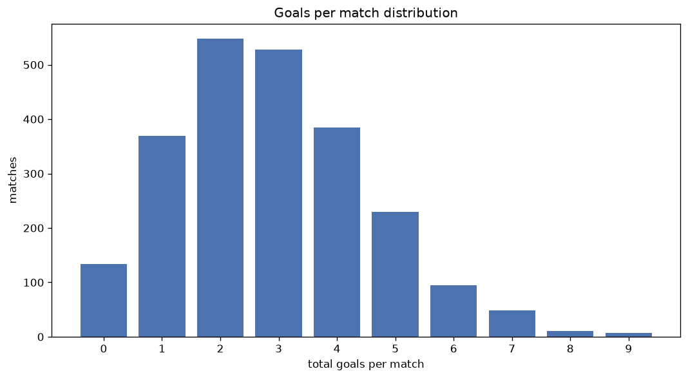
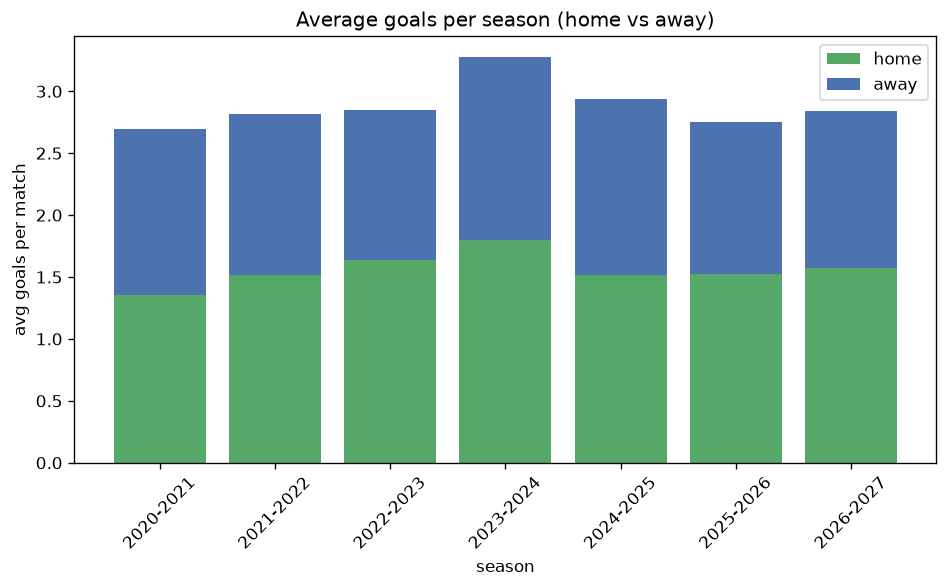

# Goal Analysis
- Report: `goals_analysis`
- Generated: 2026-10-26T01:43:35+00:00
- Script: `backend/scripts/analyze_goals.py` v1.0.0
- League: Premier League (England)
- Scope: league `premier`

## 1. Goals per match distribution
| goals | matches | pct |
|---|---|---|
| 0 | 134 | 5.7% |
| 1 | 369 | 15.7% |
| 2 | 548 | 23.3% |
| 3 | 528 | 22.4% |
| 4 | 385 | 16.3% |
| 5 | 229 | 9.7% |
| 6 | 95 | 4.0% |
| 7 | 49 | 2.1% |
| 8 | 11 | 0.5% |
| 9 | 7 | 0.3% |

## 2. Goals per match per season
| season | matches | total goals | avg home | avg away | avg total |
|---|---|---|---|---|---|
| 2020-2021 | 380 | 1024 | 1.353 | 1.342 | 2.695 |
| 2021-2022 | 380 | 1071 | 1.513 | 1.305 | 2.818 |
| 2022-2023 | 380 | 1084 | 1.634 | 1.218 | 2.853 |
| 2023-2024 | 380 | 1246 | 1.8 | 1.479 | 3.279 |
| 2024-2025 | 380 | 1115 | 1.513 | 1.421 | 2.934 |
| 2025-2026 | 380 | 1045 | 1.526 | 1.224 | 2.75 |
| 2026-2027 | 75 | 213 | 1.573 | 1.267 | 2.84 |

## 3. Home vs away goal share
- Home goals: **3667** (53.9%)
- Away goals: **3131** (46.1%)
- Home/away ratio: **1.171**

| season | home goals | away goals | total | home pct | away pct |
|---|---|---|---|---|---|
| 2020-2021 | 514 | 510 | 1024 | 50.2% | 49.8% |
| 2021-2022 | 575 | 496 | 1071 | 53.7% | 46.3% |
| 2022-2023 | 621 | 463 | 1084 | 57.3% | 42.7% |
| 2023-2024 | 684 | 562 | 1246 | 54.9% | 45.1% |
| 2024-2025 | 575 | 540 | 1115 | 51.6% | 48.4% |
| 2025-2026 | 580 | 465 | 1045 | 55.5% | 44.5% |
| 2026-2027 | 118 | 95 | 213 | 55.4% | 44.6% |

## 4. BTTS (Both Teams To Score)
- Overall: **1276** of `2355` (54.2%)

| season | matches | BTTS | pct |
|---|---|---|---|
| 2020-2021 | 380 | 186 | 48.9% |
| 2021-2022 | 380 | 190 | 50.0% |
| 2022-2023 | 380 | 196 | 51.6% |
| 2023-2024 | 380 | 234 | 61.6% |
| 2024-2025 | 380 | 218 | 57.4% |
| 2025-2026 | 380 | 213 | 56.1% |
| 2026-2027 | 75 | 39 | 52.0% |

## 5. Clean sheets
- Home clean sheets: **660** (28.0%)
- Away clean sheets: **553** (23.5%)
- Total clean sheets recorded: **1213**
- Matches with at least one clean sheet: **1079** (45.8%)
- Both teams kept clean sheets (0-0): **134**

| season | matches | home CS | away CS | total CS | matches w/ CS |
|---|---|---|---|---|---|
| 2020-2021 | 380 | 113 | 111 | 224 | 194 (51.1%) |
| 2021-2022 | 380 | 119 | 93 | 212 | 190 (50.0%) |
| 2022-2023 | 380 | 125 | 82 | 207 | 184 (48.4%) |
| 2023-2024 | 380 | 89 | 68 | 157 | 146 (38.4%) |
| 2024-2025 | 380 | 87 | 91 | 178 | 162 (42.6%) |
| 2025-2026 | 380 | 108 | 86 | 194 | 167 (43.9%) |
| 2026-2027 | 75 | 19 | 22 | 41 | 36 (48.0%) |

## 6. Scoring intensity
- First-half goals: **3043** (44.8%)
- Second-half goals: **3755** (55.2%)
- Avg first-half goals per match: **1.292**
- Avg second-half goals per match: **1.594**
- Second-half-only scoring (HT 0-0, FT goals >= 1): **503** (21.4%)

| season | matches | 1st half | 2nd half | 1st half pct | 2nd half pct |
|---|---|---|---|---|---|
| 2020-2021 | 380 | 483 | 541 | 47.2% | 52.8% |
| 2021-2022 | 380 | 484 | 587 | 45.2% | 54.8% |
| 2022-2023 | 380 | 502 | 582 | 46.3% | 53.7% |
| 2023-2024 | 380 | 517 | 729 | 41.5% | 58.5% |
| 2024-2025 | 380 | 518 | 597 | 46.5% | 53.5% |
| 2025-2026 | 380 | 452 | 593 | 43.3% | 56.7% |
| 2026-2027 | 75 | 87 | 126 | 40.8% | 59.2% |

## 7. First-goal timing
- Matches with first-goal time recorded: `2221` of `2355` (94.3%)
- Goalless matches: `134`
- Min `1` | Max `99` | Mean `29.99` | Median (p50) `25`

| bucket | count | % of matches | % of scoring matches |
|---|---|---|---|
| 1-15 | 763 | 32.4% | 34.4% |
| 16-30 | 543 | 23.1% | 24.4% |
| 31-45 | 356 | 15.1% | 16.0% |
| 46-60 | 299 | 12.7% | 13.5% |
| 61-75 | 148 | 6.3% | 6.7% |
| 76-90 | 91 | 3.9% | 4.1% |
| 91-120 | 21 | 0.9% | 0.9% |

---
*All statistics are computed from PostgreSQL tables (read-only). Run with `python backend/scripts/analyze_goals.py` to regenerate.*

## Charts

