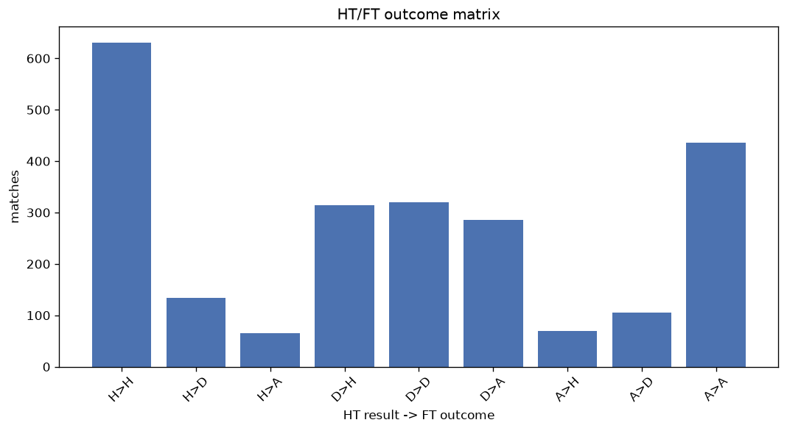
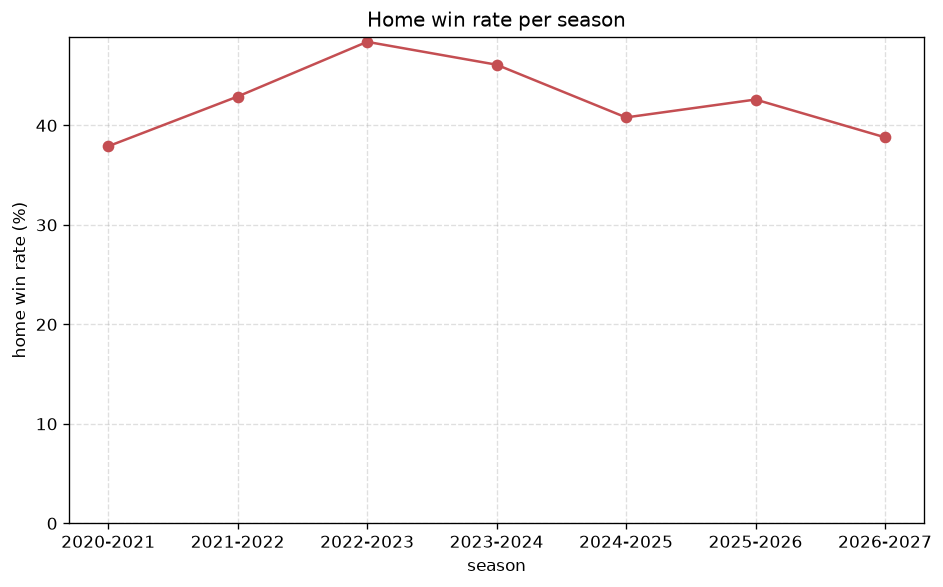

# Match Analysis
- Report: `matches_analysis`
- Generated: 2026-10-27T02:25:44+00:00
- Script: `backend/scripts/analyze_matches.py` v1.0.0
- League: Premier League (England)
- Scope: league `premier`

## 1. Overall summary
| metric | value |
|---|---|
| Matches | 2360 |
| Home wins | 1014 (43.0%) |
| Draws | 560 (23.7%) |
| Away wins | 786 (33.3%) |
| Total goals | 6807 |
| Average goals per match | 2.884 |
| Goalless matches | 135 (5.7%) |

## 2. Per-season breakdown
| season | matches | home wins | draws | away wins | total goals | avg goals | goalless |
|---|---|---|---|---|---|---|---|
| 2020-2021 | 380 | 144 (37.9%) | 83 (21.8%) | 153 (40.3%) | 1024 | 2.695 | 30 (7.9%) |
| 2021-2022 | 380 | 163 (42.9%) | 88 (23.2%) | 129 (33.9%) | 1071 | 2.818 | 22 (5.8%) |
| 2022-2023 | 380 | 184 (48.4%) | 87 (22.9%) | 109 (28.7%) | 1084 | 2.853 | 23 (6.1%) |
| 2023-2024 | 380 | 175 (46.1%) | 82 (21.6%) | 123 (32.4%) | 1246 | 3.279 | 11 (2.9%) |
| 2024-2025 | 380 | 155 (40.8%) | 93 (24.5%) | 132 (34.7%) | 1115 | 2.934 | 16 (4.2%) |
| 2025-2026 | 380 | 162 (42.6%) | 104 (27.4%) | 114 (30.0%) | 1045 | 2.75 | 27 (7.1%) |
| 2026-2027 | 80 | 31 (38.8%) | 23 (28.8%) | 26 (32.5%) | 222 | 2.775 | 6 (7.5%) |

## 3. HT/FT outcome matrix
| HT result \ FT result | Home | Draw | Away | total |
|---|---|---|---|---|
| HT home lead | 630 (76.0%) | 134 (16.2%) | 65 (7.8%) | 829 |
| HT draw | 314 (34.2%) | 320 (34.8%) | 285 (31.0%) | 919 |
| HT away lead | 70 (11.4%) | 106 (17.3%) | 436 (71.2%) | 612 |

## 4. Comeback matches
- Home comebacks (trailing at HT, won at FT): **70** (3.0%)
- Away comebacks (trailing at HT, won at FT): **65** (2.8%)

### Home comebacks
| season | home | away | HT | FT |
|---|---|---|---|---|
| 2020-2021 | Burnley | Aston Villa | 0-1 | 3-2 |
| 2020-2021 | Sheffield Utd | West Brom | 0-1 | 2-1 |
| 2020-2021 | Manchester Utd | Brighton | 0-1 | 2-1 |
| 2020-2021 | Liverpool | Aston Villa | 0-1 | 2-1 |
| 2020-2021 | Tottenham | Southampton | 0-1 | 2-1 |
| 2020-2021 | Leicester | Crystal Palace | 0-1 | 2-1 |
| 2020-2021 | Wolves | Brighton | 0-1 | 2-1 |
| 2020-2021 | Crystal Palace | Aston Villa | 1-2 | 3-2 |
| 2020-2021 | Brighton | Manchester City | 0-1 | 3-2 |
| 2021-2022 | Everton | Southampton | 0-1 | 3-1 |
| 2021-2022 | Tottenham | Leeds | 0-1 | 2-1 |
| 2021-2022 | West Ham | Chelsea | 1-2 | 3-2 |
| 2021-2022 | Everton | Arsenal | 0-1 | 2-1 |
| 2021-2022 | Brentford | Watford | 0-1 | 2-1 |
| 2021-2022 | Arsenal | Wolves | 0-1 | 2-1 |
| 2021-2022 | Burnley | Everton | 1-2 | 3-2 |
| 2021-2022 | Everton | Crystal Palace | 0-2 | 3-2 |
| 2021-2022 | Manchester City | Aston Villa | 0-1 | 3-2 |
| 2021-2022 | Brighton | West Ham | 0-1 | 3-1 |
| 2022-2023 | Manchester City | Crystal Palace | 0-2 | 4-2 |
| 2022-2023 | Liverpool | Newcastle | 0-1 | 2-1 |
| 2022-2023 | Bournemouth | Leicester | 0-1 | 2-1 |
| 2022-2023 | Crystal Palace | Wolves | 0-1 | 2-1 |
| 2022-2023 | Leeds | Bournemouth | 1-2 | 4-3 |
| 2022-2023 | Tottenham | Leeds | 1-2 | 4-3 |
| 2022-2023 | Arsenal | West Ham | 0-1 | 3-1 |
| 2022-2023 | Manchester City | Tottenham | 0-2 | 4-2 |
| 2022-2023 | Arsenal | Bournemouth | 0-1 | 3-2 |
| 2022-2023 | Bournemouth | Fulham | 0-1 | 2-1 |
| 2022-2023 | Brentford | Nottingham | 0-1 | 2-1 |
| 2022-2023 | Newcastle | Southampton | 0-1 | 3-1 |
| 2023-2024 | Manchester Utd | Nottingham | 1-2 | 3-2 |
| 2023-2024 | Manchester Utd | Brentford | 0-1 | 2-1 |
| 2023-2024 | Brentford | West Ham | 1-2 | 3-2 |
| 2023-2024 | Wolves | Tottenham | 0-1 | 2-1 |
| 2023-2024 | Manchester Utd | Aston Villa | 0-2 | 3-2 |
| 2023-2024 | Tottenham | Brentford | 0-1 | 3-2 |
| 2023-2024 | Tottenham | Brighton | 0-1 | 2-1 |
| 2023-2024 | Liverpool | Luton | 0-1 | 4-1 |
| 2023-2024 | Manchester City | Manchester Utd | 0-1 | 3-1 |
| 2023-2024 | Bournemouth | Luton | 0-3 | 4-3 |
| 2023-2024 | Newcastle | West Ham | 1-2 | 4-3 |
| 2023-2024 | Tottenham | Luton | 0-1 | 2-1 |
| 2023-2024 | West Ham | Luton | 0-1 | 3-1 |
| 2024-2025 | Aston Villa | Everton | 1-2 | 3-2 |
| 2024-2025 | Aston Villa | Wolves | 0-1 | 3-1 |
| 2024-2025 | Everton | Crystal Palace | 0-1 | 2-1 |
| 2024-2025 | Brighton | Tottenham | 0-2 | 3-2 |
| 2024-2025 | Manchester Utd | Brentford | 0-1 | 2-1 |
| 2024-2025 | Liverpool | Brighton | 0-1 | 2-1 |
| 2024-2025 | Tottenham | Aston Villa | 0-1 | 4-1 |
| 2024-2025 | Fulham | Brentford | 0-1 | 2-1 |
| 2024-2025 | Brighton | Manchester City | 0-1 | 2-1 |
| 2024-2025 | Manchester Utd | Southampton | 0-1 | 3-1 |
| 2024-2025 | Chelsea | West Ham | 0-1 | 2-1 |
| 2024-2025 | Aston Villa | Chelsea | 0-1 | 2-1 |
| 2024-2025 | Liverpool | Southampton | 0-1 | 3-1 |
| 2024-2025 | Brighton | Liverpool | 1-2 | 3-2 |
| 2025-2026 | Brighton | Manchester City | 0-1 | 2-1 |
| 2025-2026 | Everton | Crystal Palace | 0-1 | 2-1 |
| 2025-2026 | Brentford | Newcastle | 0-1 | 3-1 |
| 2025-2026 | Brighton | Brentford | 0-1 | 2-1 |
| 2025-2026 | Sunderland | Bournemouth | 1-2 | 3-2 |
| 2025-2026 | Newcastle | Leeds | 1-2 | 4-3 |
| 2025-2026 | Fulham | Brighton | 0-1 | 2-1 |
| 2025-2026 | Chelsea | West Ham | 0-2 | 3-2 |
| 2025-2026 | Manchester Utd | Crystal Palace | 0-1 | 2-1 |
| 2025-2026 | Crystal Palace | Newcastle | 0-1 | 2-1 |
| 2025-2026 | Nottingham | Burnley | 0-1 | 4-1 |
| 2026-2027 | Manchester City | Bournemouth | 0-1 | 2-1 |

### Away comebacks
| season | home | away | HT | FT |
|---|---|---|---|---|
| 2020-2021 | Southampton | Manchester Utd | 2-0 | 2-3 |
| 2020-2021 | West Ham | Manchester Utd | 1-0 | 1-3 |
| 2020-2021 | Wolves | West Brom | 2-1 | 2-3 |
| 2020-2021 | Southampton | Wolves | 1-0 | 1-2 |
| 2020-2021 | Brighton | Leicester | 1-0 | 1-2 |
| 2020-2021 | Burnley | Newcastle | 1-0 | 1-2 |
| 2020-2021 | Tottenham | Manchester Utd | 1-0 | 1-3 |
| 2020-2021 | Manchester City | Chelsea | 1-0 | 1-2 |
| 2020-2021 | Aston Villa | Manchester Utd | 1-0 | 1-3 |
| 2021-2022 | Burnley | Brighton | 1-0 | 1-2 |
| 2021-2022 | Newcastle | West Ham | 2-1 | 2-4 |
| 2021-2022 | Leeds | West Ham | 1-0 | 1-2 |
| 2021-2022 | Arsenal | Manchester City | 1-0 | 1-2 |
| 2021-2022 | Wolves | Leeds | 2-0 | 2-3 |
| 2021-2022 | Watford | Burnley | 1-0 | 1-2 |
| 2021-2022 | Southampton | Crystal Palace | 1-0 | 1-2 |
| 2021-2022 | Everton | Brentford | 2-1 | 2-3 |
| 2022-2023 | Nottingham | Bournemouth | 2-0 | 2-3 |
| 2022-2023 | Nottingham | Fulham | 1-0 | 2-3 |
| 2022-2023 | Bournemouth | Tottenham | 1-0 | 2-3 |
| 2022-2023 | Everton | Southampton | 1-0 | 1-2 |
| 2022-2023 | Southampton | Wolves | 1-0 | 1-2 |
| 2022-2023 | Aston Villa | Arsenal | 2-1 | 2-4 |
| 2022-2023 | Brentford | Newcastle | 1-0 | 1-2 |
| 2022-2023 | Tottenham | Brentford | 1-0 | 1-3 |
| 2023-2024 | Newcastle | Liverpool | 1-0 | 1-2 |
| 2023-2024 | Wolves | Liverpool | 1-0 | 1-3 |
| 2023-2024 | West Ham | Manchester City | 1-0 | 1-3 |
| 2023-2024 | Bournemouth | Wolves | 1-0 | 1-2 |
| 2023-2024 | Tottenham | West Ham | 1-0 | 1-2 |
| 2023-2024 | Luton | Manchester City | 1-0 | 1-2 |
| 2023-2024 | Brentford | Aston Villa | 1-0 | 1-2 |
| 2023-2024 | Everton | Manchester City | 1-0 | 1-3 |
| 2023-2024 | Newcastle | Manchester City | 2-1 | 2-3 |
| 2023-2024 | Crystal Palace | Chelsea | 1-0 | 1-3 |
| 2023-2024 | Wolves | West Ham | 1-0 | 1-2 |
| 2024-2025 | Wolves | Newcastle | 1-0 | 1-2 |
| 2024-2025 | Southampton | Leicester | 2-0 | 2-3 |
| 2024-2025 | Nottingham | Newcastle | 1-0 | 1-3 |
| 2024-2025 | Ipswich | Bournemouth | 1-0 | 1-2 |
| 2024-2025 | Tottenham | Chelsea | 2-1 | 3-4 |
| 2024-2025 | Manchester City | Manchester Utd | 1-0 | 1-2 |
| 2024-2025 | Chelsea | Fulham | 1-0 | 1-2 |
| 2024-2025 | Tottenham | Leicester | 1-0 | 1-2 |
| 2024-2025 | Newcastle | Fulham | 1-0 | 1-2 |
| 2024-2025 | Ipswich | Wolves | 1-0 | 1-2 |
| 2024-2025 | Fulham | Chelsea | 1-0 | 1-2 |
| 2024-2025 | Southampton | Fulham | 1-0 | 1-2 |
| 2024-2025 | Arsenal | Bournemouth | 1-0 | 1-2 |
| 2024-2025 | Brentford | Fulham | 2-1 | 2-3 |
| 2024-2025 | Tottenham | Brighton | 1-0 | 1-4 |
| 2025-2026 | Chelsea | Brighton | 1-0 | 1-3 |
| 2025-2026 | Newcastle | Arsenal | 1-0 | 1-2 |
| 2025-2026 | Leeds | Aston Villa | 1-0 | 1-2 |
| 2025-2026 | Crystal Palace | Manchester Utd | 1-0 | 1-2 |
| 2025-2026 | West Ham | Aston Villa | 2-1 | 2-3 |
| 2025-2026 | Chelsea | Aston Villa | 1-0 | 1-2 |
| 2025-2026 | West Ham | Nottingham | 1-0 | 1-2 |
| 2025-2026 | Fulham | Everton | 1-0 | 1-2 |
| 2025-2026 | Everton | Bournemouth | 1-0 | 1-2 |
| 2025-2026 | Newcastle | Sunderland | 1-0 | 1-2 |
| 2025-2026 | Everton | Sunderland | 1-0 | 1-3 |
| 2025-2026 | Manchester City | Aston Villa | 1-0 | 1-2 |
| 2026-2027 | Fulham | Crystal Palace | 2-1 | 2-3 |
| 2026-2027 | Brentford | Liverpool | 1-0 | 1-2 |

## 5. HT lead conversion
| HT state | matches | converted to win | held as draw | collapsed to loss |
|---|---|---|---|---|
| Home lead | 829 | 630 (76.0%) | 134 (16.2%) | 65 (7.8%) |
| Away lead | 612 | 436 (71.2%) | 106 (17.3%) | 70 (11.4%) |

### Matches level at half-time
| FT result | count | pct |
|---|---|---|
| Home win | 314 | 34.2% |
| Draw | 320 | 34.8% |
| Away win | 285 | 31.0% |

## 6. First-goal timing
- Matches with a first-goal time recorded: `2225` of `2360` (94.3%)

Outcome distribution by first-goal timing bucket:
| bucket | matches | % of matches | home | draw | away |
|---|---|---|---|---|---|
| 1-15 | 763 | 32.3% | 365 (47.8%) | 141 (18.5%) | 257 (33.7%) |
| 16-30 | 545 | 23.1% | 252 (46.2%) | 102 (18.7%) | 191 (35.0%) |
| 31-45 | 357 | 15.1% | 160 (44.8%) | 76 (21.3%) | 121 (33.9%) |
| 46-60 | 300 | 12.7% | 131 (43.7%) | 59 (19.7%) | 110 (36.7%) |
| 61-75 | 148 | 6.3% | 63 (42.6%) | 35 (23.6%) | 50 (33.8%) |
| 76-90 | 91 | 3.9% | 34 (37.4%) | 11 (12.1%) | 46 (50.5%) |
| 91-120 | 21 | 0.9% | 9 (42.9%) | 1 (4.8%) | 11 (52.4%) |

## 7. Goalless matches
- Overall: **135** of `2360` (5.7%)

| season | matches | goalless | pct |
|---|---|---|---|
| 2020-2021 | 380 | 30 | 7.9% |
| 2021-2022 | 380 | 22 | 5.8% |
| 2022-2023 | 380 | 23 | 6.1% |
| 2023-2024 | 380 | 11 | 2.9% |
| 2024-2025 | 380 | 16 | 4.2% |
| 2025-2026 | 380 | 27 | 7.1% |
| 2026-2027 | 80 | 6 | 7.5% |

---
*All statistics are computed from PostgreSQL tables (read-only). Run with `python backend/scripts/analyze_matches.py` to regenerate.*

## Charts

