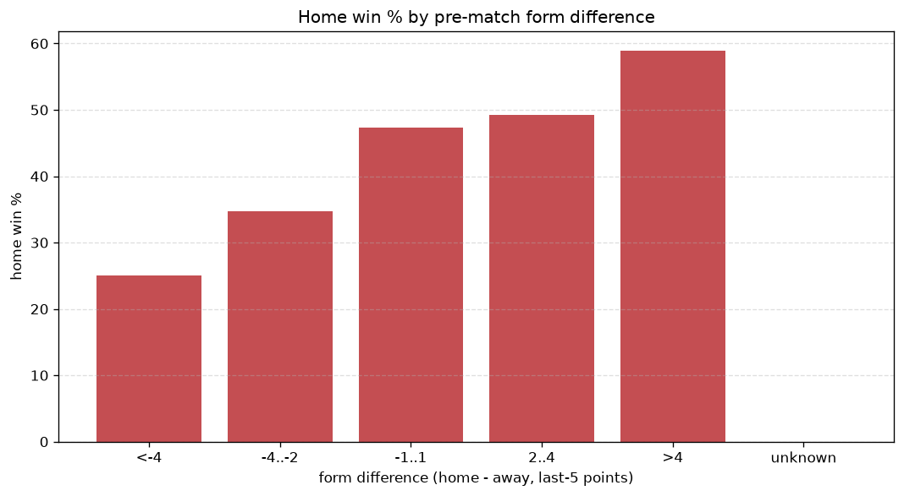
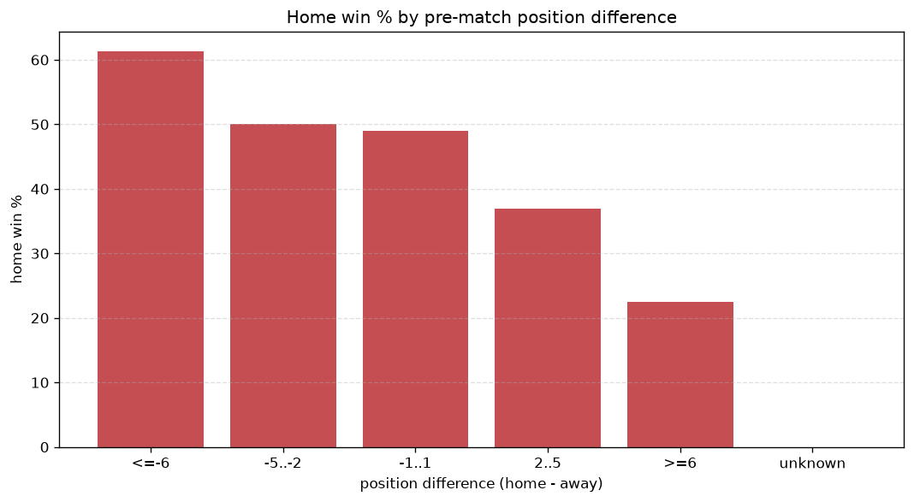

# Relationships Analysis
- Report: `relationships`
- Generated: 2026-10-26T01:43:44+00:00
- Script: `backend/scripts/analyze_relationships.py` v1.0.0
- League: Premier League (England)
- Scope: league `premier`

- Matches analysed: **2280** (23 leakage-safe pre-match features).

## 1. Correlation matrix
_Pearson correlation of each pre-match feature with observed goals; sorted by |corr(total goals)|._

| feature | corr(home) | corr(away) | corr(total) |
|---|---|---|---|
| home_position_before_match | -0.253 | 0.171 | -0.076 |
| home_team_home_win_rate | 0.191 | -0.111 | 0.070 |
| home_team_goals_scored_last_5 | 0.180 | -0.102 | 0.068 |
| home_team_home_goals_avg | 0.176 | -0.105 | 0.063 |
| home_points_before_match | 0.149 | -0.085 | 0.056 |
| home_team_wins_last_5 | 0.183 | -0.132 | 0.048 |
| points_difference | 0.286 | -0.257 | 0.040 |
| home_team_points_last_5 | 0.183 | -0.145 | 0.039 |
| position_difference | -0.284 | 0.259 | -0.037 |
| away_team_goals_scored_last_5 | -0.084 | 0.135 | 0.032 |
| away_team_away_goals_avg | -0.088 | 0.133 | 0.027 |
| home_team_home_conceded_avg | -0.135 | 0.112 | -0.025 |
| away_position_before_match | 0.144 | -0.191 | -0.025 |
| away_points_before_match | -0.083 | 0.123 | 0.024 |
| away_team_away_win_rate | -0.107 | 0.146 | 0.022 |
| away_team_goals_conceded_last_5 | 0.103 | -0.089 | 0.017 |
| home_team_goals_conceded_last_5 | -0.116 | 0.110 | -0.012 |
| rest_days_difference | -0.019 | 0.036 | 0.011 |
| away_rest_days | -0.012 | 0.008 | -0.004 |
| away_team_away_conceded_avg | 0.089 | -0.100 | -0.002 |
| away_team_wins_last_5 | -0.103 | 0.110 | -0.002 |
| home_rest_days | -0.022 | 0.026 | 0.002 |
| away_team_points_last_5 | -0.102 | 0.109 | -0.001 |

## 2. Form vs outcome
_Home win/draw/away % per bucket of `home_team_points_last_5 - away_team_points_last_5`._

| bucket | matches | home | draw | away | home % | draw % | away % |
|---|---|---|---|---|---|---|---|
| <-4 | 387 | 97 | 94 | 196 | 25.1% | 24.3% | 50.6% |
| -4..-2 | 487 | 169 | 114 | 204 | 34.7% | 23.4% | 41.9% |
| -1..1 | 643 | 304 | 153 | 186 | 47.3% | 23.8% | 28.9% |
| 2..4 | 381 | 188 | 98 | 95 | 49.3% | 25.7% | 24.9% |
| >4 | 382 | 225 | 78 | 79 | 58.9% | 20.4% | 20.7% |
| unknown | 0 | 0 | 0 | 0 | - | - | - |

## 3. Position vs outcome
_Home win/draw/away % per bucket of `position_difference` (home position - away position; negative favours the home team)._

| bucket | matches | home | draw | away | home % | draw % | away % |
|---|---|---|---|---|---|---|---|
| <=-6 | 571 | 350 | 120 | 101 | 61.3% | 21.0% | 17.7% |
| -5..-2 | 400 | 200 | 94 | 106 | 50.0% | 23.5% | 26.5% |
| -1..1 | 308 | 151 | 71 | 86 | 49.0% | 23.1% | 27.9% |
| 2..5 | 396 | 146 | 95 | 155 | 36.9% | 24.0% | 39.1% |
| >=6 | 605 | 136 | 157 | 312 | 22.5% | 26.0% | 51.6% |
| unknown | 0 | 0 | 0 | 0 | - | - | - |

## 4. Rest advantage
_Home win/draw/away % per bucket of `rest_days_difference` (home rest - away rest). Matches with unknown rest are bucketed separately._

| bucket | matches | home | draw | away | home % | draw % | away % |
|---|---|---|---|---|---|---|---|
| <-1 | 239 | 107 | 60 | 72 | 44.8% | 25.1% | 30.1% |
| -1..0 | 399 | 203 | 80 | 116 | 50.9% | 20.1% | 29.1% |
| 0 | 865 | 344 | 211 | 310 | 39.8% | 24.4% | 35.8% |
| 1..2 | 594 | 249 | 152 | 193 | 41.9% | 25.6% | 32.5% |
| >2 | 121 | 52 | 24 | 45 | 43.0% | 19.8% | 37.2% |
| unknown | 62 | 28 | 10 | 24 | 45.2% | 16.1% | 38.7% |
- *62 match(es) had unknown rest difference (missing rest data on at least one side).*

## 5. Home team quality
_Home win rate by `home_team_home_win_rate` tier (split at 0.5)._

- `< 0.5` tier: **37.5%** home win (510/1360)
- `>= 0.5` tier: **51.4%** home win (473/920)
- Home-win gap (>= split minus < split): **+13.9 pp**

| tier | label | matches | home | draw | away | home % |
|---|---|---|---|---|---|---|
| low | < 0.5 | 1360 | 510 | 323 | 527 | 37.5% |
| high | >= 0.5 | 920 | 473 | 214 | 233 | 51.4% |

## 6. Feature averages by result
_Mean feature value per outcome; `range` is home-minus-away spread of the group means._

| feature | home mean | draw mean | away mean | range |
|---|---|---|---|---|
| points_difference | 5.189 | -1.125 | -6.237 | 11.426 |
| position_difference | -2.660 | 0.650 | 3.472 | 6.133 |
| home_points_before_match | 28.509 | 24.251 | 22.443 | 6.065 |
| away_points_before_match | 23.319 | 25.376 | 28.680 | 5.361 |
| home_position_before_match | 9.163 | 11.227 | 12.525 | 3.362 |
| away_position_before_match | 11.823 | 10.577 | 9.053 | 2.770 |
| home_team_points_last_5 | 7.033 | 6.175 | 5.370 | 1.663 |
| home_team_goals_scored_last_5 | 7.196 | 6.479 | 5.799 | 1.398 |
| away_team_points_last_5 | 5.906 | 6.594 | 7.053 | 1.146 |
| away_team_goals_conceded_last_5 | 7.036 | 6.551 | 5.961 | 1.075 |
| home_team_goals_conceded_last_5 | 6.149 | 6.862 | 7.204 | 1.055 |
| away_team_goals_scored_last_5 | 6.221 | 6.752 | 7.237 | 1.016 |
| home_team_wins_last_5 | 1.981 | 1.665 | 1.438 | 0.543 |
| away_team_wins_last_5 | 1.591 | 1.849 | 1.989 | 0.398 |
| home_rest_days | 7.394 | 7.471 | 7.715 | 0.321 |
| home_team_home_goals_avg | 1.622 | 1.465 | 1.307 | 0.314 |
| away_team_away_goals_avg | 1.146 | 1.284 | 1.365 | 0.218 |
| home_team_home_conceded_avg | 1.145 | 1.270 | 1.362 | 0.217 |
| away_team_away_conceded_avg | 1.554 | 1.502 | 1.360 | 0.194 |
| away_rest_days | 7.455 | 7.455 | 7.627 | 0.172 |
| rest_days_difference | -0.061 | 0.015 | 0.088 | 0.149 |
| home_team_home_win_rate | 0.458 | 0.407 | 0.349 | 0.109 |
| away_team_away_win_rate | 0.271 | 0.330 | 0.362 | 0.091 |

---
*All features are leakage-safe pre-match values built by `ml.features.build_features.build_rows` from strictly prior matches. Run with `python backend/scripts/analyze_relationships.py` to regenerate.*

## Charts

