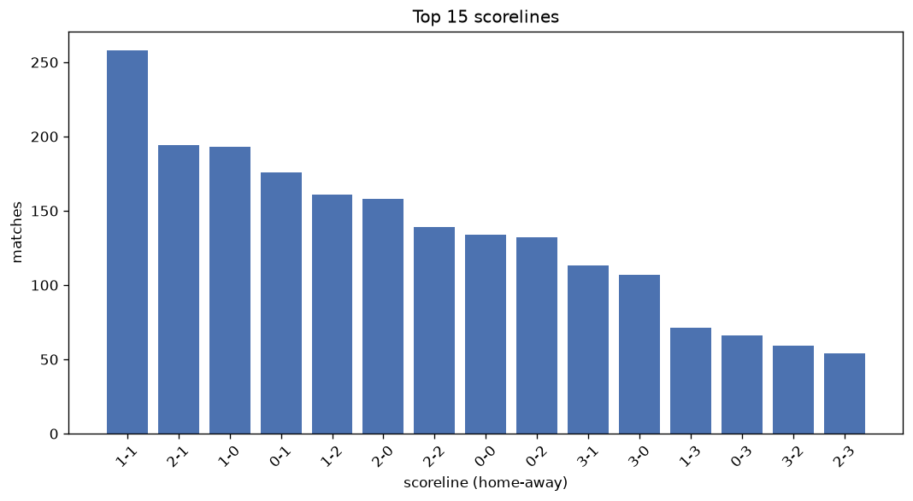
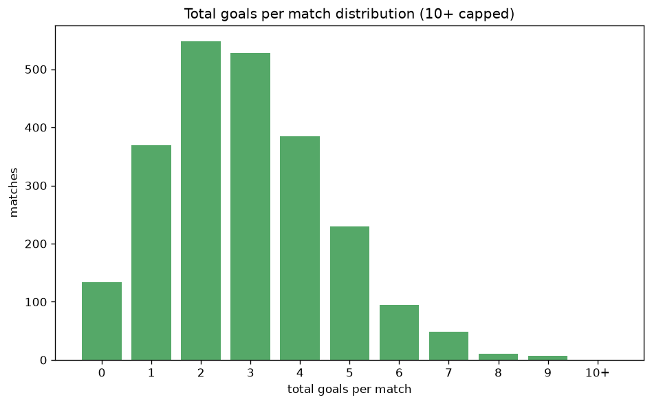

# Scoreline Analysis
- Report: `scoreline_analysis`
- Generated: 2026-10-26T01:43:41+00:00
- Script: `backend/scripts/analyze_scorelines.py` v1.0.0
- League: Premier League (England)
- Scope: league `premier`

## 1. Scoreline frequency
- Matches analysed: **2355** across **7** seasons.
- Distinct scorelines seen: **46**.

| scoreline | count | pct |
|---|---|---|
| 1-1 | 258 | 11.0% |
| 2-1 | 194 | 8.2% |
| 1-0 | 193 | 8.2% |
| 0-1 | 176 | 7.5% |
| 1-2 | 161 | 6.8% |
| 2-0 | 158 | 6.7% |
| 2-2 | 139 | 5.9% |
| 0-0 | 134 | 5.7% |
| 0-2 | 132 | 5.6% |
| 3-1 | 113 | 4.8% |
| 3-0 | 107 | 4.5% |
| 1-3 | 71 | 3.0% |
| 0-3 | 66 | 2.8% |
| 3-2 | 59 | 2.5% |
| 2-3 | 54 | 2.3% |
| 4-1 | 47 | 2.0% |
| 4-0 | 37 | 1.6% |
| 1-4 | 34 | 1.4% |
| 0-4 | 25 | 1.1% |
| 4-2 | 23 | 1.0% |

## 2. Scoreline frequency per season

### 2020-2021
| scoreline | count | pct |
|---|---|---|
| 1-1 | 40 | 10.5% |
| 0-1 | 38 | 10.0% |
| 1-0 | 33 | 8.7% |
| 1-2 | 33 | 8.7% |
| 0-0 | 30 | 7.9% |

### 2021-2022
| scoreline | count | pct |
|---|---|---|
| 1-1 | 42 | 11.1% |
| 1-0 | 37 | 9.7% |
| 2-0 | 28 | 7.4% |
| 0-1 | 28 | 7.4% |
| 1-2 | 25 | 6.6% |

### 2022-2023
| scoreline | count | pct |
|---|---|---|
| 1-0 | 46 | 12.1% |
| 1-1 | 38 | 10.0% |
| 2-1 | 34 | 8.9% |
| 2-0 | 26 | 6.8% |
| 0-1 | 24 | 6.3% |

### 2023-2024
| scoreline | count | pct |
|---|---|---|
| 1-1 | 38 | 10.0% |
| 2-1 | 31 | 8.2% |
| 2-2 | 27 | 7.1% |
| 3-1 | 26 | 6.8% |
| 2-0 | 24 | 6.3% |

### 2024-2025
| scoreline | count | pct |
|---|---|---|
| 1-1 | 45 | 11.8% |
| 2-1 | 33 | 8.7% |
| 2-2 | 31 | 8.2% |
| 1-0 | 29 | 7.6% |
| 1-2 | 29 | 7.6% |

### 2025-2026
| scoreline | count | pct |
|---|---|---|
| 1-1 | 47 | 12.4% |
| 2-1 | 37 | 9.7% |
| 0-1 | 31 | 8.2% |
| 2-0 | 29 | 7.6% |
| 0-0 | 27 | 7.1% |

### 2026-2027
| scoreline | count | pct |
|---|---|---|
| 0-1 | 9 | 12.0% |
| 2-2 | 8 | 10.7% |
| 1-1 | 8 | 10.7% |
| 2-1 | 7 | 9.3% |
| 0-2 | 6 | 8.0% |

## 3. Total-goal histogram
_10+ groups all matches with 10 or more total goals._

| total goals | matches | pct |
|---|---|---|
| 0 | 134 | 5.7% |
| 1 | 369 | 15.7% |
| 2 | 548 | 23.3% |
| 3 | 528 | 22.4% |
| 4 | 385 | 16.3% |
| 5 | 229 | 9.7% |
| 6 | 95 | 4.0% |
| 7 | 49 | 2.1% |
| 8 | 11 | 0.5% |
| 9 | 7 | 0.3% |
| 10+ | 0 | 0.0% |

## 4. Extreme scorelines
- Matches with 7+ total goals: **67**

| season | date | scoreline | total goals |
|---|---|---|---|
| 2020-2021 | 2020-10-04 | 7-2 | 9 |
| 2020-2021 | 2021-02-02 | 9-0 | 9 |
| 2021-2022 | 2021-12-26 | 6-3 | 9 |
| 2022-2023 | 2022-08-27 | 9-0 | 9 |
| 2022-2023 | 2022-10-02 | 6-3 | 9 |
| 2024-2025 | 2024-12-22 | 3-6 | 9 |
| 2025-2026 | 2025-12-02 | 4-5 | 9 |
| 2020-2021 | 2020-12-20 | 6-2 | 8 |
| 2022-2023 | 2022-09-17 | 6-2 | 8 |
| 2022-2023 | 2023-05-08 | 5-3 | 8 |
| 2022-2023 | 2023-05-28 | 4-4 | 8 |
| 2023-2024 | 2023-09-24 | 0-8 | 8 |
| 2023-2024 | 2023-11-12 | 4-4 | 8 |
| 2023-2024 | 2024-02-03 | 4-4 | 8 |
| 2024-2025 | 2024-08-25 | 2-6 | 8 |
| 2024-2025 | 2024-10-05 | 5-3 | 8 |
| 2025-2026 | 2025-12-15 | 4-4 | 8 |
| 2026-2027 | 2026-09-20 | 5-3 | 8 |
| 2020-2021 | 2020-09-12 | 4-3 | 7 |
| 2020-2021 | 2020-09-19 | 5-2 | 7 |
| 2020-2021 | 2020-09-19 | 4-3 | 7 |
| 2020-2021 | 2020-09-20 | 2-5 | 7 |
| 2020-2021 | 2020-09-27 | 2-5 | 7 |
| 2020-2021 | 2020-10-04 | 1-6 | 7 |
| 2020-2021 | 2020-11-01 | 3-4 | 7 |
| 2020-2021 | 2020-12-16 | 5-2 | 7 |
| 2020-2021 | 2020-12-19 | 0-7 | 7 |
| 2020-2021 | 2021-03-10 | 5-2 | 7 |
| 2020-2021 | 2021-04-03 | 2-5 | 7 |
| 2020-2021 | 2021-05-14 | 3-4 | 7 |
| 2021-2022 | 2021-10-23 | 7-0 | 7 |
| 2021-2022 | 2021-10-23 | 2-5 | 7 |
| 2021-2022 | 2021-12-14 | 7-0 | 7 |
| 2022-2023 | 2022-09-03 | 5-2 | 7 |
| 2022-2023 | 2022-09-04 | 5-2 | 7 |
| 2022-2023 | 2022-11-05 | 4-3 | 7 |
| 2022-2023 | 2022-11-12 | 4-3 | 7 |
| 2022-2023 | 2023-03-05 | 7-0 | 7 |
| 2022-2023 | 2023-04-17 | 1-6 | 7 |
| 2022-2023 | 2023-04-23 | 6-1 | 7 |
| 2022-2023 | 2023-04-29 | 4-3 | 7 |
| 2022-2023 | 2023-04-30 | 4-3 | 7 |
| 2022-2023 | 2023-05-08 | 4-3 | 7 |
| 2023-2024 | 2023-09-02 | 2-5 | 7 |
| 2023-2024 | 2023-09-30 | 6-1 | 7 |
| 2023-2024 | 2023-11-04 | 6-1 | 7 |
| 2023-2024 | 2023-12-03 | 4-3 | 7 |
| 2023-2024 | 2023-12-05 | 3-4 | 7 |
| 2023-2024 | 2024-02-01 | 3-4 | 7 |
| 2023-2024 | 2024-03-13 | 4-3 | 7 |
| 2023-2024 | 2024-03-30 | 4-3 | 7 |
| 2023-2024 | 2024-04-04 | 4-3 | 7 |
| 2023-2024 | 2024-04-21 | 5-2 | 7 |
| 2024-2025 | 2024-10-26 | 4-3 | 7 |
| 2024-2025 | 2024-11-30 | 2-5 | 7 |
| 2024-2025 | 2024-12-08 | 3-4 | 7 |
| 2024-2025 | 2025-02-01 | 7-0 | 7 |
| 2024-2025 | 2025-02-23 | 4-3 | 7 |
| 2024-2025 | 2025-04-12 | 5-2 | 7 |
| 2024-2025 | 2025-05-04 | 4-3 | 7 |
| 2025-2026 | 2025-12-03 | 3-4 | 7 |
| 2025-2026 | 2026-01-07 | 4-3 | 7 |
| 2025-2026 | 2026-02-28 | 3-4 | 7 |
| 2025-2026 | 2026-02-28 | 5-2 | 7 |
| 2025-2026 | 2026-04-19 | 4-3 | 7 |
| 2026-2027 | 2026-08-30 | 4-3 | 7 |
| 2026-2027 | 2026-08-30 | 5-2 | 7 |

## 5. Margin-of-victory distribution (decided matches)
- Decided matches: **1797** (draws: **558**)
- Average winning margin: **1.88**

| margin | matches | pct |
|---|---|---|
| 1 | 862 | 48.0% |
| 2 | 517 | 28.8% |
| 3+ | 418 | 23.3% |

## 6. Margin by outcome

### Home wins
- Matches: **1013** | avg margin: **1.93** | max margin: **9**
| margin | matches | pct |
|---|---|---|
| 1 | 463 | 45.7% |
| 2 | 297 | 29.3% |
| 3+ | 253 | 25.0% |
- *Full match-by-match list available in `scoreline_analysis.json`.*

### Away wins
- Matches: **784** | avg margin: **1.82** | max margin: **8**
| margin | matches | pct |
|---|---|---|
| 1 | 399 | 50.9% |
| 2 | 220 | 28.1% |
| 3+ | 165 | 21.0% |
- *Full match-by-match list available in `scoreline_analysis.json`.*

## 7. Most common exact score by outcome type
| outcome | matches | most common score | count | pct |
|---|---|---|---|---|
| home | 1013 | 2-1 | 194 | 19.2% |
| draw | 558 | 1-1 | 258 | 46.2% |
| away | 784 | 0-1 | 176 | 22.4% |

---
*All statistics are computed from PostgreSQL tables (read-only). Run with `python backend/scripts/analyze_scorelines.py` to regenerate.*

## Charts

