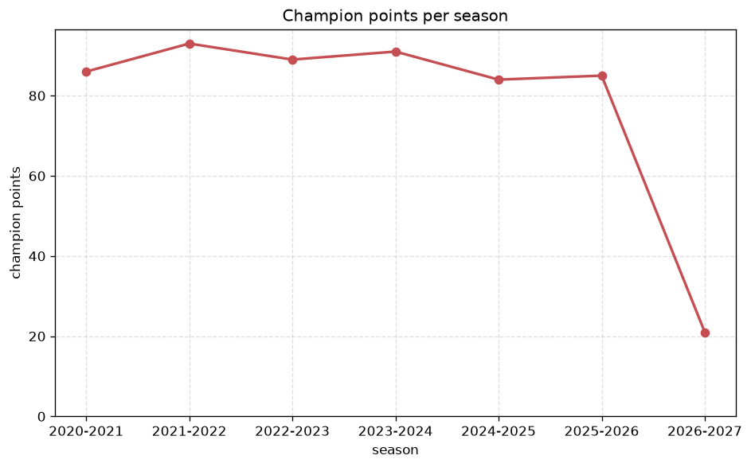
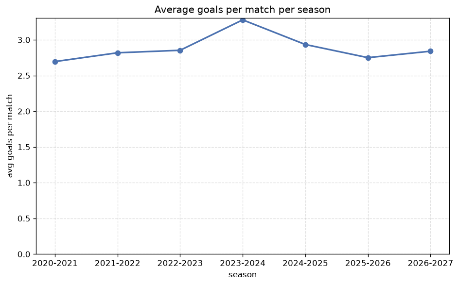

# Season Trends Analysis
- Report: `season_trends`
- Generated: 2026-10-26T01:43:39+00:00
- Script: `backend/scripts/analyze_seasons.py` v1.0.0
- League: Premier League (England)
- Scope: league `premier`

## 1. Champions per season
| season | champion | pts | runner-up | margin |
|---|---|---|---|---|
| 2020-2021 | Manchester City | 86 | Manchester Utd | 12 pts |
| 2021-2022 | Manchester City | 93 | Liverpool | 1 pts |
| 2022-2023 | Manchester City | 89 | Arsenal | 5 pts |
| 2023-2024 | Manchester City | 91 | Arsenal | 2 pts |
| 2024-2025 | Liverpool | 84 | Arsenal | 10 pts |
| 2025-2026 | Arsenal | 85 | Manchester City | 7 pts |
| 2026-2027 | Manchester City | 21 | Arsenal | 0 pts |

## 2. Title-race tightness
- Tight races (margin <= 3 pts): **3** of 7 seasons
- Tightest race: **2026-2027** - Manchester City beat Arsenal by **0** pts

| season | margin | tight |
|---|---|---|
| 2020-2021 | 12 pts |  |
| 2021-2022 | 1 pts | yes |
| 2022-2023 | 5 pts |  |
| 2023-2024 | 2 pts | yes |
| 2024-2025 | 10 pts |  |
| 2025-2026 | 7 pts |  |
| 2026-2027 | 0 pts | yes |

## 3. Points thresholds
_Position-specific points per season. Key: 1 = champion, 2 = runner-up, 4 = CL line, 6 = Europa, 17 = last safe, 20 = bottom._

| season | pos 1 | pos 2 | pos 4 | pos 6 | pos 17 | pos 20 |
|---|---|---|---|---|---|---|
| 2020-2021 | 86 | 74 | 67 | 65 | 39 | 23 |
| 2021-2022 | 93 | 92 | 71 | 58 | 38 | 22 |
| 2022-2023 | 89 | 84 | 71 | 62 | 36 | 25 |
| 2023-2024 | 91 | 89 | 68 | 63 | 36 | 16 |
| 2024-2025 | 84 | 74 | 69 | 66 | 38 | 12 |
| 2025-2026 | 85 | 78 | 65 | 57 | 41 | 20 |
| 2026-2027 | 21 | 21 | 13 | 11 | 6 | 4 |

## 4. Relegation battle
| season | safe pos | safe pts | drop pos | drop pts | gap |
|---|---|---|---|---|---|
| 2020-2021 | 17 | 39 | 18 | 28 | 11 pts |
| 2021-2022 | 17 | 38 | 18 | 35 | 3 pts |
| 2022-2023 | 17 | 36 | 18 | 34 | 2 pts |
| 2023-2024 | 17 | 36 | 18 | 26 | 10 pts |
| 2024-2025 | 17 | 38 | 18 | 25 | 13 pts |
| 2025-2026 | 17 | 41 | 18 | 39 | 2 pts |
| 2026-2027 | 17 | 6 | 18 | 6 | 0 pts |

## 5. League-level trends
| season | matches | total goals | avg goals | home win | draw | away win | goalless | avg pts/team |
|---|---|---|---|---|---|---|---|---|
| 2020-2021 | 380 | 1024 | 2.695 | 37.9% | 21.8% | 40.3% | 7.9% | 52.85 |
| 2021-2022 | 380 | 1071 | 2.818 | 42.9% | 23.2% | 33.9% | 5.8% | 52.6 |
| 2022-2023 | 380 | 1084 | 2.853 | 48.4% | 22.9% | 28.7% | 6.1% | 52.65 |
| 2023-2024 | 380 | 1246 | 3.279 | 46.1% | 21.6% | 32.4% | 2.9% | 52.9 |
| 2024-2025 | 380 | 1115 | 2.934 | 40.8% | 24.5% | 34.7% | 4.2% | 52.35 |
| 2025-2026 | 380 | 1045 | 2.75 | 42.6% | 27.4% | 30.0% | 7.1% | 51.8 |
| 2026-2027 | 75 | 213 | 2.84 | 40.0% | 28.0% | 32.0% | 6.7% | 10.2 |

## 6. View divergence
- Largest divergence: **2024-2025** (goals view, avg abs position diff = 7.100)

_Avg absolute position difference between classic view and alternative view per season._

| season | classic vs luck | classic vs goals |
|---|---|---|
| 2020-2021 | 5.100 | 3.900 |
| 2021-2022 | 3.700 | 5.200 |
| 2022-2023 | 4.300 | 5.700 |
| 2023-2024 | 3.600 | 5.700 |
| 2024-2025 | 4.600 | 7.100 |
| 2025-2026 | 4.300 | 5.400 |
| 2026-2027 | 2.700 | 6.300 |

---
*All statistics are computed from PostgreSQL tables (read-only). Run with `python backend/scripts/analyze_seasons.py` to regenerate.*

## Charts

