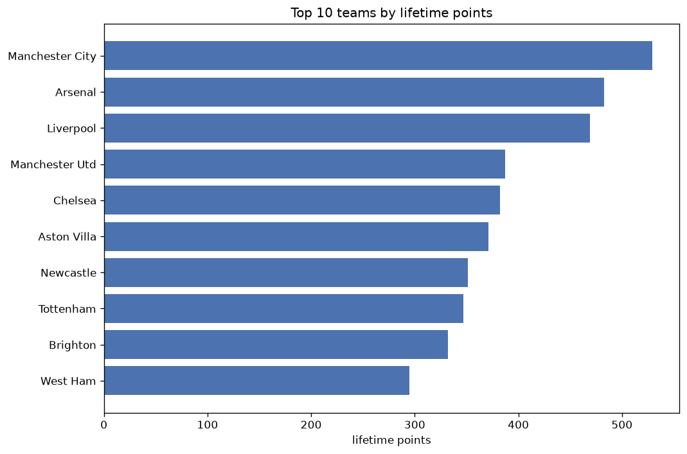
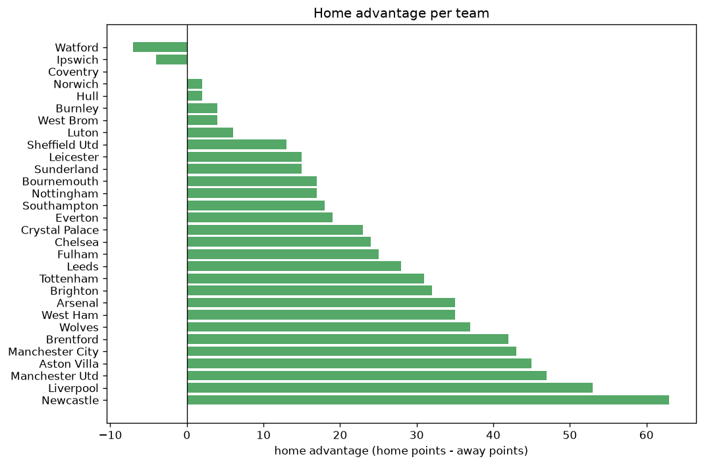

# Team Analysis
- Report: `teams_analysis`
- Generated: 2026-10-27T02:25:47+00:00
- Script: `backend/scripts/analyze_teams.py` v1.0.0
- League: Premier League (England)
- Scope: league `premier`

- Teams: **30** | Seasons: **7** | Matches: **2360**

## 1. Team standings (lifetime)
| team | seasons | played | W | D | L | pts | GF | GA | GD | avg pts/season | best pos | worst pos | titles |
|---|---|---|---|---|---|---|---|---|---|---|---|---|---|
| Manchester City | 7 | 236 | 163 | 40 | 33 | 529 | 541 | 213 | 328 | 75.57 | 1 | 3 | 5 |
| Arsenal | 7 | 236 | 147 | 42 | 47 | 483 | 448 | 225 | 223 | 69.0 | 1 | 8 | 1 |
| Liverpool | 7 | 236 | 137 | 58 | 41 | 469 | 483 | 258 | 225 | 67.0 | 1 | 5 | 1 |
| Manchester Utd | 7 | 236 | 110 | 57 | 69 | 387 | 368 | 319 | 49 | 55.29 | 2 | 16 | 0 |
| Chelsea | 7 | 236 | 107 | 61 | 68 | 382 | 388 | 289 | 99 | 54.57 | 3 | 12 | 0 |
| Aston Villa | 7 | 236 | 108 | 47 | 81 | 371 | 357 | 319 | 38 | 53.0 | 4 | 14 | 0 |
| Newcastle | 7 | 236 | 99 | 54 | 83 | 351 | 376 | 335 | 41 | 50.14 | 4 | 12 | 0 |
| Tottenham | 7 | 236 | 101 | 44 | 91 | 347 | 401 | 341 | 60 | 49.57 | 4 | 17 | 0 |
| Brighton | 7 | 236 | 86 | 74 | 76 | 332 | 350 | 317 | 33 | 47.43 | 3 | 16 | 0 |
| West Ham | 6 | 228 | 81 | 52 | 95 | 295 | 316 | 354 | -38 | 49.17 | 6 | 18 | 0 |
| Crystal Palace | 7 | 236 | 73 | 72 | 91 | 291 | 289 | 340 | -51 | 41.57 | 10 | 17 | 0 |
| Everton | 7 | 236 | 75 | 64 | 97 | 289 | 261 | 325 | -64 | 41.29 | 10 | 17 | 0 |
| Brentford | 6 | 198 | 70 | 54 | 74 | 264 | 297 | 285 | 12 | 44.0 | 6 | 16 | 0 |
| Wolves | 6 | 228 | 66 | 47 | 115 | 245 | 236 | 355 | -119 | 40.83 | 10 | 20 | 0 |
| Fulham | 6 | 198 | 65 | 46 | 87 | 241 | 246 | 282 | -36 | 40.17 | 10 | 18 | 0 |
| Bournemouth | 5 | 160 | 54 | 47 | 59 | 209 | 219 | 251 | -32 | 41.8 | 6 | 15 | 0 |
| Nottingham | 5 | 160 | 49 | 42 | 69 | 189 | 199 | 242 | -43 | 37.8 | 7 | 18 | 0 |
| Leeds | 5 | 160 | 47 | 45 | 68 | 186 | 210 | 273 | -63 | 37.2 | 7 | 19 | 0 |
| Leicester | 4 | 152 | 49 | 30 | 73 | 177 | 214 | 257 | -43 | 44.25 | 5 | 18 | 0 |
| Burnley | 4 | 152 | 26 | 42 | 84 | 120 | 146 | 261 | -115 | 30.0 | 17 | 19 | 0 |
| Southampton | 4 | 152 | 29 | 33 | 90 | 120 | 152 | 294 | -142 | 30.0 | 15 | 20 | 0 |
| Sunderland | 2 | 46 | 15 | 14 | 17 | 59 | 48 | 62 | -14 | 29.5 | 7 | 20 | 0 |
| Sheffield Utd | 2 | 76 | 10 | 9 | 57 | 39 | 55 | 167 | -112 | 19.5 | 20 | 20 | 0 |
| Ipswich | 2 | 46 | 7 | 11 | 28 | 32 | 48 | 98 | -50 | 16.0 | 12 | 19 | 0 |
| Luton | 1 | 38 | 6 | 8 | 24 | 26 | 52 | 85 | -33 | 26.0 | 18 | 18 | 0 |
| West Brom | 1 | 38 | 5 | 11 | 22 | 26 | 35 | 76 | -41 | 26.0 | 19 | 19 | 0 |
| Watford | 1 | 38 | 6 | 5 | 27 | 23 | 34 | 77 | -43 | 23.0 | 19 | 19 | 0 |
| Norwich | 1 | 38 | 5 | 7 | 26 | 22 | 23 | 84 | -61 | 22.0 | 20 | 20 | 0 |
| Hull | 1 | 8 | 2 | 4 | 2 | 10 | 9 | 8 | 1 | 10.0 | 10 | 10 | 0 |
| Coventry | 1 | 8 | 2 | 0 | 6 | 6 | 6 | 15 | -9 | 6.0 | 19 | 19 | 0 |

## 2. Home vs away split
| team | home P | H-W | H-D | H-L | H-pts | away P | A-W | A-D | A-L | A-pts | adv |
|---|---|---|---|---|---|---|---|---|---|---|---|
| Newcastle | 118 | 60 | 27 | 31 | 207 | 118 | 39 | 27 | 52 | 144 | 63 |
| Liverpool | 118 | 78 | 27 | 13 | 261 | 118 | 59 | 31 | 28 | 208 | 53 |
| Manchester Utd | 118 | 65 | 22 | 31 | 217 | 118 | 45 | 35 | 38 | 170 | 47 |
| Aston Villa | 118 | 61 | 25 | 32 | 208 | 118 | 47 | 22 | 49 | 163 | 45 |
| Manchester City | 118 | 90 | 16 | 12 | 286 | 118 | 73 | 24 | 21 | 243 | 43 |
| Brentford | 99 | 41 | 30 | 28 | 153 | 99 | 29 | 24 | 46 | 111 | 42 |
| Wolves | 114 | 40 | 21 | 53 | 141 | 114 | 26 | 26 | 62 | 104 | 37 |
| Arsenal | 118 | 80 | 19 | 19 | 259 | 118 | 67 | 23 | 28 | 224 | 35 |
| West Ham | 114 | 45 | 30 | 39 | 165 | 114 | 36 | 22 | 56 | 130 | 35 |
| Brighton | 118 | 47 | 41 | 30 | 182 | 118 | 39 | 33 | 46 | 150 | 32 |
| Tottenham | 118 | 58 | 15 | 45 | 189 | 118 | 43 | 29 | 46 | 158 | 31 |
| Leeds | 80 | 27 | 26 | 27 | 107 | 80 | 20 | 19 | 41 | 79 | 28 |
| Fulham | 99 | 38 | 19 | 42 | 133 | 99 | 27 | 27 | 45 | 108 | 25 |
| Chelsea | 118 | 56 | 35 | 27 | 203 | 118 | 51 | 26 | 41 | 179 | 24 |
| Crystal Palace | 118 | 39 | 40 | 39 | 157 | 118 | 34 | 32 | 52 | 134 | 23 |
| Everton | 118 | 42 | 28 | 48 | 154 | 118 | 33 | 36 | 49 | 135 | 19 |
| Southampton | 76 | 17 | 18 | 41 | 69 | 76 | 12 | 15 | 49 | 51 | 18 |
| Bournemouth | 80 | 29 | 26 | 25 | 113 | 80 | 25 | 21 | 34 | 96 | 17 |
| Nottingham | 80 | 26 | 25 | 29 | 103 | 80 | 23 | 17 | 40 | 86 | 17 |
| Leicester | 76 | 28 | 12 | 36 | 96 | 76 | 21 | 18 | 37 | 81 | 15 |
| Sunderland | 23 | 10 | 7 | 6 | 37 | 23 | 5 | 7 | 11 | 22 | 15 |
| Sheffield Utd | 38 | 7 | 5 | 26 | 26 | 38 | 3 | 4 | 31 | 13 | 13 |
| Luton | 19 | 4 | 4 | 11 | 16 | 19 | 2 | 4 | 13 | 10 | 6 |
| Burnley | 76 | 13 | 23 | 40 | 62 | 76 | 13 | 19 | 44 | 58 | 4 |
| West Brom | 19 | 3 | 6 | 10 | 15 | 19 | 2 | 5 | 12 | 11 | 4 |
| Norwich | 19 | 3 | 3 | 13 | 12 | 19 | 2 | 4 | 13 | 10 | 2 |
| Hull | 4 | 1 | 3 | 0 | 6 | 4 | 1 | 1 | 2 | 4 | 2 |
| Coventry | 4 | 1 | 0 | 3 | 3 | 4 | 1 | 0 | 3 | 3 | 0 |
| Ipswich | 23 | 3 | 5 | 15 | 14 | 23 | 4 | 6 | 13 | 18 | -4 |
| Watford | 19 | 2 | 2 | 15 | 8 | 19 | 4 | 3 | 12 | 15 | -7 |

## 3. Top performers
### Best points per game (PPG)
| rank | team | PPG |
|---|---|---|
| 1 | Manchester City | 2.24 |
| 2 | Arsenal | 2.05 |
| 3 | Liverpool | 1.99 |
| 4 | Manchester Utd | 1.64 |
| 5 | Chelsea | 1.62 |

### Most goals scored
| rank | team | goals |
|---|---|---|
| 1 | Manchester City | 541 |
| 2 | Liverpool | 483 |
| 3 | Arsenal | 448 |
| 4 | Tottenham | 401 |
| 5 | Chelsea | 388 |

### Best goal difference
| rank | team | GD |
|---|---|---|
| 1 | Manchester City | 328 |
| 2 | Liverpool | 225 |
| 3 | Arsenal | 223 |
| 4 | Chelsea | 99 |
| 5 | Tottenham | 60 |

### Best defence (goals against per match, standings)
| rank | team | GA/match |
|---|---|---|
| 1 | Manchester City | 0.903 |
| 2 | Arsenal | 0.953 |
| 3 | Hull | 1.000 |
| 4 | Liverpool | 1.093 |
| 5 | Chelsea | 1.225 |

## 4. Team consistency
- Teams present in all **7** seasons: **11**

Arsenal, Aston Villa, Brighton, Chelsea, Crystal Palace, Everton, Liverpool, Manchester City, Manchester Utd, Newcastle, Tottenham

## 5. Head-to-head dominance
- Distinct fixtures: **360** (showing the 15 most frequent)

| fixture | meetings | home wins | draws | away wins | home pct | draw pct | away pct |
|---|---|---|---|---|---|---|---|
| Manchester City vs Aston Villa | 13 | 9 | 1 | 3 | 69.2% | 7.7% | 23.1% |
| Arsenal vs Everton | 13 | 8 | 2 | 3 | 61.5% | 15.4% | 23.1% |
| Aston Villa vs Newcastle | 13 | 8 | 2 | 3 | 61.5% | 15.4% | 23.1% |
| Chelsea vs Everton | 13 | 8 | 3 | 2 | 61.5% | 23.1% | 15.4% |
| Liverpool vs Brighton | 13 | 7 | 4 | 2 | 53.8% | 30.8% | 15.4% |
| Arsenal vs Aston Villa | 13 | 6 | 1 | 6 | 46.2% | 7.7% | 46.2% |
| Aston Villa vs Brighton | 13 | 6 | 2 | 5 | 46.2% | 15.4% | 38.5% |
| Chelsea vs Arsenal | 13 | 6 | 3 | 4 | 46.2% | 23.1% | 30.8% |
| Chelsea vs Brighton | 13 | 6 | 3 | 4 | 46.2% | 23.1% | 30.8% |
| Everton vs Crystal Palace | 13 | 6 | 4 | 3 | 46.2% | 30.8% | 23.1% |
| Manchester City vs Manchester Utd | 13 | 6 | 2 | 5 | 46.2% | 15.4% | 38.5% |
| Newcastle vs Crystal Palace | 13 | 6 | 4 | 3 | 46.2% | 30.8% | 23.1% |
| Tottenham vs Everton | 13 | 6 | 5 | 2 | 46.2% | 38.5% | 15.4% |
| Chelsea vs Tottenham | 13 | 5 | 2 | 6 | 38.5% | 15.4% | 46.2% |
| Liverpool vs Newcastle | 13 | 5 | 4 | 4 | 38.5% | 30.8% | 30.8% |

## 6. Position per season (classic view)
_Cells show final position; '-' when the team was absent from that season._

| team | 2020-2021 | 2021-2022 | 2022-2023 | 2023-2024 | 2024-2025 | 2025-2026 | 2026-2027 |
|---|---|---|---|---|---|---|---|
| Manchester City | 1 | 1 | 1 | 1 | 3 | 2 | 1 |
| Arsenal | 8 | 5 | 2 | 2 | 2 | 1 | 2 |
| Liverpool | 3 | 2 | 5 | 3 | 1 | 5 | 4 |
| Manchester Utd | 2 | 6 | 3 | 8 | 15 | 3 | 16 |
| Chelsea | 4 | 3 | 12 | 6 | 4 | 10 | 5 |
| Aston Villa | 11 | 14 | 7 | 4 | 6 | 4 | 9 |
| Newcastle | 12 | 11 | 4 | 7 | 5 | 12 | 8 |
| Tottenham | 7 | 4 | 8 | 5 | 17 | 17 | 14 |
| Brighton | 16 | 9 | 6 | 11 | 8 | 8 | 3 |
| West Ham | 6 | 7 | 14 | 9 | 14 | 18 | - |
| Crystal Palace | 14 | 12 | 11 | 10 | 12 | 15 | 17 |
| Everton | 10 | 16 | 17 | 12 | 13 | 13 | 11 |
| Brentford | - | 13 | 9 | 16 | 10 | 9 | 6 |
| Wolves | 13 | 10 | 13 | 15 | 16 | 20 | - |
| Fulham | 18 | - | 10 | 14 | 11 | 11 | 15 |
| Bournemouth | - | - | 15 | 13 | 9 | 6 | 13 |
| Nottingham | - | - | 16 | 17 | 7 | 16 | 18 |
| Leeds | 9 | 17 | 19 | - | - | 14 | 7 |
| Leicester | 5 | 8 | 18 | - | 18 | - | - |
| Burnley | 17 | 18 | - | 19 | - | 19 | - |
| Southampton | 15 | 15 | 20 | - | 20 | - | - |
| Sunderland | - | - | - | - | - | 7 | 20 |
| Sheffield Utd | 20 | - | - | 20 | - | - | - |
| Ipswich | - | - | - | - | 19 | - | 12 |
| Luton | - | - | - | 18 | - | - | - |
| West Brom | 19 | - | - | - | - | - | - |
| Watford | - | 19 | - | - | - | - | - |
| Norwich | - | 20 | - | - | - | - | - |
| Hull | - | - | - | - | - | - | 10 |
| Coventry | - | - | - | - | - | - | 19 |

---
*All statistics are computed from PostgreSQL tables (read-only). Run with `python backend/scripts/analyze_teams.py` to regenerate.*

## Charts

