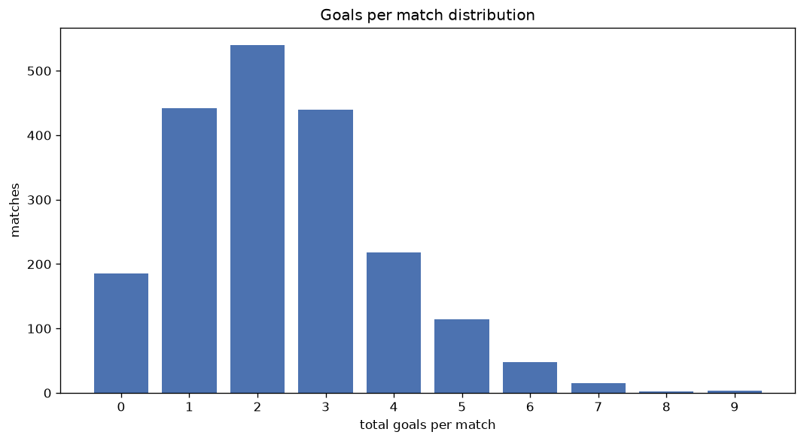
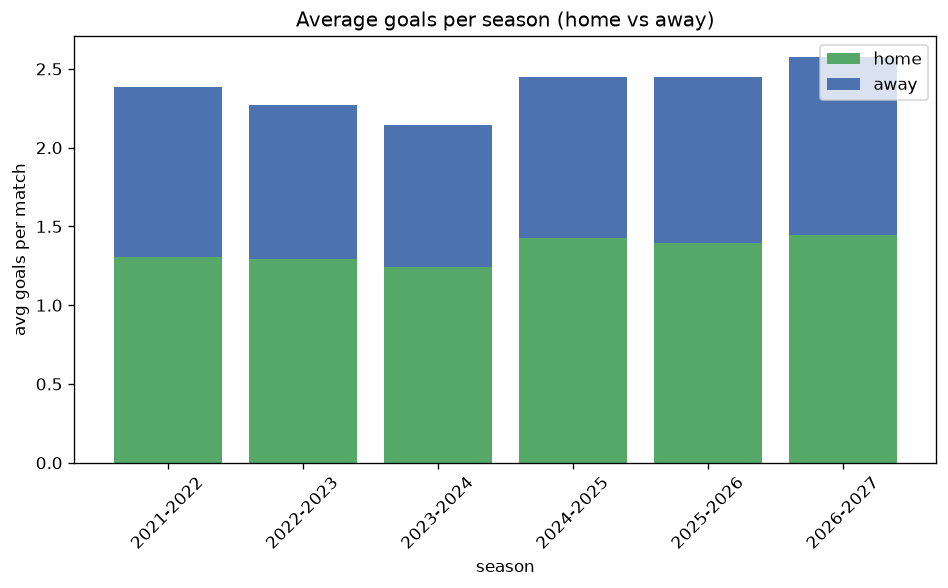

# Goal Analysis
- Report: `goals_analysis`
- Generated: 2026-10-27T02:26:08+00:00
- Script: `backend/scripts/analyze_goals.py` v1.0.0
- League: Primera RFEF - Group 1 (Spain)
- Scope: league `primera1`

## 1. Goals per match distribution
| goals | matches | pct |
|---|---|---|
| 0 | 186 | 9.3% |
| 1 | 442 | 22.0% |
| 2 | 540 | 26.9% |
| 3 | 440 | 21.9% |
| 4 | 218 | 10.9% |
| 5 | 114 | 5.7% |
| 6 | 48 | 2.4% |
| 7 | 15 | 0.7% |
| 8 | 2 | 0.1% |
| 9 | 3 | 0.1% |

## 2. Goals per match per season
| season | matches | total goals | avg home | avg away | avg total |
|---|---|---|---|---|---|
| 2021-2022 | 380 | 907 | 1.308 | 1.079 | 2.387 |
| 2022-2023 | 380 | 862 | 1.295 | 0.974 | 2.268 |
| 2023-2024 | 380 | 815 | 1.245 | 0.9 | 2.145 |
| 2024-2025 | 380 | 930 | 1.429 | 1.018 | 2.447 |
| 2025-2026 | 398 | 974 | 1.392 | 1.055 | 2.447 |
| 2026-2027 | 90 | 232 | 1.444 | 1.133 | 2.578 |

## 3. Home vs away goal share
- Home goals: **2689** (57.0%)
- Away goals: **2031** (43.0%)
- Home/away ratio: **1.324**

| season | home goals | away goals | total | home pct | away pct |
|---|---|---|---|---|---|
| 2021-2022 | 497 | 410 | 907 | 54.8% | 45.2% |
| 2022-2023 | 492 | 370 | 862 | 57.1% | 42.9% |
| 2023-2024 | 473 | 342 | 815 | 58.0% | 42.0% |
| 2024-2025 | 543 | 387 | 930 | 58.4% | 41.6% |
| 2025-2026 | 554 | 420 | 974 | 56.9% | 43.1% |
| 2026-2027 | 130 | 102 | 232 | 56.0% | 44.0% |

## 4. BTTS (Both Teams To Score)
- Overall: **965** of `2008` (48.1%)

| season | matches | BTTS | pct |
|---|---|---|---|
| 2021-2022 | 380 | 173 | 45.5% |
| 2022-2023 | 380 | 181 | 47.6% |
| 2023-2024 | 380 | 173 | 45.5% |
| 2024-2025 | 380 | 196 | 51.6% |
| 2025-2026 | 398 | 196 | 49.2% |
| 2026-2027 | 90 | 46 | 51.1% |

## 5. Clean sheets
- Home clean sheets: **732** (36.5%)
- Away clean sheets: **497** (24.8%)
- Total clean sheets recorded: **1229**
- Matches with at least one clean sheet: **1043** (51.9%)
- Both teams kept clean sheets (0-0): **186**

| season | matches | home CS | away CS | total CS | matches w/ CS |
|---|---|---|---|---|---|
| 2021-2022 | 380 | 133 | 106 | 239 | 207 (54.5%) |
| 2022-2023 | 380 | 144 | 89 | 233 | 199 (52.4%) |
| 2023-2024 | 380 | 149 | 108 | 257 | 207 (54.5%) |
| 2024-2025 | 380 | 126 | 83 | 209 | 184 (48.4%) |
| 2025-2026 | 398 | 146 | 95 | 241 | 202 (50.8%) |
| 2026-2027 | 90 | 34 | 16 | 50 | 44 (48.9%) |

## 6. Scoring intensity
- First-half goals: **2016** (43.0%)
- Second-half goals: **2669** (57.0%)
- Avg first-half goals per match: **1.012**
- Avg second-half goals per match: **1.34**
- Second-half-only scoring (HT 0-0, FT goals >= 1): **536** (26.7%)
- *16 match(es) excluded (no HT score recorded).*

| season | matches | 1st half | 2nd half | 1st half pct | 2nd half pct |
|---|---|---|---|---|---|
| 2021-2022 | 380 | 405 | 470 | 46.3% | 53.7% |
| 2022-2023 | 380 | 378 | 484 | 43.9% | 56.1% |
| 2023-2024 | 380 | 339 | 473 | 41.7% | 58.3% |
| 2024-2025 | 380 | 384 | 546 | 41.3% | 58.7% |
| 2025-2026 | 398 | 419 | 555 | 43.0% | 57.0% |
| 2026-2027 | 90 | 91 | 141 | 39.2% | 60.8% |

## 7. First-goal timing
- Matches with first-goal time recorded: `1806` of `2008` (89.9%)
- Goalless matches: `202`
- Min `1` | Max `99` | Mean `34.19` | Median (p50) `29.0`

| bucket | count | % of matches | % of scoring matches |
|---|---|---|---|
| 1-15 | 525 | 26.1% | 29.1% |
| 16-30 | 413 | 20.6% | 22.9% |
| 31-45 | 315 | 15.7% | 17.4% |
| 46-60 | 250 | 12.5% | 13.8% |
| 61-75 | 168 | 8.4% | 9.3% |
| 76-90 | 101 | 5.0% | 5.6% |
| 91-120 | 34 | 1.7% | 1.9% |

---
*All statistics are computed from PostgreSQL tables (read-only). Run with `python backend/scripts/analyze_goals.py` to regenerate.*

## Charts

