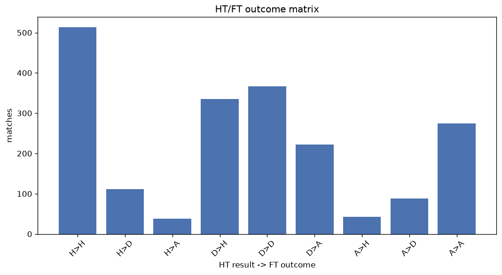
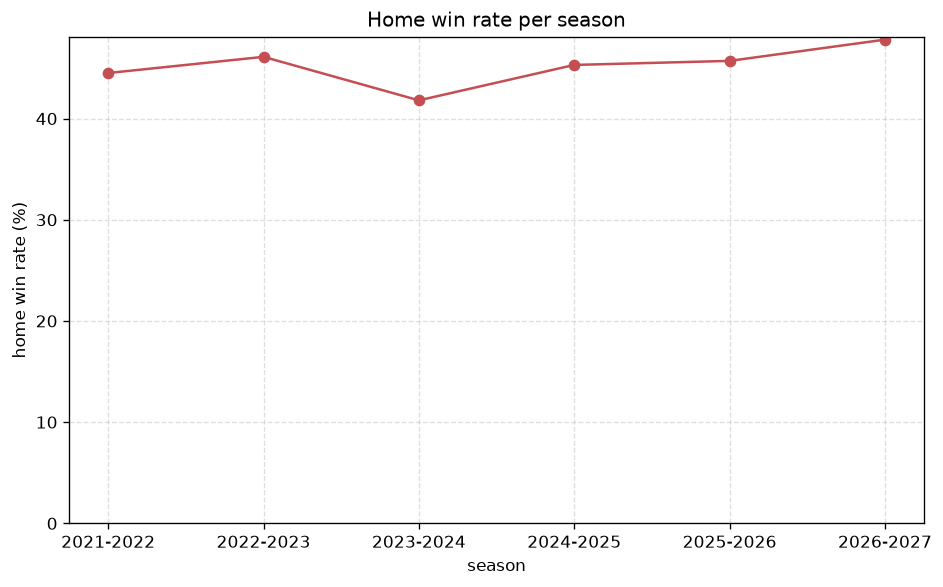

# Match Analysis
- Report: `matches_analysis`
- Generated: 2026-10-27T02:26:06+00:00
- Script: `backend/scripts/analyze_matches.py` v1.0.0
- League: Primera RFEF - Group 1 (Spain)
- Scope: league `primera1`

## 1. Overall summary
| metric | value |
|---|---|
| Matches | 2008 |
| Home wins | 900 (44.8%) |
| Draws | 566 (28.2%) |
| Away wins | 542 (27.0%) |
| Total goals | 4720 |
| Average goals per match | 2.351 |
| Goalless matches | 186 (9.3%) |

## 2. Per-season breakdown
| season | matches | home wins | draws | away wins | total goals | avg goals | goalless |
|---|---|---|---|---|---|---|---|
| 2021-2022 | 380 | 169 (44.5%) | 94 (24.7%) | 117 (30.8%) | 907 | 2.387 | 32 (8.4%) |
| 2022-2023 | 380 | 175 (46.1%) | 103 (27.1%) | 102 (26.8%) | 862 | 2.268 | 34 (8.9%) |
| 2023-2024 | 380 | 159 (41.8%) | 121 (31.8%) | 100 (26.3%) | 815 | 2.145 | 50 (13.2%) |
| 2024-2025 | 380 | 172 (45.3%) | 112 (29.5%) | 96 (25.3%) | 930 | 2.447 | 25 (6.6%) |
| 2025-2026 | 398 | 182 (45.7%) | 113 (28.4%) | 103 (25.9%) | 974 | 2.447 | 39 (9.8%) |
| 2026-2027 | 90 | 43 (47.8%) | 23 (25.6%) | 24 (26.7%) | 232 | 2.578 | 6 (6.7%) |

## 3. HT/FT outcome matrix
| HT result \ FT result | Home | Draw | Away | total |
|---|---|---|---|---|
| HT home lead | 513 (77.5%) | 111 (16.8%) | 38 (5.7%) | 662 |
| HT draw | 335 (36.3%) | 367 (39.7%) | 222 (24.0%) | 924 |
| HT away lead | 43 (10.6%) | 88 (21.7%) | 275 (67.7%) | 406 |
- *16 match(es) excluded (no HT score recorded).*

## 4. Comeback matches
- Home comebacks (trailing at HT, won at FT): **43** (2.1%)
- Away comebacks (trailing at HT, won at FT): **38** (1.9%)

### Home comebacks
| season | home | away | HT | FT |
|---|---|---|---|---|
| 2021-2022 | Cultural Leonesa | Ath Bilbao B | 0-1 | 2-1 |
| 2021-2022 | Cultural Leonesa | Valladolid Promesas | 0-2 | 4-2 |
| 2021-2022 | Calahorra | San Sebastian Reyes | 0-1 | 3-2 |
| 2021-2022 | CD Badajoz | Tudelano | 0-1 | 2-1 |
| 2021-2022 | Celta Vigo B | SD Logrones | 0-1 | 3-2 |
| 2021-2022 | Zamora | Unionistas | 0-1 | 2-1 |
| 2021-2022 | Unionistas | Rayo Majadahonda | 0-1 | 2-1 |
| 2021-2022 | Calahorra | SD Logrones | 0-1 | 2-1 |
| 2021-2022 | Rayo Majadahonda | Unionistas | 1-2 | 4-3 |
| 2021-2022 | Valladolid Promesas | CF Talavera | 0-1 | 2-1 |
| 2021-2022 | Dep. La Coruna | Tudelano | 2-3 | 4-3 |
| 2022-2023 | Dep. La Coruna | Linense | 0-1 | 2-1 |
| 2022-2023 | Fuenlabrada | Ceuta | 0-1 | 2-1 |
| 2022-2023 | Alcorcon | San Fernando | 0-1 | 2-1 |
| 2022-2023 | Fuenlabrada | CF Talavera | 0-1 | 2-1 |
| 2022-2023 | Cordoba | Linares | 0-1 | 2-1 |
| 2022-2023 | Linense | Ceuta | 0-1 | 2-1 |
| 2022-2023 | Ceuta | San Sebastian Reyes | 0-1 | 3-1 |
| 2022-2023 | Real Madrid B | Algeciras | 0-1 | 2-1 |
| 2022-2023 | Linares | Dep. La Coruna | 0-2 | 3-2 |
| 2023-2024 | Fuenlabrada | Dep. La Coruna | 0-1 | 2-1 |
| 2023-2024 | Barcelona B | Osasuna B | 0-1 | 2-1 |
| 2023-2024 | Sabadell | Celta Vigo B | 0-1 | 2-1 |
| 2023-2024 | Fuenlabrada | Sestao | 0-1 | 3-1 |
| 2023-2024 | Lugo | Sestao | 1-3 | 4-3 |
| 2024-2025 | Unionistas | Barcelona B | 0-1 | 2-1 |
| 2024-2025 | Real Sociedad B | Osasuna B | 0-1 | 3-1 |
| 2024-2025 | Ponferradina | Amorebieta | 1-2 | 5-2 |
| 2024-2025 | Ourense CF | Lugo | 0-1 | 2-1 |
| 2024-2025 | R. Union | Unionistas | 1-2 | 3-2 |
| 2024-2025 | Unionistas | Ourense CF | 0-1 | 2-1 |
| 2024-2025 | Andorra | Zamora | 0-1 | 2-1 |
| 2024-2025 | Barakaldo | Lugo | 1-2 | 3-2 |
| 2024-2025 | Ponferradina | Cultural Leonesa | 0-1 | 2-1 |
| 2024-2025 | Barcelona B | Unionistas | 0-1 | 2-1 |
| 2025-2026 | Lugo | Racing Club Ferrol | 0-1 | 2-1 |
| 2025-2026 | Real Aviles | Ath Bilbao B | 0-1 | 3-2 |
| 2025-2026 | Celta Vigo B | CF Talavera | 0-3 | 4-3 |
| 2025-2026 | Ourense CF | Real Aviles | 0-1 | 2-1 |
| 2025-2026 | CF Talavera | Arenas Getxo | 0-1 | 2-1 |
| 2025-2026 | Ourense CF | Tenerife | 0-1 | 2-1 |
| 2026-2027 | Dep. Fabril | Ponferradina | 0-1 | 2-1 |
| 2026-2027 | CD Coria | Ath Bilbao B | 0-1 | 2-1 |

### Away comebacks
| season | home | away | HT | FT |
|---|---|---|---|---|
| 2021-2022 | Internacional de Madrid | Calahorra | 1-0 | 2-3 |
| 2021-2022 | Internacional de Madrid | Rayo Majadahonda | 1-0 | 2-4 |
| 2021-2022 | Valladolid Promesas | Zamora | 1-0 | 1-3 |
| 2021-2022 | Valladolid Promesas | Racing Club Ferrol | 1-0 | 1-2 |
| 2021-2022 | Tudelano | Valladolid Promesas | 1-0 | 1-2 |
| 2022-2023 | Ceuta | Alcorcon | 1-0 | 1-2 |
| 2022-2023 | San Fernando | Celta Vigo B | 1-0 | 1-2 |
| 2022-2023 | CD Badajoz | Cordoba | 2-1 | 2-4 |
| 2022-2023 | Ceuta | Pontevedra | 1-0 | 1-2 |
| 2022-2023 | Rayo Majadahonda | Real Madrid B | 1-0 | 1-2 |
| 2022-2023 | Cordoba | Merida AD | 1-0 | 1-2 |
| 2022-2023 | Fuenlabrada | Real Madrid B | 1-0 | 1-2 |
| 2022-2023 | San Sebastian Reyes | Rayo Majadahonda | 1-0 | 1-2 |
| 2022-2023 | Algeciras | Ceuta | 1-0 | 1-2 |
| 2022-2023 | Real Madrid B | Rayo Majadahonda | 1-0 | 1-2 |
| 2023-2024 | Celta Vigo B | Cornella | 1-0 | 1-2 |
| 2023-2024 | SD Logrones | Celta Vigo B | 1-0 | 2-3 |
| 2023-2024 | Arenteiro | Dep. La Coruna | 1-0 | 1-2 |
| 2023-2024 | Tarazona | Arenteiro | 1-0 | 1-2 |
| 2023-2024 | Osasuna B | Barcelona B | 2-1 | 2-3 |
| 2023-2024 | Arenteiro | Lugo | 1-0 | 1-3 |
| 2023-2024 | Teruel | Osasuna B | 1-0 | 2-3 |
| 2023-2024 | Celta Vigo B | Barcelona B | 1-0 | 1-2 |
| 2024-2025 | Ponferradina | Sestao | 1-0 | 1-2 |
| 2024-2025 | Unionistas | Osasuna B | 1-0 | 1-3 |
| 2024-2025 | Barakaldo | Sestao | 1-0 | 2-3 |
| 2024-2025 | Andorra | Sestao | 1-0 | 1-2 |
| 2025-2026 | Osasuna B | Racing Club Ferrol | 1-0 | 1-2 |
| 2025-2026 | Ath Bilbao B | Celta Vigo B | 1-0 | 1-2 |
| 2025-2026 | Ath Bilbao B | CF Talavera | 1-0 | 1-2 |
| 2025-2026 | Zamora | Unionistas | 1-0 | 2-3 |
| 2025-2026 | CF Talavera | Real Madrid B | 1-0 | 1-2 |
| 2025-2026 | Zamora | Cacereno | 1-0 | 1-2 |
| 2025-2026 | Cacereno | CF Talavera | 1-0 | 1-2 |
| 2026-2027 | Real Aviles | Lugo | 1-0 | 1-2 |
| 2026-2027 | CD Coria | CD Extremadura | 2-0 | 2-4 |
| 2026-2027 | Real Aviles | UD Logrones | 1-0 | 1-3 |
| 2026-2027 | Cultural Leonesa | Pontevedra | 1-0 | 1-2 |

## 5. HT lead conversion
| HT state | matches | converted to win | held as draw | collapsed to loss |
|---|---|---|---|---|
| Home lead | 662 | 513 (77.5%) | 111 (16.8%) | 38 (5.7%) |
| Away lead | 406 | 275 (67.7%) | 88 (21.7%) | 43 (10.6%) |

### Matches level at half-time
| FT result | count | pct |
|---|---|---|
| Home win | 335 | 36.3% |
| Draw | 367 | 39.7% |
| Away win | 222 | 24.0% |
- *16 match(es) excluded (no HT score recorded).*

## 6. First-goal timing
- Matches with a first-goal time recorded: `1806` of `2008` (89.9%)

Outcome distribution by first-goal timing bucket:
| bucket | matches | % of matches | home | draw | away |
|---|---|---|---|---|---|
| 1-15 | 525 | 26.1% | 263 (50.1%) | 105 (20.0%) | 157 (29.9%) |
| 16-30 | 413 | 20.6% | 197 (47.7%) | 107 (25.9%) | 109 (26.4%) |
| 31-45 | 315 | 15.7% | 159 (50.5%) | 61 (19.4%) | 95 (30.2%) |
| 46-60 | 250 | 12.5% | 117 (46.8%) | 55 (22.0%) | 78 (31.2%) |
| 61-75 | 168 | 8.4% | 87 (51.8%) | 31 (18.5%) | 50 (29.8%) |
| 76-90 | 101 | 5.0% | 48 (47.5%) | 20 (19.8%) | 33 (32.7%) |
| 91-120 | 34 | 1.7% | 20 (58.8%) | 1 (2.9%) | 13 (38.2%) |

## 7. Goalless matches
- Overall: **186** of `2008` (9.3%)

| season | matches | goalless | pct |
|---|---|---|---|
| 2021-2022 | 380 | 32 | 8.4% |
| 2022-2023 | 380 | 34 | 8.9% |
| 2023-2024 | 380 | 50 | 13.2% |
| 2024-2025 | 380 | 25 | 6.6% |
| 2025-2026 | 398 | 39 | 9.8% |
| 2026-2027 | 90 | 6 | 6.7% |

---
*All statistics are computed from PostgreSQL tables (read-only). Run with `python backend/scripts/analyze_matches.py` to regenerate.*

## Charts

