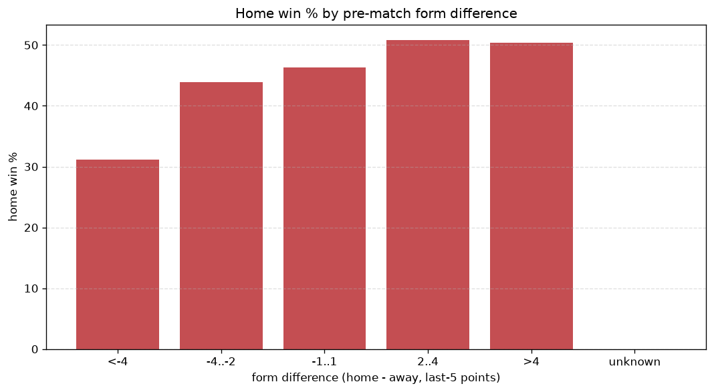
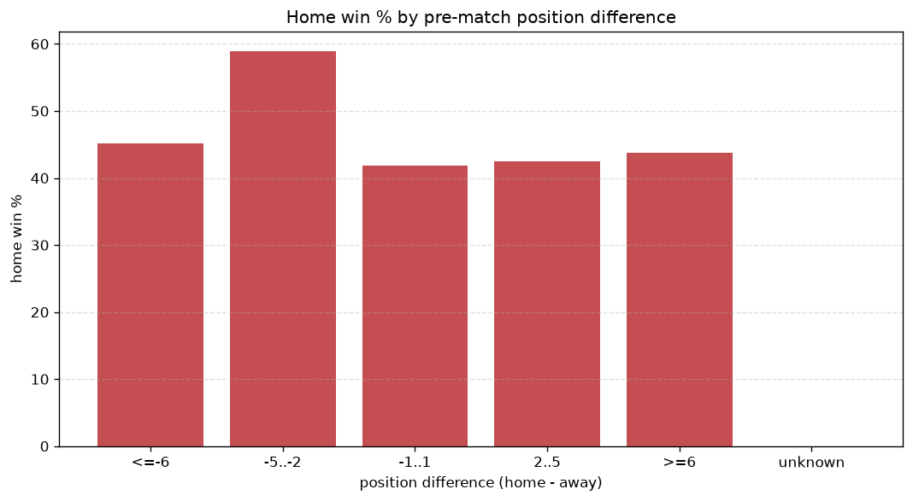

# Relationships Analysis
- Report: `relationships`
- Generated: 2026-10-30T04:06:39+00:00
- Script: `backend/scripts/analyze_relationships.py` v1.0.0
- League: Primera RFEF - Group 1 (Spain)
- Scope: league `primera1`

- Matches analysed: **1918** (23 leakage-safe pre-match features).

## 1. Correlation matrix
_Pearson correlation of each pre-match feature with observed goals; sorted by |corr(total goals)|._

| feature | corr(home) | corr(away) | corr(total) |
|---|---|---|---|
| away_team_away_conceded_avg | 0.138 | 0.026 | 0.121 |
| away_team_goals_conceded_last_5 | 0.110 | -0.006 | 0.078 |
| home_team_goals_scored_last_5 | 0.085 | 0.002 | 0.065 |
| home_team_home_goals_avg | 0.103 | -0.024 | 0.062 |
| home_team_home_win_rate | 0.087 | -0.015 | 0.055 |
| position_difference | -0.148 | 0.090 | -0.051 |
| away_team_goals_scored_last_5 | -0.029 | 0.107 | 0.050 |
| home_team_wins_last_5 | 0.071 | -0.006 | 0.049 |
| away_position_before_match | 0.111 | -0.054 | 0.047 |
| home_team_points_last_5 | 0.078 | -0.016 | 0.047 |
| home_points_before_match | 0.073 | -0.018 | 0.042 |
| away_team_away_goals_avg | -0.012 | 0.075 | 0.041 |
| points_difference | 0.153 | -0.114 | 0.038 |
| home_team_home_conceded_avg | -0.002 | 0.058 | 0.037 |
| away_team_away_win_rate | -0.072 | 0.038 | -0.028 |
| home_team_goals_conceded_last_5 | -0.029 | 0.069 | 0.024 |
| rest_days_difference | -0.021 | -0.012 | -0.024 |
| home_position_before_match | -0.095 | 0.071 | -0.023 |
| away_team_points_last_5 | -0.065 | 0.106 | 0.022 |
| away_points_before_match | -0.024 | 0.054 | 0.018 |
| away_team_wins_last_5 | -0.071 | 0.105 | 0.017 |
| away_rest_days | 0.010 | 0.004 | 0.010 |
| home_rest_days | -0.004 | -0.004 | -0.006 |

## 2. Form vs outcome
_Home win/draw/away % per bucket of `home_team_points_last_5 - away_team_points_last_5`._

| bucket | matches | home | draw | away | home % | draw % | away % |
|---|---|---|---|---|---|---|---|
| <-4 | 309 | 96 | 99 | 114 | 31.1% | 32.0% | 36.9% |
| -4..-2 | 433 | 190 | 120 | 123 | 43.9% | 27.7% | 28.4% |
| -1..1 | 566 | 262 | 159 | 145 | 46.3% | 28.1% | 25.6% |
| 2..4 | 360 | 183 | 99 | 78 | 50.8% | 27.5% | 21.7% |
| >4 | 250 | 126 | 66 | 58 | 50.4% | 26.4% | 23.2% |
| unknown | 0 | 0 | 0 | 0 | - | - | - |

## 3. Position vs outcome
_Home win/draw/away % per bucket of `position_difference` (home position - away position; negative favours the home team)._

| bucket | matches | home | draw | away | home % | draw % | away % |
|---|---|---|---|---|---|---|---|
| <=-6 | 481 | 249 | 132 | 100 | 51.8% | 27.4% | 20.8% |
| -5..-2 | 332 | 165 | 83 | 84 | 49.7% | 25.0% | 25.3% |
| -1..1 | 251 | 114 | 80 | 57 | 45.4% | 31.9% | 22.7% |
| 2..5 | 314 | 133 | 89 | 92 | 42.4% | 28.3% | 29.3% |
| >=6 | 540 | 196 | 159 | 185 | 36.3% | 29.4% | 34.3% |
| unknown | 0 | 0 | 0 | 0 | - | - | - |

## 4. Rest advantage
_Home win/draw/away % per bucket of `rest_days_difference` (home rest - away rest). Matches with unknown rest are bucketed separately._

| bucket | matches | home | draw | away | home % | draw % | away % |
|---|---|---|---|---|---|---|---|
| <-1 | 84 | 33 | 29 | 22 | 39.3% | 34.5% | 26.2% |
| -1..0 | 429 | 191 | 118 | 120 | 44.5% | 27.5% | 28.0% |
| 0 | 812 | 373 | 219 | 220 | 45.9% | 27.0% | 27.1% |
| 1..2 | 500 | 213 | 159 | 128 | 42.6% | 31.8% | 25.6% |
| >2 | 41 | 20 | 5 | 16 | 48.8% | 12.2% | 39.0% |
| unknown | 52 | 27 | 13 | 12 | 51.9% | 25.0% | 23.1% |
- *52 match(es) had unknown rest difference (missing rest data on at least one side).*

## 5. Home team quality
_Home win rate by `home_team_home_win_rate` tier (split at 0.5)._

- `< 0.5` tier: **42.1%** home win (447/1063)
- `>= 0.5` tier: **48.0%** home win (410/855)
- Home-win gap (>= split minus < split): **+5.9 pp**

| tier | label | matches | home | draw | away | home % |
|---|---|---|---|---|---|---|
| low | < 0.5 | 1063 | 447 | 296 | 320 | 42.1% |
| high | >= 0.5 | 855 | 410 | 247 | 198 | 48.0% |

## 6. Feature averages by result
_Mean feature value per outcome; `range` is home-minus-away spread of the group means._

| feature | home mean | draw mean | away mean | range |
|---|---|---|---|---|
| points_difference | 1.457 | -0.670 | -2.710 | 4.168 |
| position_difference | -0.855 | 0.580 | 2.044 | 2.900 |
| home_points_before_match | 26.042 | 25.026 | 23.454 | 2.588 |
| away_points_before_match | 24.585 | 25.696 | 26.164 | 1.579 |
| away_position_before_match | 11.366 | 10.481 | 9.836 | 1.530 |
| home_position_before_match | 10.511 | 11.061 | 11.880 | 1.369 |
| away_team_points_last_5 | 6.050 | 6.545 | 6.863 | 0.813 |
| away_team_goals_scored_last_5 | 5.250 | 5.540 | 5.784 | 0.534 |
| home_team_goals_conceded_last_5 | 5.243 | 5.431 | 5.764 | 0.522 |
| home_team_points_last_5 | 6.305 | 6.015 | 5.873 | 0.432 |
| away_team_goals_conceded_last_5 | 5.504 | 5.120 | 5.089 | 0.415 |
| away_team_wins_last_5 | 1.583 | 1.735 | 1.869 | 0.285 |
| home_team_goals_scored_last_5 | 5.393 | 5.133 | 5.135 | 0.261 |
| home_rest_days | 7.329 | 7.225 | 7.435 | 0.210 |
| away_rest_days | 7.324 | 7.172 | 7.346 | 0.174 |
| home_team_wins_last_5 | 1.655 | 1.576 | 1.531 | 0.124 |
| away_team_away_conceded_avg | 1.286 | 1.165 | 1.186 | 0.121 |
| home_team_home_goals_avg | 1.253 | 1.214 | 1.153 | 0.100 |
| rest_days_difference | 0.004 | 0.053 | 0.089 | 0.085 |
| home_team_home_conceded_avg | 0.904 | 0.917 | 0.961 | 0.056 |
| away_team_away_goals_avg | 0.902 | 0.923 | 0.958 | 0.056 |
| home_team_home_win_rate | 0.429 | 0.422 | 0.391 | 0.038 |
| away_team_away_win_rate | 0.245 | 0.266 | 0.274 | 0.029 |

---
*All features are leakage-safe pre-match values built by `ml.features.build_features.build_rows` from strictly prior matches. Run with `python backend/scripts/analyze_relationships.py` to regenerate.*

## Charts

