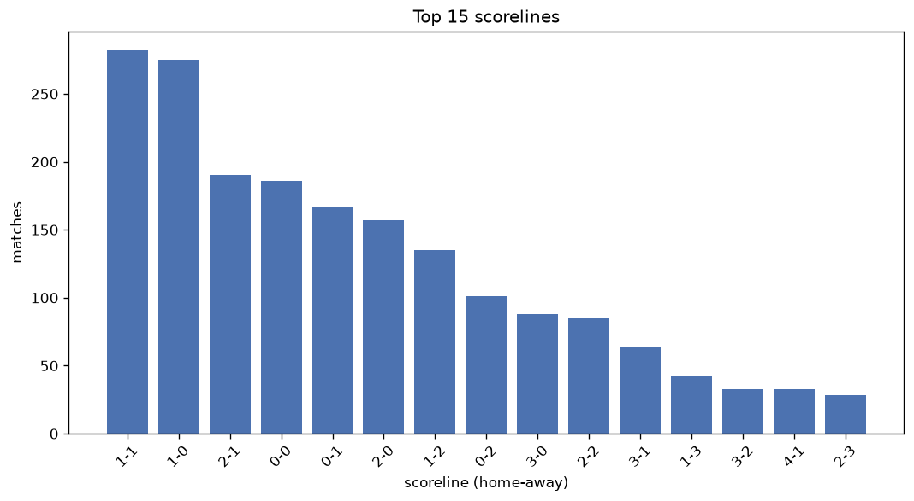
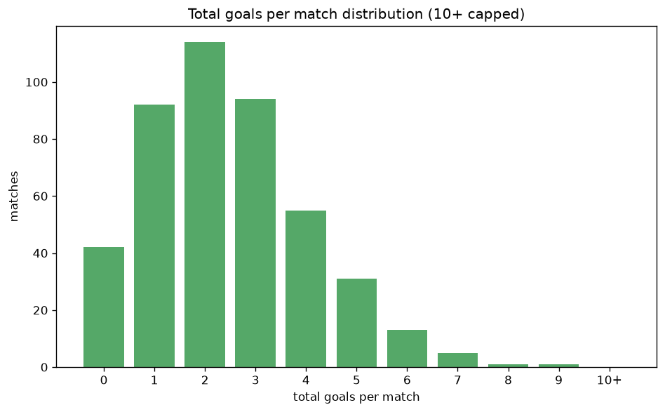

# Scoreline Analysis
- Report: `scoreline_analysis`
- Generated: 2026-10-27T02:26:14+00:00
- Script: `backend/scripts/analyze_scorelines.py` v1.0.0
- League: Primera RFEF - Group 1 (Spain)
- Scope: league `primera1`

## 1. Scoreline frequency
- Matches analysed: **2008** across **6** seasons.
- Distinct scorelines seen: **37**.

| scoreline | count | pct |
|---|---|---|
| 1-1 | 282 | 14.0% |
| 1-0 | 275 | 13.7% |
| 2-1 | 190 | 9.5% |
| 0-0 | 186 | 9.3% |
| 0-1 | 167 | 8.3% |
| 2-0 | 157 | 7.8% |
| 1-2 | 135 | 6.7% |
| 0-2 | 101 | 5.0% |
| 3-0 | 88 | 4.4% |
| 2-2 | 85 | 4.2% |
| 3-1 | 64 | 3.2% |
| 1-3 | 42 | 2.1% |
| 3-2 | 33 | 1.6% |
| 4-1 | 33 | 1.6% |
| 2-3 | 28 | 1.4% |
| 0-3 | 27 | 1.3% |
| 4-0 | 18 | 0.9% |
| 3-3 | 13 | 0.6% |
| 4-2 | 12 | 0.6% |
| 2-4 | 12 | 0.6% |

## 2. Scoreline frequency per season

### 2021-2022
| scoreline | count | pct |
|---|---|---|
| 1-0 | 53 | 13.9% |
| 1-1 | 45 | 11.8% |
| 0-1 | 35 | 9.2% |
| 2-1 | 34 | 8.9% |
| 0-0 | 32 | 8.4% |

### 2022-2023
| scoreline | count | pct |
|---|---|---|
| 1-0 | 57 | 15.0% |
| 1-1 | 55 | 14.5% |
| 2-1 | 38 | 10.0% |
| 2-0 | 36 | 9.5% |
| 0-0 | 34 | 8.9% |

### 2023-2024
| scoreline | count | pct |
|---|---|---|
| 1-1 | 57 | 15.0% |
| 1-0 | 53 | 13.9% |
| 0-0 | 50 | 13.2% |
| 0-1 | 36 | 9.5% |
| 2-1 | 33 | 8.7% |

### 2024-2025
| scoreline | count | pct |
|---|---|---|
| 1-1 | 62 | 16.3% |
| 1-0 | 47 | 12.4% |
| 0-1 | 37 | 9.7% |
| 2-1 | 37 | 9.7% |
| 2-0 | 30 | 7.9% |

### 2025-2026
| scoreline | count | pct |
|---|---|---|
| 1-1 | 51 | 12.8% |
| 1-0 | 49 | 12.3% |
| 2-1 | 42 | 10.6% |
| 0-0 | 39 | 9.8% |
| 2-0 | 36 | 9.0% |

### 2026-2027
| scoreline | count | pct |
|---|---|---|
| 1-0 | 16 | 17.8% |
| 1-1 | 12 | 13.3% |
| 2-0 | 9 | 10.0% |
| 0-0 | 6 | 6.7% |
| 2-1 | 6 | 6.7% |

## 3. Total-goal histogram
_10+ groups all matches with 10 or more total goals._

| total goals | matches | pct |
|---|---|---|
| 0 | 186 | 9.3% |
| 1 | 442 | 22.0% |
| 2 | 540 | 26.9% |
| 3 | 440 | 21.9% |
| 4 | 218 | 10.9% |
| 5 | 114 | 5.7% |
| 6 | 48 | 2.4% |
| 7 | 15 | 0.7% |
| 8 | 2 | 0.1% |
| 9 | 3 | 0.1% |
| 10+ | 0 | 0.0% |

## 4. Extreme scorelines
- Matches with 7+ total goals: **20**

| season | date | scoreline | total goals |
|---|---|---|---|
| 2022-2023 | 2023-04-30 | 2-7 | 9 |
| 2024-2025 | 2024-12-08 | 7-2 | 9 |
| 2025-2026 | 2026-02-07 | 6-3 | 9 |
| 2021-2022 | 2022-05-08 | 5-3 | 8 |
| 2026-2027 | 2026-09-27 | 3-5 | 8 |
| 2021-2022 | 2022-01-22 | 0-7 | 7 |
| 2021-2022 | 2022-02-12 | 6-1 | 7 |
| 2021-2022 | 2022-03-26 | 4-3 | 7 |
| 2021-2022 | 2022-05-14 | 4-3 | 7 |
| 2022-2023 | 2023-02-12 | 4-3 | 7 |
| 2023-2024 | 2023-09-24 | 4-3 | 7 |
| 2023-2024 | 2024-03-24 | 4-3 | 7 |
| 2024-2025 | 2024-11-24 | 5-2 | 7 |
| 2024-2025 | 2025-01-26 | 4-3 | 7 |
| 2024-2025 | 2025-05-11 | 4-3 | 7 |
| 2025-2026 | 2025-10-05 | 3-4 | 7 |
| 2025-2026 | 2025-11-08 | 4-3 | 7 |
| 2025-2026 | 2025-11-29 | 4-3 | 7 |
| 2025-2026 | 2026-03-29 | 4-3 | 7 |
| 2026-2027 | 2026-09-12 | 3-4 | 7 |

## 5. Margin-of-victory distribution (decided matches)
- Decided matches: **1442** (draws: **566**)
- Average winning margin: **1.62**

| margin | matches | pct |
|---|---|---|
| 1 | 840 | 58.3% |
| 2 | 390 | 27.0% |
| 3+ | 212 | 14.7% |

## 6. Margin by outcome

### Home wins
- Matches: **900** | avg margin: **1.66** | max margin: **5**
| margin | matches | pct |
|---|---|---|
| 1 | 508 | 56.4% |
| 2 | 234 | 26.0% |
| 3+ | 158 | 17.6% |
- *Full match-by-match list available in `scoreline_analysis.json`.*

### Away wins
- Matches: **542** | avg margin: **1.54** | max margin: **7**
| margin | matches | pct |
|---|---|---|
| 1 | 332 | 61.3% |
| 2 | 156 | 28.8% |
| 3+ | 54 | 10.0% |
- *Full match-by-match list available in `scoreline_analysis.json`.*

## 7. Most common exact score by outcome type
| outcome | matches | most common score | count | pct |
|---|---|---|---|---|
| home | 900 | 1-0 | 275 | 30.6% |
| draw | 566 | 1-1 | 282 | 49.8% |
| away | 542 | 0-1 | 167 | 30.8% |

---
*All statistics are computed from PostgreSQL tables (read-only). Run with `python backend/scripts/analyze_scorelines.py` to regenerate.*

## Charts

