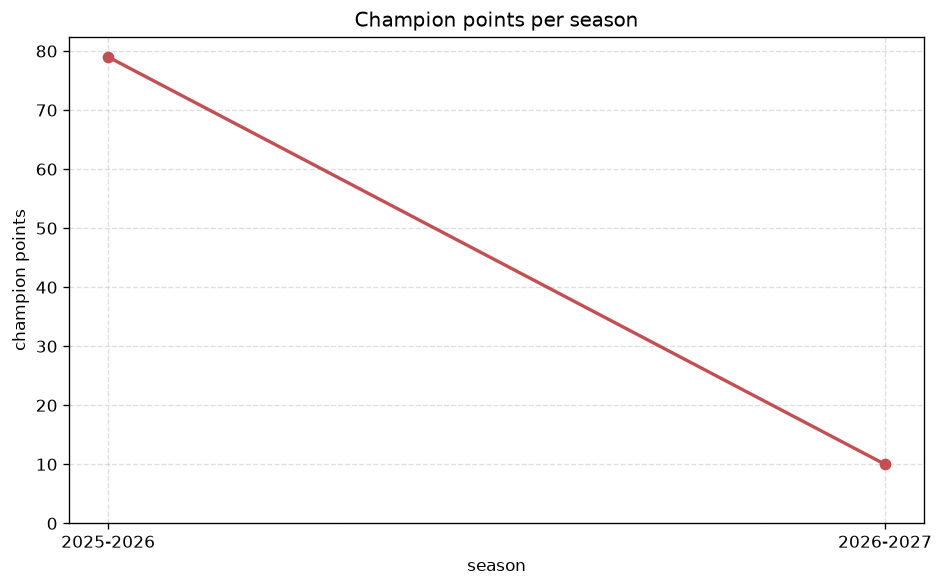
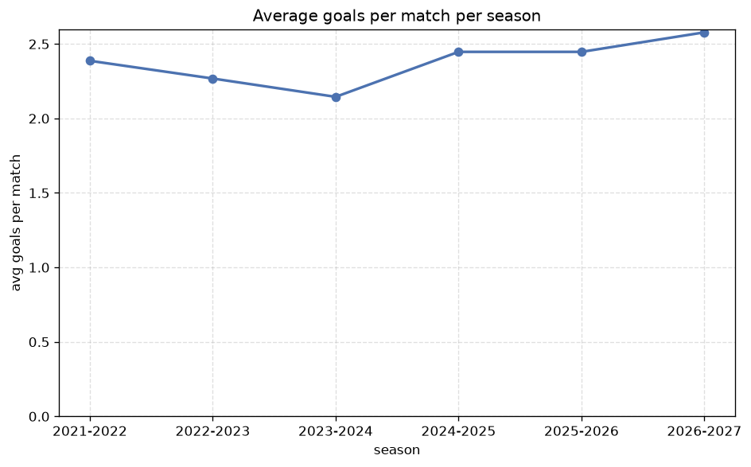

# Season Trends Analysis
- Report: `season_trends`
- Generated: 2026-10-27T02:26:12+00:00
- Script: `backend/scripts/analyze_seasons.py` v1.0.0
- League: Primera RFEF - Group 1 (Spain)
- Scope: league `primera1`

## 1. Champions per season
| season | champion | pts | runner-up | margin |
|---|---|---|---|---|
| 2021-2022 | Racing Santander | 82 | Dep. La Coruna | 8 pts |
| 2022-2023 | Racing Club Ferrol | 75 | Alcorcon | 1 pts |
| 2023-2024 | Dep. La Coruna | 78 | Barcelona B | 8 pts |
| 2024-2025 | Ponferradina | 65 | Cultural Leonesa | 0 pts |
| 2025-2026 | Tenerife | 79 | Celta Vigo B | 11 pts |
| 2026-2027 | Lugo | 22 | UD Logrones | 2 pts |

## 2. Title-race tightness
- Tight races (margin <= 3 pts): **3** of 6 seasons
- Tightest race: **2024-2025** - Ponferradina beat Cultural Leonesa by **0** pts

| season | margin | tight |
|---|---|---|
| 2021-2022 | 8 pts |  |
| 2022-2023 | 1 pts | yes |
| 2023-2024 | 8 pts |  |
| 2024-2025 | 0 pts | yes |
| 2025-2026 | 11 pts |  |
| 2026-2027 | 2 pts | yes |

## 3. Points thresholds
_Position-specific points per season. Key: 1 = champion, 2 = runner-up, 4 = CL line, 6 = Europa, 17 = last safe, 20 = bottom._

| season | pos 1 | pos 2 | pos 4 | pos 6 | pos 17 | pos 20 |
|---|---|---|---|---|---|---|
| 2021-2022 | 82 | 74 | 62 | 61 | 37 | 20 |
| 2022-2023 | 75 | 74 | 67 | 59 | 43 | 33 |
| 2023-2024 | 78 | 70 | 65 | 60 | 38 | 30 |
| 2024-2025 | 65 | 65 | 60 | 54 | 45 | 41 |
| 2025-2026 | 79 | 68 | 61 | 59 | 43 | 28 |
| 2026-2027 | 22 | 20 | 15 | 14 | 9 | 5 |

## 4. Relegation battle
| season | safe pos | safe pts | drop pos | drop pts | gap |
|---|---|---|---|---|---|
| 2021-2022 | 17 | 37 | 18 | 36 | 1 pts |
| 2022-2023 | 17 | 43 | 18 | 42 | 1 pts |
| 2023-2024 | 17 | 38 | 18 | 35 | 3 pts |
| 2024-2025 | 17 | 45 | 18 | 44 | 1 pts |
| 2025-2026 | 17 | 43 | 18 | 41 | 2 pts |
| 2026-2027 | 17 | 9 | 18 | 8 | 1 pts |

## 5. League-level trends
| season | matches | total goals | avg goals | home win | draw | away win | goalless | avg pts/team |
|---|---|---|---|---|---|---|---|---|
| 2021-2022 | 380 | 907 | 2.387 | 44.5% | 24.7% | 30.8% | 8.4% | 52.3 |
| 2022-2023 | 380 | 862 | 2.268 | 46.1% | 27.1% | 26.8% | 8.9% | 49.38 |
| 2023-2024 | 380 | 815 | 2.145 | 41.8% | 31.8% | 26.3% | 13.2% | 50.95 |
| 2024-2025 | 380 | 930 | 2.447 | 45.3% | 29.5% | 25.3% | 6.6% | 51.4 |
| 2025-2026 | 398 | 974 | 2.447 | 45.7% | 28.4% | 25.9% | 9.8% | 51.48 |
| 2026-2027 | 90 | 232 | 2.578 | 47.8% | 25.6% | 26.7% | 6.7% | 12.35 |

## 6. View divergence
- Largest divergence: **2024-2025** (goals view, avg abs position diff = 7.600)

_Avg absolute position difference between classic view and alternative view per season._

| season | classic vs luck | classic vs goals |
|---|---|---|
| 2021-2022 | 2.200 | 7.000 |
| 2022-2023 | 3.714 | 6.762 |
| 2023-2024 | 2.500 | 6.400 |
| 2024-2025 | 5.200 | 7.600 |
| 2025-2026 | 2.857 | 6.857 |
| 2026-2027 | 1.600 | 6.900 |

---
*All statistics are computed from PostgreSQL tables (read-only). Run with `python backend/scripts/analyze_seasons.py` to regenerate.*

## Charts

