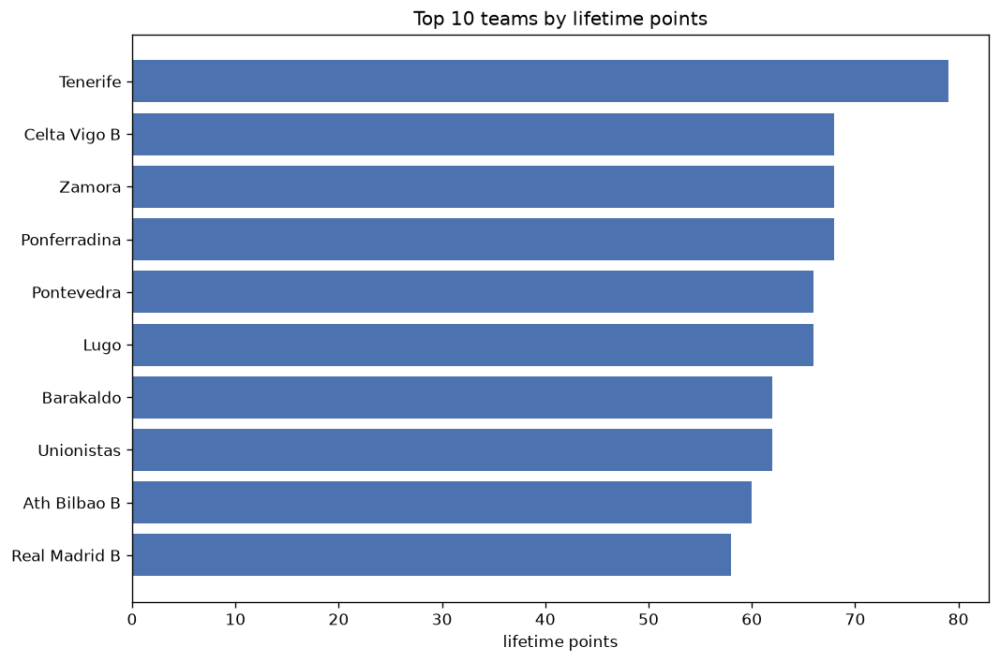
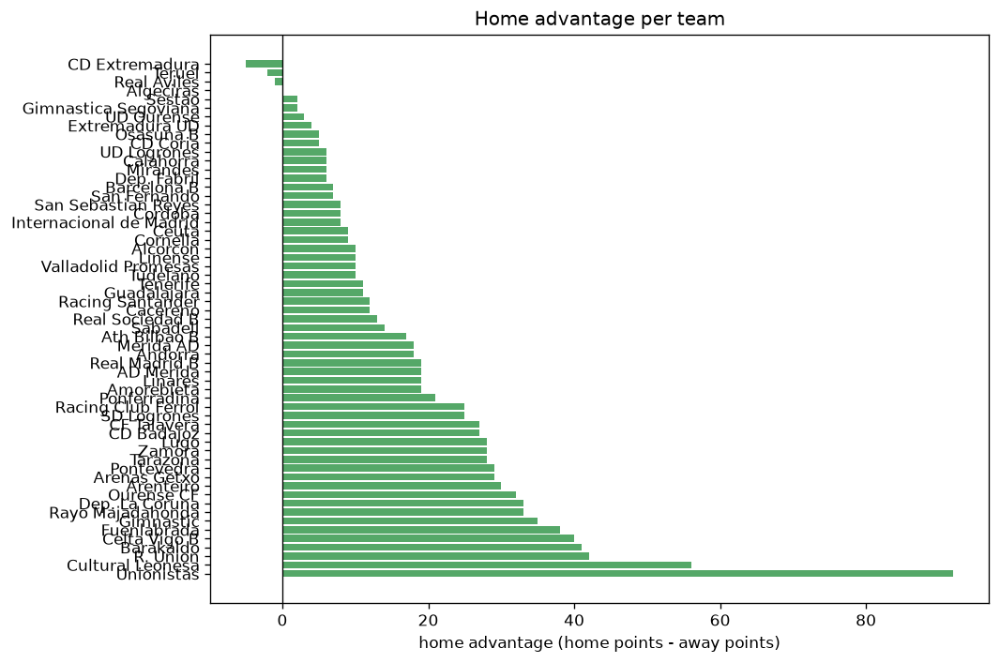

# Team Analysis
- Report: `teams_analysis`
- Generated: 2026-10-27T02:26:10+00:00
- Script: `backend/scripts/analyze_teams.py` v1.0.0
- League: Primera RFEF - Group 1 (Spain)
- Scope: league `primera1`

- Teams: **59** | Seasons: **6** | Matches: **2008**

## 1. Team standings (lifetime)
| team | seasons | played | W | D | L | pts | GF | GA | GD | avg pts/season | best pos | worst pos | titles |
|---|---|---|---|---|---|---|---|---|---|---|---|---|---|
| Celta Vigo B | 5 | 191 | 86 | 48 | 57 | 306 | 294 | 222 | 72 | 61.2 | 2 | 9 | 0 |
| Unionistas | 6 | 200 | 75 | 65 | 60 | 290 | 242 | 216 | 26 | 48.33 | 6 | 16 | 0 |
| Cultural Leonesa | 5 | 161 | 61 | 51 | 49 | 234 | 202 | 176 | 26 | 46.8 | 2 | 12 | 0 |
| Dep. La Coruna | 3 | 114 | 62 | 33 | 19 | 219 | 176 | 85 | 91 | 73.0 | 1 | 4 | 1 |
| Racing Club Ferrol | 4 | 124 | 61 | 30 | 33 | 213 | 157 | 107 | 50 | 53.25 | 1 | 13 | 1 |
| Ponferradina | 4 | 124 | 56 | 35 | 33 | 203 | 146 | 106 | 40 | 50.75 | 1 | 10 | 1 |
| Lugo | 4 | 124 | 46 | 36 | 42 | 174 | 127 | 141 | -14 | 43.5 | 1 | 15 | 1 |
| Zamora | 4 | 124 | 44 | 34 | 46 | 166 | 140 | 134 | 6 | 41.5 | 3 | 17 | 0 |
| Ath Bilbao B | 4 | 124 | 43 | 34 | 47 | 163 | 140 | 151 | -11 | 40.75 | 7 | 15 | 0 |
| R. Union | 4 | 123 | 44 | 28 | 51 | 160 | 159 | 170 | -11 | 40.0 | 8 | 18 | 0 |
| Rayo Majadahonda | 3 | 114 | 36 | 29 | 49 | 137 | 120 | 151 | -31 | 45.67 | 5 | 20 | 0 |
| Osasuna B | 3 | 114 | 33 | 32 | 49 | 131 | 122 | 154 | -32 | 43.67 | 11 | 19 | 0 |
| Gimnastic | 2 | 76 | 36 | 21 | 19 | 129 | 99 | 67 | 32 | 64.5 | 3 | 5 | 0 |
| Arenteiro | 3 | 115 | 31 | 35 | 49 | 128 | 113 | 138 | -25 | 42.67 | 8 | 20 | 0 |
| Real Madrid B | 2 | 77 | 35 | 22 | 20 | 127 | 119 | 93 | 26 | 63.5 | 3 | 8 | 0 |
| CF Talavera | 3 | 115 | 31 | 28 | 56 | 121 | 115 | 165 | -50 | 40.33 | 15 | 20 | 0 |
| Barakaldo | 3 | 86 | 30 | 27 | 29 | 117 | 108 | 93 | 15 | 39.0 | 7 | 15 | 0 |
| Barcelona B | 2 | 76 | 31 | 22 | 23 | 115 | 112 | 99 | 13 | 57.5 | 2 | 16 | 0 |
| Real Sociedad B | 2 | 76 | 29 | 26 | 21 | 113 | 94 | 74 | 20 | 56.5 | 3 | 9 | 0 |
| Pontevedra | 3 | 86 | 27 | 28 | 31 | 109 | 96 | 96 | 0 | 36.33 | 5 | 19 | 0 |
| CD Badajoz | 2 | 76 | 25 | 24 | 27 | 99 | 75 | 82 | -7 | 49.5 | 9 | 17 | 0 |
| Tarazona | 2 | 76 | 24 | 26 | 26 | 98 | 70 | 68 | 2 | 49.0 | 6 | 13 | 0 |
| San Sebastian Reyes | 2 | 76 | 26 | 18 | 32 | 96 | 70 | 87 | -17 | 48.0 | 10 | 16 | 0 |
| Ourense CF | 2 | 77 | 23 | 25 | 29 | 94 | 81 | 94 | -13 | 47.0 | 10 | 17 | 0 |
| Sestao | 2 | 76 | 22 | 24 | 30 | 90 | 78 | 92 | -14 | 45.0 | 12 | 17 | 0 |
| Fuenlabrada | 2 | 76 | 23 | 21 | 32 | 90 | 64 | 90 | -26 | 45.0 | 11 | 14 | 0 |
| SD Logrones | 2 | 76 | 21 | 20 | 35 | 83 | 70 | 98 | -28 | 41.5 | 13 | 19 | 0 |
| Racing Santander | 1 | 38 | 25 | 7 | 6 | 82 | 61 | 31 | 30 | 82.0 | 1 | 1 | 1 |
| UD Logrones | 2 | 47 | 24 | 10 | 13 | 82 | 61 | 49 | 12 | 41.0 | 2 | 4 | 0 |
| Tenerife | 1 | 39 | 23 | 10 | 6 | 79 | 65 | 24 | 41 | 79.0 | 1 | 1 | 1 |
| Merida AD | 2 | 56 | 21 | 15 | 20 | 78 | 66 | 64 | 2 | 39.0 | 9 | 21 | 0 |
| Alcorcon | 1 | 38 | 21 | 11 | 6 | 74 | 53 | 23 | 30 | 74.0 | 2 | 2 | 0 |
| AD Merida | 2 | 47 | 18 | 11 | 18 | 65 | 62 | 65 | -3 | 32.5 | 9 | 10 | 0 |
| Cacereno | 2 | 48 | 15 | 17 | 16 | 62 | 52 | 55 | -3 | 31.0 | 4 | 14 | 0 |
| Andorra | 1 | 38 | 16 | 12 | 10 | 60 | 49 | 38 | 11 | 60.0 | 4 | 4 | 0 |
| Linares | 1 | 38 | 17 | 8 | 13 | 59 | 53 | 53 | 0 | 59.0 | 6 | 6 | 0 |
| Arenas Getxo | 2 | 48 | 16 | 9 | 23 | 57 | 53 | 80 | -27 | 28.5 | 12 | 20 | 0 |
| Real Aviles | 2 | 48 | 14 | 13 | 21 | 55 | 71 | 82 | -11 | 27.5 | 14 | 16 | 0 |
| Cordoba | 1 | 38 | 14 | 12 | 12 | 54 | 48 | 37 | 11 | 54.0 | 8 | 8 | 0 |
| Calahorra | 1 | 38 | 14 | 10 | 14 | 52 | 48 | 43 | 5 | 52.0 | 11 | 11 | 0 |
| Internacional de Madrid | 2 | 38 | 11 | 13 | 14 | 46 | 46 | 51 | -5 | 23.0 | 14 | 21 | 0 |
| Ceuta | 1 | 38 | 12 | 9 | 17 | 45 | 53 | 52 | 1 | 45.0 | 12 | 12 | 0 |
| San Fernando | 1 | 38 | 11 | 12 | 15 | 45 | 46 | 50 | -4 | 45.0 | 13 | 13 | 0 |
| Algeciras | 1 | 38 | 11 | 11 | 16 | 44 | 36 | 47 | -11 | 44.0 | 15 | 15 | 0 |
| Linense | 1 | 38 | 10 | 12 | 16 | 42 | 31 | 34 | -3 | 42.0 | 18 | 18 | 0 |
| Sabadell | 1 | 38 | 11 | 9 | 18 | 42 | 38 | 57 | -19 | 42.0 | 16 | 16 | 0 |
| Gimnastica Segoviana | 1 | 38 | 9 | 15 | 14 | 42 | 43 | 69 | -26 | 42.0 | 19 | 19 | 0 |
| Amorebieta | 1 | 38 | 10 | 11 | 17 | 41 | 42 | 57 | -15 | 41.0 | 20 | 20 | 0 |
| Guadalajara | 1 | 39 | 10 | 11 | 18 | 41 | 44 | 60 | -16 | 41.0 | 18 | 18 | 0 |
| Teruel | 1 | 38 | 6 | 20 | 12 | 38 | 32 | 41 | -9 | 38.0 | 17 | 17 | 0 |
| Valladolid Promesas | 1 | 38 | 9 | 9 | 20 | 36 | 42 | 64 | -22 | 36.0 | 18 | 18 | 0 |
| Cornella | 1 | 38 | 8 | 11 | 19 | 35 | 30 | 44 | -14 | 35.0 | 18 | 18 | 0 |
| Tudelano | 1 | 38 | 7 | 7 | 24 | 28 | 33 | 54 | -21 | 28.0 | 19 | 19 | 0 |
| Extremadura UD | 1 | 38 | 5 | 5 | 28 | 20 | 22 | 80 | -58 | 20.0 | 20 | 20 | 0 |
| Mirandes | 1 | 9 | 4 | 2 | 3 | 14 | 12 | 10 | 2 | 14.0 | 5 | 5 | 0 |
| CD Extremadura | 1 | 9 | 4 | 1 | 4 | 13 | 16 | 10 | 6 | 13.0 | 7 | 7 | 0 |
| CD Coria | 1 | 9 | 2 | 3 | 4 | 9 | 12 | 16 | -4 | 9.0 | 17 | 17 | 0 |
| Dep. Fabril | 1 | 9 | 2 | 2 | 5 | 8 | 8 | 16 | -8 | 8.0 | 18 | 18 | 0 |
| UD Ourense | 1 | 9 | 1 | 2 | 6 | 5 | 3 | 15 | -12 | 5.0 | 19 | 19 | 0 |

## 2. Home vs away split
| team | home P | H-W | H-D | H-L | H-pts | away P | A-W | A-D | A-L | A-pts | adv |
|---|---|---|---|---|---|---|---|---|---|---|---|
| Unionistas | 101 | 53 | 32 | 16 | 191 | 99 | 22 | 33 | 44 | 99 | 92 |
| Cultural Leonesa | 80 | 42 | 19 | 19 | 145 | 81 | 19 | 32 | 30 | 89 | 56 |
| R. Union | 61 | 28 | 17 | 16 | 101 | 62 | 16 | 11 | 35 | 59 | 42 |
| Barakaldo | 43 | 23 | 10 | 10 | 79 | 43 | 7 | 17 | 19 | 38 | 41 |
| Celta Vigo B | 95 | 51 | 20 | 24 | 173 | 96 | 35 | 28 | 33 | 133 | 40 |
| Fuenlabrada | 38 | 18 | 10 | 10 | 64 | 38 | 5 | 11 | 22 | 26 | 38 |
| Gimnastic | 38 | 24 | 10 | 4 | 82 | 38 | 12 | 11 | 15 | 47 | 35 |
| Dep. La Coruna | 57 | 37 | 15 | 5 | 126 | 57 | 25 | 18 | 14 | 93 | 33 |
| Rayo Majadahonda | 57 | 22 | 19 | 16 | 85 | 57 | 14 | 10 | 33 | 52 | 33 |
| Ourense CF | 38 | 18 | 9 | 11 | 63 | 39 | 5 | 16 | 18 | 31 | 32 |
| Arenteiro | 57 | 19 | 22 | 16 | 79 | 58 | 12 | 13 | 33 | 49 | 30 |
| Pontevedra | 44 | 16 | 21 | 7 | 69 | 42 | 11 | 7 | 24 | 40 | 29 |
| Arenas Getxo | 24 | 13 | 4 | 7 | 43 | 24 | 3 | 5 | 16 | 14 | 29 |
| Lugo | 62 | 28 | 17 | 17 | 101 | 62 | 18 | 19 | 25 | 73 | 28 |
| Zamora | 63 | 27 | 16 | 20 | 97 | 61 | 17 | 18 | 26 | 69 | 28 |
| Tarazona | 38 | 17 | 12 | 9 | 63 | 38 | 7 | 14 | 17 | 35 | 28 |
| CF Talavera | 58 | 19 | 17 | 22 | 74 | 57 | 12 | 11 | 34 | 47 | 27 |
| CD Badajoz | 38 | 17 | 12 | 9 | 63 | 38 | 8 | 12 | 18 | 36 | 27 |
| Racing Club Ferrol | 62 | 34 | 17 | 11 | 119 | 62 | 27 | 13 | 22 | 94 | 25 |
| SD Logrones | 38 | 14 | 12 | 12 | 54 | 38 | 7 | 8 | 23 | 29 | 25 |
| Ponferradina | 62 | 33 | 13 | 16 | 112 | 62 | 23 | 22 | 17 | 91 | 21 |
| Real Madrid B | 38 | 20 | 13 | 5 | 73 | 39 | 15 | 9 | 15 | 54 | 19 |
| AD Merida | 24 | 12 | 6 | 6 | 42 | 23 | 6 | 5 | 12 | 23 | 19 |
| Linares | 19 | 12 | 3 | 4 | 39 | 19 | 5 | 5 | 9 | 20 | 19 |
| Amorebieta | 19 | 8 | 6 | 5 | 30 | 19 | 2 | 5 | 12 | 11 | 19 |
| Merida AD | 28 | 14 | 6 | 8 | 48 | 28 | 7 | 9 | 12 | 30 | 18 |
| Andorra | 19 | 11 | 6 | 2 | 39 | 19 | 5 | 6 | 8 | 21 | 18 |
| Ath Bilbao B | 61 | 24 | 18 | 19 | 90 | 63 | 19 | 16 | 28 | 73 | 17 |
| Sabadell | 19 | 8 | 4 | 7 | 28 | 19 | 3 | 5 | 11 | 14 | 14 |
| Real Sociedad B | 38 | 17 | 12 | 9 | 63 | 38 | 12 | 14 | 12 | 50 | 13 |
| Racing Santander | 19 | 14 | 5 | 0 | 47 | 19 | 11 | 2 | 6 | 35 | 12 |
| Cacereno | 25 | 10 | 7 | 8 | 37 | 23 | 5 | 10 | 8 | 25 | 12 |
| Tenerife | 20 | 14 | 3 | 3 | 45 | 19 | 9 | 7 | 3 | 34 | 11 |
| Guadalajara | 20 | 7 | 5 | 8 | 26 | 19 | 3 | 6 | 10 | 15 | 11 |
| Alcorcon | 19 | 12 | 6 | 1 | 42 | 19 | 9 | 5 | 5 | 32 | 10 |
| Linense | 19 | 7 | 5 | 7 | 26 | 19 | 3 | 7 | 9 | 16 | 10 |
| Valladolid Promesas | 19 | 6 | 5 | 8 | 23 | 19 | 3 | 4 | 12 | 13 | 10 |
| Tudelano | 19 | 5 | 4 | 10 | 19 | 19 | 2 | 3 | 14 | 9 | 10 |
| Ceuta | 19 | 8 | 3 | 8 | 27 | 19 | 4 | 6 | 9 | 18 | 9 |
| Cornella | 19 | 5 | 7 | 7 | 22 | 19 | 3 | 4 | 12 | 13 | 9 |
| San Sebastian Reyes | 38 | 14 | 10 | 14 | 52 | 38 | 12 | 8 | 18 | 44 | 8 |
| Cordoba | 19 | 9 | 4 | 6 | 31 | 19 | 5 | 8 | 6 | 23 | 8 |
| Internacional de Madrid | 19 | 6 | 9 | 4 | 27 | 19 | 5 | 4 | 10 | 19 | 8 |
| Barcelona B | 38 | 16 | 13 | 9 | 61 | 38 | 15 | 9 | 14 | 54 | 7 |
| San Fernando | 19 | 7 | 5 | 7 | 26 | 19 | 4 | 7 | 8 | 19 | 7 |
| UD Logrones | 23 | 13 | 5 | 5 | 44 | 24 | 11 | 5 | 8 | 38 | 6 |
| Calahorra | 19 | 8 | 5 | 6 | 29 | 19 | 6 | 5 | 8 | 23 | 6 |
| Mirandes | 4 | 3 | 1 | 0 | 10 | 5 | 1 | 1 | 3 | 4 | 6 |
| Dep. Fabril | 5 | 2 | 1 | 2 | 7 | 4 | 0 | 1 | 3 | 1 | 6 |
| Osasuna B | 57 | 17 | 17 | 23 | 68 | 57 | 16 | 15 | 26 | 63 | 5 |
| CD Coria | 4 | 2 | 1 | 1 | 7 | 5 | 0 | 2 | 3 | 2 | 5 |
| Extremadura UD | 19 | 3 | 3 | 13 | 12 | 19 | 2 | 2 | 15 | 8 | 4 |
| UD Ourense | 4 | 1 | 1 | 2 | 4 | 5 | 0 | 1 | 4 | 1 | 3 |
| Sestao | 38 | 11 | 13 | 14 | 46 | 38 | 11 | 11 | 16 | 44 | 2 |
| Gimnastica Segoviana | 19 | 4 | 10 | 5 | 22 | 19 | 5 | 5 | 9 | 20 | 2 |
| Algeciras | 19 | 5 | 7 | 7 | 22 | 19 | 6 | 4 | 9 | 22 | 0 |
| Real Aviles | 24 | 7 | 6 | 11 | 27 | 24 | 7 | 7 | 10 | 28 | -1 |
| Teruel | 19 | 4 | 6 | 9 | 18 | 19 | 2 | 14 | 3 | 20 | -2 |
| CD Extremadura | 4 | 1 | 1 | 2 | 4 | 5 | 3 | 0 | 2 | 9 | -5 |

## 3. Top performers
### Best points per game (PPG)
| rank | team | PPG |
|---|---|---|
| 1 | Racing Santander | 2.16 |
| 2 | Tenerife | 2.03 |
| 3 | Alcorcon | 1.95 |
| 4 | Dep. La Coruna | 1.92 |
| 5 | UD Logrones | 1.75 |

### Most goals scored
| rank | team | goals |
|---|---|---|
| 1 | Celta Vigo B | 294 |
| 2 | Unionistas | 242 |
| 3 | Cultural Leonesa | 202 |
| 4 | Dep. La Coruna | 176 |
| 5 | R. Union | 159 |

### Best goal difference
| rank | team | GD |
|---|---|---|
| 1 | Dep. La Coruna | 91 |
| 2 | Celta Vigo B | 72 |
| 3 | Racing Club Ferrol | 50 |
| 4 | Tenerife | 41 |
| 5 | Ponferradina | 40 |

### Best defence (goals against per match, standings)
| rank | team | GA/match |
|---|---|---|
| 1 | Alcorcon | 0.605 |
| 2 | Tenerife | 0.615 |
| 3 | Dep. La Coruna | 0.746 |
| 4 | Racing Santander | 0.816 |
| 5 | Ponferradina | 0.855 |

## 4. Team consistency
- Teams present in all **6** seasons: **1**

Unionistas

## 5. Head-to-head dominance
- Distinct fixtures: **799** (showing the 15 most frequent)

| fixture | meetings | home wins | draws | away wins | home pct | draw pct | away pct |
|---|---|---|---|---|---|---|---|
| Unionistas vs Celta Vigo B | 10 | 4 | 2 | 4 | 40.0% | 20.0% | 40.0% |
| Unionistas vs Cultural Leonesa | 9 | 5 | 2 | 2 | 55.6% | 22.2% | 22.2% |
| Celta Vigo B vs Cultural Leonesa | 8 | 4 | 2 | 2 | 50.0% | 25.0% | 25.0% |
| Unionistas vs R. Union | 7 | 5 | 1 | 1 | 71.4% | 14.3% | 14.3% |
| Ath Bilbao B vs Zamora | 7 | 3 | 2 | 2 | 42.9% | 28.6% | 28.6% |
| Racing Club Ferrol vs Unionistas | 7 | 3 | 1 | 3 | 42.9% | 14.3% | 42.9% |
| Unionistas vs Ath Bilbao B | 7 | 2 | 2 | 3 | 28.6% | 28.6% | 42.9% |
| Unionistas vs Lugo | 7 | 1 | 4 | 2 | 14.3% | 57.1% | 28.6% |
| Ponferradina vs Lugo | 7 | 0 | 4 | 3 | 0.0% | 57.1% | 42.9% |
| Rayo Majadahonda vs Unionistas | 6 | 5 | 1 | 0 | 83.3% | 16.7% | 0.0% |
| Arenteiro vs Osasuna B | 6 | 4 | 2 | 0 | 66.7% | 33.3% | 0.0% |
| Dep. La Coruna vs Cultural Leonesa | 6 | 4 | 1 | 1 | 66.7% | 16.7% | 16.7% |
| Dep. La Coruna vs Unionistas | 6 | 4 | 1 | 1 | 66.7% | 16.7% | 16.7% |
| Racing Club Ferrol vs CF Talavera | 6 | 4 | 0 | 2 | 66.7% | 0.0% | 33.3% |
| Racing Club Ferrol vs Celta Vigo B | 6 | 4 | 0 | 2 | 66.7% | 0.0% | 33.3% |

## 6. Position per season (classic view)
_Cells show final position; '-' when the team was absent from that season._

| team | 2021-2022 | 2022-2023 | 2023-2024 | 2024-2025 | 2025-2026 | 2026-2027 |
|---|---|---|---|---|---|---|
| Celta Vigo B | 7 | 5 | 4 | 9 | 2 | - |
| Unionistas | 6 | 7 | 7 | 13 | 6 | 16 |
| Cultural Leonesa | 12 | 10 | 6 | 2 | - | 12 |
| Dep. La Coruna | 2 | 4 | 1 | - | - | - |
| Racing Club Ferrol | 3 | 1 | - | - | 13 | 3 |
| Ponferradina | - | - | 5 | 1 | 4 | 10 |
| Lugo | - | - | 10 | 15 | 9 | 1 |
| Zamora | 17 | - | - | 8 | 3 | 13 |
| Ath Bilbao B | 15 | - | - | 7 | 11 | 11 |
| R. Union | 8 | - | 15 | 18 | - | 8 |
| Rayo Majadahonda | 5 | 14 | 20 | - | - | - |
| Osasuna B | - | - | 11 | 14 | 19 | - |
| Gimnastic | - | - | 3 | 5 | - | - |
| Arenteiro | - | - | 8 | 12 | 20 | - |
| Real Madrid B | - | 3 | - | - | 8 | - |
| CF Talavera | 16 | 20 | - | - | 15 | - |
| Barakaldo | - | - | - | 11 | 7 | 15 |
| Barcelona B | - | - | 2 | 16 | - | - |
| Real Sociedad B | - | - | 9 | 3 | - | - |
| Pontevedra | - | 19 | - | - | 5 | 6 |
| CD Badajoz | 9 | 17 | - | - | - | - |
| Tarazona | - | - | 13 | 6 | - | - |
| San Sebastian Reyes | 10 | 16 | - | - | - | - |
| Ourense CF | - | - | - | 10 | 17 | - |
| Sestao | - | - | 12 | 17 | - | - |
| Fuenlabrada | - | 11 | 14 | - | - | - |
| SD Logrones | 13 | - | 19 | - | - | - |
| Racing Santander | 1 | - | - | - | - | - |
| UD Logrones | 4 | - | - | - | - | 2 |
| Tenerife | - | - | - | - | 1 | - |
| Merida AD | - | 9 | - | - | 21 | - |
| Alcorcon | - | 2 | - | - | - | - |
| AD Merida | - | - | - | - | 10 | 9 |
| Cacereno | - | - | - | - | 14 | 4 |
| Andorra | - | - | - | 4 | - | - |
| Linares | - | 6 | - | - | - | - |
| Arenas Getxo | - | - | - | - | 12 | 20 |
| Real Aviles | - | - | - | - | 16 | 14 |
| Cordoba | - | 8 | - | - | - | - |
| Calahorra | 11 | - | - | - | - | - |
| Internacional de Madrid | 14 | 21 | - | - | - | - |
| Ceuta | - | 12 | - | - | - | - |
| San Fernando | - | 13 | - | - | - | - |
| Algeciras | - | 15 | - | - | - | - |
| Linense | - | 18 | - | - | - | - |
| Sabadell | - | - | 16 | - | - | - |
| Gimnastica Segoviana | - | - | - | 19 | - | - |
| Amorebieta | - | - | - | 20 | - | - |
| Guadalajara | - | - | - | - | 18 | - |
| Teruel | - | - | 17 | - | - | - |
| Valladolid Promesas | 18 | - | - | - | - | - |
| Cornella | - | - | 18 | - | - | - |
| Tudelano | 19 | - | - | - | - | - |
| Extremadura UD | 20 | - | - | - | - | - |
| Mirandes | - | - | - | - | - | 5 |
| CD Extremadura | - | - | - | - | - | 7 |
| CD Coria | - | - | - | - | - | 17 |
| Dep. Fabril | - | - | - | - | - | 18 |
| UD Ourense | - | - | - | - | - | 19 |

---
*All statistics are computed from PostgreSQL tables (read-only). Run with `python backend/scripts/analyze_teams.py` to regenerate.*

## Charts

