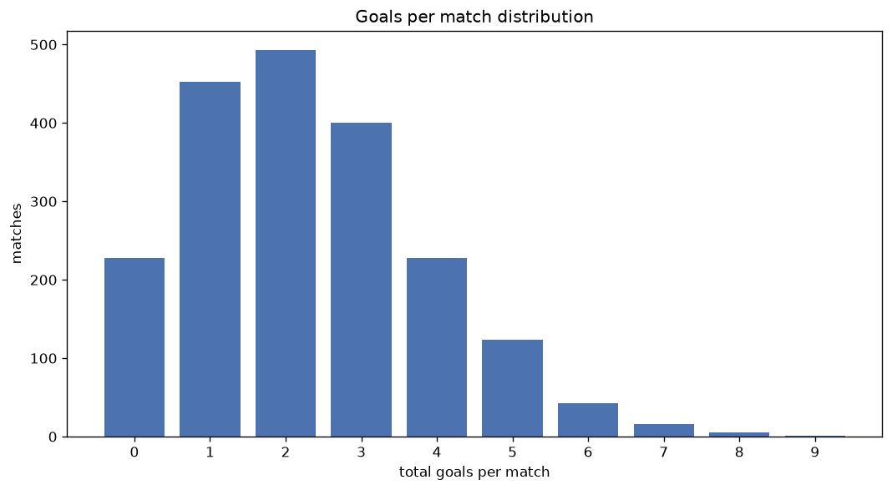
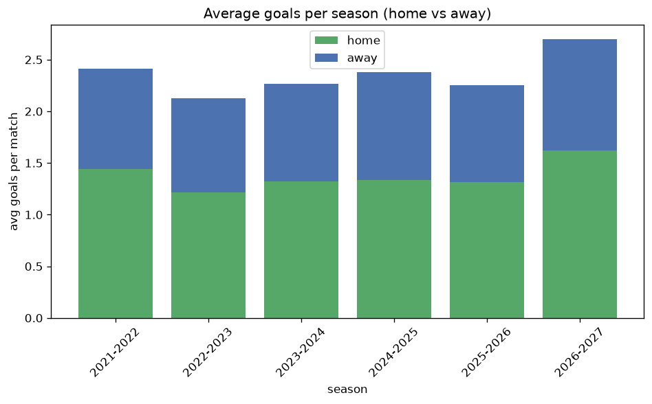

# Goal Analysis
- Report: `goals_analysis`
- Generated: 2026-10-27T02:26:27+00:00
- Script: `backend/scripts/analyze_goals.py` v1.0.0
- League: Primera RFEF - Group 2 (Spain)
- Scope: league `primera2`

## 1. Goals per match distribution
| goals | matches | pct |
|---|---|---|
| 0 | 228 | 11.5% |
| 1 | 452 | 22.7% |
| 2 | 493 | 24.8% |
| 3 | 400 | 20.1% |
| 4 | 228 | 11.5% |
| 5 | 124 | 6.2% |
| 6 | 43 | 2.2% |
| 7 | 16 | 0.8% |
| 8 | 5 | 0.3% |
| 9 | 1 | 0.1% |

## 2. Goals per match per season
| season | matches | total goals | avg home | avg away | avg total |
|---|---|---|---|---|---|
| 2021-2022 | 380 | 916 | 1.439 | 0.971 | 2.411 |
| 2022-2023 | 380 | 809 | 1.216 | 0.913 | 2.129 |
| 2023-2024 | 380 | 862 | 1.324 | 0.945 | 2.268 |
| 2024-2025 | 380 | 903 | 1.337 | 1.039 | 2.376 |
| 2025-2026 | 380 | 856 | 1.316 | 0.937 | 2.253 |
| 2026-2027 | 90 | 243 | 1.622 | 1.078 | 2.7 |

## 3. Home vs away goal share
- Home goals: **2666** (58.1%)
- Away goals: **1923** (41.9%)
- Home/away ratio: **1.386**

| season | home goals | away goals | total | home pct | away pct |
|---|---|---|---|---|---|
| 2021-2022 | 547 | 369 | 916 | 59.7% | 40.3% |
| 2022-2023 | 462 | 347 | 809 | 57.1% | 42.9% |
| 2023-2024 | 503 | 359 | 862 | 58.4% | 41.6% |
| 2024-2025 | 508 | 395 | 903 | 56.3% | 43.7% |
| 2025-2026 | 500 | 356 | 856 | 58.4% | 41.6% |
| 2026-2027 | 146 | 97 | 243 | 60.1% | 39.9% |

## 4. BTTS (Both Teams To Score)
- Overall: **915** of `1990` (46.0%)

| season | matches | BTTS | pct |
|---|---|---|---|
| 2021-2022 | 380 | 167 | 43.9% |
| 2022-2023 | 380 | 172 | 45.3% |
| 2023-2024 | 380 | 162 | 42.6% |
| 2024-2025 | 380 | 199 | 52.4% |
| 2025-2026 | 380 | 167 | 43.9% |
| 2026-2027 | 90 | 48 | 53.3% |

## 5. Clean sheets
- Home clean sheets: **781** (39.2%)
- Away clean sheets: **522** (26.2%)
- Total clean sheets recorded: **1303**
- Matches with at least one clean sheet: **1075** (54.0%)
- Both teams kept clean sheets (0-0): **228**

| season | matches | home CS | away CS | total CS | matches w/ CS |
|---|---|---|---|---|---|
| 2021-2022 | 380 | 157 | 93 | 250 | 213 (56.1%) |
| 2022-2023 | 380 | 155 | 106 | 261 | 208 (54.7%) |
| 2023-2024 | 380 | 152 | 109 | 261 | 218 (57.4%) |
| 2024-2025 | 380 | 128 | 96 | 224 | 181 (47.6%) |
| 2025-2026 | 380 | 156 | 103 | 259 | 213 (56.1%) |
| 2026-2027 | 90 | 33 | 15 | 48 | 42 (46.7%) |

## 6. Scoring intensity
- First-half goals: **2005** (43.7%)
- Second-half goals: **2584** (56.3%)
- Avg first-half goals per match: **1.008**
- Avg second-half goals per match: **1.298**
- Second-half-only scoring (HT 0-0, FT goals >= 1): **515** (25.9%)

| season | matches | 1st half | 2nd half | 1st half pct | 2nd half pct |
|---|---|---|---|---|---|
| 2021-2022 | 380 | 409 | 507 | 44.7% | 55.3% |
| 2022-2023 | 380 | 350 | 459 | 43.3% | 56.7% |
| 2023-2024 | 380 | 373 | 489 | 43.3% | 56.7% |
| 2024-2025 | 380 | 367 | 536 | 40.6% | 59.4% |
| 2025-2026 | 380 | 398 | 458 | 46.5% | 53.5% |
| 2026-2027 | 90 | 108 | 135 | 44.4% | 55.6% |

## 7. First-goal timing
- Matches with first-goal time recorded: `1762` of `1990` (88.5%)
- Goalless matches: `228`
- Min `1` | Max `99` | Mean `33.83` | Median (p50) `29.0`

| bucket | count | % of matches | % of scoring matches |
|---|---|---|---|
| 1-15 | 523 | 26.3% | 29.7% |
| 16-30 | 398 | 20.0% | 22.6% |
| 31-45 | 303 | 15.2% | 17.2% |
| 46-60 | 257 | 12.9% | 14.6% |
| 61-75 | 153 | 7.7% | 8.7% |
| 76-90 | 92 | 4.6% | 5.2% |
| 91-120 | 36 | 1.8% | 2.0% |

---
*All statistics are computed from PostgreSQL tables (read-only). Run with `python backend/scripts/analyze_goals.py` to regenerate.*

## Charts

