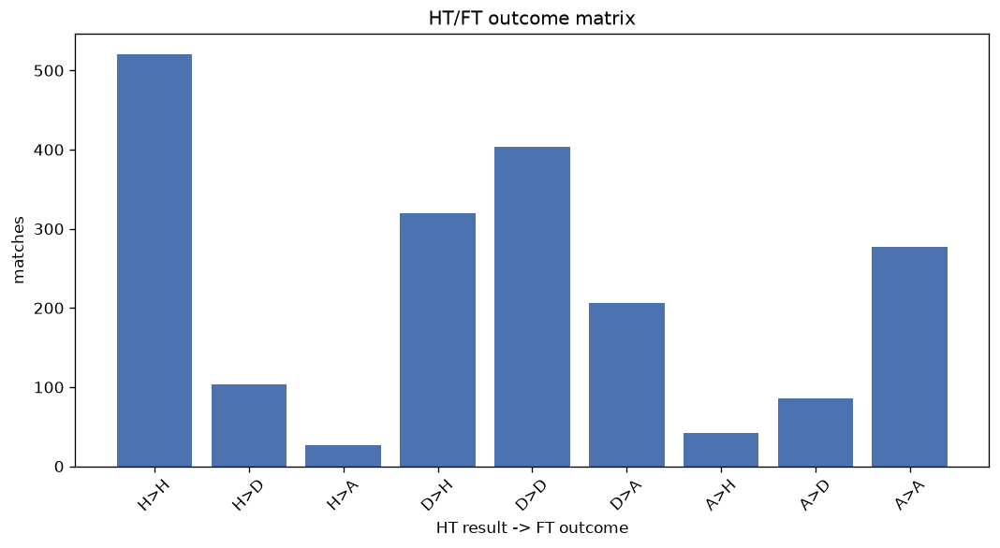
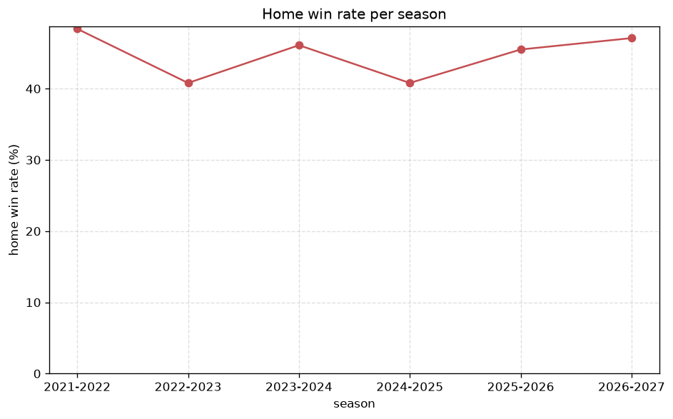

# Match Analysis
- Report: `matches_analysis`
- Generated: 2026-10-26T01:44:18+00:00
- Script: `backend/scripts/analyze_matches.py` v1.0.0
- League: Primera RFEF - Group 2 (Spain)
- Scope: league `primera2`

## 1. Overall summary
| metric | value |
|---|---|
| Matches | 1985 |
| Home wins | 882 (44.4%) |
| Draws | 593 (29.9%) |
| Away wins | 510 (25.7%) |
| Total goals | 4568 |
| Average goals per match | 2.301 |
| Goalless matches | 228 (11.5%) |

## 2. Per-season breakdown
| season | matches | home wins | draws | away wins | total goals | avg goals | goalless |
|---|---|---|---|---|---|---|---|
| 2021-2022 | 380 | 184 (48.4%) | 96 (25.3%) | 100 (26.3%) | 916 | 2.411 | 37 (9.7%) |
| 2022-2023 | 380 | 155 (40.8%) | 129 (33.9%) | 96 (25.3%) | 809 | 2.129 | 53 (13.9%) |
| 2023-2024 | 380 | 175 (46.1%) | 97 (25.5%) | 108 (28.4%) | 862 | 2.268 | 43 (11.3%) |
| 2024-2025 | 380 | 155 (40.8%) | 132 (34.7%) | 93 (24.5%) | 903 | 2.376 | 43 (11.3%) |
| 2025-2026 | 380 | 173 (45.5%) | 113 (29.7%) | 94 (24.7%) | 856 | 2.253 | 46 (12.1%) |
| 2026-2027 | 85 | 40 (47.1%) | 26 (30.6%) | 19 (22.4%) | 222 | 2.612 | 6 (7.1%) |

## 3. HT/FT outcome matrix
| HT result \ FT result | Home | Draw | Away | total |
|---|---|---|---|---|
| HT home lead | 520 (80.0%) | 103 (15.8%) | 27 (4.2%) | 650 |
| HT draw | 320 (34.4%) | 404 (43.4%) | 206 (22.2%) | 930 |
| HT away lead | 42 (10.4%) | 86 (21.2%) | 277 (68.4%) | 405 |

## 4. Comeback matches
- Home comebacks (trailing at HT, won at FT): **42** (2.1%)
- Away comebacks (trailing at HT, won at FT): **27** (1.4%)

### Home comebacks
| season | home | away | HT | FT |
|---|---|---|---|---|
| 2021-2022 | Gimnastic | Alcoyano | 0-1 | 2-1 |
| 2021-2022 | Linares | Villarreal B | 0-1 | 2-1 |
| 2021-2022 | Barcelona B | Baleares | 0-1 | 3-1 |
| 2021-2022 | Baleares | Alcoyano | 0-1 | 2-1 |
| 2021-2022 | Linares | Andorra | 0-1 | 3-1 |
| 2022-2023 | Barcelona B | Castellon | 1-2 | 3-2 |
| 2022-2023 | Alcoyano | Baleares | 0-1 | 2-1 |
| 2022-2023 | Castellon | La Nucia | 0-1 | 4-1 |
| 2022-2023 | R. Union | Amorebieta | 2-3 | 4-3 |
| 2022-2023 | SD Logrones | Castellon | 0-1 | 2-1 |
| 2022-2023 | Cornella | Barcelona B | 2-3 | 4-3 |
| 2022-2023 | Numancia | Gimnastic | 0-1 | 3-1 |
| 2022-2023 | SD Logrones | Eldense | 0-1 | 2-1 |
| 2022-2023 | Baleares | Gimnastic | 0-1 | 2-1 |
| 2023-2024 | San Fernando | Granada CF B | 0-1 | 2-1 |
| 2023-2024 | Granada CF B | Sanluqueno | 0-1 | 2-1 |
| 2023-2024 | UD Ibiza | San Fernando | 0-1 | 3-2 |
| 2023-2024 | Alcoyano | Antequera | 0-1 | 2-1 |
| 2023-2024 | Melilla | Granada CF B | 0-2 | 4-3 |
| 2023-2024 | Atl. Madrid B | CF Intercity | 0-1 | 2-1 |
| 2023-2024 | UD Ibiza | Melilla | 1-2 | 4-3 |
| 2023-2024 | Merida AD | Algeciras | 0-1 | 3-1 |
| 2023-2024 | Granada CF B | Recreativo Huelva | 0-1 | 2-1 |
| 2023-2024 | Merida AD | Ceuta | 1-2 | 3-2 |
| 2023-2024 | San Fernando | Linares | 0-1 | 2-1 |
| 2024-2025 | Marbella | CF Intercity | 0-1 | 2-1 |
| 2024-2025 | Merida AD | CF Intercity | 0-1 | 2-1 |
| 2024-2025 | Marbella | Algeciras | 0-1 | 3-1 |
| 2024-2025 | Alcorcon | Villarreal B | 0-1 | 2-1 |
| 2024-2025 | Hercules | UD Ibiza | 1-2 | 3-2 |
| 2024-2025 | Alcorcon | Sanluqueno | 0-1 | 3-1 |
| 2024-2025 | Alcoyano | CF Intercity | 0-1 | 2-1 |
| 2025-2026 | Tarazona | Villarreal B | 0-1 | 2-1 |
| 2025-2026 | Betis B | Alcorcon | 0-1 | 2-1 |
| 2025-2026 | Tarazona | Teruel | 1-2 | 3-2 |
| 2025-2026 | Sevilla FC B | Sanluqueno | 0-1 | 2-1 |
| 2025-2026 | Sabadell | Algeciras | 0-1 | 3-1 |
| 2025-2026 | Atl. Madrid B | Antequera | 0-1 | 3-2 |
| 2025-2026 | Atl. Madrid B | Marbella | 1-2 | 5-4 |
| 2025-2026 | Eldense | FC Cartagena SAD | 0-1 | 2-1 |
| 2025-2026 | Torremolinos | Atl. Madrid B | 0-1 | 3-1 |
| 2026-2027 | Murcia | CE Europa | 0-1 | 2-1 |

### Away comebacks
| season | home | away | HT | FT |
|---|---|---|---|---|
| 2021-2022 | Linares | UCAM Murcia | 1-0 | 1-2 |
| 2021-2022 | Som Maresme | Baleares | 1-0 | 1-2 |
| 2021-2022 | Sabadell | San Fernando | 2-0 | 2-3 |
| 2021-2022 | Linense | Villarreal B | 1-0 | 1-2 |
| 2021-2022 | UCAM Murcia | Alcoyano | 1-0 | 1-2 |
| 2021-2022 | Alcoyano | Barcelona B | 1-0 | 2-3 |
| 2021-2022 | UCAM Murcia | Villarreal B | 1-0 | 2-3 |
| 2021-2022 | Linense | Barcelona B | 1-0 | 1-2 |
| 2021-2022 | Sanluqueno | Andorra | 1-0 | 1-2 |
| 2021-2022 | Castellon | Cornella | 1-0 | 1-3 |
| 2022-2023 | Ath Bilbao B | La Nucia | 1-0 | 1-2 |
| 2022-2023 | Cornella | Osasuna B | 1-0 | 1-3 |
| 2022-2023 | Real Sociedad B | Murcia | 1-0 | 1-2 |
| 2022-2023 | Baleares | UD Logrones | 1-0 | 1-2 |
| 2022-2023 | Amorebieta | Numancia | 1-0 | 1-2 |
| 2022-2023 | Sabadell | Real Sociedad B | 1-0 | 1-2 |
| 2022-2023 | CF Intercity | R. Union | 1-0 | 1-2 |
| 2023-2024 | Melilla | CF Intercity | 1-0 | 1-2 |
| 2024-2025 | Alcorcon | Atl. Madrid B | 1-0 | 2-3 |
| 2024-2025 | Alcorcon | Betis B | 1-0 | 1-2 |
| 2024-2025 | UD Ibiza | Betis B | 1-0 | 1-2 |
| 2024-2025 | Betis B | Antequera | 1-0 | 1-2 |
| 2024-2025 | Alcorcon | Antequera | 1-0 | 1-2 |
| 2024-2025 | Alcoyano | Fuenlabrada | 2-1 | 2-4 |
| 2024-2025 | Yeclano | CF Intercity | 1-0 | 1-2 |
| 2025-2026 | Tarazona | Atl. Madrid B | 1-0 | 1-4 |
| 2025-2026 | Teruel | Alcorcon | 1-0 | 1-2 |

## 5. HT lead conversion
| HT state | matches | converted to win | held as draw | collapsed to loss |
|---|---|---|---|---|
| Home lead | 650 | 520 (80.0%) | 103 (15.8%) | 27 (4.2%) |
| Away lead | 405 | 277 (68.4%) | 86 (21.2%) | 42 (10.4%) |

### Matches level at half-time
| FT result | count | pct |
|---|---|---|
| Home win | 320 | 34.4% |
| Draw | 404 | 43.4% |
| Away win | 206 | 22.2% |

## 6. First-goal timing
- Matches with a first-goal time recorded: `1757` of `1985` (88.5%)

Outcome distribution by first-goal timing bucket:
| bucket | matches | % of matches | home | draw | away |
|---|---|---|---|---|---|
| 1-15 | 521 | 26.2% | 267 (51.2%) | 114 (21.9%) | 140 (26.9%) |
| 16-30 | 396 | 19.9% | 188 (47.5%) | 87 (22.0%) | 121 (30.6%) |
| 31-45 | 302 | 15.2% | 161 (53.3%) | 65 (21.5%) | 76 (25.2%) |
| 46-60 | 257 | 12.9% | 128 (49.8%) | 53 (20.6%) | 76 (29.6%) |
| 61-75 | 153 | 7.7% | 68 (44.4%) | 33 (21.6%) | 52 (34.0%) |
| 76-90 | 92 | 4.6% | 47 (51.1%) | 13 (14.1%) | 32 (34.8%) |
| 91-120 | 36 | 1.8% | 23 (63.9%) | 0 (0.0%) | 13 (36.1%) |

## 7. Goalless matches
- Overall: **228** of `1985` (11.5%)

| season | matches | goalless | pct |
|---|---|---|---|
| 2021-2022 | 380 | 37 | 9.7% |
| 2022-2023 | 380 | 53 | 13.9% |
| 2023-2024 | 380 | 43 | 11.3% |
| 2024-2025 | 380 | 43 | 11.3% |
| 2025-2026 | 380 | 46 | 12.1% |
| 2026-2027 | 85 | 6 | 7.1% |

---
*All statistics are computed from PostgreSQL tables (read-only). Run with `python backend/scripts/analyze_matches.py` to regenerate.*

## Charts

