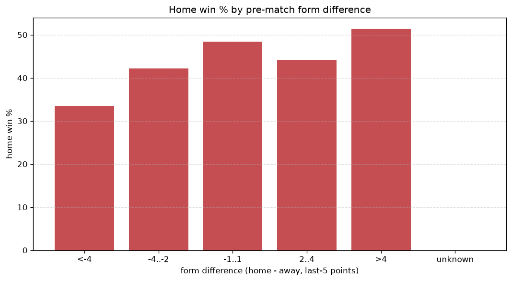
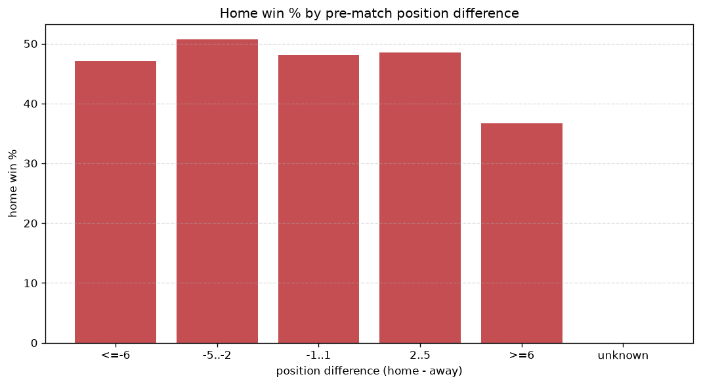

# Relationships Analysis
- Report: `relationships`
- Generated: 2026-10-27T02:26:35+00:00
- Script: `backend/scripts/analyze_relationships.py` v1.0.0
- League: Primera RFEF - Group 2 (Spain)
- Scope: league `primera2`

- Matches analysed: **1900** (23 leakage-safe pre-match features).

## 1. Correlation matrix
_Pearson correlation of each pre-match feature with observed goals; sorted by |corr(total goals)|._

| feature | corr(home) | corr(away) | corr(total) |
|---|---|---|---|
| home_team_home_goals_avg | 0.104 | -0.018 | 0.067 |
| home_team_goals_scored_last_5 | 0.109 | -0.037 | 0.058 |
| home_points_before_match | 0.098 | -0.036 | 0.051 |
| away_points_before_match | 0.016 | 0.038 | 0.036 |
| home_team_home_win_rate | 0.087 | -0.047 | 0.036 |
| away_team_goals_scored_last_5 | 0.001 | 0.047 | 0.031 |
| home_team_goals_conceded_last_5 | -0.002 | 0.047 | 0.029 |
| position_difference | -0.119 | 0.096 | -0.029 |
| away_rest_days | 0.029 | 0.009 | 0.028 |
| away_team_points_last_5 | -0.009 | 0.052 | 0.027 |
| home_team_home_conceded_avg | -0.002 | 0.045 | 0.027 |
| home_team_wins_last_5 | 0.069 | -0.040 | 0.027 |
| home_position_before_match | -0.088 | 0.062 | -0.026 |
| away_team_away_win_rate | -0.009 | 0.051 | 0.026 |
| away_team_wins_last_5 | -0.012 | 0.049 | 0.022 |
| points_difference | 0.131 | -0.119 | 0.022 |
| home_rest_days | 0.014 | 0.015 | 0.020 |
| away_team_away_goals_avg | -0.011 | 0.042 | 0.019 |
| home_team_points_last_5 | 0.069 | -0.053 | 0.018 |
| away_position_before_match | 0.080 | -0.072 | 0.014 |
| away_team_goals_conceded_last_5 | 0.028 | -0.047 | -0.009 |
| rest_days_difference | -0.017 | 0.008 | -0.008 |
| away_team_away_conceded_avg | 0.023 | -0.017 | 0.006 |

## 2. Form vs outcome
_Home win/draw/away % per bucket of `home_team_points_last_5 - away_team_points_last_5`._

| bucket | matches | home | draw | away | home % | draw % | away % |
|---|---|---|---|---|---|---|---|
| <-4 | 266 | 89 | 82 | 95 | 33.5% | 30.8% | 35.7% |
| -4..-2 | 455 | 192 | 143 | 120 | 42.2% | 31.4% | 26.4% |
| -1..1 | 585 | 283 | 171 | 131 | 48.4% | 29.2% | 22.4% |
| 2..4 | 380 | 168 | 115 | 97 | 44.2% | 30.3% | 25.5% |
| >4 | 214 | 110 | 56 | 48 | 51.4% | 26.2% | 22.4% |
| unknown | 0 | 0 | 0 | 0 | - | - | - |

## 3. Position vs outcome
_Home win/draw/away % per bucket of `position_difference` (home position - away position; negative favours the home team)._

| bucket | matches | home | draw | away | home % | draw % | away % |
|---|---|---|---|---|---|---|---|
| <=-6 | 469 | 236 | 134 | 99 | 50.3% | 28.6% | 21.1% |
| -5..-2 | 323 | 171 | 87 | 65 | 52.9% | 26.9% | 20.1% |
| -1..1 | 258 | 111 | 77 | 70 | 43.0% | 29.8% | 27.1% |
| 2..5 | 334 | 136 | 106 | 92 | 40.7% | 31.7% | 27.5% |
| >=6 | 516 | 188 | 163 | 165 | 36.4% | 31.6% | 32.0% |
| unknown | 0 | 0 | 0 | 0 | - | - | - |

## 4. Rest advantage
_Home win/draw/away % per bucket of `rest_days_difference` (home rest - away rest). Matches with unknown rest are bucketed separately._

| bucket | matches | home | draw | away | home % | draw % | away % |
|---|---|---|---|---|---|---|---|
| <-1 | 117 | 63 | 27 | 27 | 53.8% | 23.1% | 23.1% |
| -1..0 | 386 | 173 | 96 | 117 | 44.8% | 24.9% | 30.3% |
| 0 | 824 | 350 | 272 | 202 | 42.5% | 33.0% | 24.5% |
| 1..2 | 463 | 211 | 134 | 118 | 45.6% | 28.9% | 25.5% |
| >2 | 60 | 27 | 19 | 14 | 45.0% | 31.7% | 23.3% |
| unknown | 50 | 18 | 19 | 13 | 36.0% | 38.0% | 26.0% |
- *50 match(es) had unknown rest difference (missing rest data on at least one side).*

## 5. Home team quality
_Home win rate by `home_team_home_win_rate` tier (split at 0.5)._

- `< 0.5` tier: **41.2%** home win (497/1207)
- `>= 0.5` tier: **49.8%** home win (345/693)
- Home-win gap (>= split minus < split): **+8.6 pp**

| tier | label | matches | home | draw | away | home % |
|---|---|---|---|---|---|---|
| low | < 0.5 | 1207 | 497 | 360 | 350 | 41.2% |
| high | >= 0.5 | 693 | 345 | 207 | 141 | 49.8% |

## 6. Feature averages by result
_Mean feature value per outcome; `range` is home-minus-away spread of the group means._

| feature | home mean | draw mean | away mean | range |
|---|---|---|---|---|
| points_difference | 1.394 | -0.596 | -2.800 | 4.195 |
| home_points_before_match | 26.129 | 24.116 | 23.110 | 3.019 |
| position_difference | -0.799 | 0.767 | 1.880 | 2.679 |
| home_position_before_match | 10.548 | 10.979 | 12.000 | 1.452 |
| away_position_before_match | 11.347 | 10.212 | 10.120 | 1.227 |
| away_points_before_match | 24.735 | 24.713 | 25.910 | 1.198 |
| home_team_goals_scored_last_5 | 5.410 | 4.947 | 4.831 | 0.579 |
| home_team_points_last_5 | 6.305 | 5.966 | 5.739 | 0.566 |
| home_team_goals_conceded_last_5 | 5.322 | 5.099 | 5.572 | 0.474 |
| away_team_goals_conceded_last_5 | 5.319 | 4.926 | 4.998 | 0.394 |
| away_team_points_last_5 | 6.228 | 6.402 | 6.542 | 0.314 |
| home_rest_days | 7.272 | 7.502 | 7.251 | 0.251 |
| away_team_goals_scored_last_5 | 5.242 | 5.312 | 5.450 | 0.208 |
| rest_days_difference | -0.034 | 0.157 | -0.038 | 0.195 |
| home_team_wins_last_5 | 1.637 | 1.506 | 1.464 | 0.172 |
| home_team_home_goals_avg | 1.266 | 1.178 | 1.158 | 0.108 |
| away_team_wins_last_5 | 1.607 | 1.684 | 1.705 | 0.098 |
| home_team_home_conceded_avg | 0.906 | 0.892 | 0.960 | 0.068 |
| away_team_away_conceded_avg | 1.240 | 1.180 | 1.202 | 0.060 |
| away_rest_days | 7.306 | 7.345 | 7.289 | 0.056 |
| home_team_home_win_rate | 0.424 | 0.395 | 0.369 | 0.055 |
| away_team_away_goals_avg | 0.907 | 0.912 | 0.938 | 0.030 |
| away_team_away_win_rate | 0.239 | 0.240 | 0.257 | 0.018 |

---
*All features are leakage-safe pre-match values built by `ml.features.build_features.build_rows` from strictly prior matches. Run with `python backend/scripts/analyze_relationships.py` to regenerate.*

## Charts

