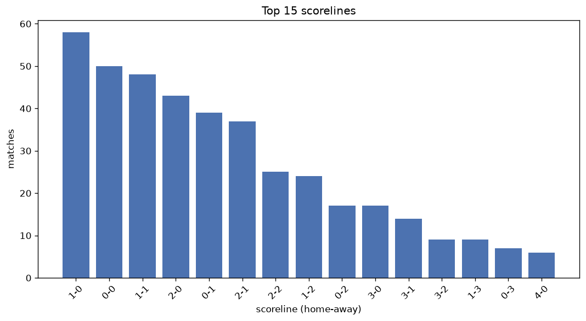
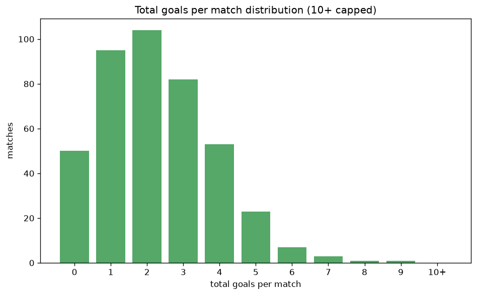

# Scoreline Analysis
- Report: `scoreline_analysis`
- Generated: 2026-10-30T04:07:04+00:00
- Script: `backend/scripts/analyze_scorelines.py` v1.0.0
- League: Primera RFEF - Group 2 (Spain)
- Scope: league `primera2`

## 1. Scoreline frequency
- Matches analysed: **1990** across **6** seasons.
- Distinct scorelines seen: **35**.

| scoreline | count | pct |
|---|---|---|
| 1-0 | 277 | 13.9% |
| 1-1 | 260 | 13.1% |
| 0-0 | 228 | 11.5% |
| 0-1 | 175 | 8.8% |
| 2-1 | 162 | 8.1% |
| 2-0 | 158 | 7.9% |
| 1-2 | 116 | 5.8% |
| 2-2 | 90 | 4.5% |
| 3-0 | 83 | 4.2% |
| 0-2 | 75 | 3.8% |
| 3-1 | 65 | 3.3% |
| 1-3 | 46 | 2.3% |
| 0-3 | 39 | 2.0% |
| 3-2 | 38 | 1.9% |
| 2-3 | 30 | 1.5% |
| 4-1 | 27 | 1.4% |
| 4-0 | 22 | 1.1% |
| 1-4 | 17 | 0.9% |
| 3-3 | 16 | 0.8% |
| 4-2 | 13 | 0.7% |

## 2. Scoreline frequency per season

### 2021-2022
| scoreline | count | pct |
|---|---|---|
| 1-0 | 56 | 14.7% |
| 1-1 | 43 | 11.3% |
| 0-0 | 37 | 9.7% |
| 2-1 | 31 | 8.2% |
| 2-0 | 31 | 8.2% |

### 2022-2023
| scoreline | count | pct |
|---|---|---|
| 1-1 | 57 | 15.0% |
| 1-0 | 56 | 14.7% |
| 0-0 | 53 | 13.9% |
| 0-1 | 42 | 11.1% |
| 2-0 | 31 | 8.2% |

### 2023-2024
| scoreline | count | pct |
|---|---|---|
| 1-0 | 56 | 14.7% |
| 1-1 | 43 | 11.3% |
| 0-0 | 43 | 11.3% |
| 0-1 | 40 | 10.5% |
| 2-1 | 31 | 8.2% |

### 2024-2025
| scoreline | count | pct |
|---|---|---|
| 1-1 | 63 | 16.6% |
| 1-0 | 45 | 11.8% |
| 0-0 | 43 | 11.3% |
| 2-1 | 37 | 9.7% |
| 0-1 | 28 | 7.4% |

### 2025-2026
| scoreline | count | pct |
|---|---|---|
| 1-0 | 52 | 13.7% |
| 0-0 | 46 | 12.1% |
| 1-1 | 43 | 11.3% |
| 0-1 | 37 | 9.7% |
| 2-0 | 37 | 9.7% |

### 2026-2027
| scoreline | count | pct |
|---|---|---|
| 1-0 | 12 | 13.3% |
| 1-1 | 11 | 12.2% |
| 2-0 | 10 | 11.1% |
| 2-2 | 8 | 8.9% |
| 1-2 | 7 | 7.8% |

## 3. Total-goal histogram
_10+ groups all matches with 10 or more total goals._

| total goals | matches | pct |
|---|---|---|
| 0 | 228 | 11.5% |
| 1 | 452 | 22.7% |
| 2 | 493 | 24.8% |
| 3 | 400 | 20.1% |
| 4 | 228 | 11.5% |
| 5 | 124 | 6.2% |
| 6 | 43 | 2.2% |
| 7 | 16 | 0.8% |
| 8 | 5 | 0.3% |
| 9 | 1 | 0.1% |
| 10+ | 0 | 0.0% |

## 4. Extreme scorelines
- Matches with 7+ total goals: **22**

| season | date | scoreline | total goals |
|---|---|---|---|
| 2025-2026 | 2026-04-10 | 5-4 | 9 |
| 2021-2022 | 2021-12-05 | 7-1 | 8 |
| 2021-2022 | 2022-04-17 | 6-2 | 8 |
| 2024-2025 | 2025-02-09 | 5-3 | 8 |
| 2025-2026 | 2026-05-16 | 6-2 | 8 |
| 2026-2027 | 2026-10-11 | 4-4 | 8 |
| 2021-2022 | 2022-03-13 | 5-2 | 7 |
| 2021-2022 | 2022-05-13 | 5-2 | 7 |
| 2022-2023 | 2022-09-17 | 5-2 | 7 |
| 2022-2023 | 2022-10-09 | 4-3 | 7 |
| 2022-2023 | 2023-02-04 | 4-3 | 7 |
| 2023-2024 | 2023-10-15 | 5-2 | 7 |
| 2023-2024 | 2023-11-04 | 5-2 | 7 |
| 2023-2024 | 2023-11-18 | 1-6 | 7 |
| 2023-2024 | 2024-03-17 | 4-3 | 7 |
| 2023-2024 | 2024-04-07 | 4-3 | 7 |
| 2024-2025 | 2024-09-08 | 5-2 | 7 |
| 2024-2025 | 2025-02-01 | 3-4 | 7 |
| 2024-2025 | 2025-04-06 | 4-3 | 7 |
| 2025-2026 | 2026-03-14 | 5-2 | 7 |
| 2025-2026 | 2026-05-08 | 4-3 | 7 |
| 2026-2027 | 2026-09-13 | 3-4 | 7 |

## 5. Margin-of-victory distribution (decided matches)
- Decided matches: **1395** (draws: **595**)
- Average winning margin: **1.64**

| margin | matches | pct |
|---|---|---|
| 1 | 807 | 57.8% |
| 2 | 360 | 25.8% |
| 3+ | 228 | 16.3% |

## 6. Margin by outcome

### Home wins
- Matches: **885** | avg margin: **1.71** | max margin: **6**
| margin | matches | pct |
|---|---|---|
| 1 | 484 | 54.7% |
| 2 | 237 | 26.8% |
| 3+ | 164 | 18.5% |
- *Full match-by-match list available in `scoreline_analysis.json`.*

### Away wins
- Matches: **510** | avg margin: **1.51** | max margin: **5**
| margin | matches | pct |
|---|---|---|
| 1 | 323 | 63.3% |
| 2 | 123 | 24.1% |
| 3+ | 64 | 12.5% |
- *Full match-by-match list available in `scoreline_analysis.json`.*

## 7. Most common exact score by outcome type
| outcome | matches | most common score | count | pct |
|---|---|---|---|---|
| home | 885 | 1-0 | 277 | 31.3% |
| draw | 595 | 1-1 | 260 | 43.7% |
| away | 510 | 0-1 | 175 | 34.3% |

---
*All statistics are computed from PostgreSQL tables (read-only). Run with `python backend/scripts/analyze_scorelines.py` to regenerate.*

## Charts

