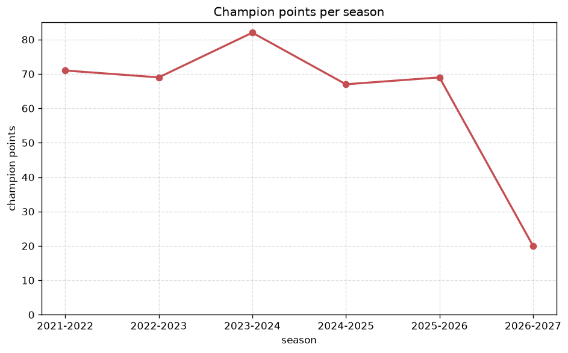
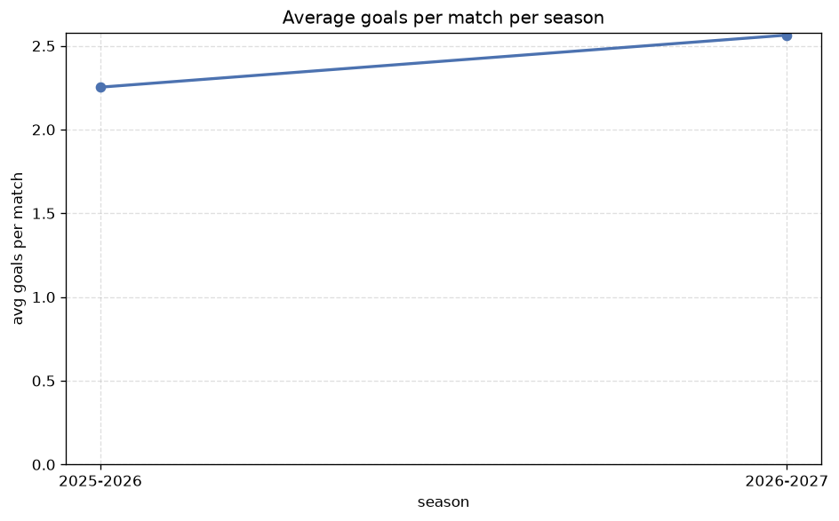

# Season Trends Analysis
- Report: `season_trends`
- Generated: 2026-10-29T02:11:22+00:00
- Script: `backend/scripts/analyze_seasons.py` v1.0.0
- League: Primera RFEF - Group 2 (Spain)
- Scope: league `primera2`

## 1. Champions per season
| season | champion | pts | runner-up | margin |
|---|---|---|---|---|
| 2021-2022 | Andorra | 71 | Villarreal B | 4 pts |
| 2022-2023 | Eldense | 69 | Amorebieta | 0 pts |
| 2023-2024 | Castellon | 82 | Cordoba | 5 pts |
| 2024-2025 | Ceuta | 67 | Murcia | 3 pts |
| 2025-2026 | Eldense | 69 | Sabadell | 1 pts |
| 2026-2027 | Villarreal B | 20 | Zaragoza | 0 pts |

## 2. Title-race tightness
- Tight races (margin <= 3 pts): **4** of 6 seasons
- Tightest race: **2022-2023** - Eldense beat Amorebieta by **0** pts

| season | margin | tight |
|---|---|---|
| 2021-2022 | 4 pts |  |
| 2022-2023 | 0 pts | yes |
| 2023-2024 | 5 pts |  |
| 2024-2025 | 3 pts | yes |
| 2025-2026 | 1 pts | yes |
| 2026-2027 | 0 pts | yes |

## 3. Points thresholds
_Position-specific points per season. Key: 1 = champion, 2 = runner-up, 4 = CL line, 6 = Europa, 17 = last safe, 20 = bottom._

| season | pos 1 | pos 2 | pos 4 | pos 6 | pos 17 | pos 20 |
|---|---|---|---|---|---|---|
| 2021-2022 | 71 | 67 | 61 | 59 | 46 | 21 |
| 2022-2023 | 69 | 69 | 61 | 56 | 46 | 26 |
| 2023-2024 | 82 | 77 | 68 | 61 | 39 | 27 |
| 2024-2025 | 67 | 64 | 58 | 54 | 43 | 35 |
| 2025-2026 | 69 | 68 | 63 | 57 | 45 | 28 |
| 2026-2027 | 20 | 20 | 16 | 14 | 7 | 6 |

## 4. Relegation battle
| season | safe pos | safe pts | drop pos | drop pts | gap |
|---|---|---|---|---|---|
| 2021-2022 | 17 | 46 | 18 | 35 | 11 pts |
| 2022-2023 | 17 | 46 | 18 | 36 | 10 pts |
| 2023-2024 | 17 | 39 | 18 | 34 | 5 pts |
| 2024-2025 | 17 | 43 | 18 | 42 | 1 pts |
| 2025-2026 | 17 | 45 | 18 | 34 | 11 pts |
| 2026-2027 | 17 | 7 | 18 | 7 | 0 pts |

## 5. League-level trends
| season | matches | total goals | avg goals | home win | draw | away win | goalless | avg pts/team |
|---|---|---|---|---|---|---|---|---|
| 2021-2022 | 380 | 916 | 2.411 | 48.4% | 25.3% | 26.3% | 9.7% | 52.2 |
| 2022-2023 | 380 | 809 | 2.129 | 40.8% | 33.9% | 25.3% | 13.9% | 50.55 |
| 2023-2024 | 380 | 862 | 2.268 | 46.1% | 25.5% | 28.4% | 11.3% | 52.15 |
| 2024-2025 | 380 | 903 | 2.376 | 40.8% | 34.7% | 24.5% | 11.3% | 50.4 |
| 2025-2026 | 380 | 856 | 2.253 | 45.5% | 29.7% | 24.7% | 12.1% | 51.35 |
| 2026-2027 | 90 | 243 | 2.7 | 47.8% | 31.1% | 21.1% | 6.7% | 12.1 |

## 6. View divergence
- Largest divergence: **2022-2023** (goals view, avg abs position diff = 6.700)

_Avg absolute position difference between classic view and alternative view per season._

| season | classic vs luck | classic vs goals |
|---|---|---|
| 2021-2022 | 3.200 | 6.600 |
| 2022-2023 | 2.800 | 6.700 |
| 2023-2024 | 2.000 | 5.000 |
| 2024-2025 | 2.900 | 6.500 |
| 2025-2026 | 2.800 | 5.100 |
| 2026-2027 | 1.900 | 5.000 |

---
*All statistics are computed from PostgreSQL tables (read-only). Run with `python backend/scripts/analyze_seasons.py` to regenerate.*

## Charts

