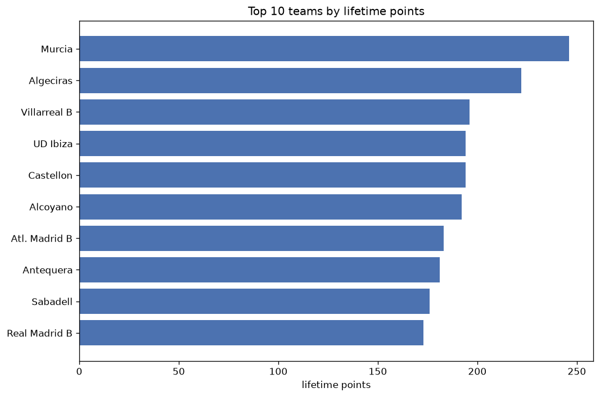
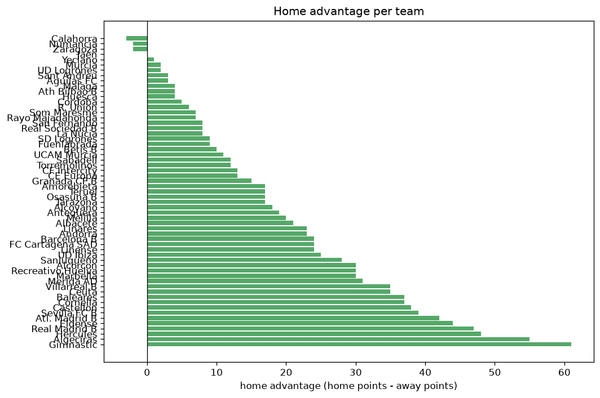

# Team Analysis
- Report: `teams_analysis`
- Generated: 2026-10-29T02:11:19+00:00
- Script: `backend/scripts/analyze_teams.py` v1.0.0
- League: Primera RFEF - Group 2 (Spain)
- Scope: league `primera2`

- Teams: **59** | Seasons: **6** | Matches: **1990**

## 1. Team standings (lifetime)
| team | seasons | played | W | D | L | pts | GF | GA | GD | avg pts/season | best pos | worst pos | titles |
|---|---|---|---|---|---|---|---|---|---|---|---|---|---|
| Murcia | 5 | 161 | 67 | 45 | 49 | 246 | 188 | 150 | 38 | 49.2 | 2 | 10 | 0 |
| Algeciras | 5 | 161 | 58 | 51 | 52 | 225 | 188 | 182 | 6 | 45.0 | 7 | 13 | 0 |
| Villarreal B | 4 | 123 | 53 | 40 | 30 | 199 | 191 | 119 | 72 | 49.75 | 1 | 11 | 1 |
| UD Ibiza | 4 | 123 | 54 | 33 | 36 | 195 | 166 | 118 | 48 | 48.75 | 3 | 12 | 0 |
| Castellon | 3 | 114 | 56 | 26 | 32 | 194 | 157 | 121 | 36 | 64.67 | 1 | 13 | 1 |
| Alcoyano | 4 | 152 | 48 | 48 | 56 | 192 | 147 | 166 | -19 | 48.0 | 11 | 18 | 0 |
| Atl. Madrid B | 4 | 123 | 47 | 43 | 33 | 184 | 176 | 139 | 37 | 46.0 | 3 | 14 | 0 |
| Antequera | 4 | 123 | 48 | 37 | 38 | 181 | 162 | 153 | 9 | 45.25 | 4 | 13 | 0 |
| Sabadell | 3 | 114 | 47 | 35 | 32 | 176 | 139 | 103 | 36 | 58.67 | 2 | 10 | 0 |
| Gimnastic | 4 | 123 | 47 | 34 | 42 | 175 | 133 | 136 | -3 | 43.75 | 4 | 14 | 0 |
| Real Madrid B | 4 | 123 | 44 | 41 | 38 | 173 | 179 | 137 | 42 | 43.25 | 6 | 12 | 0 |
| Sanluqueno | 4 | 152 | 40 | 48 | 64 | 168 | 141 | 201 | -60 | 42.0 | 14 | 19 | 0 |
| Eldense | 2 | 76 | 38 | 24 | 14 | 138 | 107 | 67 | 40 | 69.0 | 1 | 1 | 2 |
| Baleares | 3 | 114 | 33 | 36 | 45 | 135 | 119 | 140 | -21 | 45.0 | 6 | 19 | 0 |
| Ceuta | 2 | 76 | 34 | 27 | 15 | 129 | 101 | 75 | 26 | 64.5 | 1 | 5 | 1 |
| CF Intercity | 3 | 114 | 32 | 33 | 49 | 129 | 119 | 146 | -27 | 43.0 | 11 | 20 | 0 |
| Sevilla FC B | 3 | 114 | 32 | 31 | 51 | 127 | 97 | 142 | -45 | 42.33 | 8 | 20 | 0 |
| Barcelona B | 2 | 76 | 32 | 22 | 22 | 118 | 104 | 89 | 15 | 59.0 | 4 | 9 | 0 |
| Alcorcon | 3 | 85 | 29 | 29 | 27 | 116 | 113 | 98 | 15 | 38.67 | 6 | 11 | 0 |
| Hercules | 3 | 85 | 31 | 21 | 33 | 114 | 99 | 101 | -2 | 38.0 | 9 | 12 | 0 |
| Betis B | 3 | 114 | 29 | 25 | 60 | 112 | 115 | 186 | -71 | 37.33 | 15 | 20 | 0 |
| Merida AD | 2 | 76 | 27 | 24 | 25 | 105 | 89 | 97 | -8 | 52.5 | 5 | 12 | 0 |
| Linares | 2 | 76 | 27 | 18 | 31 | 99 | 92 | 98 | -6 | 49.5 | 5 | 17 | 0 |
| Recreativo Huelva | 2 | 76 | 24 | 26 | 26 | 98 | 76 | 89 | -13 | 49.0 | 6 | 19 | 0 |
| Cornella | 2 | 76 | 26 | 19 | 31 | 97 | 73 | 90 | -17 | 48.5 | 12 | 15 | 0 |
| San Fernando | 2 | 76 | 24 | 18 | 34 | 90 | 85 | 106 | -21 | 45.0 | 14 | 16 | 0 |
| Marbella | 2 | 76 | 21 | 17 | 38 | 80 | 87 | 113 | -26 | 40.0 | 13 | 18 | 0 |
| Cordoba | 1 | 38 | 23 | 8 | 7 | 77 | 66 | 32 | 34 | 77.0 | 2 | 2 | 0 |
| FC Cartagena SAD | 2 | 47 | 19 | 15 | 13 | 72 | 51 | 47 | 4 | 36.0 | 5 | 6 | 0 |
| Andorra | 1 | 38 | 21 | 8 | 9 | 71 | 61 | 38 | 23 | 71.0 | 1 | 1 | 1 |
| Malaga | 1 | 38 | 19 | 13 | 6 | 70 | 51 | 25 | 26 | 70.0 | 3 | 3 | 0 |
| Amorebieta | 1 | 38 | 19 | 12 | 7 | 69 | 48 | 29 | 19 | 69.0 | 2 | 2 | 0 |
| Albacete | 1 | 38 | 19 | 10 | 9 | 67 | 52 | 34 | 18 | 67.0 | 3 | 3 | 0 |
| CE Europa | 2 | 47 | 18 | 13 | 16 | 67 | 61 | 65 | -4 | 33.5 | 5 | 18 | 0 |
| Real Sociedad B | 1 | 38 | 14 | 18 | 6 | 60 | 50 | 34 | 16 | 60.0 | 5 | 5 | 0 |
| Teruel | 2 | 47 | 13 | 16 | 18 | 55 | 31 | 48 | -17 | 27.5 | 13 | 20 | 0 |
| Osasuna B | 1 | 38 | 15 | 8 | 15 | 53 | 51 | 45 | 6 | 53.0 | 7 | 7 | 0 |
| Torremolinos | 2 | 47 | 12 | 16 | 19 | 52 | 56 | 71 | -15 | 26.0 | 15 | 19 | 0 |
| SD Logrones | 1 | 38 | 13 | 12 | 13 | 51 | 40 | 43 | -3 | 51.0 | 9 | 9 | 0 |
| Linense | 1 | 38 | 13 | 11 | 14 | 50 | 35 | 44 | -9 | 50.0 | 12 | 12 | 0 |
| R. Union | 1 | 38 | 13 | 9 | 16 | 48 | 39 | 48 | -9 | 48.0 | 13 | 13 | 0 |
| Numancia | 1 | 38 | 11 | 13 | 14 | 46 | 31 | 36 | -5 | 46.0 | 16 | 16 | 0 |
| La Nucia | 1 | 38 | 9 | 19 | 10 | 46 | 39 | 45 | -6 | 46.0 | 17 | 17 | 0 |
| Tarazona | 1 | 38 | 11 | 12 | 15 | 45 | 31 | 40 | -9 | 45.0 | 16 | 16 | 0 |
| Yeclano | 1 | 38 | 9 | 16 | 13 | 43 | 36 | 34 | 2 | 43.0 | 16 | 16 | 0 |
| Fuenlabrada | 1 | 38 | 10 | 13 | 15 | 43 | 43 | 48 | -5 | 43.0 | 17 | 17 | 0 |
| UD Logrones | 1 | 38 | 7 | 15 | 16 | 36 | 25 | 33 | -8 | 36.0 | 18 | 18 | 0 |
| UCAM Murcia | 1 | 38 | 8 | 11 | 19 | 35 | 42 | 56 | -14 | 35.0 | 18 | 18 | 0 |
| Melilla | 1 | 38 | 9 | 7 | 22 | 34 | 26 | 52 | -26 | 34.0 | 18 | 18 | 0 |
| Calahorra | 1 | 38 | 7 | 12 | 19 | 33 | 31 | 52 | -21 | 33.0 | 19 | 19 | 0 |
| Som Maresme | 1 | 38 | 6 | 15 | 17 | 33 | 26 | 51 | -25 | 33.0 | 19 | 19 | 0 |
| Granada CF B | 1 | 38 | 7 | 6 | 25 | 27 | 30 | 56 | -26 | 27.0 | 20 | 20 | 0 |
| Ath Bilbao B | 1 | 38 | 5 | 11 | 22 | 26 | 27 | 54 | -27 | 26.0 | 20 | 20 | 0 |
| Zaragoza | 1 | 9 | 6 | 2 | 1 | 20 | 17 | 10 | 7 | 20.0 | 2 | 2 | 0 |
| Jaen | 1 | 9 | 4 | 4 | 1 | 16 | 13 | 9 | 4 | 16.0 | 3 | 3 | 0 |
| Huesca | 1 | 9 | 2 | 6 | 1 | 12 | 11 | 11 | 0 | 12.0 | 11 | 11 | 0 |
| Sant Andreu | 1 | 9 | 2 | 3 | 4 | 9 | 10 | 12 | -2 | 9.0 | 15 | 15 | 0 |
| Rayo Majadahonda | 1 | 9 | 2 | 1 | 6 | 7 | 7 | 10 | -3 | 7.0 | 16 | 16 | 0 |
| Aguilas FC | 1 | 9 | 1 | 4 | 4 | 7 | 9 | 15 | -6 | 7.0 | 17 | 17 | 0 |

## 2. Home vs away split
| team | home P | H-W | H-D | H-L | H-pts | away P | A-W | A-D | A-L | A-pts | adv |
|---|---|---|---|---|---|---|---|---|---|---|---|
| Gimnastic | 62 | 35 | 13 | 14 | 118 | 61 | 12 | 21 | 28 | 57 | 61 |
| Algeciras | 81 | 36 | 32 | 13 | 140 | 80 | 22 | 19 | 39 | 85 | 55 |
| Hercules | 43 | 24 | 9 | 10 | 81 | 42 | 7 | 12 | 23 | 33 | 48 |
| Real Madrid B | 61 | 31 | 17 | 13 | 110 | 62 | 13 | 24 | 25 | 63 | 47 |
| Eldense | 38 | 27 | 10 | 1 | 91 | 38 | 11 | 14 | 13 | 47 | 44 |
| Atl. Madrid B | 62 | 30 | 23 | 9 | 113 | 61 | 17 | 20 | 24 | 71 | 42 |
| Sevilla FC B | 57 | 22 | 17 | 18 | 83 | 57 | 10 | 14 | 33 | 44 | 39 |
| Castellon | 57 | 35 | 11 | 11 | 116 | 57 | 21 | 15 | 21 | 78 | 38 |
| Baleares | 57 | 23 | 17 | 17 | 86 | 57 | 10 | 19 | 28 | 49 | 37 |
| Cornella | 38 | 18 | 13 | 7 | 67 | 38 | 8 | 6 | 24 | 30 | 37 |
| Villarreal B | 62 | 33 | 18 | 11 | 117 | 61 | 20 | 22 | 19 | 82 | 35 |
| Ceuta | 38 | 24 | 10 | 4 | 82 | 38 | 10 | 17 | 11 | 47 | 35 |
| Merida AD | 38 | 19 | 11 | 8 | 68 | 38 | 8 | 13 | 17 | 37 | 31 |
| Alcorcon | 43 | 19 | 16 | 8 | 73 | 42 | 10 | 13 | 19 | 43 | 30 |
| Recreativo Huelva | 38 | 17 | 13 | 8 | 64 | 38 | 7 | 13 | 18 | 34 | 30 |
| Marbella | 38 | 16 | 7 | 15 | 55 | 38 | 5 | 10 | 23 | 25 | 30 |
| Sanluqueno | 76 | 24 | 26 | 26 | 98 | 76 | 16 | 22 | 38 | 70 | 28 |
| UD Ibiza | 61 | 31 | 17 | 13 | 110 | 62 | 23 | 16 | 23 | 85 | 25 |
| Barcelona B | 38 | 20 | 11 | 7 | 71 | 38 | 12 | 11 | 15 | 47 | 24 |
| FC Cartagena SAD | 23 | 14 | 6 | 3 | 48 | 24 | 5 | 9 | 10 | 24 | 24 |
| Linense | 19 | 11 | 4 | 4 | 37 | 19 | 2 | 7 | 10 | 13 | 24 |
| Linares | 38 | 17 | 10 | 11 | 61 | 38 | 10 | 8 | 20 | 38 | 23 |
| Andorra | 19 | 15 | 2 | 2 | 47 | 19 | 6 | 6 | 7 | 24 | 23 |
| Albacete | 19 | 14 | 2 | 3 | 44 | 19 | 5 | 8 | 6 | 23 | 21 |
| Melilla | 19 | 8 | 3 | 8 | 27 | 19 | 1 | 4 | 14 | 7 | 20 |
| Antequera | 61 | 27 | 19 | 15 | 100 | 62 | 21 | 18 | 23 | 81 | 19 |
| Alcoyano | 76 | 25 | 30 | 21 | 105 | 76 | 23 | 18 | 35 | 87 | 18 |
| Amorebieta | 19 | 13 | 4 | 2 | 43 | 19 | 6 | 8 | 5 | 26 | 17 |
| Teruel | 24 | 9 | 9 | 6 | 36 | 23 | 4 | 7 | 12 | 19 | 17 |
| Osasuna B | 19 | 11 | 2 | 6 | 35 | 19 | 4 | 6 | 9 | 18 | 17 |
| Tarazona | 19 | 8 | 7 | 4 | 31 | 19 | 3 | 5 | 11 | 14 | 17 |
| Granada CF B | 19 | 6 | 3 | 10 | 21 | 19 | 1 | 3 | 15 | 6 | 15 |
| CF Intercity | 57 | 17 | 20 | 20 | 71 | 57 | 15 | 13 | 29 | 58 | 13 |
| CE Europa | 24 | 11 | 7 | 6 | 40 | 23 | 7 | 6 | 10 | 27 | 13 |
| Sabadell | 57 | 26 | 16 | 15 | 94 | 57 | 21 | 19 | 17 | 82 | 12 |
| Torremolinos | 23 | 8 | 8 | 7 | 32 | 24 | 4 | 8 | 12 | 20 | 12 |
| UCAM Murcia | 19 | 6 | 5 | 8 | 23 | 19 | 2 | 6 | 11 | 12 | 11 |
| Betis B | 57 | 18 | 7 | 32 | 61 | 57 | 11 | 18 | 28 | 51 | 10 |
| SD Logrones | 19 | 8 | 6 | 5 | 30 | 19 | 5 | 6 | 8 | 21 | 9 |
| Fuenlabrada | 19 | 6 | 8 | 5 | 26 | 19 | 4 | 5 | 10 | 17 | 9 |
| San Fernando | 38 | 12 | 13 | 13 | 49 | 38 | 12 | 5 | 21 | 41 | 8 |
| Real Sociedad B | 19 | 9 | 7 | 3 | 34 | 19 | 5 | 11 | 3 | 26 | 8 |
| La Nucia | 19 | 5 | 12 | 2 | 27 | 19 | 4 | 7 | 8 | 19 | 8 |
| Som Maresme | 19 | 4 | 8 | 7 | 20 | 19 | 2 | 7 | 10 | 13 | 7 |
| Rayo Majadahonda | 5 | 2 | 1 | 2 | 7 | 4 | 0 | 0 | 4 | 0 | 7 |
| R. Union | 19 | 8 | 3 | 8 | 27 | 19 | 5 | 6 | 8 | 21 | 6 |
| Cordoba | 19 | 13 | 2 | 4 | 41 | 19 | 10 | 6 | 3 | 36 | 5 |
| Malaga | 19 | 10 | 7 | 2 | 37 | 19 | 9 | 6 | 4 | 33 | 4 |
| Ath Bilbao B | 19 | 3 | 6 | 10 | 15 | 19 | 2 | 5 | 12 | 11 | 4 |
| Huesca | 5 | 2 | 2 | 1 | 8 | 4 | 0 | 4 | 0 | 4 | 4 |
| Sant Andreu | 4 | 1 | 3 | 0 | 6 | 5 | 1 | 0 | 4 | 3 | 3 |
| Aguilas FC | 5 | 1 | 2 | 2 | 5 | 4 | 0 | 2 | 2 | 2 | 3 |
| Murcia | 80 | 33 | 25 | 22 | 124 | 81 | 34 | 20 | 27 | 122 | 2 |
| UD Logrones | 19 | 4 | 7 | 8 | 19 | 19 | 3 | 8 | 8 | 17 | 2 |
| Yeclano | 19 | 4 | 10 | 5 | 22 | 19 | 5 | 6 | 8 | 21 | 1 |
| Jaen | 4 | 2 | 2 | 0 | 8 | 5 | 2 | 2 | 1 | 8 | 0 |
| Numancia | 19 | 5 | 7 | 7 | 22 | 19 | 6 | 6 | 7 | 24 | -2 |
| Zaragoza | 3 | 3 | 0 | 0 | 9 | 6 | 3 | 2 | 1 | 11 | -2 |
| Calahorra | 19 | 2 | 9 | 8 | 15 | 19 | 5 | 3 | 11 | 18 | -3 |

## 3. Top performers
### Best points per game (PPG)
| rank | team | PPG |
|---|---|---|
| 1 | Zaragoza | 2.22 |
| 2 | Cordoba | 2.03 |
| 3 | Andorra | 1.87 |
| 4 | Malaga | 1.84 |
| 5 | Eldense | 1.82 |

### Most goals scored
| rank | team | goals |
|---|---|---|
| 1 | Villarreal B | 191 |
| 2 | Murcia | 188 |
| 3 | Algeciras | 188 |
| 4 | Real Madrid B | 179 |
| 5 | Atl. Madrid B | 176 |

### Best goal difference
| rank | team | GD |
|---|---|---|
| 1 | Villarreal B | 72 |
| 2 | UD Ibiza | 48 |
| 3 | Real Madrid B | 42 |
| 4 | Eldense | 40 |
| 5 | Murcia | 38 |

### Best defence (goals against per match, standings)
| rank | team | GA/match |
|---|---|---|
| 1 | Malaga | 0.658 |
| 2 | Amorebieta | 0.763 |
| 3 | Cordoba | 0.842 |
| 4 | UD Logrones | 0.868 |
| 5 | Eldense | 0.882 |

## 4. Team consistency
- Teams present in all **6** seasons: **0**

## 5. Head-to-head dominance
- Distinct fixtures: **781** (showing the 15 most frequent)

| fixture | meetings | home wins | draws | away wins | home pct | draw pct | away pct |
|---|---|---|---|---|---|---|---|
| Algeciras vs Sanluqueno | 8 | 1 | 4 | 3 | 12.5% | 50.0% | 37.5% |
| UD Ibiza vs Antequera | 7 | 5 | 1 | 1 | 71.4% | 14.3% | 14.3% |
| Algeciras vs Villarreal B | 7 | 4 | 2 | 1 | 57.1% | 28.6% | 14.3% |
| Murcia vs Atl. Madrid B | 7 | 4 | 3 | 0 | 57.1% | 42.9% | 0.0% |
| Real Madrid B vs Algeciras | 7 | 3 | 2 | 2 | 42.9% | 28.6% | 28.6% |
| Real Madrid B vs Sanluqueno | 6 | 5 | 1 | 0 | 83.3% | 16.7% | 0.0% |
| Villarreal B vs Sevilla FC B | 6 | 5 | 1 | 0 | 83.3% | 16.7% | 0.0% |
| Alcoyano vs CF Intercity | 6 | 4 | 1 | 1 | 66.7% | 16.7% | 16.7% |
| Algeciras vs Atl. Madrid B | 6 | 4 | 2 | 0 | 66.7% | 33.3% | 0.0% |
| Baleares vs Alcoyano | 6 | 4 | 2 | 0 | 66.7% | 33.3% | 0.0% |
| Baleares vs Castellon | 6 | 4 | 1 | 1 | 66.7% | 16.7% | 16.7% |
| Sanluqueno vs Antequera | 6 | 4 | 0 | 2 | 66.7% | 0.0% | 33.3% |
| Sevilla FC B vs Betis B | 6 | 4 | 1 | 1 | 66.7% | 16.7% | 16.7% |
| Alcoyano vs Castellon | 6 | 3 | 2 | 1 | 50.0% | 33.3% | 16.7% |
| Alcoyano vs Sanluqueno | 6 | 3 | 1 | 2 | 50.0% | 16.7% | 33.3% |

## 6. Position per season (classic view)
_Cells show final position; '-' when the team was absent from that season._

| team | 2021-2022 | 2022-2023 | 2023-2024 | 2024-2025 | 2025-2026 | 2026-2027 |
|---|---|---|---|---|---|---|
| Murcia | - | 6 | 7 | 2 | 10 | 4 |
| Algeciras | 7 | - | 13 | 9 | 8 | 9 |
| Villarreal B | 2 | - | - | 11 | 4 | 1 |
| UD Ibiza | - | - | 4 | 3 | 12 | 8 |
| Castellon | 13 | 3 | 1 | - | - | - |
| Alcoyano | 11 | 15 | 11 | 18 | - | - |
| Atl. Madrid B | - | - | 9 | 7 | 3 | 14 |
| Antequera | - | - | 8 | 4 | 7 | 13 |
| Sabadell | 8 | 10 | - | - | 2 | - |
| Gimnastic | 4 | 8 | - | - | 14 | 7 |
| Real Madrid B | 10 | - | 10 | 6 | - | 12 |
| Sanluqueno | 16 | - | 14 | 14 | 19 | - |
| Eldense | - | 1 | - | - | 1 | - |
| Baleares | 6 | 14 | 19 | - | - | - |
| Ceuta | - | - | 5 | 1 | - | - |
| CF Intercity | - | 11 | 15 | 20 | - | - |
| Sevilla FC B | 17 | - | - | 8 | 20 | - |
| Barcelona B | 9 | 4 | - | - | - | - |
| Alcorcon | - | - | - | 10 | 11 | 6 |
| Hercules | - | - | - | 12 | 9 | 10 |
| Betis B | 20 | - | - | 15 | 17 | - |
| Merida AD | - | - | 12 | 5 | - | - |
| Linares | 5 | - | 17 | - | - | - |
| Recreativo Huelva | - | - | 6 | 19 | - | - |
| Cornella | 15 | 12 | - | - | - | - |
| San Fernando | 14 | - | 16 | - | - | - |
| Marbella | - | - | - | 13 | 18 | - |
| Cordoba | - | - | 2 | - | - | - |
| FC Cartagena SAD | - | - | - | - | 6 | 5 |
| Andorra | 1 | - | - | - | - | - |
| Malaga | - | - | 3 | - | - | - |
| Amorebieta | - | 2 | - | - | - | - |
| Albacete | 3 | - | - | - | - | - |
| CE Europa | - | - | - | - | 5 | 18 |
| Real Sociedad B | - | 5 | - | - | - | - |
| Teruel | - | - | - | - | 13 | 20 |
| Osasuna B | - | 7 | - | - | - | - |
| Torremolinos | - | - | - | - | 15 | 19 |
| SD Logrones | - | 9 | - | - | - | - |
| Linense | 12 | - | - | - | - | - |
| R. Union | - | 13 | - | - | - | - |
| Numancia | - | 16 | - | - | - | - |
| La Nucia | - | 17 | - | - | - | - |
| Tarazona | - | - | - | - | 16 | - |
| Yeclano | - | - | - | 16 | - | - |
| Fuenlabrada | - | - | - | 17 | - | - |
| UD Logrones | - | 18 | - | - | - | - |
| UCAM Murcia | 18 | - | - | - | - | - |
| Melilla | - | - | 18 | - | - | - |
| Calahorra | - | 19 | - | - | - | - |
| Som Maresme | 19 | - | - | - | - | - |
| Granada CF B | - | - | 20 | - | - | - |
| Ath Bilbao B | - | 20 | - | - | - | - |
| Zaragoza | - | - | - | - | - | 2 |
| Jaen | - | - | - | - | - | 3 |
| Huesca | - | - | - | - | - | 11 |
| Sant Andreu | - | - | - | - | - | 15 |
| Rayo Majadahonda | - | - | - | - | - | 16 |
| Aguilas FC | - | - | - | - | - | 17 |

---
*All statistics are computed from PostgreSQL tables (read-only). Run with `python backend/scripts/analyze_teams.py` to regenerate.*

## Charts

