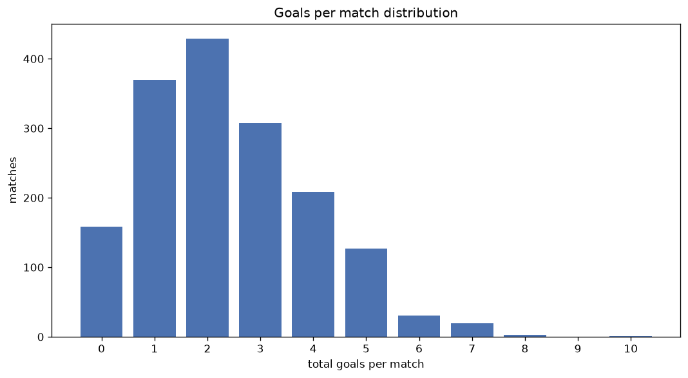
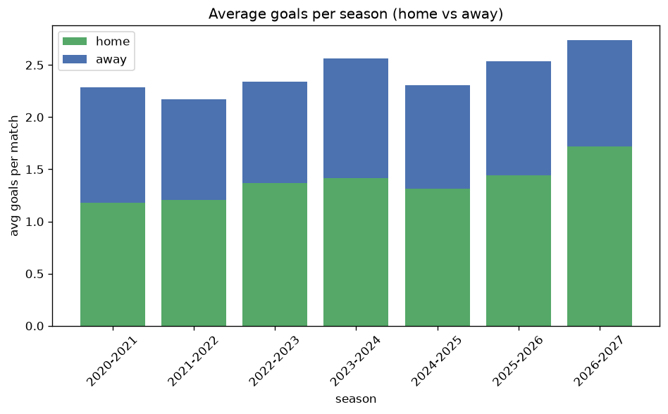

# Goal Analysis
- Report: `goals_analysis`
- Generated: 2026-10-30T04:07:26+00:00
- Script: `backend/scripts/analyze_goals.py` v1.0.0
- League: Superliga (Romania)
- Scope: league `romania1`

## 1. Goals per match distribution
| goals | matches | pct |
|---|---|---|
| 0 | 158 | 9.6% |
| 1 | 370 | 22.4% |
| 2 | 429 | 25.9% |
| 3 | 308 | 18.6% |
| 4 | 208 | 12.6% |
| 5 | 127 | 7.7% |
| 6 | 31 | 1.9% |
| 7 | 19 | 1.1% |
| 8 | 3 | 0.2% |
| 9 | 0 | 0.0% |
| 10 | 1 | 0.1% |

## 2. Goals per match per season
| season | matches | total goals | avg home | avg away | avg total |
|---|---|---|---|---|---|
| 2020-2021 | 240 | 549 | 1.179 | 1.108 | 2.288 |
| 2021-2022 | 240 | 521 | 1.204 | 0.967 | 2.171 |
| 2022-2023 | 240 | 562 | 1.371 | 0.971 | 2.342 |
| 2023-2024 | 240 | 615 | 1.413 | 1.15 | 2.562 |
| 2024-2025 | 240 | 553 | 1.312 | 0.992 | 2.304 |
| 2025-2026 | 350 | 887 | 1.44 | 1.094 | 2.534 |
| 2026-2027 | 104 | 285 | 1.721 | 1.019 | 2.74 |

## 3. Home vs away goal share
- Home goals: **2238** (56.3%)
- Away goals: **1734** (43.7%)
- Home/away ratio: **1.291**

| season | home goals | away goals | total | home pct | away pct |
|---|---|---|---|---|---|
| 2020-2021 | 283 | 266 | 549 | 51.5% | 48.5% |
| 2021-2022 | 289 | 232 | 521 | 55.5% | 44.5% |
| 2022-2023 | 329 | 233 | 562 | 58.5% | 41.5% |
| 2023-2024 | 339 | 276 | 615 | 55.1% | 44.9% |
| 2024-2025 | 315 | 238 | 553 | 57.0% | 43.0% |
| 2025-2026 | 504 | 383 | 887 | 56.8% | 43.2% |
| 2026-2027 | 179 | 106 | 285 | 62.8% | 37.2% |

## 4. BTTS (Both Teams To Score)
- Overall: **800** of `1654` (48.4%)

| season | matches | BTTS | pct |
|---|---|---|---|
| 2020-2021 | 240 | 111 | 46.2% |
| 2021-2022 | 240 | 97 | 40.4% |
| 2022-2023 | 240 | 116 | 48.3% |
| 2023-2024 | 240 | 129 | 53.8% |
| 2024-2025 | 240 | 117 | 48.8% |
| 2025-2026 | 350 | 180 | 51.4% |
| 2026-2027 | 104 | 50 | 48.1% |

## 5. Clean sheets
- Home clean sheets: **558** (33.7%)
- Away clean sheets: **454** (27.4%)
- Total clean sheets recorded: **1012**
- Matches with at least one clean sheet: **854** (51.6%)
- Both teams kept clean sheets (0-0): **158**

| season | matches | home CS | away CS | total CS | matches w/ CS |
|---|---|---|---|---|---|
| 2020-2021 | 240 | 77 | 77 | 154 | 129 (53.8%) |
| 2021-2022 | 240 | 93 | 78 | 171 | 143 (59.6%) |
| 2022-2023 | 240 | 77 | 64 | 141 | 124 (51.7%) |
| 2023-2024 | 240 | 81 | 60 | 141 | 111 (46.2%) |
| 2024-2025 | 240 | 84 | 65 | 149 | 123 (51.2%) |
| 2025-2026 | 350 | 106 | 89 | 195 | 170 (48.6%) |
| 2026-2027 | 104 | 40 | 21 | 61 | 54 (51.9%) |

## 6. Scoring intensity
- First-half goals: **1784** (44.9%)
- Second-half goals: **2185** (55.1%)
- Avg first-half goals per match: **1.079**
- Avg second-half goals per match: **1.322**
- Second-half-only scoring (HT 0-0, FT goals >= 1): **417** (25.2%)
- *1 match(es) excluded (no HT score recorded).*

| season | matches | 1st half | 2nd half | 1st half pct | 2nd half pct |
|---|---|---|---|---|---|
| 2020-2021 | 240 | 245 | 301 | 44.9% | 55.1% |
| 2021-2022 | 240 | 220 | 301 | 42.2% | 57.8% |
| 2022-2023 | 240 | 266 | 296 | 47.3% | 52.7% |
| 2023-2024 | 240 | 285 | 330 | 46.3% | 53.7% |
| 2024-2025 | 240 | 248 | 305 | 44.8% | 55.2% |
| 2025-2026 | 350 | 397 | 490 | 44.8% | 55.2% |
| 2026-2027 | 104 | 123 | 162 | 43.2% | 56.8% |

## 7. First-goal timing
- Matches with first-goal time recorded: `1495` of `1654` (90.4%)
- Goalless matches: `159`
- Min `1` | Max `98` | Mean `33.11` | Median (p50) `28`

| bucket | count | % of matches | % of scoring matches |
|---|---|---|---|
| 1-15 | 452 | 27.3% | 30.2% |
| 16-30 | 358 | 21.6% | 23.9% |
| 31-45 | 241 | 14.6% | 16.1% |
| 46-60 | 207 | 12.5% | 13.8% |
| 61-75 | 137 | 8.3% | 9.2% |
| 76-90 | 72 | 4.4% | 4.8% |
| 91-120 | 28 | 1.7% | 1.9% |

---
*All statistics are computed from PostgreSQL tables (read-only). Run with `python backend/scripts/analyze_goals.py` to regenerate.*

## Charts

