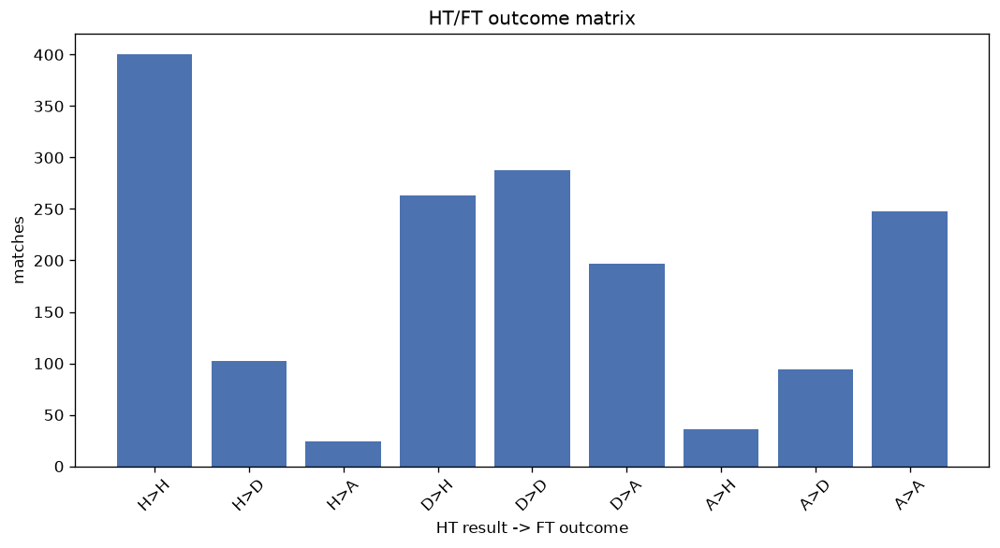
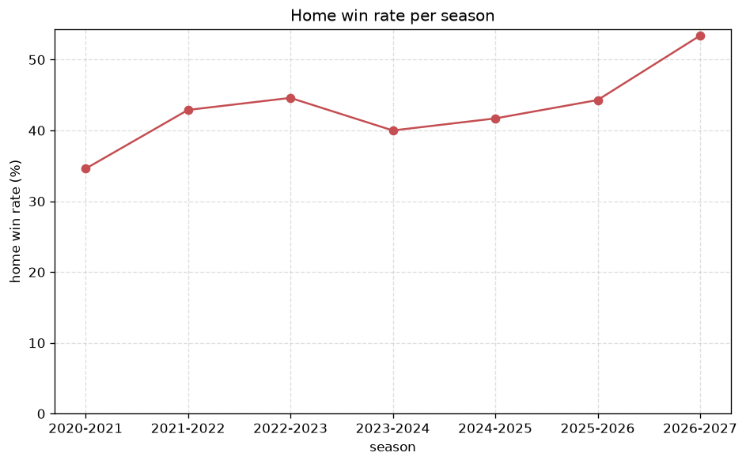

# Match Analysis
- Report: `matches_analysis`
- Generated: 2026-10-27T02:26:44+00:00
- Script: `backend/scripts/analyze_matches.py` v1.0.0
- League: Superliga (Romania)
- Scope: league `romania1`

## 1. Overall summary
| metric | value |
|---|---|
| Matches | 1653 |
| Home wins | 699 (42.3%) |
| Draws | 484 (29.3%) |
| Away wins | 470 (28.4%) |
| Total goals | 3967 |
| Average goals per match | 2.400 |
| Goalless matches | 158 (9.6%) |

## 2. Per-season breakdown
| season | matches | home wins | draws | away wins | total goals | avg goals | goalless |
|---|---|---|---|---|---|---|---|
| 2020-2021 | 240 | 83 (34.6%) | 74 (30.8%) | 83 (34.6%) | 549 | 2.288 | 25 (10.4%) |
| 2021-2022 | 240 | 103 (42.9%) | 68 (28.3%) | 69 (28.8%) | 521 | 2.171 | 28 (11.7%) |
| 2022-2023 | 240 | 107 (44.6%) | 63 (26.2%) | 70 (29.2%) | 562 | 2.342 | 17 (7.1%) |
| 2023-2024 | 240 | 96 (40.0%) | 80 (33.3%) | 64 (26.7%) | 615 | 2.562 | 30 (12.5%) |
| 2024-2025 | 240 | 100 (41.7%) | 78 (32.5%) | 62 (25.8%) | 553 | 2.304 | 26 (10.8%) |
| 2025-2026 | 350 | 155 (44.3%) | 96 (27.4%) | 99 (28.3%) | 887 | 2.534 | 25 (7.1%) |
| 2026-2027 | 103 | 55 (53.4%) | 25 (24.3%) | 23 (22.3%) | 280 | 2.718 | 7 (6.8%) |

## 3. HT/FT outcome matrix
| HT result \ FT result | Home | Draw | Away | total |
|---|---|---|---|---|
| HT home lead | 400 (76.0%) | 102 (19.4%) | 24 (4.6%) | 526 |
| HT draw | 263 (35.2%) | 288 (38.5%) | 197 (26.3%) | 748 |
| HT away lead | 36 (9.5%) | 94 (24.9%) | 248 (65.6%) | 378 |
- *1 match(es) excluded (no HT score recorded).*

## 4. Comeback matches
- Home comebacks (trailing at HT, won at FT): **36** (2.2%)
- Away comebacks (trailing at HT, won at FT): **24** (1.5%)

### Home comebacks
| season | home | away | HT | FT |
|---|---|---|---|---|
| 2020-2021 | FC Hermannstadt | FC Voluntari | 1-2 | 3-2 |
| 2020-2021 | LPS HD Clinceni | Poli Iasi | 0-1 | 2-1 |
| 2020-2021 | FC Arges | Chindia Targoviste | 0-1 | 3-1 |
| 2021-2022 | CFR Cluj | Gaz Metan Medias | 0-1 | 2-1 |
| 2021-2022 | FCSB | FC Botosani | 0-1 | 3-1 |
| 2021-2022 | FCSB | Chindia Targoviste | 0-2 | 3-2 |
| 2022-2023 | FCSB | Chindia Targoviste | 0-2 | 3-2 |
| 2022-2023 | Farul Constanta | FC Voluntari | 0-1 | 2-1 |
| 2022-2023 | FC Arges | Chindia Targoviste | 0-1 | 2-1 |
| 2022-2023 | Univ. Craiova | Farul Constanta | 2-3 | 4-3 |
| 2022-2023 | U Craiova 1948 | FC Voluntari | 0-1 | 2-1 |
| 2022-2023 | Univ. Craiova | UTA Arad | 0-1 | 2-1 |
| 2023-2024 | FC Hermannstadt | UTA Arad | 0-1 | 2-1 |
| 2023-2024 | FC Hermannstadt | FC Voluntari | 0-1 | 3-1 |
| 2023-2024 | Sepsi Sf. Gheorghe | CFR Cluj | 0-1 | 2-1 |
| 2023-2024 | FC Botosani | Poli Iasi | 0-1 | 2-1 |
| 2023-2024 | Petrolul | Poli Iasi | 0-1 | 2-1 |
| 2024-2025 | CFR Cluj | Din. Bucuresti | 1-2 | 3-2 |
| 2024-2025 | FCSB | Farul Constanta | 1-2 | 3-2 |
| 2024-2025 | FC Hermannstadt | FC Botosani | 0-1 | 2-1 |
| 2024-2025 | Poli Iasi | Otelul | 0-1 | 2-1 |
| 2024-2025 | U. Cluj | CFR Cluj | 0-1 | 3-2 |
| 2024-2025 | U. Cluj | Gloria Buzau | 0-1 | 2-1 |
| 2024-2025 | U. Cluj | Unirea Slobozia | 1-2 | 3-2 |
| 2025-2026 | Univ. Craiova | U. Cluj | 0-1 | 2-1 |
| 2025-2026 | Unirea Slobozia | Metaloglobus Bucharest | 0-1 | 2-1 |
| 2025-2026 | Metaloglobus Bucharest | FCSB | 0-1 | 2-1 |
| 2025-2026 | Petrolul | FC Arges | 0-1 | 2-1 |
| 2025-2026 | Univ. Craiova | Metaloglobus Bucharest | 0-1 | 2-1 |
| 2025-2026 | FC Botosani | Unirea Slobozia | 1-2 | 3-2 |
| 2025-2026 | FC Botosani | FCSB | 1-2 | 3-2 |
| 2025-2026 | Farul Constanta | Chindia Targoviste | 0-1 | 2-1 |
| 2026-2027 | U. Cluj | FC Botosani | 0-1 | 2-1 |
| 2026-2027 | Sepsi Sf. Gheorghe | CFR Cluj | 0-1 | 3-1 |
| 2026-2027 | FC Rapid Bucuresti | FC Voluntari | 0-1 | 2-1 |
| 2026-2027 | FCSB | FC Rapid Bucuresti | 0-1 | 4-1 |

### Away comebacks
| season | home | away | HT | FT |
|---|---|---|---|---|
| 2020-2021 | FC Voluntari | Sepsi Sf. Gheorghe | 1-0 | 1-2 |
| 2020-2021 | FC Botosani | UTA Arad | 2-1 | 2-3 |
| 2020-2021 | Chindia Targoviste | Sepsi Sf. Gheorghe | 1-0 | 1-2 |
| 2020-2021 | Poli Iasi | UTA Arad | 1-0 | 1-2 |
| 2021-2022 | Univ. Craiova | FC Botosani | 1-0 | 1-2 |
| 2021-2022 | FC Rapid Bucuresti | Univ. Craiova | 1-0 | 1-2 |
| 2021-2022 | LPS HD Clinceni | FC Rapid Bucuresti | 1-0 | 2-3 |
| 2022-2023 | FC Hermannstadt | Sepsi Sf. Gheorghe | 1-0 | 1-2 |
| 2022-2023 | Petrolul | Chindia Targoviste | 1-0 | 1-2 |
| 2023-2024 | Poli Iasi | Univ. Craiova | 1-0 | 1-4 |
| 2023-2024 | U. Cluj | CFR Cluj | 2-1 | 3-4 |
| 2023-2024 | Otelul | Univ. Craiova | 1-0 | 1-3 |
| 2023-2024 | FC Rapid Bucuresti | U. Cluj | 2-1 | 2-3 |
| 2023-2024 | Petrolul | CFR Cluj | 1-0 | 1-2 |
| 2023-2024 | FC Voluntari | FCSB | 1-0 | 1-2 |
| 2023-2024 | U Craiova 1948 | Univ. Craiova | 1-0 | 1-2 |
| 2024-2025 | CFR Cluj | U. Cluj | 1-0 | 2-3 |
| 2024-2025 | UTA Arad | Univ. Craiova | 1-0 | 1-2 |
| 2024-2025 | Unirea Slobozia | FC Hermannstadt | 1-0 | 1-2 |
| 2025-2026 | FCSB | Farul Constanta | 1-0 | 1-2 |
| 2025-2026 | FC Rapid Bucuresti | U. Cluj | 1-0 | 1-2 |
| 2025-2026 | Unirea Slobozia | Petrolul | 1-0 | 1-2 |
| 2025-2026 | Farul Constanta | FCSB | 1-0 | 2-3 |
| 2026-2027 | CFR Cluj | U. Cluj | 1-0 | 1-3 |

## 5. HT lead conversion
| HT state | matches | converted to win | held as draw | collapsed to loss |
|---|---|---|---|---|
| Home lead | 526 | 400 (76.0%) | 102 (19.4%) | 24 (4.6%) |
| Away lead | 378 | 248 (65.6%) | 94 (24.9%) | 36 (9.5%) |

### Matches level at half-time
| FT result | count | pct |
|---|---|---|
| Home win | 263 | 35.2% |
| Draw | 288 | 38.5% |
| Away win | 197 | 26.3% |
- *1 match(es) excluded (no HT score recorded).*

## 6. First-goal timing
- Matches with a first-goal time recorded: `1494` of `1653` (90.4%)

Outcome distribution by first-goal timing bucket:
| bucket | matches | % of matches | home | draw | away |
|---|---|---|---|---|---|
| 1-15 | 451 | 27.3% | 222 (49.2%) | 102 (22.6%) | 127 (28.2%) |
| 16-30 | 358 | 21.7% | 169 (47.2%) | 83 (23.2%) | 106 (29.6%) |
| 31-45 | 241 | 14.6% | 107 (44.4%) | 65 (27.0%) | 69 (28.6%) |
| 46-60 | 207 | 12.5% | 87 (42.0%) | 50 (24.2%) | 70 (33.8%) |
| 61-75 | 137 | 8.3% | 60 (43.8%) | 20 (14.6%) | 57 (41.6%) |
| 76-90 | 72 | 4.4% | 36 (50.0%) | 6 (8.3%) | 30 (41.7%) |
| 91-120 | 28 | 1.7% | 18 (64.3%) | 0 (0.0%) | 10 (35.7%) |

## 7. Goalless matches
- Overall: **158** of `1653` (9.6%)

| season | matches | goalless | pct |
|---|---|---|---|
| 2020-2021 | 240 | 25 | 10.4% |
| 2021-2022 | 240 | 28 | 11.7% |
| 2022-2023 | 240 | 17 | 7.1% |
| 2023-2024 | 240 | 30 | 12.5% |
| 2024-2025 | 240 | 26 | 10.8% |
| 2025-2026 | 350 | 25 | 7.1% |
| 2026-2027 | 103 | 7 | 6.8% |

---
*All statistics are computed from PostgreSQL tables (read-only). Run with `python backend/scripts/analyze_matches.py` to regenerate.*

## Charts

