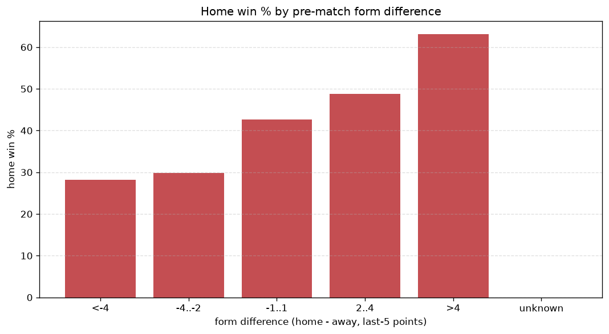
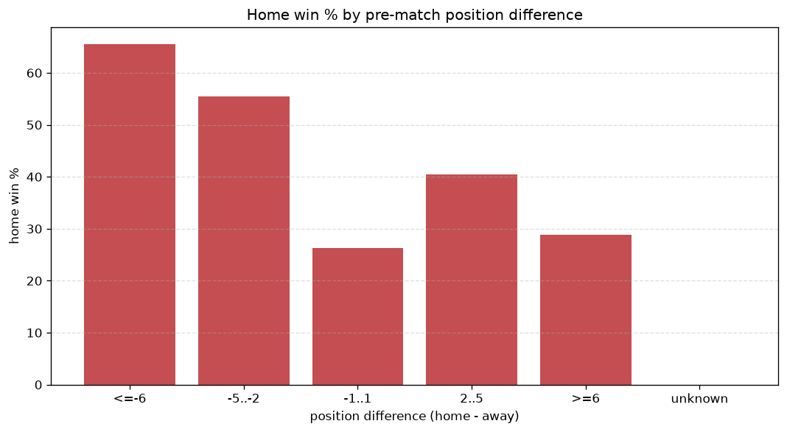

# Relationships Analysis
- Report: `relationships`
- Generated: 2026-10-29T02:11:44+00:00
- Script: `backend/scripts/analyze_relationships.py` v1.0.0
- League: Superliga (Romania)
- Scope: league `romania1`

- Matches analysed: **1550** (23 leakage-safe pre-match features).

## 1. Correlation matrix
_Pearson correlation of each pre-match feature with observed goals; sorted by |corr(total goals)|._

| feature | corr(home) | corr(away) | corr(total) |
|---|---|---|---|
| away_position_before_match | 0.197 | -0.070 | 0.106 |
| position_difference | -0.244 | 0.162 | -0.084 |
| points_difference | 0.240 | -0.161 | 0.081 |
| away_team_points_last_5 | -0.135 | 0.040 | -0.078 |
| away_points_before_match | -0.091 | -0.007 | -0.075 |
| away_team_wins_last_5 | -0.121 | 0.044 | -0.065 |
| away_team_away_conceded_avg | 0.118 | -0.058 | 0.053 |
| away_team_goals_conceded_last_5 | 0.129 | -0.077 | 0.049 |
| away_team_goals_scored_last_5 | -0.078 | 0.019 | -0.048 |
| home_team_home_goals_avg | 0.093 | -0.052 | 0.038 |
| home_team_home_win_rate | 0.111 | -0.076 | 0.036 |
| away_team_away_goals_avg | -0.082 | 0.041 | -0.036 |
| away_team_away_win_rate | -0.091 | 0.060 | -0.032 |
| away_rest_days | 0.038 | 0.003 | 0.031 |
| home_rest_days | 0.049 | -0.022 | 0.023 |
| home_team_goals_conceded_last_5 | -0.059 | 0.105 | 0.022 |
| rest_days_difference | 0.022 | -0.053 | -0.017 |
| home_points_before_match | 0.081 | -0.123 | -0.016 |
| home_team_goals_scored_last_5 | 0.102 | -0.100 | 0.015 |
| home_team_points_last_5 | 0.116 | -0.154 | -0.010 |
| home_position_before_match | -0.137 | 0.152 | -0.008 |
| home_team_home_conceded_avg | -0.076 | 0.087 | -0.003 |
| home_team_wins_last_5 | 0.124 | -0.150 | -0.001 |

## 2. Form vs outcome
_Home win/draw/away % per bucket of `home_team_points_last_5 - away_team_points_last_5`._

| bucket | matches | home | draw | away | home % | draw % | away % |
|---|---|---|---|---|---|---|---|
| <-4 | 262 | 74 | 74 | 114 | 28.2% | 28.2% | 43.5% |
| -4..-2 | 326 | 97 | 117 | 112 | 29.8% | 35.9% | 34.4% |
| -1..1 | 448 | 191 | 137 | 120 | 42.6% | 30.6% | 26.8% |
| 2..4 | 297 | 145 | 79 | 73 | 48.8% | 26.6% | 24.6% |
| >4 | 217 | 137 | 52 | 28 | 63.1% | 24.0% | 12.9% |
| unknown | 0 | 0 | 0 | 0 | - | - | - |

## 3. Position vs outcome
_Home win/draw/away % per bucket of `position_difference` (home position - away position; negative favours the home team)._

| bucket | matches | home | draw | away | home % | draw % | away % |
|---|---|---|---|---|---|---|---|
| <=-6 | 297 | 178 | 71 | 48 | 59.9% | 23.9% | 16.2% |
| -5..-2 | 339 | 173 | 84 | 82 | 51.0% | 24.8% | 24.2% |
| -1..1 | 244 | 87 | 82 | 75 | 35.7% | 33.6% | 30.7% |
| 2..5 | 345 | 130 | 117 | 98 | 37.7% | 33.9% | 28.4% |
| >=6 | 325 | 76 | 105 | 144 | 23.4% | 32.3% | 44.3% |
| unknown | 0 | 0 | 0 | 0 | - | - | - |

## 4. Rest advantage
_Home win/draw/away % per bucket of `rest_days_difference` (home rest - away rest). Matches with unknown rest are bucketed separately._

| bucket | matches | home | draw | away | home % | draw % | away % |
|---|---|---|---|---|---|---|---|
| <-1 | 281 | 106 | 85 | 90 | 37.7% | 30.2% | 32.0% |
| -1..0 | 333 | 147 | 99 | 87 | 44.1% | 29.7% | 26.1% |
| 0 | 278 | 115 | 88 | 75 | 41.4% | 31.7% | 27.0% |
| 1..2 | 511 | 218 | 140 | 153 | 42.7% | 27.4% | 29.9% |
| >2 | 96 | 39 | 27 | 30 | 40.6% | 28.1% | 31.2% |
| unknown | 51 | 19 | 20 | 12 | 37.3% | 39.2% | 23.5% |
- *51 match(es) had unknown rest difference (missing rest data on at least one side).*

## 5. Home team quality
_Home win rate by `home_team_home_win_rate` tier (split at 0.5)._

- `< 0.5` tier: **38.0%** home win (388/1020)
- `>= 0.5` tier: **48.3%** home win (256/530)
- Home-win gap (>= split minus < split): **+10.3 pp**

| tier | label | matches | home | draw | away | home % |
|---|---|---|---|---|---|---|
| low | < 0.5 | 1020 | 388 | 313 | 319 | 38.0% |
| high | >= 0.5 | 530 | 256 | 146 | 128 | 48.3% |

## 6. Feature averages by result
_Mean feature value per outcome; `range` is home-minus-away spread of the group means._

| feature | home mean | draw mean | away mean | range |
|---|---|---|---|---|
| points_difference | 3.276 | -1.453 | -3.756 | 7.033 |
| home_points_before_match | 23.655 | 20.118 | 18.584 | 5.071 |
| position_difference | -1.812 | 0.924 | 2.228 | 4.040 |
| away_position_before_match | 9.915 | 8.209 | 7.872 | 2.042 |
| home_position_before_match | 8.102 | 9.133 | 10.101 | 1.998 |
| away_points_before_match | 20.379 | 21.571 | 22.340 | 1.961 |
| home_team_points_last_5 | 6.675 | 5.758 | 5.201 | 1.474 |
| away_team_points_last_5 | 5.742 | 6.331 | 6.902 | 1.159 |
| home_team_goals_conceded_last_5 | 5.175 | 5.383 | 6.085 | 0.910 |
| home_team_goals_scored_last_5 | 5.803 | 5.020 | 4.926 | 0.877 |
| away_team_goals_conceded_last_5 | 5.716 | 5.203 | 4.839 | 0.877 |
| home_rest_days | 8.425 | 7.872 | 7.720 | 0.705 |
| away_team_goals_scored_last_5 | 5.199 | 5.641 | 5.790 | 0.591 |
| away_rest_days | 8.341 | 8.000 | 7.782 | 0.559 |
| home_team_wins_last_5 | 1.790 | 1.449 | 1.277 | 0.513 |
| away_team_wins_last_5 | 1.477 | 1.649 | 1.857 | 0.380 |
| rest_days_difference | 0.088 | -0.134 | -0.062 | 0.222 |
| away_team_away_conceded_avg | 1.354 | 1.189 | 1.194 | 0.164 |
| home_team_home_goals_avg | 1.336 | 1.186 | 1.191 | 0.150 |
| home_team_home_conceded_avg | 0.955 | 1.027 | 1.103 | 0.148 |
| away_team_away_goals_avg | 0.965 | 1.049 | 1.079 | 0.114 |
| home_team_home_win_rate | 0.411 | 0.355 | 0.339 | 0.072 |
| away_team_away_win_rate | 0.248 | 0.284 | 0.304 | 0.055 |

---
*All features are leakage-safe pre-match values built by `ml.features.build_features.build_rows` from strictly prior matches. Run with `python backend/scripts/analyze_relationships.py` to regenerate.*

## Charts

