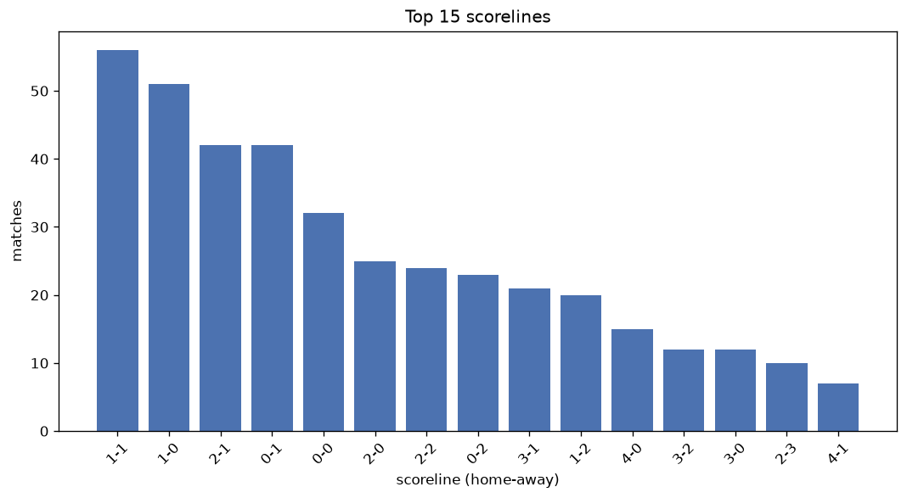
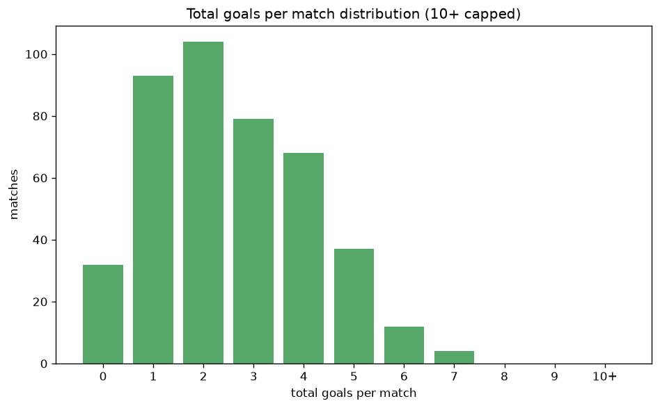

# Scoreline Analysis
- Report: `scoreline_analysis`
- Generated: 2026-10-30T04:07:33+00:00
- Script: `backend/scripts/analyze_scorelines.py` v1.0.0
- League: Superliga (Romania)
- Scope: league `romania1`

## 1. Scoreline frequency
- Matches analysed: **1654** across **7** seasons.
- Distinct scorelines seen: **39**.

| scoreline | count | pct |
|---|---|---|
| 1-1 | 234 | 14.1% |
| 1-0 | 203 | 12.3% |
| 0-1 | 167 | 10.1% |
| 0-0 | 158 | 9.6% |
| 2-1 | 151 | 9.1% |
| 2-0 | 100 | 6.0% |
| 0-2 | 95 | 5.7% |
| 1-2 | 88 | 5.3% |
| 2-2 | 79 | 4.8% |
| 3-1 | 58 | 3.5% |
| 3-0 | 43 | 2.6% |
| 3-2 | 39 | 2.4% |
| 4-0 | 36 | 2.2% |
| 2-3 | 33 | 2.0% |
| 1-3 | 31 | 1.9% |
| 4-1 | 28 | 1.7% |
| 0-3 | 26 | 1.6% |
| 5-0 | 13 | 0.8% |
| 3-3 | 13 | 0.8% |
| 1-4 | 11 | 0.7% |

## 2. Scoreline frequency per season

### 2020-2021
| scoreline | count | pct |
|---|---|---|
| 1-1 | 38 | 15.8% |
| 0-1 | 28 | 11.7% |
| 1-0 | 27 | 11.2% |
| 0-0 | 25 | 10.4% |
| 2-1 | 19 | 7.9% |

### 2021-2022
| scoreline | count | pct |
|---|---|---|
| 1-0 | 38 | 15.8% |
| 1-1 | 31 | 12.9% |
| 0-0 | 28 | 11.7% |
| 0-1 | 26 | 10.8% |
| 2-1 | 18 | 7.5% |

### 2022-2023
| scoreline | count | pct |
|---|---|---|
| 1-1 | 36 | 15.0% |
| 0-1 | 33 | 13.8% |
| 2-1 | 29 | 12.1% |
| 1-0 | 26 | 10.8% |
| 2-0 | 19 | 7.9% |

### 2023-2024
| scoreline | count | pct |
|---|---|---|
| 1-1 | 31 | 12.9% |
| 0-0 | 30 | 12.5% |
| 1-0 | 29 | 12.1% |
| 2-1 | 23 | 9.6% |
| 2-2 | 17 | 7.1% |

### 2024-2025
| scoreline | count | pct |
|---|---|---|
| 1-1 | 40 | 16.7% |
| 1-0 | 30 | 12.5% |
| 0-0 | 26 | 10.8% |
| 0-1 | 21 | 8.8% |
| 2-1 | 19 | 7.9% |

### 2025-2026
| scoreline | count | pct |
|---|---|---|
| 1-1 | 47 | 13.4% |
| 1-0 | 39 | 11.1% |
| 0-1 | 37 | 10.6% |
| 2-1 | 35 | 10.0% |
| 0-0 | 25 | 7.1% |

### 2026-2027
| scoreline | count | pct |
|---|---|---|
| 1-0 | 14 | 13.5% |
| 1-1 | 11 | 10.6% |
| 2-0 | 8 | 7.7% |
| 2-1 | 8 | 7.7% |
| 0-1 | 8 | 7.7% |

## 3. Total-goal histogram
_10+ groups all matches with 10 or more total goals._

| total goals | matches | pct |
|---|---|---|
| 0 | 158 | 9.6% |
| 1 | 370 | 22.4% |
| 2 | 429 | 25.9% |
| 3 | 308 | 18.6% |
| 4 | 208 | 12.6% |
| 5 | 127 | 7.7% |
| 6 | 31 | 1.9% |
| 7 | 19 | 1.1% |
| 8 | 3 | 0.2% |
| 9 | 0 | 0.0% |
| 10+ | 1 | 0.1% |

## 4. Extreme scorelines
- Matches with 7+ total goals: **23**

| season | date | scoreline | total goals |
|---|---|---|---|
| 2021-2022 | 2022-02-17 | 2-8 | 10 |
| 2022-2023 | 2022-12-04 | 8-0 | 8 |
| 2023-2024 | 2023-08-25 | 3-5 | 8 |
| 2024-2025 | 2024-08-31 | 6-2 | 8 |
| 2020-2021 | 2020-09-27 | 5-2 | 7 |
| 2021-2022 | 2021-10-30 | 5-2 | 7 |
| 2021-2022 | 2022-02-10 | 1-6 | 7 |
| 2022-2023 | 2022-09-05 | 4-3 | 7 |
| 2022-2023 | 2022-09-17 | 7-0 | 7 |
| 2022-2023 | 2023-02-27 | 2-5 | 7 |
| 2023-2024 | 2023-07-28 | 3-4 | 7 |
| 2023-2024 | 2023-08-18 | 4-3 | 7 |
| 2023-2024 | 2023-08-21 | 3-4 | 7 |
| 2023-2024 | 2023-09-24 | 2-5 | 7 |
| 2023-2024 | 2023-10-23 | 5-2 | 7 |
| 2023-2024 | 2024-01-19 | 4-3 | 7 |
| 2024-2025 | 2024-12-08 | 3-4 | 7 |
| 2025-2026 | 2025-07-21 | 6-1 | 7 |
| 2025-2026 | 2025-08-02 | 4-3 | 7 |
| 2025-2026 | 2025-08-02 | 4-3 | 7 |
| 2025-2026 | 2026-05-24 | 4-3 | 7 |
| 2026-2027 | 2026-10-12 | 3-4 | 7 |
| 2026-2027 | 2026-10-25 | 4-3 | 7 |

## 5. Margin-of-victory distribution (decided matches)
- Decided matches: **1170** (draws: **484**)
- Average winning margin: **1.66**

| margin | matches | pct |
|---|---|---|
| 1 | 692 | 59.1% |
| 2 | 292 | 25.0% |
| 3+ | 186 | 15.9% |

## 6. Margin by outcome

### Home wins
- Matches: **699** | avg margin: **1.75** | max margin: **8**
| margin | matches | pct |
|---|---|---|
| 1 | 400 | 57.2% |
| 2 | 163 | 23.3% |
| 3+ | 136 | 19.5% |
- *Full match-by-match list available in `scoreline_analysis.json`.*

### Away wins
- Matches: **471** | avg margin: **1.53** | max margin: **6**
| margin | matches | pct |
|---|---|---|
| 1 | 292 | 62.0% |
| 2 | 129 | 27.4% |
| 3+ | 50 | 10.6% |
- *Full match-by-match list available in `scoreline_analysis.json`.*

## 7. Most common exact score by outcome type
| outcome | matches | most common score | count | pct |
|---|---|---|---|---|
| home | 699 | 1-0 | 203 | 29.0% |
| draw | 484 | 1-1 | 234 | 48.3% |
| away | 471 | 0-1 | 167 | 35.5% |

---
*All statistics are computed from PostgreSQL tables (read-only). Run with `python backend/scripts/analyze_scorelines.py` to regenerate.*

## Charts

