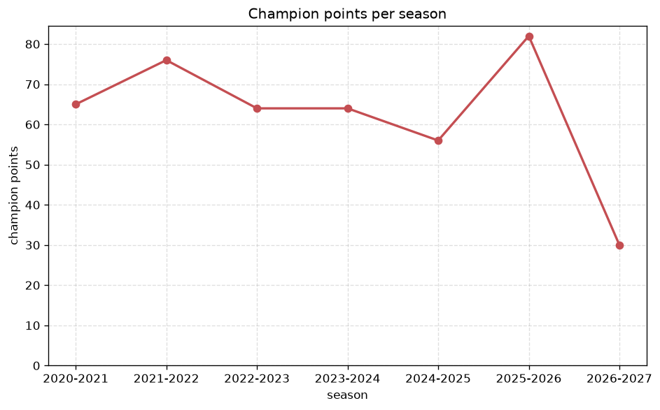
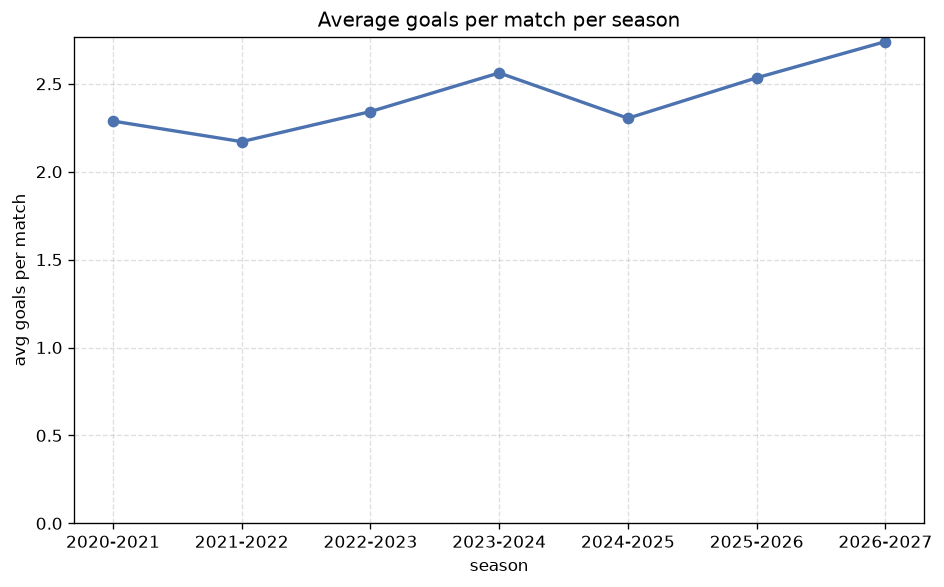

# Season Trends Analysis
- Report: `season_trends`
- Generated: 2026-10-29T02:11:40+00:00
- Script: `backend/scripts/analyze_seasons.py` v1.0.0
- League: Superliga (Romania)
- Scope: league `romania1`

## 1. Champions per season
| season | champion | pts | runner-up | margin |
|---|---|---|---|---|
| 2020-2021 | FCSB | 65 | CFR Cluj | 1 pts |
| 2021-2022 | CFR Cluj | 76 | FCSB | 14 pts |
| 2022-2023 | Farul Constanta | 64 | CFR Cluj | 1 pts |
| 2023-2024 | FCSB | 64 | FC Rapid Bucuresti | 9 pts |
| 2024-2025 | FCSB | 56 | CFR Cluj | 2 pts |
| 2025-2026 | Univ. Craiova | 82 | U. Cluj | 9 pts |
| 2026-2027 | Dinamo Bucuresti | 30 | Univ. Craiova | 1 pts |

## 2. Title-race tightness
- Tight races (margin <= 3 pts): **4** of 7 seasons
- Tightest race: **2020-2021** - FCSB beat CFR Cluj by **1** pts

| season | margin | tight |
|---|---|---|
| 2020-2021 | 1 pts | yes |
| 2021-2022 | 14 pts |  |
| 2022-2023 | 1 pts | yes |
| 2023-2024 | 9 pts |  |
| 2024-2025 | 2 pts | yes |
| 2025-2026 | 9 pts |  |
| 2026-2027 | 1 pts | yes |

## 3. Points thresholds
_Position-specific points per season. Key: 1 = champion, 2 = runner-up, 4 = CL line, 6 = Europa, 13 = last safe, 16 = bottom._

| season | pos 1 | pos 2 | pos 4 | pos 6 | pos 13 | pos 16 |
|---|---|---|---|---|---|---|
| 2020-2021 | 65 | 64 | 45 | 42 | 31 | 25 |
| 2021-2022 | 76 | 62 | 48 | 47 | 29 | 14 |
| 2022-2023 | 64 | 63 | 54 | 42 | 32 | 22 |
| 2023-2024 | 64 | 55 | 49 | 43 | 31 | 21 |
| 2024-2025 | 56 | 54 | 52 | 46 | 31 | 20 |
| 2025-2026 | 82 | 73 | 68 | 64 | 45 | 34 |
| 2026-2027 | 30 | 29 | 23 | 21 | 12 | 5 |

## 4. Relegation battle
| season | safe pos | safe pts | drop pos | drop pts | gap |
|---|---|---|---|---|---|
| 2020-2021 | 13 | 31 | 14 | 27 | 4 pts |
| 2021-2022 | 13 | 29 | 14 | 24 | 5 pts |
| 2022-2023 | 13 | 32 | 14 | 27 | 5 pts |
| 2023-2024 | 13 | 31 | 14 | 29 | 2 pts |
| 2024-2025 | 13 | 31 | 14 | 31 | 0 pts |
| 2025-2026 | 13 | 45 | 14 | 42 | 3 pts |
| 2026-2027 | 13 | 12 | 14 | 11 | 1 pts |

## 5. League-level trends
| season | matches | total goals | avg goals | home win | draw | away win | goalless | avg pts/team |
|---|---|---|---|---|---|---|---|---|
| 2020-2021 | 240 | 549 | 2.288 | 34.6% | 30.8% | 34.6% | 10.4% | 40.38 |
| 2021-2022 | 240 | 521 | 2.171 | 42.9% | 28.3% | 28.8% | 11.7% | 40.75 |
| 2022-2023 | 240 | 562 | 2.342 | 44.6% | 26.2% | 29.2% | 7.1% | 41.06 |
| 2023-2024 | 240 | 615 | 2.562 | 40.0% | 33.3% | 26.7% | 12.5% | 40.0 |
| 2024-2025 | 240 | 553 | 2.304 | 41.7% | 32.5% | 25.8% | 10.8% | 40.12 |
| 2025-2026 | 350 | 887 | 2.534 | 44.3% | 27.4% | 28.3% | 7.1% | 49.74 |
| 2026-2027 | 104 | 285 | 2.74 | 52.9% | 24.0% | 23.1% | 6.7% | 17.94 |

## 6. View divergence
- Largest divergence: **2025-2026** (goals view, avg abs position diff = 7.684)

_Avg absolute position difference between classic view and alternative view per season._

| season | classic vs luck | classic vs goals |
|---|---|---|
| 2020-2021 | 3.125 | 5.500 |
| 2021-2022 | 2.375 | 5.625 |
| 2022-2023 | 2.375 | 4.250 |
| 2023-2024 | 3.500 | 4.375 |
| 2024-2025 | 3.625 | 5.000 |
| 2025-2026 | 4.316 | 7.684 |
| 2026-2027 | 1.375 | 4.500 |

---
*All statistics are computed from PostgreSQL tables (read-only). Run with `python backend/scripts/analyze_seasons.py` to regenerate.*

## Charts

