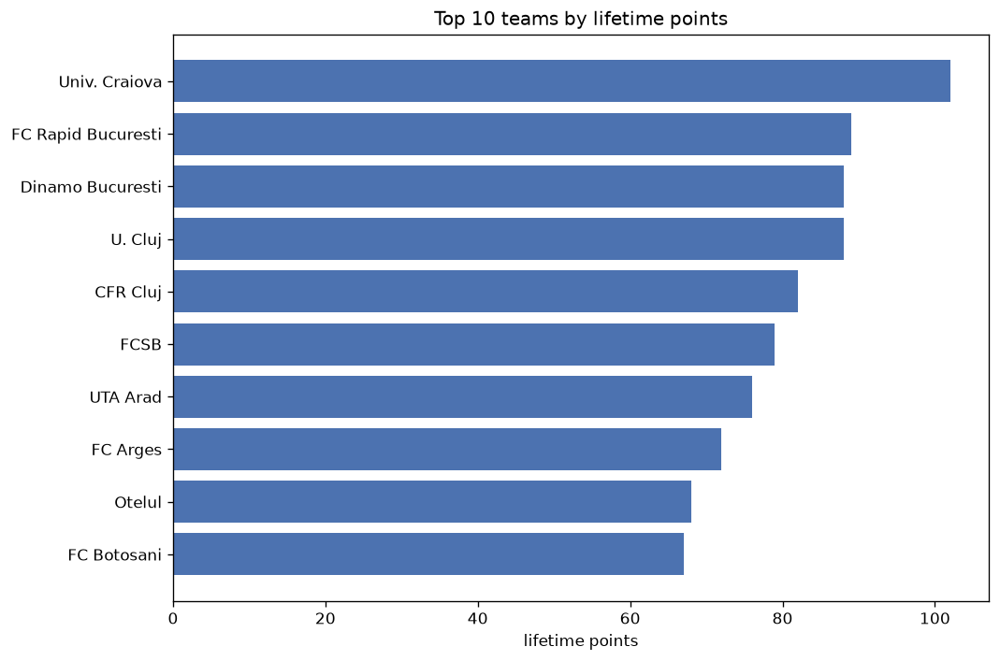
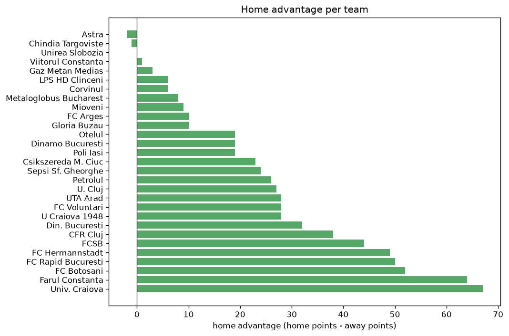

# Team Analysis
- Report: `teams_analysis`
- Generated: 2026-10-30T04:07:28+00:00
- Script: `backend/scripts/analyze_teams.py` v1.0.0
- League: Superliga (Romania)
- Scope: league `romania1`

- Teams: **29** | Seasons: **7** | Matches: **1654**

## 1. Team standings (lifetime)
| team | seasons | played | W | D | L | pts | GF | GA | GD | avg pts/season | best pos | worst pos | titles |
|---|---|---|---|---|---|---|---|---|---|---|---|---|---|
| CFR Cluj | 7 | 204 | 116 | 48 | 40 | 396 | 331 | 189 | 142 | 56.57 | 1 | 9 | 1 |
| FCSB | 7 | 206 | 114 | 50 | 42 | 392 | 348 | 213 | 135 | 56.0 | 1 | 7 | 3 |
| Univ. Craiova | 7 | 205 | 107 | 57 | 41 | 378 | 317 | 181 | 136 | 54.0 | 1 | 4 | 1 |
| FC Rapid Bucuresti | 6 | 175 | 77 | 57 | 41 | 288 | 244 | 173 | 71 | 48.0 | 2 | 9 | 0 |
| UTA Arad | 7 | 204 | 64 | 68 | 72 | 260 | 215 | 244 | -29 | 37.14 | 6 | 14 | 0 |
| Farul Constanta | 6 | 176 | 69 | 51 | 56 | 258 | 238 | 201 | 37 | 43.0 | 1 | 13 | 1 |
| FC Botosani | 7 | 205 | 56 | 74 | 75 | 242 | 228 | 265 | -37 | 34.57 | 6 | 16 | 0 |
| Sepsi Sf. Gheorghe | 6 | 163 | 56 | 56 | 51 | 224 | 212 | 177 | 35 | 37.33 | 4 | 12 | 0 |
| U. Cluj | 5 | 145 | 61 | 40 | 44 | 223 | 189 | 162 | 27 | 44.6 | 2 | 11 | 0 |
| FC Arges | 5 | 145 | 50 | 38 | 57 | 188 | 135 | 157 | -22 | 37.6 | 5 | 15 | 0 |
| FC Hermannstadt | 5 | 163 | 45 | 52 | 66 | 187 | 174 | 209 | -35 | 37.4 | 7 | 15 | 0 |
| Petrolul | 5 | 144 | 43 | 47 | 54 | 176 | 138 | 172 | -34 | 35.2 | 4 | 14 | 0 |
| Din. Bucuresti | 5 | 149 | 46 | 38 | 65 | 176 | 155 | 200 | -45 | 35.2 | 5 | 15 | 0 |
| FC Voluntari | 6 | 135 | 38 | 38 | 59 | 152 | 140 | 180 | -40 | 25.33 | 6 | 18 | 0 |
| Otelul | 4 | 114 | 31 | 42 | 41 | 135 | 128 | 138 | -10 | 33.75 | 9 | 14 | 0 |
| Chindia Targoviste | 4 | 92 | 25 | 32 | 35 | 107 | 83 | 96 | -13 | 26.75 | 8 | 19 | 0 |
| U Craiova 1948 | 3 | 90 | 28 | 20 | 42 | 104 | 108 | 118 | -10 | 34.67 | 8 | 13 | 0 |
| Dinamo Bucuresti | 2 | 54 | 26 | 17 | 11 | 95 | 85 | 51 | 34 | 47.5 | 1 | 5 | 1 |
| Poli Iasi | 3 | 90 | 22 | 23 | 45 | 89 | 91 | 154 | -63 | 29.67 | 12 | 16 | 0 |
| Unirea Slobozia | 2 | 71 | 16 | 12 | 43 | 60 | 66 | 108 | -42 | 30.0 | 15 | 16 | 0 |
| LPS HD Clinceni | 2 | 60 | 13 | 19 | 28 | 58 | 51 | 90 | -39 | 29.0 | 5 | 16 | 0 |
| Gaz Metan Medias | 2 | 60 | 15 | 12 | 33 | 57 | 54 | 87 | -33 | 28.5 | 11 | 14 | 0 |
| Csikszereda M. Ciuc | 2 | 54 | 14 | 13 | 27 | 55 | 52 | 98 | -46 | 27.5 | 12 | 16 | 0 |
| Mioveni | 2 | 60 | 10 | 21 | 29 | 51 | 42 | 81 | -39 | 25.5 | 13 | 16 | 0 |
| Astra | 1 | 30 | 9 | 11 | 10 | 38 | 38 | 39 | -1 | 38.0 | 9 | 9 | 0 |
| Viitorul Constanta | 1 | 30 | 6 | 13 | 11 | 31 | 36 | 37 | -1 | 31.0 | 13 | 13 | 0 |
| Metaloglobus Bucharest | 1 | 41 | 4 | 10 | 27 | 22 | 35 | 85 | -50 | 22.0 | 17 | 17 | 0 |
| Gloria Buzau | 1 | 30 | 5 | 5 | 20 | 20 | 25 | 51 | -26 | 20.0 | 16 | 16 | 0 |
| Corvinul | 1 | 13 | 4 | 4 | 5 | 16 | 14 | 16 | -2 | 16.0 | 10 | 10 | 0 |

## 2. Home vs away split
| team | home P | H-W | H-D | H-L | H-pts | away P | A-W | A-D | A-L | A-pts | adv |
|---|---|---|---|---|---|---|---|---|---|---|---|
| Univ. Craiova | 103 | 66 | 23 | 14 | 221 | 102 | 41 | 34 | 27 | 157 | 64 |
| Farul Constanta | 88 | 47 | 20 | 21 | 161 | 88 | 22 | 31 | 35 | 97 | 64 |
| FC Botosani | 102 | 35 | 42 | 25 | 147 | 103 | 21 | 32 | 50 | 95 | 52 |
| FC Rapid Bucuresti | 88 | 48 | 25 | 15 | 169 | 87 | 29 | 32 | 26 | 119 | 50 |
| FC Hermannstadt | 81 | 31 | 25 | 25 | 118 | 82 | 14 | 27 | 41 | 69 | 49 |
| FCSB | 104 | 64 | 26 | 14 | 218 | 102 | 50 | 24 | 28 | 174 | 44 |
| CFR Cluj | 101 | 65 | 22 | 14 | 217 | 103 | 51 | 26 | 26 | 179 | 38 |
| Din. Bucuresti | 75 | 28 | 20 | 27 | 104 | 74 | 18 | 18 | 38 | 72 | 32 |
| UTA Arad | 102 | 37 | 33 | 32 | 144 | 102 | 27 | 35 | 40 | 116 | 28 |
| FC Voluntari | 68 | 24 | 18 | 26 | 90 | 67 | 14 | 20 | 33 | 62 | 28 |
| U Craiova 1948 | 45 | 19 | 9 | 17 | 66 | 45 | 9 | 11 | 25 | 38 | 28 |
| U. Cluj | 73 | 35 | 20 | 18 | 125 | 72 | 26 | 20 | 26 | 98 | 27 |
| Petrolul | 71 | 26 | 23 | 22 | 101 | 73 | 17 | 24 | 32 | 75 | 26 |
| Sepsi Sf. Gheorghe | 81 | 32 | 28 | 21 | 124 | 82 | 24 | 28 | 30 | 100 | 24 |
| Csikszereda M. Ciuc | 26 | 10 | 9 | 7 | 39 | 28 | 4 | 4 | 20 | 16 | 23 |
| Otelul | 58 | 18 | 23 | 17 | 77 | 56 | 13 | 19 | 24 | 58 | 19 |
| Dinamo Bucuresti | 27 | 17 | 6 | 4 | 57 | 27 | 9 | 11 | 7 | 38 | 19 |
| Poli Iasi | 45 | 14 | 12 | 19 | 54 | 45 | 8 | 11 | 26 | 35 | 19 |
| FC Arges | 73 | 26 | 21 | 26 | 99 | 72 | 24 | 17 | 31 | 89 | 10 |
| Gloria Buzau | 15 | 4 | 3 | 8 | 15 | 15 | 1 | 2 | 12 | 5 | 10 |
| Mioveni | 30 | 6 | 12 | 12 | 30 | 30 | 4 | 9 | 17 | 21 | 9 |
| Metaloglobus Bucharest | 20 | 3 | 6 | 11 | 15 | 21 | 1 | 4 | 16 | 7 | 8 |
| LPS HD Clinceni | 30 | 8 | 8 | 14 | 32 | 30 | 5 | 11 | 14 | 26 | 6 |
| Corvinul | 7 | 3 | 2 | 2 | 11 | 6 | 1 | 2 | 3 | 5 | 6 |
| Gaz Metan Medias | 30 | 7 | 9 | 14 | 30 | 30 | 8 | 3 | 19 | 27 | 3 |
| Viitorul Constanta | 15 | 3 | 7 | 5 | 16 | 15 | 3 | 6 | 6 | 15 | 1 |
| Unirea Slobozia | 35 | 8 | 6 | 21 | 30 | 36 | 8 | 6 | 22 | 30 | 0 |
| Chindia Targoviste | 46 | 11 | 20 | 15 | 53 | 46 | 14 | 12 | 20 | 54 | -1 |
| Astra | 15 | 4 | 6 | 5 | 18 | 15 | 5 | 5 | 5 | 20 | -2 |

## 3. Top performers
### Best points per game (PPG)
| rank | team | PPG |
|---|---|---|
| 1 | CFR Cluj | 1.94 |
| 2 | FCSB | 1.90 |
| 3 | Univ. Craiova | 1.84 |
| 4 | Dinamo Bucuresti | 1.76 |
| 5 | FC Rapid Bucuresti | 1.65 |

### Most goals scored
| rank | team | goals |
|---|---|---|
| 1 | FCSB | 348 |
| 2 | CFR Cluj | 331 |
| 3 | Univ. Craiova | 317 |
| 4 | FC Rapid Bucuresti | 244 |
| 5 | Farul Constanta | 238 |

### Best goal difference
| rank | team | GD |
|---|---|---|
| 1 | CFR Cluj | 142 |
| 2 | Univ. Craiova | 136 |
| 3 | FCSB | 135 |
| 4 | FC Rapid Bucuresti | 71 |
| 5 | Farul Constanta | 37 |

### Best defence (goals against per match, standings)
| rank | team | GA/match |
|---|---|---|
| 1 | Univ. Craiova | 0.883 |
| 2 | Dinamo Bucuresti | 0.925 |
| 3 | CFR Cluj | 0.926 |
| 4 | FC Rapid Bucuresti | 0.989 |
| 5 | FCSB | 1.025 |

## 4. Team consistency
- Teams present in all **7** seasons: **5**

CFR Cluj, FC Botosani, FCSB, UTA Arad, Univ. Craiova

## 5. Head-to-head dominance
- Distinct fixtures: **321** (showing the 15 most frequent)

| fixture | meetings | home wins | draws | away wins | home pct | draw pct | away pct |
|---|---|---|---|---|---|---|---|
| FCSB vs FC Botosani | 15 | 11 | 1 | 3 | 73.3% | 6.7% | 20.0% |
| FCSB vs UTA Arad | 14 | 9 | 1 | 4 | 64.3% | 7.1% | 28.6% |
| FC Botosani vs UTA Arad | 14 | 8 | 4 | 2 | 57.1% | 28.6% | 14.3% |
| CFR Cluj vs Univ. Craiova | 14 | 5 | 6 | 3 | 35.7% | 42.9% | 21.4% |
| CFR Cluj vs FC Rapid Bucuresti | 13 | 8 | 3 | 2 | 61.5% | 23.1% | 15.4% |
| CFR Cluj vs FC Botosani | 13 | 7 | 4 | 2 | 53.8% | 30.8% | 15.4% |
| FCSB vs Univ. Craiova | 13 | 7 | 3 | 3 | 53.8% | 23.1% | 23.1% |
| Univ. Craiova vs UTA Arad | 13 | 6 | 3 | 4 | 46.2% | 23.1% | 30.8% |
| FCSB vs CFR Cluj | 13 | 5 | 5 | 3 | 38.5% | 38.5% | 23.1% |
| Univ. Craiova vs FC Rapid Bucuresti | 13 | 4 | 7 | 2 | 30.8% | 53.8% | 15.4% |
| CFR Cluj vs UTA Arad | 13 | 2 | 4 | 7 | 15.4% | 30.8% | 53.8% |
| Univ. Craiova vs FC Botosani | 12 | 5 | 6 | 1 | 41.7% | 50.0% | 8.3% |
| FC Botosani vs Farul Constanta | 12 | 3 | 7 | 2 | 25.0% | 58.3% | 16.7% |
| UTA Arad vs Farul Constanta | 12 | 3 | 8 | 1 | 25.0% | 66.7% | 8.3% |
| FCSB vs Farul Constanta | 12 | 2 | 3 | 7 | 16.7% | 25.0% | 58.3% |

## 6. Position per season (classic view)
_Cells show final position; '-' when the team was absent from that season._

| team | 2020-2021 | 2021-2022 | 2022-2023 | 2023-2024 | 2024-2025 | 2025-2026 | 2026-2027 |
|---|---|---|---|---|---|---|---|
| CFR Cluj | 2 | 1 | 2 | 3 | 2 | 3 | 9 |
| FCSB | 1 | 2 | 3 | 1 | 1 | 7 | 6 |
| Univ. Craiova | 3 | 3 | 4 | 4 | 3 | 1 | 2 |
| FC Rapid Bucuresti | - | 9 | 5 | 2 | 6 | 4 | 3 |
| UTA Arad | 10 | 8 | 14 | 9 | 11 | 6 | 8 |
| Farul Constanta | - | 4 | 1 | 6 | 10 | 13 | 7 |
| FC Botosani | 6 | 7 | 13 | 16 | 13 | 10 | 11 |
| Sepsi Sf. Gheorghe | 4 | 10 | 6 | 5 | 7 | - | 12 |
| U. Cluj | - | - | 11 | 7 | 4 | 2 | 5 |
| FC Arges | 7 | 5 | 15 | - | - | 8 | 13 |
| FC Hermannstadt | 15 | - | 7 | 8 | 8 | 15 | - |
| Petrolul | - | - | 9 | 10 | 9 | 14 | 4 |
| Din. Bucuresti | 14 | 15 | - | 14 | 5 | 11 | - |
| FC Voluntari | 12 | 6 | 10 | 15 | - | 18 | 15 |
| Otelul | - | - | - | 11 | 12 | 9 | 14 |
| Chindia Targoviste | 8 | 11 | 12 | - | - | 19 | - |
| U Craiova 1948 | - | 12 | 8 | 13 | - | - | - |
| Dinamo Bucuresti | - | - | - | - | - | 5 | 1 |
| Poli Iasi | 16 | - | - | 12 | 14 | - | - |
| Unirea Slobozia | - | - | - | - | 15 | 16 | - |
| LPS HD Clinceni | 5 | 16 | - | - | - | - | - |
| Gaz Metan Medias | 11 | 14 | - | - | - | - | - |
| Csikszereda M. Ciuc | - | - | - | - | - | 12 | 16 |
| Mioveni | - | 13 | 16 | - | - | - | - |
| Astra | 9 | - | - | - | - | - | - |
| Viitorul Constanta | 13 | - | - | - | - | - | - |
| Metaloglobus Bucharest | - | - | - | - | - | 17 | - |
| Gloria Buzau | - | - | - | - | 16 | - | - |
| Corvinul | - | - | - | - | - | - | 10 |

---
*All statistics are computed from PostgreSQL tables (read-only). Run with `python backend/scripts/analyze_teams.py` to regenerate.*

## Charts

