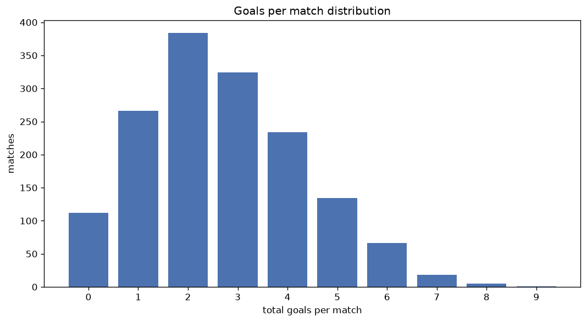
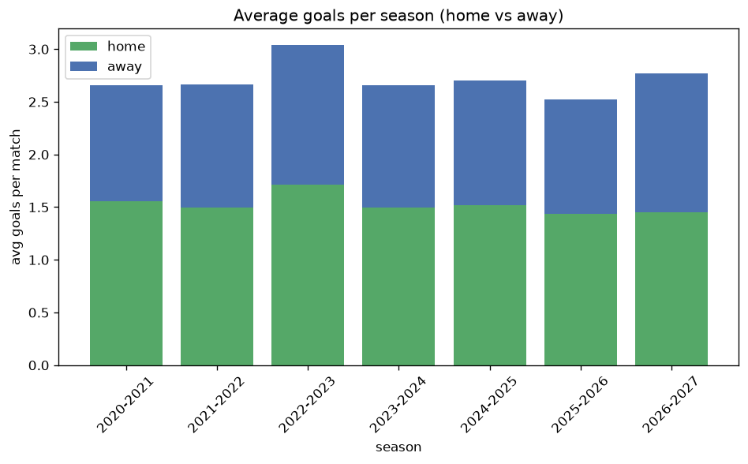

# Goal Analysis
- Report: `goals_analysis`
- Generated: 2026-10-29T02:11:54+00:00
- Script: `backend/scripts/analyze_goals.py` v1.0.0
- League: Premier League (Russia)
- Scope: league `russia`

## 1. Goals per match distribution
| goals | matches | pct |
|---|---|---|
| 0 | 112 | 7.3% |
| 1 | 266 | 17.2% |
| 2 | 384 | 24.9% |
| 3 | 324 | 21.0% |
| 4 | 234 | 15.2% |
| 5 | 134 | 8.7% |
| 6 | 66 | 4.3% |
| 7 | 18 | 1.2% |
| 8 | 5 | 0.3% |
| 9 | 1 | 0.1% |

## 2. Goals per match per season
| season | matches | total goals | avg home | avg away | avg total |
|---|---|---|---|---|---|
| 2020-2021 | 240 | 637 | 1.558 | 1.096 | 2.654 |
| 2021-2022 | 240 | 639 | 1.496 | 1.167 | 2.663 |
| 2022-2023 | 240 | 730 | 1.712 | 1.329 | 3.042 |
| 2023-2024 | 240 | 637 | 1.496 | 1.158 | 2.654 |
| 2024-2025 | 240 | 648 | 1.517 | 1.183 | 2.7 |
| 2025-2026 | 244 | 615 | 1.434 | 1.086 | 2.52 |
| 2026-2027 | 100 | 277 | 1.45 | 1.32 | 2.77 |

## 3. Home vs away goal share
- Home goals: **2362** (56.5%)
- Away goals: **1821** (43.5%)
- Home/away ratio: **1.297**

| season | home goals | away goals | total | home pct | away pct |
|---|---|---|---|---|---|
| 2020-2021 | 374 | 263 | 637 | 58.7% | 41.3% |
| 2021-2022 | 359 | 280 | 639 | 56.2% | 43.8% |
| 2022-2023 | 411 | 319 | 730 | 56.3% | 43.7% |
| 2023-2024 | 359 | 278 | 637 | 56.4% | 43.6% |
| 2024-2025 | 364 | 284 | 648 | 56.2% | 43.8% |
| 2025-2026 | 350 | 265 | 615 | 56.9% | 43.1% |
| 2026-2027 | 145 | 132 | 277 | 52.3% | 47.7% |

## 4. BTTS (Both Teams To Score)
- Overall: **820** of `1544` (53.1%)

| season | matches | BTTS | pct |
|---|---|---|---|
| 2020-2021 | 240 | 111 | 46.2% |
| 2021-2022 | 240 | 138 | 57.5% |
| 2022-2023 | 240 | 136 | 56.7% |
| 2023-2024 | 240 | 128 | 53.3% |
| 2024-2025 | 240 | 123 | 51.2% |
| 2025-2026 | 244 | 125 | 51.2% |
| 2026-2027 | 100 | 59 | 59.0% |

## 5. Clean sheets
- Home clean sheets: **492** (31.9%)
- Away clean sheets: **344** (22.3%)
- Total clean sheets recorded: **836**
- Matches with at least one clean sheet: **724** (46.9%)
- Both teams kept clean sheets (0-0): **112**

| season | matches | home CS | away CS | total CS | matches w/ CS |
|---|---|---|---|---|---|
| 2020-2021 | 240 | 86 | 60 | 146 | 129 (53.8%) |
| 2021-2022 | 240 | 70 | 50 | 120 | 102 (42.5%) |
| 2022-2023 | 240 | 68 | 50 | 118 | 104 (43.3%) |
| 2023-2024 | 240 | 82 | 50 | 132 | 112 (46.7%) |
| 2024-2025 | 240 | 79 | 58 | 137 | 117 (48.8%) |
| 2025-2026 | 244 | 81 | 53 | 134 | 119 (48.8%) |
| 2026-2027 | 100 | 26 | 23 | 49 | 41 (41.0%) |

## 6. Scoring intensity
- First-half goals: **1827** (43.8%)
- Second-half goals: **2347** (56.2%)
- Avg first-half goals per match: **1.186**
- Avg second-half goals per match: **1.523**
- Second-half-only scoring (HT 0-0, FT goals >= 1): **359** (23.3%)
- *3 match(es) excluded (no HT score recorded).*

| season | matches | 1st half | 2nd half | 1st half pct | 2nd half pct |
|---|---|---|---|---|---|
| 2020-2021 | 240 | 260 | 371 | 41.2% | 58.8% |
| 2021-2022 | 240 | 289 | 350 | 45.2% | 54.8% |
| 2022-2023 | 240 | 316 | 411 | 43.5% | 56.5% |
| 2023-2024 | 240 | 278 | 359 | 43.6% | 56.4% |
| 2024-2025 | 240 | 287 | 361 | 44.3% | 55.7% |
| 2025-2026 | 244 | 285 | 330 | 46.3% | 53.7% |
| 2026-2027 | 100 | 112 | 165 | 40.4% | 59.6% |

## 7. First-goal timing
- Matches with first-goal time recorded: `1429` of `1544` (92.6%)
- Goalless matches: `115`
- Min `1` | Max `99` | Mean `32.53` | Median (p50) `27`

| bucket | count | % of matches | % of scoring matches |
|---|---|---|---|
| 1-15 | 435 | 28.2% | 30.4% |
| 16-30 | 345 | 22.3% | 24.1% |
| 31-45 | 249 | 16.1% | 17.4% |
| 46-60 | 193 | 12.5% | 13.5% |
| 61-75 | 109 | 7.1% | 7.6% |
| 76-90 | 77 | 5.0% | 5.4% |
| 91-120 | 21 | 1.4% | 1.5% |

---
*All statistics are computed from PostgreSQL tables (read-only). Run with `python backend/scripts/analyze_goals.py` to regenerate.*

## Charts

