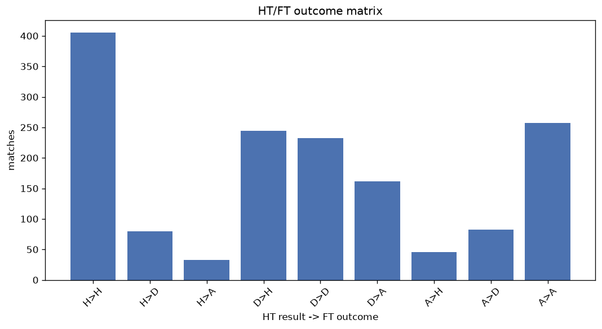
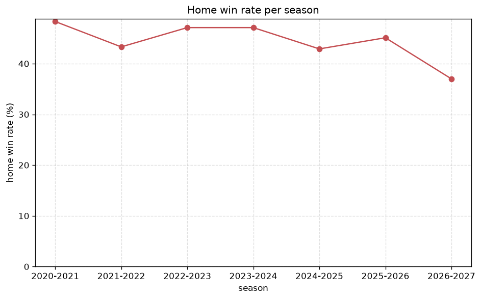

# Match Analysis
- Report: `matches_analysis`
- Generated: 2026-10-27T02:27:02+00:00
- Script: `backend/scripts/analyze_matches.py` v1.0.0
- League: Premier League (Russia)
- Scope: league `russia`

## 1. Overall summary
| metric | value |
|---|---|
| Matches | 1544 |
| Home wins | 696 (45.1%) |
| Draws | 394 (25.5%) |
| Away wins | 454 (29.4%) |
| Total goals | 4183 |
| Average goals per match | 2.709 |
| Goalless matches | 112 (7.3%) |

## 2. Per-season breakdown
| season | matches | home wins | draws | away wins | total goals | avg goals | goalless |
|---|---|---|---|---|---|---|---|
| 2020-2021 | 240 | 116 (48.3%) | 50 (20.8%) | 74 (30.8%) | 637 | 2.654 | 17 (7.1%) |
| 2021-2022 | 240 | 104 (43.3%) | 59 (24.6%) | 77 (32.1%) | 639 | 2.663 | 18 (7.5%) |
| 2022-2023 | 240 | 113 (47.1%) | 54 (22.5%) | 73 (30.4%) | 730 | 3.042 | 14 (5.8%) |
| 2023-2024 | 240 | 113 (47.1%) | 66 (27.5%) | 61 (25.4%) | 637 | 2.654 | 20 (8.3%) |
| 2024-2025 | 240 | 103 (42.9%) | 65 (27.1%) | 72 (30.0%) | 648 | 2.7 | 20 (8.3%) |
| 2025-2026 | 244 | 110 (45.1%) | 67 (27.5%) | 67 (27.5%) | 615 | 2.52 | 15 (6.1%) |
| 2026-2027 | 100 | 37 (37.0%) | 33 (33.0%) | 30 (30.0%) | 277 | 2.77 | 8 (8.0%) |

## 3. HT/FT outcome matrix
| HT result \ FT result | Home | Draw | Away | total |
|---|---|---|---|---|
| HT home lead | 405 (78.2%) | 80 (15.4%) | 33 (6.4%) | 518 |
| HT draw | 244 (38.2%) | 232 (36.4%) | 162 (25.4%) | 638 |
| HT away lead | 46 (11.9%) | 82 (21.3%) | 257 (66.8%) | 385 |
- *3 match(es) excluded (no HT score recorded).*

## 4. Comeback matches
- Home comebacks (trailing at HT, won at FT): **46** (3.0%)
- Away comebacks (trailing at HT, won at FT): **33** (2.1%)

### Home comebacks
| season | home | away | HT | FT |
|---|---|---|---|---|
| 2020-2021 | Spartak Moscow | Lokomotiv Moscow | 0-1 | 2-1 |
| 2020-2021 | Zenit | Krasnodar | 0-1 | 3-1 |
| 2020-2021 | Khimki | Lokomotiv Moscow | 1-2 | 3-2 |
| 2020-2021 | Spartak Moscow | Khimki | 0-1 | 2-1 |
| 2020-2021 | Dynamo Moscow | CSKA Moscow | 0-1 | 3-2 |
| 2021-2022 | Lokomotiv Moscow | Arsenal Tula | 0-1 | 3-1 |
| 2021-2022 | Dynamo Moscow | CSKA Moscow | 0-1 | 2-1 |
| 2021-2022 | Rubin Kazan | Akhmat Grozny | 0-1 | 2-1 |
| 2021-2022 | Ufa | Khimki | 0-1 | 3-2 |
| 2021-2022 | CSKA Moscow | Krylya Sovetov | 0-1 | 3-1 |
| 2021-2022 | Akhmat Grozny | Ufa | 0-1 | 2-1 |
| 2021-2022 | Khimki | CSKA Moscow | 1-2 | 4-2 |
| 2021-2022 | Sochi | Akhmat Grozny | 0-1 | 3-2 |
| 2021-2022 | Spartak Moscow | Krylya Sovetov | 0-1 | 2-1 |
| 2022-2023 | CSKA Moscow | Fakel Voronezh | 0-1 | 4-1 |
| 2022-2023 | Pari NN | Fakel Voronezh | 0-1 | 3-1 |
| 2022-2023 | Orenburg | Akhmat Grozny | 0-1 | 2-1 |
| 2022-2023 | FK Rostov | Krasnodar | 0-2 | 3-2 |
| 2022-2023 | Krylya Sovetov | Pari NN | 0-1 | 2-1 |
| 2022-2023 | Lokomotiv Moscow | Krasnodar | 0-2 | 3-2 |
| 2022-2023 | Spartak Moscow | Krasnodar | 0-1 | 4-3 |
| 2023-2024 | Dynamo Moscow | CSKA Moscow | 0-1 | 2-1 |
| 2023-2024 | Krasnodar | FK Rostov | 0-2 | 3-2 |
| 2023-2024 | CSKA Moscow | Pari NN | 1-2 | 3-2 |
| 2023-2024 | FK Rostov | Orenburg | 0-1 | 2-1 |
| 2024-2025 | FK Rostov | Orenburg | 0-2 | 3-2 |
| 2024-2025 | Krasnodar | Pari NN | 0-1 | 2-1 |
| 2024-2025 | Zenit | Fakel Voronezh | 0-1 | 3-1 |
| 2024-2025 | Dynamo Makhachkala | Orenburg | 0-1 | 2-1 |
| 2024-2025 | Krylya Sovetov | Akhmat Grozny | 0-1 | 2-1 |
| 2024-2025 | Orenburg | Dynamo Makhachkala | 0-1 | 2-1 |
| 2024-2025 | Rubin Kazan | Fakel Voronezh | 0-1 | 2-1 |
| 2024-2025 | Zenit | Pari NN | 0-1 | 2-1 |
| 2025-2026 | Zenit | FK Rostov | 0-1 | 2-1 |
| 2025-2026 | Spartak Moscow | Krylya Sovetov | 0-1 | 2-1 |
| 2025-2026 | Akron Togliatti | Sochi | 0-1 | 3-2 |
| 2025-2026 | Akhmat Grozny | Dynamo Moscow | 0-1 | 2-1 |
| 2025-2026 | Orenburg | Zenit | 0-1 | 2-1 |
| 2025-2026 | Spartak Moscow | Lokomotiv Moscow | 0-1 | 2-1 |
| 2025-2026 | Sochi | Krylya Sovetov | 0-1 | 2-1 |
| 2025-2026 | Orenburg | Pari NN | 0-1 | 2-1 |
| 2025-2026 | Zenit | Sochi | 0-1 | 2-1 |
| 2025-2026 | Dynamo Moscow | Krasnodar | 0-1 | 2-1 |
| 2026-2027 | Dynamo Makhachkala | Lokomotiv Moscow | 0-1 | 2-1 |
| 2026-2027 | Zenit | Lokomotiv Moscow | 0-1 | 2-1 |
| 2026-2027 | Zenit | Akhmat Grozny | 0-1 | 3-2 |

### Away comebacks
| season | home | away | HT | FT |
|---|---|---|---|---|
| 2020-2021 | Khimki | Akhmat Grozny | 1-0 | 1-2 |
| 2020-2021 | Tambov | R. Volgograd | 1-0 | 1-3 |
| 2020-2021 | Krasnodar | Dynamo Moscow | 1-0 | 2-3 |
| 2020-2021 | Arsenal Tula | Rubin Kazan | 2-0 | 2-4 |
| 2021-2022 | Dynamo Moscow | Pari NN | 1-0 | 1-2 |
| 2021-2022 | Zenit | Sochi | 1-0 | 1-2 |
| 2021-2022 | Khimki | Arsenal Tula | 1-0 | 1-2 |
| 2021-2022 | Akhmat Grozny | Rubin Kazan | 1-0 | 1-2 |
| 2021-2022 | Akhmat Grozny | Lokomotiv Moscow | 2-1 | 2-3 |
| 2021-2022 | Rubin Kazan | Ufa | 1-0 | 1-2 |
| 2022-2023 | Orenburg | Krylya Sovetov | 1-0 | 2-4 |
| 2022-2023 | Fakel Voronezh | Spartak Moscow | 1-0 | 1-4 |
| 2022-2023 | Spartak Moscow | Zenit | 1-0 | 1-2 |
| 2022-2023 | Pari NN | Spartak Moscow | 1-0 | 1-2 |
| 2022-2023 | Akhmat Grozny | FK Rostov | 1-0 | 1-2 |
| 2023-2024 | Zenit | Lokomotiv Moscow | 1-0 | 1-2 |
| 2023-2024 | Akhmat Grozny | Fakel Voronezh | 1-0 | 1-2 |
| 2023-2024 | CSKA Moscow | Dynamo Moscow | 2-1 | 2-3 |
| 2023-2024 | Dynamo Moscow | Spartak Moscow | 1-0 | 1-2 |
| 2023-2024 | Krasnodar | Zenit | 1-0 | 1-2 |
| 2023-2024 | Pari NN | Lokomotiv Moscow | 1-0 | 2-3 |
| 2024-2025 | Rubin Kazan | Khimki | 1-0 | 2-3 |
| 2024-2025 | Akron Togliatti | Rubin Kazan | 1-0 | 1-2 |
| 2024-2025 | Akhmat Grozny | Fakel Voronezh | 2-1 | 2-3 |
| 2024-2025 | Orenburg | Rubin Kazan | 1-0 | 1-2 |
| 2024-2025 | CSKA Moscow | FK Rostov | 1-0 | 1-2 |
| 2024-2025 | Dynamo Makhachkala | Rubin Kazan | 2-1 | 2-3 |
| 2024-2025 | Khimki | Krylya Sovetov | 1-0 | 1-3 |
| 2024-2025 | Akron Togliatti | Spartak Moscow | 2-1 | 2-3 |
| 2025-2026 | Akron Togliatti | Orenburg | 1-0 | 1-2 |
| 2025-2026 | Sochi | CSKA Moscow | 1-0 | 1-3 |
| 2025-2026 | Pari NN | CSKA Moscow | 1-0 | 1-2 |
| 2026-2027 | Zenit | Rodina Moscow | 1-0 | 1-2 |

## 5. HT lead conversion
| HT state | matches | converted to win | held as draw | collapsed to loss |
|---|---|---|---|---|
| Home lead | 518 | 405 (78.2%) | 80 (15.4%) | 33 (6.4%) |
| Away lead | 385 | 257 (66.8%) | 82 (21.3%) | 46 (11.9%) |

### Matches level at half-time
| FT result | count | pct |
|---|---|---|
| Home win | 244 | 38.2% |
| Draw | 232 | 36.4% |
| Away win | 162 | 25.4% |
- *3 match(es) excluded (no HT score recorded).*

## 6. First-goal timing
- Matches with a first-goal time recorded: `1429` of `1544` (92.6%)

Outcome distribution by first-goal timing bucket:
| bucket | matches | % of matches | home | draw | away |
|---|---|---|---|---|---|
| 1-15 | 435 | 28.2% | 207 (47.6%) | 94 (21.6%) | 134 (30.8%) |
| 16-30 | 345 | 22.3% | 162 (47.0%) | 68 (19.7%) | 115 (33.3%) |
| 31-45 | 249 | 16.1% | 119 (47.8%) | 45 (18.1%) | 85 (34.1%) |
| 46-60 | 193 | 12.5% | 104 (53.9%) | 36 (18.7%) | 53 (27.5%) |
| 61-75 | 109 | 7.1% | 55 (50.5%) | 23 (21.1%) | 31 (28.4%) |
| 76-90 | 77 | 5.0% | 36 (46.8%) | 15 (19.5%) | 26 (33.8%) |
| 91-120 | 21 | 1.4% | 12 (57.1%) | 1 (4.8%) | 8 (38.1%) |

## 7. Goalless matches
- Overall: **112** of `1544` (7.3%)

| season | matches | goalless | pct |
|---|---|---|---|
| 2020-2021 | 240 | 17 | 7.1% |
| 2021-2022 | 240 | 18 | 7.5% |
| 2022-2023 | 240 | 14 | 5.8% |
| 2023-2024 | 240 | 20 | 8.3% |
| 2024-2025 | 240 | 20 | 8.3% |
| 2025-2026 | 244 | 15 | 6.1% |
| 2026-2027 | 100 | 8 | 8.0% |

---
*All statistics are computed from PostgreSQL tables (read-only). Run with `python backend/scripts/analyze_matches.py` to regenerate.*

## Charts

