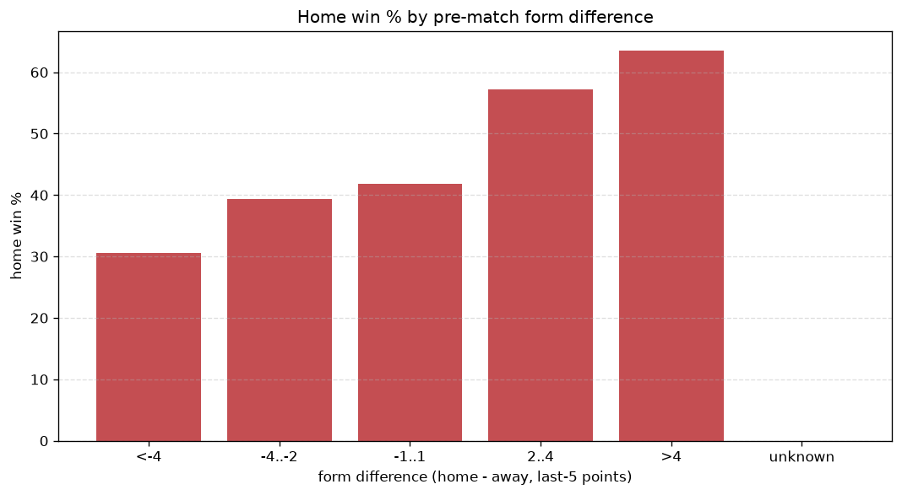
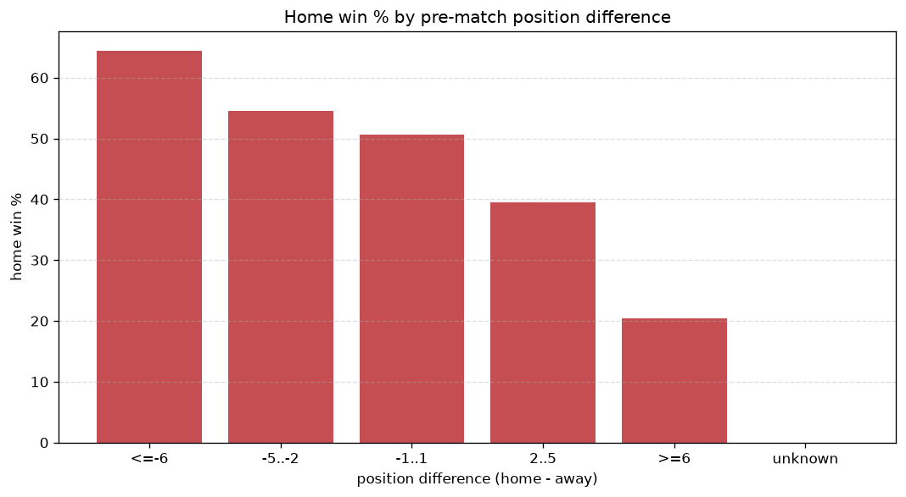

# Relationships Analysis
- Report: `relationships`
- Generated: 2026-10-26T01:45:08+00:00
- Script: `backend/scripts/analyze_relationships.py` v1.0.0
- League: Premier League (Russia)
- Scope: league `russia`

- Matches analysed: **1444** (23 leakage-safe pre-match features).

## 1. Correlation matrix
_Pearson correlation of each pre-match feature with observed goals; sorted by |corr(total goals)|._

| feature | corr(home) | corr(away) | corr(total) |
|---|---|---|---|
| home_team_goals_scored_last_5 | 0.201 | -0.050 | 0.123 |
| home_position_before_match | -0.245 | 0.104 | -0.120 |
| home_team_home_goals_avg | 0.218 | -0.080 | 0.116 |
| home_team_wins_last_5 | 0.191 | -0.074 | 0.099 |
| home_team_home_win_rate | 0.204 | -0.106 | 0.087 |
| home_team_points_last_5 | 0.190 | -0.091 | 0.086 |
| position_difference | -0.286 | 0.221 | -0.072 |
| points_difference | 0.267 | -0.211 | 0.064 |
| home_points_before_match | 0.146 | -0.079 | 0.060 |
| home_team_home_conceded_avg | -0.085 | 0.012 | -0.058 |
| home_team_goals_conceded_last_5 | -0.085 | 0.049 | -0.033 |
| away_position_before_match | 0.155 | -0.205 | -0.019 |
| away_team_points_last_5 | -0.103 | 0.091 | -0.018 |
| away_team_wins_last_5 | -0.105 | 0.095 | -0.017 |
| away_team_goals_conceded_last_5 | 0.120 | -0.113 | 0.016 |
| away_rest_days | 0.002 | -0.024 | -0.014 |
| home_rest_days | 0.004 | -0.021 | -0.011 |
| rest_days_difference | 0.008 | 0.005 | 0.010 |
| away_team_away_goals_avg | -0.055 | 0.075 | 0.009 |
| away_points_before_match | -0.072 | 0.093 | 0.007 |
| away_team_away_win_rate | -0.062 | 0.077 | 0.004 |
| away_team_goals_scored_last_5 | -0.085 | 0.096 | -0.001 |
| away_team_away_conceded_avg | 0.119 | -0.138 | -0.001 |

## 2. Form vs outcome
_Home win/draw/away % per bucket of `home_team_points_last_5 - away_team_points_last_5`._

| bucket | matches | home | draw | away | home % | draw % | away % |
|---|---|---|---|---|---|---|---|
| <-4 | 252 | 77 | 70 | 105 | 30.6% | 27.8% | 41.7% |
| -4..-2 | 280 | 110 | 80 | 90 | 39.3% | 28.6% | 32.1% |
| -1..1 | 409 | 171 | 112 | 126 | 41.8% | 27.4% | 30.8% |
| 2..4 | 292 | 167 | 67 | 58 | 57.2% | 22.9% | 19.9% |
| >4 | 211 | 134 | 32 | 45 | 63.5% | 15.2% | 21.3% |
| unknown | 0 | 0 | 0 | 0 | - | - | - |

## 3. Position vs outcome
_Home win/draw/away % per bucket of `position_difference` (home position - away position; negative favours the home team)._

| bucket | matches | home | draw | away | home % | draw % | away % |
|---|---|---|---|---|---|---|---|
| <=-6 | 306 | 197 | 56 | 53 | 64.4% | 18.3% | 17.3% |
| -5..-2 | 284 | 155 | 65 | 64 | 54.6% | 22.9% | 22.5% |
| -1..1 | 241 | 122 | 62 | 57 | 50.6% | 25.7% | 23.7% |
| 2..5 | 314 | 124 | 90 | 100 | 39.5% | 28.7% | 31.8% |
| >=6 | 299 | 61 | 88 | 150 | 20.4% | 29.4% | 50.2% |
| unknown | 0 | 0 | 0 | 0 | - | - | - |

## 4. Rest advantage
_Home win/draw/away % per bucket of `rest_days_difference` (home rest - away rest). Matches with unknown rest are bucketed separately._

| bucket | matches | home | draw | away | home % | draw % | away % |
|---|---|---|---|---|---|---|---|
| <-1 | 76 | 39 | 16 | 21 | 51.3% | 21.1% | 27.6% |
| -1..0 | 379 | 165 | 89 | 125 | 43.5% | 23.5% | 33.0% |
| 0 | 520 | 242 | 130 | 148 | 46.5% | 25.0% | 28.5% |
| 1..2 | 410 | 194 | 110 | 106 | 47.3% | 26.8% | 25.9% |
| >2 | 9 | 4 | 2 | 3 | 44.4% | 22.2% | 33.3% |
| unknown | 50 | 15 | 14 | 21 | 30.0% | 28.0% | 42.0% |
- *50 match(es) had unknown rest difference (missing rest data on at least one side).*

## 5. Home team quality
_Home win rate by `home_team_home_win_rate` tier (split at 0.5)._

- `< 0.5` tier: **37.3%** home win (295/790)
- `>= 0.5` tier: **55.7%** home win (364/654)
- Home-win gap (>= split minus < split): **+18.4 pp**

| tier | label | matches | home | draw | away | home % |
|---|---|---|---|---|---|---|
| low | < 0.5 | 790 | 295 | 205 | 290 | 37.3% |
| high | >= 0.5 | 654 | 364 | 156 | 134 | 55.7% |

## 6. Feature averages by result
_Mean feature value per outcome; `range` is home-minus-away spread of the group means._

| feature | home mean | draw mean | away mean | range |
|---|---|---|---|---|
| points_difference | 3.527 | -1.651 | -4.741 | 8.267 |
| home_points_before_match | 22.108 | 18.551 | 17.191 | 4.917 |
| position_difference | -2.093 | 1.033 | 2.519 | 4.611 |
| away_points_before_match | 18.581 | 20.202 | 21.932 | 3.350 |
| home_position_before_match | 7.665 | 9.269 | 9.979 | 2.314 |
| away_position_before_match | 9.757 | 8.235 | 7.460 | 2.297 |
| home_rest_days | 10.890 | 11.450 | 9.181 | 2.268 |
| away_rest_days | 10.679 | 11.202 | 9.042 | 2.160 |
| home_team_points_last_5 | 6.715 | 5.848 | 5.333 | 1.382 |
| home_team_goals_scored_last_5 | 6.552 | 5.792 | 5.406 | 1.147 |
| away_team_goals_conceded_last_5 | 6.451 | 5.812 | 5.488 | 0.962 |
| away_team_goals_scored_last_5 | 5.646 | 6.463 | 6.509 | 0.863 |
| away_team_points_last_5 | 5.813 | 6.573 | 6.675 | 0.861 |
| home_team_goals_conceded_last_5 | 5.809 | 6.338 | 6.460 | 0.651 |
| home_team_wins_last_5 | 1.853 | 1.565 | 1.422 | 0.431 |
| home_team_home_goals_avg | 1.550 | 1.360 | 1.228 | 0.322 |
| away_team_wins_last_5 | 1.548 | 1.837 | 1.851 | 0.304 |
| away_team_away_conceded_avg | 1.551 | 1.339 | 1.267 | 0.285 |
| away_team_away_goals_avg | 1.054 | 1.181 | 1.197 | 0.142 |
| rest_days_difference | 0.211 | 0.248 | 0.109 | 0.139 |
| home_team_home_win_rate | 0.462 | 0.399 | 0.339 | 0.124 |
| home_team_home_conceded_avg | 1.090 | 1.148 | 1.178 | 0.087 |
| away_team_away_win_rate | 0.253 | 0.303 | 0.301 | 0.050 |

---
*All features are leakage-safe pre-match values built by `ml.features.build_features.build_rows` from strictly prior matches. Run with `python backend/scripts/analyze_relationships.py` to regenerate.*

## Charts

