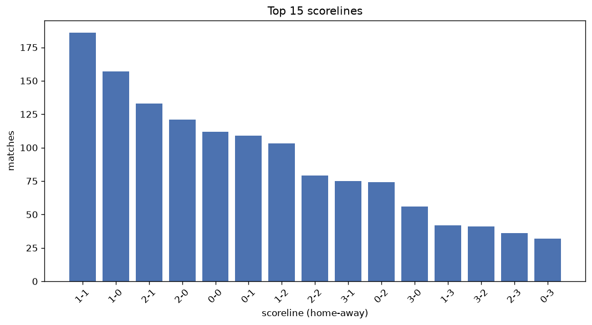
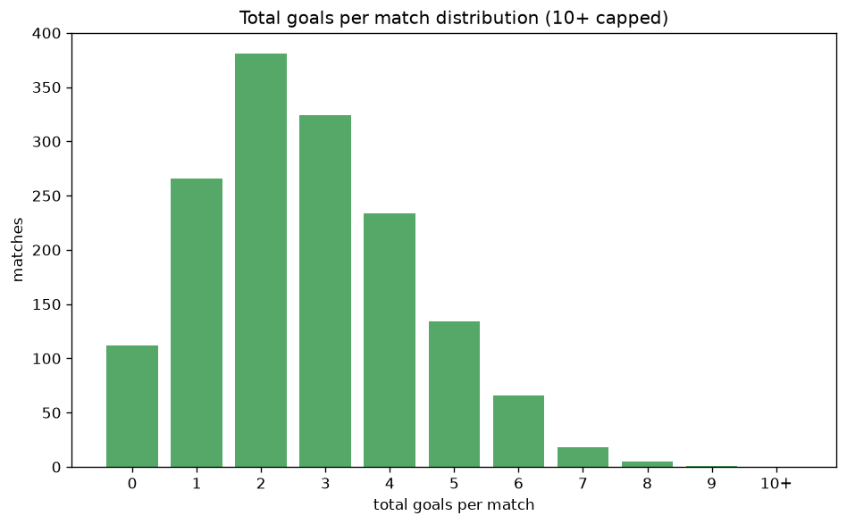

# Scoreline Analysis
- Report: `scoreline_analysis`
- Generated: 2026-10-30T04:08:02+00:00
- Script: `backend/scripts/analyze_scorelines.py` v1.0.0
- League: Premier League (Russia)
- Scope: league `russia`

## 1. Scoreline frequency
- Matches analysed: **1544** across **7** seasons.
- Distinct scorelines seen: **40**.

| scoreline | count | pct |
|---|---|---|
| 1-1 | 186 | 12.0% |
| 1-0 | 157 | 10.2% |
| 2-1 | 133 | 8.6% |
| 2-0 | 124 | 8.0% |
| 0-0 | 112 | 7.3% |
| 0-1 | 109 | 7.1% |
| 1-2 | 103 | 6.7% |
| 2-2 | 79 | 5.1% |
| 3-1 | 75 | 4.9% |
| 0-2 | 74 | 4.8% |
| 3-0 | 56 | 3.6% |
| 1-3 | 42 | 2.7% |
| 3-2 | 41 | 2.7% |
| 2-3 | 36 | 2.3% |
| 0-3 | 32 | 2.1% |
| 4-0 | 29 | 1.9% |
| 4-1 | 25 | 1.6% |
| 5-1 | 19 | 1.2% |
| 1-4 | 17 | 1.1% |
| 3-3 | 17 | 1.1% |

## 2. Scoreline frequency per season

### 2020-2021
| scoreline | count | pct |
|---|---|---|
| 1-0 | 32 | 13.3% |
| 2-0 | 23 | 9.6% |
| 1-1 | 22 | 9.2% |
| 0-1 | 19 | 7.9% |
| 3-1 | 18 | 7.5% |

### 2021-2022
| scoreline | count | pct |
|---|---|---|
| 1-1 | 30 | 12.5% |
| 1-2 | 28 | 11.7% |
| 1-0 | 23 | 9.6% |
| 0-1 | 21 | 8.8% |
| 2-1 | 21 | 8.8% |

### 2022-2023
| scoreline | count | pct |
|---|---|---|
| 2-1 | 24 | 10.0% |
| 1-1 | 21 | 8.8% |
| 1-0 | 17 | 7.1% |
| 2-2 | 16 | 6.7% |
| 3-0 | 15 | 6.2% |

### 2023-2024
| scoreline | count | pct |
|---|---|---|
| 1-0 | 28 | 11.7% |
| 1-1 | 27 | 11.2% |
| 2-1 | 26 | 10.8% |
| 2-0 | 23 | 9.6% |
| 0-0 | 20 | 8.3% |

### 2024-2025
| scoreline | count | pct |
|---|---|---|
| 1-1 | 35 | 14.6% |
| 1-0 | 23 | 9.6% |
| 0-0 | 20 | 8.3% |
| 2-1 | 17 | 7.1% |
| 2-0 | 15 | 6.2% |

### 2025-2026
| scoreline | count | pct |
|---|---|---|
| 1-1 | 36 | 14.8% |
| 1-0 | 28 | 11.5% |
| 2-1 | 25 | 10.2% |
| 2-0 | 24 | 9.8% |
| 0-1 | 23 | 9.4% |

### 2026-2027
| scoreline | count | pct |
|---|---|---|
| 1-1 | 15 | 15.0% |
| 1-2 | 9 | 9.0% |
| 0-0 | 8 | 8.0% |
| 2-1 | 7 | 7.0% |
| 3-1 | 7 | 7.0% |

## 3. Total-goal histogram
_10+ groups all matches with 10 or more total goals._

| total goals | matches | pct |
|---|---|---|
| 0 | 112 | 7.3% |
| 1 | 266 | 17.2% |
| 2 | 384 | 24.9% |
| 3 | 324 | 21.0% |
| 4 | 234 | 15.2% |
| 5 | 134 | 8.7% |
| 6 | 66 | 4.3% |
| 7 | 18 | 1.2% |
| 8 | 5 | 0.3% |
| 9 | 1 | 0.1% |
| 10+ | 0 | 0.0% |

## 4. Extreme scorelines
- Matches with 7+ total goals: **24**

| season | date | scoreline | total goals |
|---|---|---|---|
| 2020-2021 | 2020-09-18 | 7-2 | 9 |
| 2021-2022 | 2021-10-24 | 7-1 | 8 |
| 2022-2023 | 2022-09-11 | 8-0 | 8 |
| 2023-2024 | 2024-04-13 | 1-7 | 8 |
| 2023-2024 | 2024-05-20 | 2-6 | 8 |
| 2025-2026 | 2025-10-04 | 3-5 | 8 |
| 2020-2021 | 2021-03-07 | 6-1 | 7 |
| 2020-2021 | 2021-04-24 | 2-5 | 7 |
| 2020-2021 | 2021-05-02 | 6-1 | 7 |
| 2021-2022 | 2022-03-20 | 6-1 | 7 |
| 2021-2022 | 2022-05-06 | 5-2 | 7 |
| 2022-2023 | 2022-08-14 | 3-4 | 7 |
| 2022-2023 | 2022-10-09 | 5-2 | 7 |
| 2022-2023 | 2022-10-24 | 7-0 | 7 |
| 2022-2023 | 2022-10-29 | 6-1 | 7 |
| 2022-2023 | 2023-04-24 | 4-3 | 7 |
| 2023-2024 | 2024-04-06 | 3-4 | 7 |
| 2023-2024 | 2024-05-12 | 6-1 | 7 |
| 2024-2025 | 2024-09-21 | 2-5 | 7 |
| 2024-2025 | 2024-10-27 | 3-4 | 7 |
| 2024-2025 | 2024-11-23 | 5-2 | 7 |
| 2024-2025 | 2025-05-12 | 5-2 | 7 |
| 2025-2026 | 2025-09-27 | 5-2 | 7 |
| 2025-2026 | 2026-03-09 | 4-3 | 7 |

## 5. Margin-of-victory distribution (decided matches)
- Decided matches: **1150** (draws: **394**)
- Average winning margin: **1.81**

| margin | matches | pct |
|---|---|---|
| 1 | 584 | 50.8% |
| 2 | 335 | 29.1% |
| 3+ | 231 | 20.1% |

## 6. Margin by outcome

### Home wins
- Matches: **696** | avg margin: **1.89** | max margin: **8**
| margin | matches | pct |
|---|---|---|
| 1 | 333 | 47.8% |
| 2 | 208 | 29.9% |
| 3+ | 155 | 22.3% |
- *Full match-by-match list available in `scoreline_analysis.json`.*

### Away wins
- Matches: **454** | avg margin: **1.7** | max margin: **6**
| margin | matches | pct |
|---|---|---|
| 1 | 251 | 55.3% |
| 2 | 127 | 28.0% |
| 3+ | 76 | 16.7% |
- *Full match-by-match list available in `scoreline_analysis.json`.*

## 7. Most common exact score by outcome type
| outcome | matches | most common score | count | pct |
|---|---|---|---|---|
| home | 696 | 1-0 | 157 | 22.6% |
| draw | 394 | 1-1 | 186 | 47.2% |
| away | 454 | 0-1 | 109 | 24.0% |

---
*All statistics are computed from PostgreSQL tables (read-only). Run with `python backend/scripts/analyze_scorelines.py` to regenerate.*

## Charts

