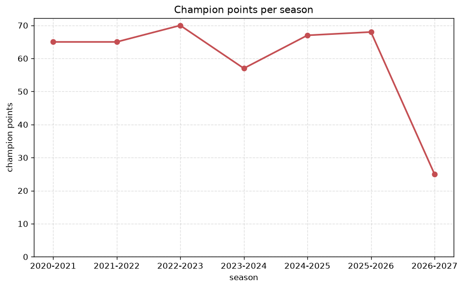
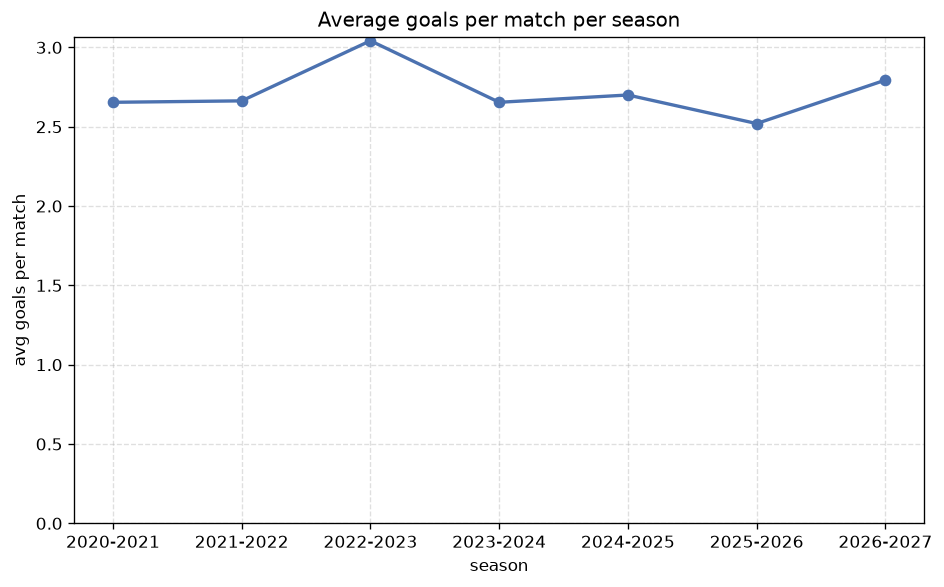

# Season Trends Analysis
- Report: `season_trends`
- Generated: 2026-10-26T01:45:04+00:00
- Script: `backend/scripts/analyze_seasons.py` v1.0.0
- League: Premier League (Russia)
- Scope: league `russia`

## 1. Champions per season
| season | champion | pts | runner-up | margin |
|---|---|---|---|---|
| 2020-2021 | Zenit | 65 | Spartak Moscow | 8 pts |
| 2021-2022 | Zenit | 65 | Sochi | 9 pts |
| 2022-2023 | Zenit | 70 | CSKA Moscow | 12 pts |
| 2023-2024 | Zenit | 57 | Krasnodar | 1 pts |
| 2024-2025 | Krasnodar | 67 | Zenit | 1 pts |
| 2025-2026 | Zenit | 68 | Krasnodar | 2 pts |
| 2026-2027 | CSKA Moscow | 25 | Dynamo Moscow | 0 pts |

## 2. Title-race tightness
- Tight races (margin <= 3 pts): **4** of 7 seasons
- Tightest race: **2026-2027** - CSKA Moscow beat Dynamo Moscow by **0** pts

| season | margin | tight |
|---|---|---|
| 2020-2021 | 8 pts |  |
| 2021-2022 | 9 pts |  |
| 2022-2023 | 12 pts |  |
| 2023-2024 | 1 pts | yes |
| 2024-2025 | 1 pts | yes |
| 2025-2026 | 2 pts | yes |
| 2026-2027 | 0 pts | yes |

## 3. Points thresholds
_Position-specific points per season. Key: 1 = champion, 2 = runner-up, 4 = CL line, 6 = Europa, 13 = last safe, 16 = bottom._

| season | pos 1 | pos 2 | pos 4 | pos 6 | pos 13 | pos 16 |
|---|---|---|---|---|---|---|
| 2020-2021 | 65 | 57 | 53 | 50 | 25 | 13 |
| 2021-2022 | 65 | 56 | 50 | 48 | 32 | 23 |
| 2022-2023 | 70 | 58 | 53 | 48 | 30 | 13 |
| 2023-2024 | 57 | 56 | 53 | 48 | 30 | 24 |
| 2024-2025 | 67 | 66 | 57 | 53 | 27 | 18 |
| 2025-2026 | 68 | 66 | 52 | 46 | 30 | 22 |
| 2026-2027 | 25 | 25 | 24 | 17 | 11 | 6 |

## 4. Relegation battle
| season | safe pos | safe pts | drop pos | drop pts | gap |
|---|---|---|---|---|---|
| 2020-2021 | 13 | 25 | 14 | 23 | 2 pts |
| 2021-2022 | 13 | 32 | 14 | 30 | 2 pts |
| 2022-2023 | 13 | 30 | 14 | 30 | 0 pts |
| 2023-2024 | 13 | 30 | 14 | 30 | 0 pts |
| 2024-2025 | 13 | 27 | 14 | 25 | 2 pts |
| 2025-2026 | 13 | 30 | 14 | 29 | 1 pts |
| 2026-2027 | 13 | 11 | 14 | 11 | 0 pts |

## 5. League-level trends
| season | matches | total goals | avg goals | home win | draw | away win | goalless | avg pts/team |
|---|---|---|---|---|---|---|---|---|
| 2020-2021 | 240 | 637 | 2.654 | 48.3% | 20.8% | 30.8% | 7.1% | 41.88 |
| 2021-2022 | 240 | 639 | 2.663 | 43.3% | 24.6% | 32.1% | 7.5% | 41.31 |
| 2022-2023 | 240 | 730 | 3.042 | 47.1% | 22.5% | 30.4% | 5.8% | 41.62 |
| 2023-2024 | 240 | 637 | 2.654 | 47.1% | 27.5% | 25.4% | 8.3% | 40.88 |
| 2024-2025 | 240 | 648 | 2.7 | 42.9% | 27.1% | 30.0% | 8.3% | 40.94 |
| 2025-2026 | 244 | 615 | 2.52 | 45.1% | 27.5% | 27.5% | 6.1% | 36.94 |
| 2026-2027 | 97 | 271 | 2.794 | 35.1% | 34.0% | 30.9% | 8.2% | 16.12 |

## 6. View divergence
- Largest divergence: **2026-2027** (goals view, avg abs position diff = 5.125)

_Avg absolute position difference between classic view and alternative view per season._

| season | classic vs luck | classic vs goals |
|---|---|---|
| 2020-2021 | 3.250 | 3.375 |
| 2021-2022 | 3.500 | 4.500 |
| 2022-2023 | 2.875 | 3.875 |
| 2023-2024 | 2.250 | 4.875 |
| 2024-2025 | 2.250 | 4.875 |
| 2025-2026 | 3.556 | 4.667 |
| 2026-2027 | 1.875 | 5.125 |

---
*All statistics are computed from PostgreSQL tables (read-only). Run with `python backend/scripts/analyze_seasons.py` to regenerate.*

## Charts

