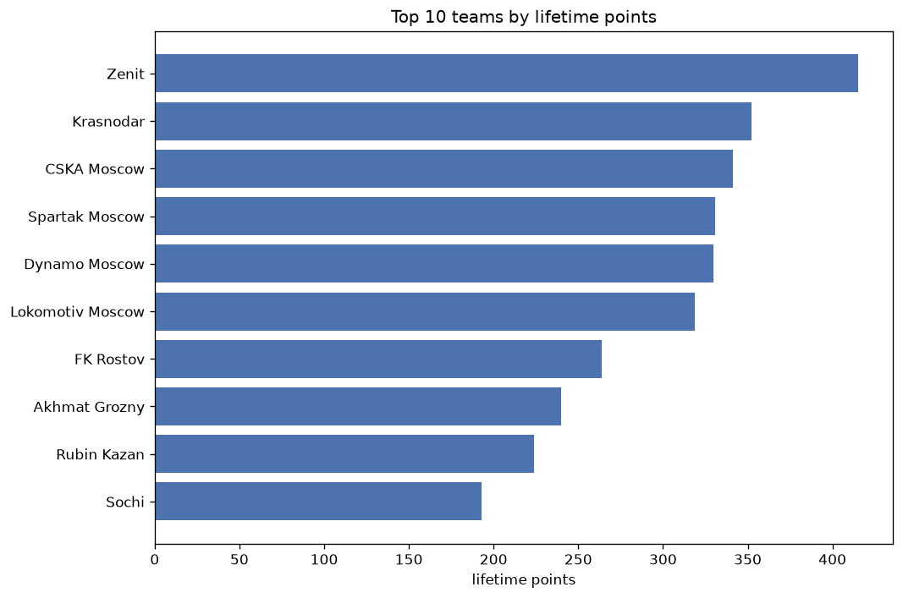
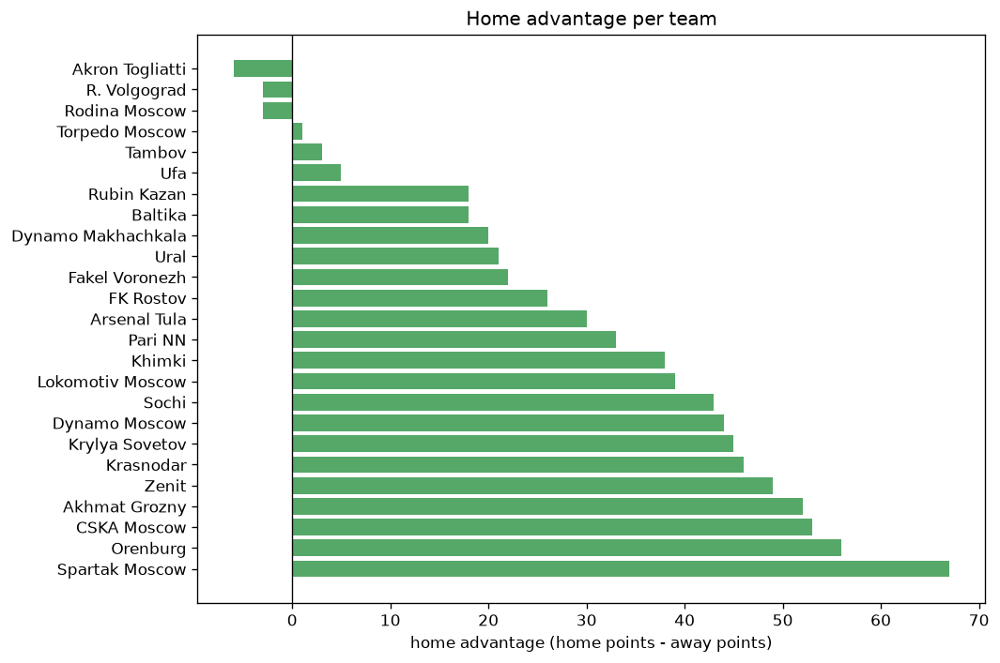

# Team Analysis
- Report: `teams_analysis`
- Generated: 2026-10-26T01:45:02+00:00
- Script: `backend/scripts/analyze_teams.py` v1.0.0
- League: Premier League (Russia)
- Scope: league `russia`

- Teams: **25** | Seasons: **7** | Matches: **1541**

## 1. Team standings (lifetime)
| team | seasons | played | W | D | L | pts | GF | GA | GD | avg pts/season | best pos | worst pos | titles |
|---|---|---|---|---|---|---|---|---|---|---|---|---|---|
| Zenit | 7 | 192 | 124 | 43 | 25 | 415 | 405 | 153 | 252 | 59.29 | 1 | 3 | 5 |
| Krasnodar | 7 | 193 | 101 | 49 | 43 | 352 | 342 | 212 | 130 | 50.29 | 1 | 10 | 1 |
| CSKA Moscow | 7 | 192 | 98 | 47 | 47 | 341 | 317 | 196 | 121 | 48.71 | 1 | 6 | 1 |
| Spartak Moscow | 7 | 191 | 95 | 46 | 50 | 331 | 318 | 220 | 98 | 47.29 | 2 | 10 | 0 |
| Dynamo Moscow | 7 | 192 | 96 | 42 | 54 | 330 | 330 | 245 | 85 | 47.14 | 2 | 9 | 0 |
| Lokomotiv Moscow | 7 | 191 | 88 | 55 | 48 | 319 | 315 | 252 | 63 | 45.57 | 3 | 13 | 0 |
| FK Rostov | 7 | 192 | 72 | 48 | 72 | 264 | 255 | 269 | -14 | 37.71 | 4 | 10 | 0 |
| Akhmat Grozny | 7 | 192 | 64 | 48 | 80 | 240 | 233 | 264 | -31 | 34.29 | 5 | 14 | 0 |
| Rubin Kazan | 6 | 162 | 61 | 41 | 60 | 224 | 190 | 220 | -30 | 37.33 | 5 | 15 | 0 |
| Sochi | 5 | 150 | 54 | 31 | 65 | 193 | 206 | 225 | -19 | 38.6 | 2 | 16 | 0 |
| Krylya Sovetov | 6 | 163 | 50 | 43 | 70 | 193 | 207 | 245 | -38 | 32.17 | 7 | 12 | 0 |
| Pari NN | 5 | 150 | 37 | 32 | 81 | 143 | 141 | 244 | -103 | 28.6 | 12 | 15 | 0 |
| Orenburg | 5 | 133 | 35 | 37 | 61 | 142 | 165 | 210 | -45 | 28.4 | 6 | 15 | 0 |
| Ural | 5 | 122 | 32 | 37 | 53 | 133 | 116 | 165 | -49 | 26.6 | 11 | 18 | 0 |
| Khimki | 4 | 120 | 30 | 34 | 56 | 124 | 129 | 209 | -80 | 31.0 | 8 | 15 | 0 |
| Baltika | 3 | 72 | 21 | 23 | 28 | 86 | 86 | 76 | 10 | 28.67 | 6 | 15 | 0 |
| Fakel Voronezh | 4 | 103 | 16 | 38 | 49 | 86 | 81 | 144 | -63 | 21.5 | 11 | 16 | 0 |
| Akron Togliatti | 3 | 75 | 19 | 21 | 35 | 78 | 93 | 132 | -39 | 26.0 | 9 | 13 | 0 |
| Dynamo Makhachkala | 3 | 73 | 17 | 23 | 33 | 74 | 65 | 93 | -28 | 24.67 | 10 | 12 | 0 |
| Ufa | 2 | 60 | 12 | 19 | 29 | 55 | 55 | 86 | -31 | 27.5 | 13 | 14 | 0 |
| Arsenal Tula | 2 | 60 | 11 | 13 | 36 | 46 | 58 | 110 | -52 | 23.0 | 14 | 16 | 0 |
| R. Volgograd | 2 | 32 | 6 | 7 | 19 | 25 | 16 | 54 | -38 | 12.5 | 15 | 17 | 0 |
| Torpedo Moscow | 1 | 30 | 3 | 4 | 23 | 13 | 22 | 61 | -39 | 13.0 | 16 | 16 | 0 |
| Tambov | 1 | 30 | 3 | 4 | 23 | 13 | 19 | 65 | -46 | 13.0 | 16 | 16 | 0 |
| Rodina Moscow | 1 | 12 | 2 | 3 | 7 | 9 | 13 | 27 | -14 | 9.0 | 15 | 15 | 0 |

## 2. Home vs away split
| team | home P | H-W | H-D | H-L | H-pts | away P | A-W | A-D | A-L | A-pts | adv |
|---|---|---|---|---|---|---|---|---|---|---|---|
| Spartak Moscow | 97 | 59 | 22 | 16 | 199 | 94 | 36 | 24 | 34 | 132 | 67 |
| Orenburg | 67 | 26 | 21 | 20 | 99 | 66 | 9 | 16 | 41 | 43 | 56 |
| CSKA Moscow | 97 | 58 | 23 | 16 | 197 | 95 | 40 | 24 | 31 | 144 | 53 |
| Akhmat Grozny | 96 | 41 | 23 | 32 | 146 | 96 | 23 | 25 | 48 | 94 | 52 |
| Zenit | 96 | 74 | 10 | 12 | 232 | 96 | 50 | 33 | 13 | 183 | 49 |
| Krasnodar | 96 | 60 | 19 | 17 | 199 | 97 | 41 | 30 | 26 | 153 | 46 |
| Krylya Sovetov | 82 | 31 | 26 | 25 | 119 | 81 | 19 | 17 | 45 | 74 | 45 |
| Dynamo Moscow | 96 | 57 | 16 | 23 | 187 | 96 | 39 | 26 | 31 | 143 | 44 |
| Sochi | 75 | 33 | 19 | 23 | 118 | 75 | 21 | 12 | 42 | 75 | 43 |
| Lokomotiv Moscow | 95 | 50 | 29 | 16 | 179 | 96 | 38 | 26 | 32 | 140 | 39 |
| Khimki | 60 | 20 | 21 | 19 | 81 | 60 | 10 | 13 | 37 | 43 | 38 |
| Pari NN | 75 | 24 | 16 | 35 | 88 | 75 | 13 | 16 | 46 | 55 | 33 |
| Arsenal Tula | 30 | 9 | 11 | 10 | 38 | 30 | 2 | 2 | 26 | 8 | 30 |
| FK Rostov | 95 | 41 | 22 | 32 | 145 | 97 | 31 | 26 | 40 | 119 | 26 |
| Fakel Voronezh | 52 | 9 | 27 | 16 | 54 | 51 | 7 | 11 | 33 | 32 | 22 |
| Ural | 61 | 20 | 17 | 24 | 77 | 61 | 12 | 20 | 29 | 56 | 21 |
| Dynamo Makhachkala | 36 | 12 | 11 | 13 | 47 | 37 | 5 | 12 | 20 | 27 | 20 |
| Rubin Kazan | 81 | 33 | 22 | 26 | 121 | 81 | 28 | 19 | 34 | 103 | 18 |
| Baltika | 36 | 14 | 10 | 12 | 52 | 36 | 7 | 13 | 16 | 34 | 18 |
| Ufa | 30 | 6 | 12 | 12 | 30 | 30 | 6 | 7 | 17 | 25 | 5 |
| Tambov | 15 | 2 | 2 | 11 | 8 | 15 | 1 | 2 | 12 | 5 | 3 |
| Torpedo Moscow | 15 | 2 | 1 | 12 | 7 | 15 | 1 | 3 | 11 | 6 | 1 |
| R. Volgograd | 16 | 3 | 2 | 11 | 11 | 16 | 3 | 5 | 8 | 14 | -3 |
| Rodina Moscow | 5 | 0 | 3 | 2 | 3 | 7 | 2 | 0 | 5 | 6 | -3 |
| Akron Togliatti | 37 | 9 | 9 | 19 | 36 | 38 | 10 | 12 | 16 | 42 | -6 |

## 3. Top performers
### Best points per game (PPG)
| rank | team | PPG |
|---|---|---|
| 1 | Zenit | 2.16 |
| 2 | Krasnodar | 1.82 |
| 3 | CSKA Moscow | 1.78 |
| 4 | Spartak Moscow | 1.73 |
| 5 | Dynamo Moscow | 1.72 |

### Most goals scored
| rank | team | goals |
|---|---|---|
| 1 | Zenit | 405 |
| 2 | Krasnodar | 342 |
| 3 | Dynamo Moscow | 330 |
| 4 | Spartak Moscow | 318 |
| 5 | CSKA Moscow | 317 |

### Best goal difference
| rank | team | GD |
|---|---|---|
| 1 | Zenit | 252 |
| 2 | Krasnodar | 130 |
| 3 | CSKA Moscow | 121 |
| 4 | Spartak Moscow | 98 |
| 5 | Dynamo Moscow | 85 |

### Best defence (goals against per match, standings)
| rank | team | GA/match |
|---|---|---|
| 1 | Zenit | 0.797 |
| 2 | CSKA Moscow | 1.021 |
| 3 | Baltika | 1.056 |
| 4 | Krasnodar | 1.098 |
| 5 | Spartak Moscow | 1.152 |

## 4. Team consistency
- Teams present in all **7** seasons: **8**

Akhmat Grozny, CSKA Moscow, Dynamo Moscow, FK Rostov, Krasnodar, Lokomotiv Moscow, Spartak Moscow, Zenit

## 5. Head-to-head dominance
- Distinct fixtures: **255** (showing the 15 most frequent)

| fixture | meetings | home wins | draws | away wins | home pct | draw pct | away pct |
|---|---|---|---|---|---|---|---|
| Zenit vs CSKA Moscow | 14 | 4 | 3 | 7 | 28.6% | 21.4% | 50.0% |
| CSKA Moscow vs Dynamo Moscow | 13 | 8 | 1 | 4 | 61.5% | 7.7% | 30.8% |
| FK Rostov vs Krasnodar | 13 | 8 | 3 | 2 | 61.5% | 23.1% | 15.4% |
| Zenit vs Dynamo Moscow | 13 | 8 | 2 | 3 | 61.5% | 15.4% | 23.1% |
| FK Rostov vs Akhmat Grozny | 13 | 7 | 2 | 4 | 53.8% | 15.4% | 30.8% |
| Zenit vs Akhmat Grozny | 13 | 7 | 2 | 4 | 53.8% | 15.4% | 30.8% |
| Lokomotiv Moscow vs Krasnodar | 13 | 6 | 5 | 2 | 46.2% | 38.5% | 15.4% |
| Spartak Moscow vs Krasnodar | 13 | 6 | 0 | 7 | 46.2% | 0.0% | 53.8% |
| Zenit vs Lokomotiv Moscow | 13 | 6 | 5 | 2 | 46.2% | 38.5% | 15.4% |
| Zenit vs Spartak Moscow | 13 | 6 | 5 | 2 | 46.2% | 38.5% | 15.4% |
| CSKA Moscow vs FK Rostov | 13 | 5 | 5 | 3 | 38.5% | 38.5% | 23.1% |
| Lokomotiv Moscow vs CSKA Moscow | 13 | 5 | 3 | 5 | 38.5% | 23.1% | 38.5% |
| Spartak Moscow vs FK Rostov | 13 | 5 | 4 | 4 | 38.5% | 30.8% | 30.8% |
| Dynamo Moscow vs FK Rostov | 13 | 4 | 4 | 5 | 30.8% | 30.8% | 38.5% |
| Krasnodar vs Akhmat Grozny | 13 | 4 | 4 | 5 | 30.8% | 30.8% | 38.5% |

## 6. Position per season (classic view)
_Cells show final position; '-' when the team was absent from that season._

| team | 2020-2021 | 2021-2022 | 2022-2023 | 2023-2024 | 2024-2025 | 2025-2026 | 2026-2027 |
|---|---|---|---|---|---|---|---|
| Zenit | 1 | 1 | 1 | 1 | 2 | 1 | 3 |
| Krasnodar | 10 | 5 | 6 | 2 | 1 | 2 | 4 |
| CSKA Moscow | 6 | 4 | 2 | 6 | 3 | 5 | 1 |
| Spartak Moscow | 2 | 10 | 3 | 5 | 4 | 4 | 5 |
| Dynamo Moscow | 7 | 3 | 9 | 3 | 5 | 7 | 2 |
| Lokomotiv Moscow | 3 | 6 | 8 | 4 | 6 | 3 | 13 |
| FK Rostov | 9 | 9 | 4 | 7 | 8 | 10 | 8 |
| Akhmat Grozny | 11 | 7 | 5 | 10 | 14 | 9 | 14 |
| Rubin Kazan | 5 | 15 | - | 8 | 7 | 8 | 12 |
| Sochi | 4 | 2 | 10 | 16 | - | 16 | - |
| Krylya Sovetov | - | 8 | 12 | 9 | 10 | 11 | 7 |
| Pari NN | - | 12 | 14 | 14 | 13 | 15 | - |
| Orenburg | - | - | 7 | 12 | 15 | 14 | 6 |
| Ural | 12 | 11 | 11 | 13 | - | 18 | - |
| Khimki | 8 | 13 | 15 | - | 12 | - | - |
| Baltika | - | - | - | 15 | - | 6 | 9 |
| Fakel Voronezh | - | - | 13 | 11 | 16 | - | 16 |
| Akron Togliatti | - | - | - | - | 9 | 13 | 11 |
| Dynamo Makhachkala | - | - | - | - | 11 | 12 | 10 |
| Ufa | 13 | 14 | - | - | - | - | - |
| Arsenal Tula | 14 | 16 | - | - | - | - | - |
| R. Volgograd | 15 | - | - | - | - | 17 | - |
| Torpedo Moscow | - | - | 16 | - | - | - | - |
| Tambov | 16 | - | - | - | - | - | - |
| Rodina Moscow | - | - | - | - | - | - | 15 |

---
*All statistics are computed from PostgreSQL tables (read-only). Run with `python backend/scripts/analyze_teams.py` to regenerate.*

## Charts

