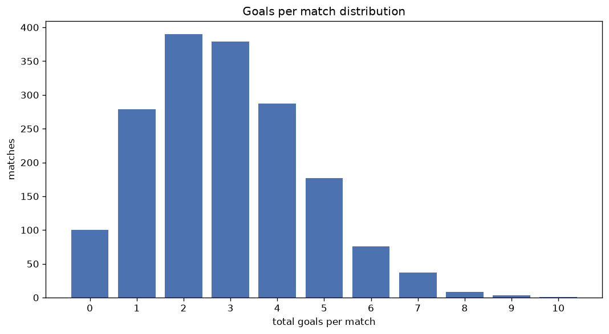
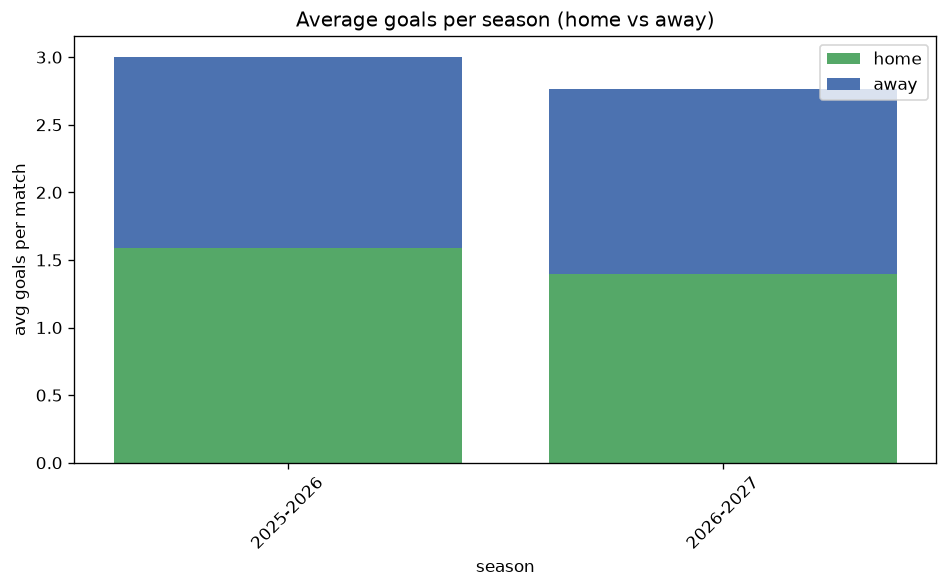

# Goal Analysis
- Report: `goals_analysis`
- Generated: 2026-10-27T02:27:23+00:00
- Script: `backend/scripts/analyze_goals.py` v1.0.0
- League: Saudi Professional League (Saudi Arabia)
- Scope: league `saudi1`

## 1. Goals per match distribution
| goals | matches | pct |
|---|---|---|
| 0 | 100 | 5.8% |
| 1 | 279 | 16.1% |
| 2 | 390 | 22.5% |
| 3 | 379 | 21.8% |
| 4 | 287 | 16.5% |
| 5 | 177 | 10.2% |
| 6 | 76 | 4.4% |
| 7 | 37 | 2.1% |
| 8 | 8 | 0.5% |
| 9 | 3 | 0.2% |
| 10 | 1 | 0.1% |

## 2. Goals per match per season
| season | matches | total goals | avg home | avg away | avg total |
|---|---|---|---|---|---|
| 2020-2021 | 240 | 746 | 1.587 | 1.521 | 3.108 |
| 2021-2022 | 240 | 637 | 1.496 | 1.158 | 2.654 |
| 2022-2023 | 240 | 648 | 1.45 | 1.25 | 2.7 |
| 2023-2024 | 306 | 909 | 1.575 | 1.395 | 2.971 |
| 2024-2025 | 306 | 902 | 1.559 | 1.389 | 2.948 |
| 2025-2026 | 314 | 943 | 1.592 | 1.411 | 3.003 |
| 2026-2027 | 91 | 260 | 1.429 | 1.429 | 2.857 |

## 3. Home vs away goal share
- Home goals: **2677** (53.1%)
- Away goals: **2368** (46.9%)
- Home/away ratio: **1.13**

| season | home goals | away goals | total | home pct | away pct |
|---|---|---|---|---|---|
| 2020-2021 | 381 | 365 | 746 | 51.1% | 48.9% |
| 2021-2022 | 359 | 278 | 637 | 56.4% | 43.6% |
| 2022-2023 | 348 | 300 | 648 | 53.7% | 46.3% |
| 2023-2024 | 482 | 427 | 909 | 53.0% | 47.0% |
| 2024-2025 | 477 | 425 | 902 | 52.9% | 47.1% |
| 2025-2026 | 500 | 443 | 943 | 53.0% | 47.0% |
| 2026-2027 | 130 | 130 | 260 | 50.0% | 50.0% |

## 4. BTTS (Both Teams To Score)
- Overall: **963** of `1737` (55.4%)

| season | matches | BTTS | pct |
|---|---|---|---|
| 2020-2021 | 240 | 157 | 65.4% |
| 2021-2022 | 240 | 120 | 50.0% |
| 2022-2023 | 240 | 114 | 47.5% |
| 2023-2024 | 306 | 175 | 57.2% |
| 2024-2025 | 306 | 169 | 55.2% |
| 2025-2026 | 314 | 182 | 58.0% |
| 2026-2027 | 91 | 46 | 50.5% |

## 5. Clean sheets
- Home clean sheets: **503** (29.0%)
- Away clean sheets: **371** (21.4%)
- Total clean sheets recorded: **874**
- Matches with at least one clean sheet: **774** (44.6%)
- Both teams kept clean sheets (0-0): **100**

| season | matches | home CS | away CS | total CS | matches w/ CS |
|---|---|---|---|---|---|
| 2020-2021 | 240 | 56 | 36 | 92 | 83 (34.6%) |
| 2021-2022 | 240 | 87 | 50 | 137 | 120 (50.0%) |
| 2022-2023 | 240 | 82 | 56 | 138 | 126 (52.5%) |
| 2023-2024 | 306 | 84 | 71 | 155 | 131 (42.8%) |
| 2024-2025 | 306 | 81 | 68 | 149 | 137 (44.8%) |
| 2025-2026 | 314 | 87 | 61 | 148 | 132 (42.0%) |
| 2026-2027 | 91 | 26 | 29 | 55 | 45 (49.5%) |

## 6. Scoring intensity
- First-half goals: **2213** (43.9%)
- Second-half goals: **2829** (56.1%)
- Avg first-half goals per match: **1.275**
- Avg second-half goals per match: **1.63**
- Second-half-only scoring (HT 0-0, FT goals >= 1): **375** (21.6%)
- *1 match(es) excluded (no HT score recorded).*

| season | matches | 1st half | 2nd half | 1st half pct | 2nd half pct |
|---|---|---|---|---|---|
| 2020-2021 | 240 | 326 | 420 | 43.7% | 56.3% |
| 2021-2022 | 240 | 292 | 345 | 45.8% | 54.2% |
| 2022-2023 | 240 | 288 | 360 | 44.4% | 55.6% |
| 2023-2024 | 306 | 394 | 515 | 43.3% | 56.7% |
| 2024-2025 | 306 | 368 | 531 | 40.9% | 59.1% |
| 2025-2026 | 314 | 416 | 527 | 44.1% | 55.9% |
| 2026-2027 | 91 | 129 | 131 | 49.6% | 50.4% |

## 7. First-goal timing
- Matches with first-goal time recorded: `1636` of `1737` (94.2%)
- Goalless matches: `101`
- Min `1` | Max `102` | Mean `31.37` | Median (p50) `25.0`

| bucket | count | % of matches | % of scoring matches |
|---|---|---|---|
| 1-15 | 510 | 29.4% | 31.2% |
| 16-30 | 418 | 24.1% | 25.6% |
| 31-45 | 267 | 15.4% | 16.3% |
| 46-60 | 241 | 13.9% | 14.7% |
| 61-75 | 103 | 5.9% | 6.3% |
| 76-90 | 63 | 3.6% | 3.9% |
| 91-120 | 34 | 2.0% | 2.1% |

---
*All statistics are computed from PostgreSQL tables (read-only). Run with `python backend/scripts/analyze_goals.py` to regenerate.*

## Charts

