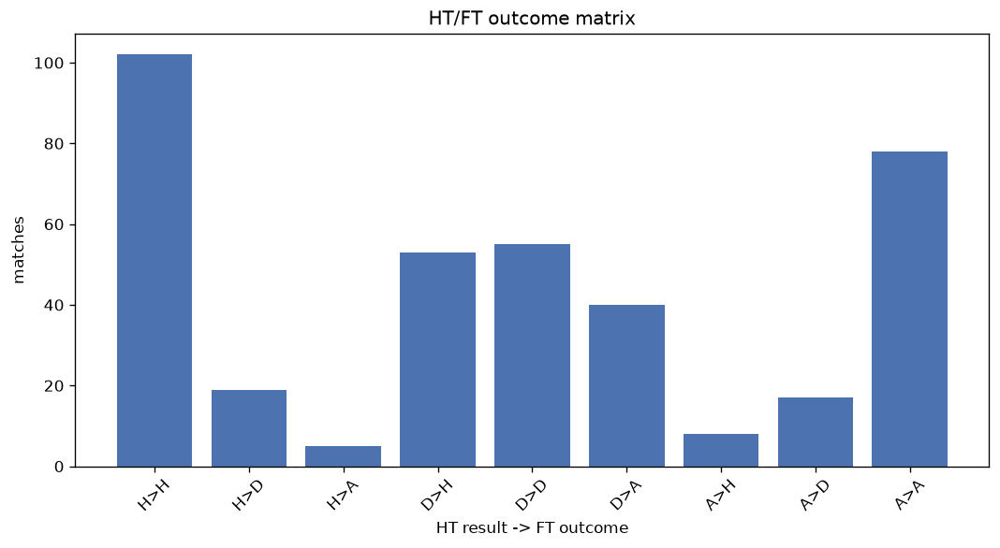
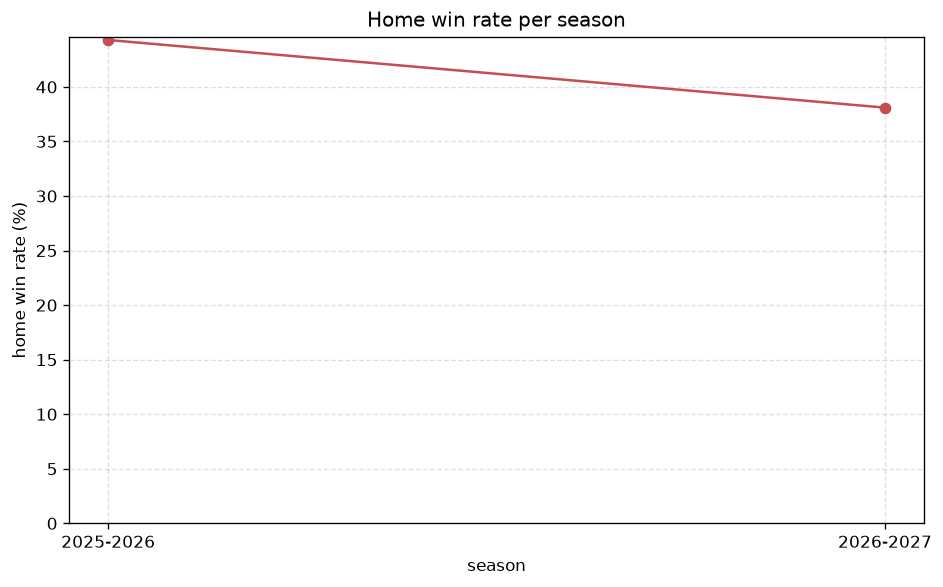

# Match Analysis
- Report: `matches_analysis`
- Generated: 2026-10-30T04:08:22+00:00
- Script: `backend/scripts/analyze_matches.py` v1.0.0
- League: Saudi Professional League (Saudi Arabia)
- Scope: league `saudi1`

## 1. Overall summary
| metric | value |
|---|---|
| Matches | 1737 |
| Home wins | 751 (43.2%) |
| Draws | 403 (23.2%) |
| Away wins | 583 (33.6%) |
| Total goals | 5045 |
| Average goals per match | 2.904 |
| Goalless matches | 100 (5.8%) |

## 2. Per-season breakdown
| season | matches | home wins | draws | away wins | total goals | avg goals | goalless |
|---|---|---|---|---|---|---|---|
| 2020-2021 | 240 | 93 (38.8%) | 58 (24.2%) | 89 (37.1%) | 746 | 3.108 | 9 (3.8%) |
| 2021-2022 | 240 | 109 (45.4%) | 67 (27.9%) | 64 (26.7%) | 637 | 2.654 | 17 (7.1%) |
| 2022-2023 | 240 | 111 (46.2%) | 50 (20.8%) | 79 (32.9%) | 648 | 2.7 | 12 (5.0%) |
| 2023-2024 | 306 | 129 (42.2%) | 75 (24.5%) | 102 (33.3%) | 909 | 2.971 | 24 (7.8%) |
| 2024-2025 | 306 | 134 (43.8%) | 57 (18.6%) | 115 (37.6%) | 902 | 2.948 | 12 (3.9%) |
| 2025-2026 | 314 | 139 (44.3%) | 72 (22.9%) | 103 (32.8%) | 943 | 3.003 | 16 (5.1%) |
| 2026-2027 | 91 | 36 (39.6%) | 24 (26.4%) | 31 (34.1%) | 260 | 2.857 | 10 (11.0%) |

## 3. HT/FT outcome matrix
| HT result \ FT result | Home | Draw | Away | total |
|---|---|---|---|---|
| HT home lead | 448 (76.3%) | 95 (16.2%) | 44 (7.5%) | 587 |
| HT draw | 259 (37.1%) | 223 (31.9%) | 217 (31.0%) | 699 |
| HT away lead | 44 (9.8%) | 85 (18.9%) | 321 (71.3%) | 450 |
- *1 match(es) excluded (no HT score recorded).*

## 4. Comeback matches
- Home comebacks (trailing at HT, won at FT): **44** (2.5%)
- Away comebacks (trailing at HT, won at FT): **44** (2.5%)

### Home comebacks
| season | home | away | HT | FT |
|---|---|---|---|---|
| 2020-2021 | Al Wehda | Al Qadisiya | 0-1 | 2-1 |
| 2020-2021 | Abha | Al Nassr | 0-1 | 2-1 |
| 2020-2021 | Damac | Al Ahli SC | 1-3 | 4-3 |
| 2020-2021 | Al Ettifaq | Al Shabab | 1-2 | 4-3 |
| 2020-2021 | Al Nassr | Al Raed | 0-1 | 3-1 |
| 2021-2022 | Al Taee | Al Nassr | 0-1 | 2-1 |
| 2021-2022 | Al Taee | Al-Faisaly | 0-1 | 3-1 |
| 2021-2022 | Al Ittihad | Al Ettifaq | 0-2 | 3-2 |
| 2021-2022 | Abha | Al Hazem | 0-1 | 2-1 |
| 2021-2022 | Damac | Abha | 1-2 | 3-2 |
| 2022-2023 | Abha | Al Raed | 0-1 | 2-1 |
| 2022-2023 | Al Raed | Al Adalah | 0-1 | 2-1 |
| 2022-2023 | Al Wehda | Al Shabab | 0-1 | 2-1 |
| 2022-2023 | Al Ettifaq | Abha | 0-1 | 2-1 |
| 2022-2023 | Abha | Damac | 0-1 | 2-1 |
| 2022-2023 | Damac | Al Fateh | 0-1 | 3-1 |
| 2022-2023 | Al Nassr | Al Batin | 0-1 | 3-1 |
| 2022-2023 | Al Nassr | Abha | 0-1 | 2-1 |
| 2022-2023 | Al Batin | Al Taee | 1-3 | 4-3 |
| 2022-2023 | Al Nassr | Al Shabab | 1-2 | 3-2 |
| 2022-2023 | Al Khaleej | Abha | 0-1 | 3-1 |
| 2023-2024 | Al Ettifaq | Al Nassr | 0-1 | 2-1 |
| 2023-2024 | Al Nassr | Damac | 0-1 | 2-1 |
| 2023-2024 | Abha | Al Okhdood | 1-2 | 3-2 |
| 2023-2024 | Al Taee | Al Raed | 1-2 | 4-3 |
| 2023-2024 | Al Raed | Abha | 1-2 | 4-3 |
| 2023-2024 | Al Ittihad | Al Wehda | 0-1 | 2-1 |
| 2023-2024 | Al Nassr | Al Fayha | 0-1 | 3-1 |
| 2024-2025 | Al Ittihad | Al Khaleej | 0-1 | 4-1 |
| 2024-2025 | Al Khaleej | Al Hilal | 1-2 | 3-2 |
| 2024-2025 | Al Kholood | Al Raed | 0-1 | 2-1 |
| 2024-2025 | Al Kholood | Al Riyadh | 0-1 | 3-2 |
| 2024-2025 | Al Okhdood | Al Ahli SC | 0-1 | 2-1 |
| 2024-2025 | Al Nassr | Al Riyadh | 0-1 | 2-1 |
| 2024-2025 | Al Fayha | Damac | 0-1 | 2-1 |
| 2024-2025 | Al Taawon | Al Riyadh | 1-2 | 3-2 |
| 2025-2026 | Al Hazem | Al Najma | 0-2 | 3-2 |
| 2025-2026 | Al Hilal | Al Nassr | 0-1 | 3-1 |
| 2025-2026 | Al Ahli SC | Al Taawon | 0-1 | 2-1 |
| 2025-2026 | Al Ahli SC | Al Khaleej | 0-1 | 4-1 |
| 2025-2026 | Al Ahli SC | Al Najma | 0-1 | 4-1 |
| 2025-2026 | Al Riyadh | Al Ittihad | 0-1 | 3-1 |
| 2025-2026 | Al Qadsiah | Al Ahli SC | 0-2 | 3-2 |
| 2025-2026 | Al Hazem | Al Riyadh | 0-1 | 2-1 |

### Away comebacks
| season | home | away | HT | FT |
|---|---|---|---|---|
| 2020-2021 | Al Fateh | Al Shabab | 1-0 | 1-3 |
| 2020-2021 | Al Raed | Al Ahli SC | 1-0 | 1-2 |
| 2020-2021 | Al Raed | Al Ettifaq | 1-0 | 2-3 |
| 2020-2021 | Al Wehda | Al Shabab | 2-1 | 2-4 |
| 2020-2021 | Al Shabab | Al Fateh | 1-0 | 1-2 |
| 2020-2021 | Al Taawon | Al Ittihad | 1-0 | 1-2 |
| 2020-2021 | Al Fateh | Al Ettifaq | 1-0 | 2-3 |
| 2020-2021 | Al Ittihad | Al-Faisaly | 1-0 | 1-3 |
| 2020-2021 | Al Ahli SC | Damac | 1-0 | 1-3 |
| 2020-2021 | Al Taawon | Al Fateh | 2-1 | 3-4 |
| 2021-2022 | Al Taawon | Al Hilal | 1-0 | 1-2 |
| 2021-2022 | Al-Faisaly | Al Hilal | 1-0 | 2-3 |
| 2021-2022 | Damac | Al Hilal | 2-1 | 2-4 |
| 2022-2023 | Al Fayha | Al Shabab | 1-0 | 1-2 |
| 2022-2023 | Al Taawon | Abha | 1-0 | 1-3 |
| 2022-2023 | Al Taawon | Al Fateh | 1-0 | 1-2 |
| 2022-2023 | Al Shabab | Al Adalah | 1-0 | 1-2 |
| 2022-2023 | Al Taee | Damac | 1-0 | 1-3 |
| 2023-2024 | Al Ittihad | Al Hilal | 3-1 | 3-4 |
| 2023-2024 | Al Hazem | Al Wehda | 1-0 | 1-2 |
| 2023-2024 | Al Taawon | Al Riyadh | 1-0 | 1-2 |
| 2023-2024 | Al Shabab | Al Taawon | 1-0 | 1-2 |
| 2023-2024 | Al Taee | Al Taawon | 2-1 | 2-3 |
| 2023-2024 | Al Ahli SC | Al Hilal | 1-0 | 1-2 |
| 2024-2025 | Al Fateh | Al Okhdood | 2-1 | 2-4 |
| 2024-2025 | Al Ahli SC | Al Hilal | 1-0 | 1-2 |
| 2024-2025 | Al Ettifaq | Al Orubah | 2-1 | 2-3 |
| 2024-2025 | Al Wehda | Al Khaleej | 1-0 | 1-3 |
| 2024-2025 | Al Fateh | Al Riyadh | 1-0 | 1-2 |
| 2024-2025 | Al Taawon | Al Ahli SC | 2-1 | 2-4 |
| 2024-2025 | Al Shabab | Al Qadisiya | 1-0 | 2-3 |
| 2024-2025 | Al Fateh | Al Taawon | 1-0 | 1-2 |
| 2024-2025 | Al Raed | Al Khaleej | 1-0 | 1-2 |
| 2024-2025 | Al Riyadh | Al Orubah | 2-1 | 2-4 |
| 2024-2025 | Al Nassr | Al Ittihad | 2-0 | 2-3 |
| 2024-2025 | Al Khaleej | Al Riyadh | 1-0 | 1-2 |
| 2024-2025 | Al Fateh | Al Hilal | 2-0 | 3-4 |
| 2024-2025 | Al Ahli SC | Al Ettifaq | 1-0 | 1-3 |
| 2025-2026 | Neom SC | Al Hilal | 1-0 | 1-2 |
| 2025-2026 | Al Kholood | Al Ettifaq | 1-0 | 1-2 |
| 2025-2026 | Al Fayha | Al Nassr | 1-0 | 1-3 |
| 2025-2026 | Al Ettifaq | Al Riyadh | 2-1 | 2-3 |
| 2026-2027 | Al Ettifaq | Al Nassr | 2-0 | 2-3 |
| 2026-2027 | Al Fateh | Al Khaleej | 1-0 | 2-3 |

## 5. HT lead conversion
| HT state | matches | converted to win | held as draw | collapsed to loss |
|---|---|---|---|---|
| Home lead | 587 | 448 (76.3%) | 95 (16.2%) | 44 (7.5%) |
| Away lead | 450 | 321 (71.3%) | 85 (18.9%) | 44 (9.8%) |

### Matches level at half-time
| FT result | count | pct |
|---|---|---|
| Home win | 259 | 37.1% |
| Draw | 223 | 31.9% |
| Away win | 217 | 31.0% |
- *1 match(es) excluded (no HT score recorded).*

## 6. First-goal timing
- Matches with a first-goal time recorded: `1636` of `1737` (94.2%)

Outcome distribution by first-goal timing bucket:
| bucket | matches | % of matches | home | draw | away |
|---|---|---|---|---|---|
| 1-15 | 510 | 29.4% | 230 (45.1%) | 98 (19.2%) | 182 (35.7%) |
| 16-30 | 418 | 24.1% | 195 (46.7%) | 76 (18.2%) | 147 (35.2%) |
| 31-45 | 267 | 15.4% | 115 (43.1%) | 61 (22.8%) | 91 (34.1%) |
| 46-60 | 241 | 13.9% | 106 (44.0%) | 43 (17.8%) | 92 (38.2%) |
| 61-75 | 103 | 5.9% | 54 (52.4%) | 16 (15.5%) | 33 (32.0%) |
| 76-90 | 63 | 3.6% | 32 (50.8%) | 4 (6.3%) | 27 (42.9%) |
| 91-120 | 34 | 2.0% | 19 (55.9%) | 5 (14.7%) | 10 (29.4%) |

## 7. Goalless matches
- Overall: **100** of `1737` (5.8%)

| season | matches | goalless | pct |
|---|---|---|---|
| 2020-2021 | 240 | 9 | 3.8% |
| 2021-2022 | 240 | 17 | 7.1% |
| 2022-2023 | 240 | 12 | 5.0% |
| 2023-2024 | 306 | 24 | 7.8% |
| 2024-2025 | 306 | 12 | 3.9% |
| 2025-2026 | 314 | 16 | 5.1% |
| 2026-2027 | 91 | 10 | 11.0% |

---
*All statistics are computed from PostgreSQL tables (read-only). Run with `python backend/scripts/analyze_matches.py` to regenerate.*

## Charts

