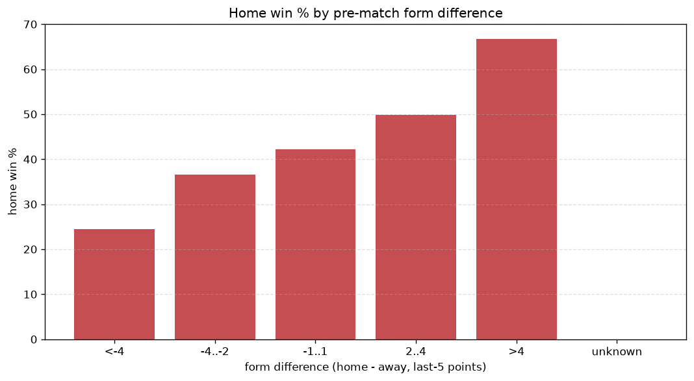
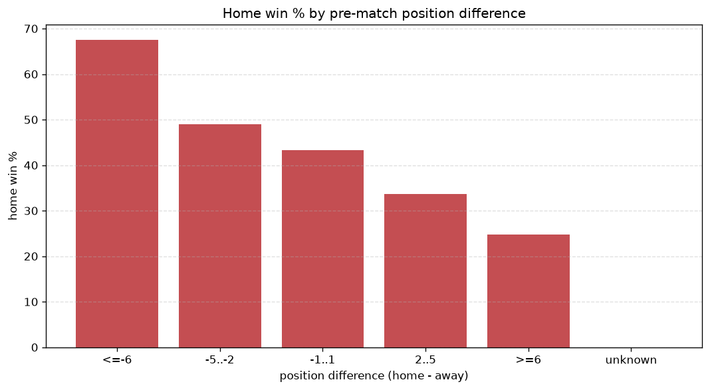

# Relationships Analysis
- Report: `relationships`
- Generated: 2026-10-26T01:45:28+00:00
- Script: `backend/scripts/analyze_relationships.py` v1.0.0
- League: Saudi Professional League (Saudi Arabia)
- Scope: league `saudi1`

- Matches analysed: **1646** (23 leakage-safe pre-match features).

## 1. Correlation matrix
_Pearson correlation of each pre-match feature with observed goals; sorted by |corr(total goals)|._

| feature | corr(home) | corr(away) | corr(total) |
|---|---|---|---|
| away_team_away_goals_avg | -0.097 | 0.233 | 0.103 |
| away_points_before_match | -0.076 | 0.199 | 0.093 |
| home_team_goals_scored_last_5 | 0.223 | -0.108 | 0.084 |
| away_team_goals_scored_last_5 | -0.099 | 0.205 | 0.081 |
| home_team_wins_last_5 | 0.221 | -0.111 | 0.080 |
| away_team_away_win_rate | -0.120 | 0.223 | 0.079 |
| home_team_home_goals_avg | 0.196 | -0.094 | 0.074 |
| home_points_before_match | 0.174 | -0.075 | 0.073 |
| away_team_wins_last_5 | -0.102 | 0.194 | 0.070 |
| away_team_points_last_5 | -0.105 | 0.197 | 0.070 |
| home_team_points_last_5 | 0.208 | -0.119 | 0.065 |
| away_position_before_match | 0.177 | -0.257 | -0.062 |
| home_rest_days | 0.041 | 0.042 | 0.062 |
| away_rest_days | 0.033 | 0.031 | 0.047 |
| home_team_home_conceded_avg | -0.074 | 0.125 | 0.039 |
| home_team_home_win_rate | 0.169 | -0.118 | 0.036 |
| position_difference | -0.286 | 0.325 | 0.032 |
| rest_days_difference | 0.016 | 0.021 | 0.028 |
| points_difference | 0.290 | -0.319 | -0.025 |
| away_team_goals_conceded_last_5 | 0.132 | -0.100 | 0.023 |
| away_team_away_conceded_avg | 0.141 | -0.111 | 0.021 |
| home_team_goals_conceded_last_5 | -0.086 | 0.110 | 0.019 |
| home_position_before_match | -0.222 | 0.195 | -0.018 |

## 2. Form vs outcome
_Home win/draw/away % per bucket of `home_team_points_last_5 - away_team_points_last_5`._

| bucket | matches | home | draw | away | home % | draw % | away % |
|---|---|---|---|---|---|---|---|
| <-4 | 275 | 67 | 56 | 152 | 24.4% | 20.4% | 55.3% |
| -4..-2 | 325 | 119 | 84 | 122 | 36.6% | 25.8% | 37.5% |
| -1..1 | 479 | 202 | 116 | 161 | 42.2% | 24.2% | 33.6% |
| 2..4 | 303 | 151 | 78 | 74 | 49.8% | 25.7% | 24.4% |
| >4 | 264 | 176 | 45 | 43 | 66.7% | 17.0% | 16.3% |
| unknown | 0 | 0 | 0 | 0 | - | - | - |

## 3. Position vs outcome
_Home win/draw/away % per bucket of `position_difference` (home position - away position; negative favours the home team)._

| bucket | matches | home | draw | away | home % | draw % | away % |
|---|---|---|---|---|---|---|---|
| <=-6 | 348 | 235 | 68 | 45 | 67.5% | 19.5% | 12.9% |
| -5..-2 | 355 | 174 | 81 | 100 | 49.0% | 22.8% | 28.2% |
| -1..1 | 233 | 101 | 60 | 72 | 43.3% | 25.8% | 30.9% |
| 2..5 | 327 | 110 | 83 | 134 | 33.6% | 25.4% | 41.0% |
| >=6 | 383 | 95 | 87 | 201 | 24.8% | 22.7% | 52.5% |
| unknown | 0 | 0 | 0 | 0 | - | - | - |

## 4. Rest advantage
_Home win/draw/away % per bucket of `rest_days_difference` (home rest - away rest). Matches with unknown rest are bucketed separately._

| bucket | matches | home | draw | away | home % | draw % | away % |
|---|---|---|---|---|---|---|---|
| <-1 | 210 | 104 | 45 | 61 | 49.5% | 21.4% | 29.0% |
| -1..0 | 354 | 161 | 85 | 108 | 45.5% | 24.0% | 30.5% |
| 0 | 484 | 196 | 116 | 172 | 40.5% | 24.0% | 35.5% |
| 1..2 | 473 | 193 | 115 | 165 | 40.8% | 24.3% | 34.9% |
| >2 | 73 | 36 | 10 | 27 | 49.3% | 13.7% | 37.0% |
| unknown | 52 | 25 | 8 | 19 | 48.1% | 15.4% | 36.5% |
- *52 match(es) had unknown rest difference (missing rest data on at least one side).*

## 5. Home team quality
_Home win rate by `home_team_home_win_rate` tier (split at 0.5)._

- `< 0.5` tier: **37.9%** home win (373/983)
- `>= 0.5` tier: **51.6%** home win (342/663)
- Home-win gap (>= split minus < split): **+13.7 pp**

| tier | label | matches | home | draw | away | home % |
|---|---|---|---|---|---|---|
| low | < 0.5 | 983 | 373 | 226 | 384 | 37.9% |
| high | >= 0.5 | 663 | 342 | 153 | 168 | 51.6% |

## 6. Feature averages by result
_Mean feature value per outcome; `range` is home-minus-away spread of the group means._

| feature | home mean | draw mean | away mean | range |
|---|---|---|---|---|
| points_difference | 4.894 | -0.710 | -6.444 | 11.338 |
| away_points_before_match | 19.056 | 21.631 | 25.281 | 6.225 |
| position_difference | -2.362 | 0.375 | 3.205 | 5.567 |
| home_points_before_match | 23.950 | 20.921 | 18.837 | 5.113 |
| away_position_before_match | 10.492 | 9.314 | 7.611 | 2.882 |
| home_position_before_match | 8.130 | 9.689 | 10.815 | 2.685 |
| away_team_goals_scored_last_5 | 5.855 | 6.533 | 7.678 | 1.823 |
| away_team_points_last_5 | 5.601 | 6.272 | 7.306 | 1.705 |
| home_team_points_last_5 | 6.936 | 6.037 | 5.433 | 1.503 |
| home_team_goals_scored_last_5 | 7.262 | 6.325 | 5.792 | 1.470 |
| home_team_goals_conceded_last_5 | 6.154 | 6.718 | 7.188 | 1.035 |
| away_team_goals_conceded_last_5 | 6.905 | 6.723 | 5.946 | 0.959 |
| away_rest_days | 8.787 | 9.210 | 8.537 | 0.674 |
| away_team_wins_last_5 | 1.515 | 1.741 | 2.085 | 0.570 |
| home_team_wins_last_5 | 1.985 | 1.652 | 1.455 | 0.530 |
| rest_days_difference | 0.129 | -0.237 | 0.244 | 0.481 |
| away_team_away_goals_avg | 1.074 | 1.210 | 1.478 | 0.404 |
| away_team_away_conceded_avg | 1.517 | 1.430 | 1.283 | 0.235 |
| home_team_home_goals_avg | 1.515 | 1.401 | 1.292 | 0.223 |
| home_team_home_conceded_avg | 1.144 | 1.246 | 1.362 | 0.218 |
| home_rest_days | 8.916 | 8.973 | 8.780 | 0.193 |
| away_team_away_win_rate | 0.250 | 0.306 | 0.388 | 0.138 |
| home_team_home_win_rate | 0.452 | 0.429 | 0.360 | 0.092 |

---
*All features are leakage-safe pre-match values built by `ml.features.build_features.build_rows` from strictly prior matches. Run with `python backend/scripts/analyze_relationships.py` to regenerate.*

## Charts

