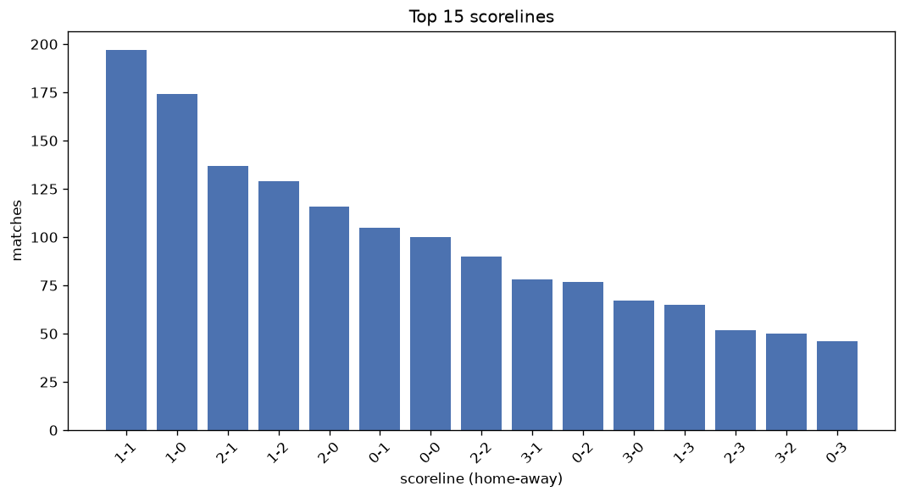
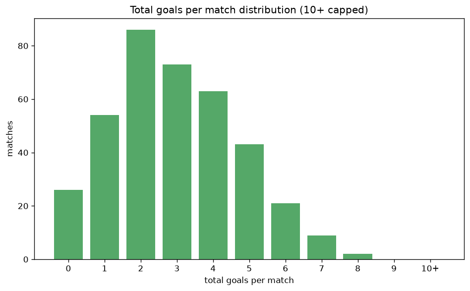

# Scoreline Analysis
- Report: `scoreline_analysis`
- Generated: 2026-10-29T02:12:18+00:00
- Script: `backend/scripts/analyze_scorelines.py` v1.0.0
- League: Saudi Professional League (Saudi Arabia)
- Scope: league `saudi1`

## 1. Scoreline frequency
- Matches analysed: **1737** across **7** seasons.
- Distinct scorelines seen: **41**.

| scoreline | count | pct |
|---|---|---|
| 1-1 | 197 | 11.3% |
| 1-0 | 174 | 10.0% |
| 2-1 | 137 | 7.9% |
| 1-2 | 129 | 7.4% |
| 2-0 | 116 | 6.7% |
| 0-1 | 105 | 6.0% |
| 0-0 | 100 | 5.8% |
| 2-2 | 90 | 5.2% |
| 3-1 | 78 | 4.5% |
| 0-2 | 77 | 4.4% |
| 3-0 | 67 | 3.9% |
| 1-3 | 65 | 3.7% |
| 2-3 | 52 | 3.0% |
| 3-2 | 50 | 2.9% |
| 0-3 | 46 | 2.6% |
| 4-1 | 35 | 2.0% |
| 4-0 | 32 | 1.8% |
| 0-4 | 22 | 1.3% |
| 2-4 | 19 | 1.1% |
| 4-2 | 19 | 1.1% |

## 2. Scoreline frequency per season

### 2020-2021
| scoreline | count | pct |
|---|---|---|
| 1-1 | 31 | 12.9% |
| 1-2 | 28 | 11.7% |
| 1-0 | 23 | 9.6% |
| 2-1 | 19 | 7.9% |
| 2-2 | 17 | 7.1% |

### 2021-2022
| scoreline | count | pct |
|---|---|---|
| 1-0 | 36 | 15.0% |
| 1-1 | 33 | 13.8% |
| 2-1 | 17 | 7.1% |
| 2-0 | 17 | 7.1% |
| 0-0 | 17 | 7.1% |

### 2022-2023
| scoreline | count | pct |
|---|---|---|
| 1-0 | 25 | 10.4% |
| 2-1 | 23 | 9.6% |
| 2-0 | 23 | 9.6% |
| 1-1 | 22 | 9.2% |
| 1-2 | 20 | 8.3% |

### 2023-2024
| scoreline | count | pct |
|---|---|---|
| 1-1 | 36 | 11.8% |
| 1-0 | 27 | 8.8% |
| 0-0 | 24 | 7.8% |
| 3-1 | 22 | 7.2% |
| 1-2 | 21 | 6.9% |

### 2024-2025
| scoreline | count | pct |
|---|---|---|
| 1-0 | 30 | 9.8% |
| 1-2 | 27 | 8.8% |
| 1-1 | 26 | 8.5% |
| 2-1 | 25 | 8.2% |
| 2-0 | 23 | 7.5% |

### 2025-2026
| scoreline | count | pct |
|---|---|---|
| 1-1 | 39 | 12.4% |
| 2-1 | 28 | 8.9% |
| 1-0 | 28 | 8.9% |
| 2-0 | 23 | 7.3% |
| 1-2 | 20 | 6.4% |

### 2026-2027
| scoreline | count | pct |
|---|---|---|
| 0-0 | 10 | 11.0% |
| 1-1 | 10 | 11.0% |
| 2-1 | 8 | 8.8% |
| 0-1 | 7 | 7.7% |
| 3-0 | 5 | 5.5% |

## 3. Total-goal histogram
_10+ groups all matches with 10 or more total goals._

| total goals | matches | pct |
|---|---|---|
| 0 | 100 | 5.8% |
| 1 | 279 | 16.1% |
| 2 | 390 | 22.5% |
| 3 | 379 | 21.8% |
| 4 | 287 | 16.5% |
| 5 | 177 | 10.2% |
| 6 | 76 | 4.4% |
| 7 | 37 | 2.1% |
| 8 | 8 | 0.5% |
| 9 | 3 | 0.2% |
| 10+ | 1 | 0.1% |

## 4. Extreme scorelines
- Matches with 7+ total goals: **49**

| season | date | scoreline | total goals |
|---|---|---|---|
| 2021-2022 | 2021-11-25 | 5-5 | 10 |
| 2023-2024 | 2023-11-25 | 0-9 | 9 |
| 2024-2025 | 2025-01-16 | 9-0 | 9 |
| 2024-2025 | 2025-05-12 | 0-9 | 9 |
| 2021-2022 | 2021-09-17 | 3-5 | 8 |
| 2021-2022 | 2022-05-06 | 4-4 | 8 |
| 2023-2024 | 2024-02-29 | 4-4 | 8 |
| 2023-2024 | 2024-04-02 | 0-8 | 8 |
| 2024-2025 | 2024-09-15 | 7-1 | 8 |
| 2024-2025 | 2025-05-07 | 3-5 | 8 |
| 2025-2026 | 2025-11-01 | 4-4 | 8 |
| 2025-2026 | 2026-02-27 | 3-5 | 8 |
| 2020-2021 | 2020-11-07 | 3-4 | 7 |
| 2020-2021 | 2020-12-05 | 4-3 | 7 |
| 2020-2021 | 2021-02-28 | 2-5 | 7 |
| 2020-2021 | 2021-03-20 | 7-0 | 7 |
| 2020-2021 | 2021-03-21 | 3-4 | 7 |
| 2020-2021 | 2021-04-25 | 3-4 | 7 |
| 2020-2021 | 2021-05-05 | 4-3 | 7 |
| 2020-2021 | 2021-05-14 | 4-3 | 7 |
| 2020-2021 | 2021-05-30 | 3-4 | 7 |
| 2021-2022 | 2021-09-11 | 6-1 | 7 |
| 2021-2022 | 2022-01-01 | 3-4 | 7 |
| 2021-2022 | 2022-02-17 | 3-4 | 7 |
| 2021-2022 | 2022-02-26 | 3-4 | 7 |
| 2021-2022 | 2022-05-21 | 5-2 | 7 |
| 2022-2023 | 2023-05-10 | 4-3 | 7 |
| 2023-2024 | 2023-09-01 | 3-4 | 7 |
| 2023-2024 | 2023-09-15 | 6-1 | 7 |
| 2023-2024 | 2023-09-21 | 4-3 | 7 |
| 2023-2024 | 2023-09-22 | 4-3 | 7 |
| 2023-2024 | 2023-10-21 | 4-3 | 7 |
| 2023-2024 | 2023-11-24 | 4-3 | 7 |
| 2023-2024 | 2023-12-21 | 7-0 | 7 |
| 2023-2024 | 2023-12-26 | 2-5 | 7 |
| 2023-2024 | 2023-12-29 | 4-3 | 7 |
| 2023-2024 | 2024-03-30 | 3-4 | 7 |
| 2024-2025 | 2025-02-01 | 4-3 | 7 |
| 2024-2025 | 2025-04-24 | 4-3 | 7 |
| 2024-2025 | 2025-05-16 | 3-4 | 7 |
| 2025-2026 | 2025-08-30 | 2-5 | 7 |
| 2025-2026 | 2025-10-19 | 6-1 | 7 |
| 2025-2026 | 2025-11-07 | 2-5 | 7 |
| 2025-2026 | 2026-01-08 | 3-4 | 7 |
| 2025-2026 | 2026-01-20 | 2-5 | 7 |
| 2025-2026 | 2026-02-13 | 2-5 | 7 |
| 2025-2026 | 2026-02-19 | 4-3 | 7 |
| 2025-2026 | 2026-04-03 | 5-2 | 7 |
| 2025-2026 | 2026-04-08 | 3-4 | 7 |

## 5. Margin-of-victory distribution (decided matches)
- Decided matches: **1334** (draws: **403**)
- Average winning margin: **1.84**

| margin | matches | pct |
|---|---|---|
| 1 | 671 | 50.3% |
| 2 | 377 | 28.3% |
| 3+ | 286 | 21.4% |

## 6. Margin by outcome

### Home wins
- Matches: **751** | avg margin: **1.84** | max margin: **9**
| margin | matches | pct |
|---|---|---|
| 1 | 373 | 49.7% |
| 2 | 213 | 28.4% |
| 3+ | 165 | 22.0% |
- *Full match-by-match list available in `scoreline_analysis.json`.*

### Away wins
- Matches: **583** | avg margin: **1.85** | max margin: **9**
| margin | matches | pct |
|---|---|---|
| 1 | 298 | 51.1% |
| 2 | 164 | 28.1% |
| 3+ | 121 | 20.8% |
- *Full match-by-match list available in `scoreline_analysis.json`.*

## 7. Most common exact score by outcome type
| outcome | matches | most common score | count | pct |
|---|---|---|---|---|
| home | 751 | 1-0 | 174 | 23.2% |
| draw | 403 | 1-1 | 197 | 48.9% |
| away | 583 | 1-2 | 129 | 22.1% |

---
*All statistics are computed from PostgreSQL tables (read-only). Run with `python backend/scripts/analyze_scorelines.py` to regenerate.*

## Charts

