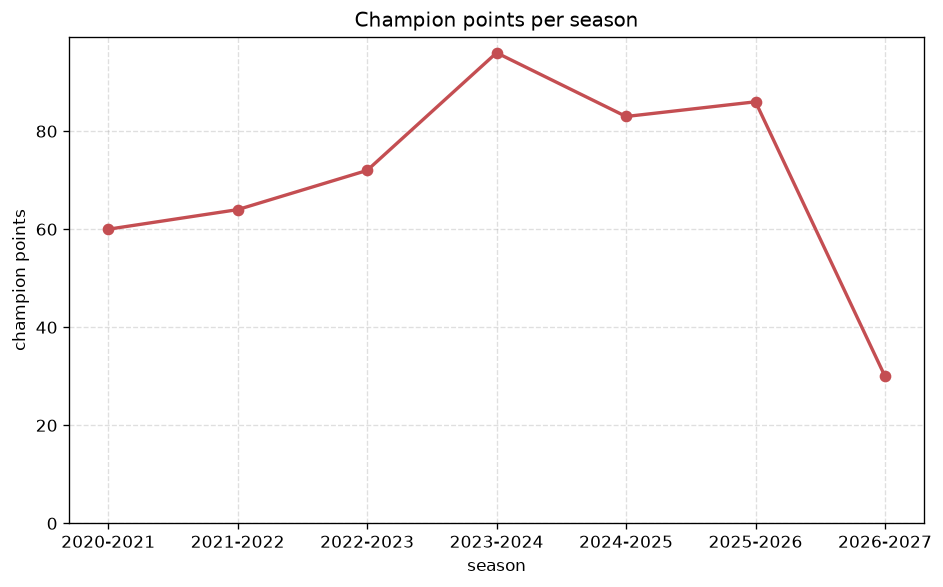
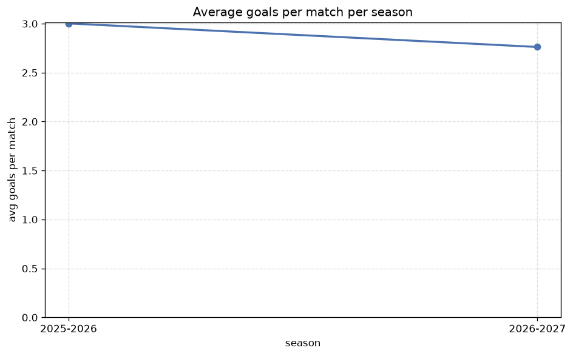

# Season Trends Analysis
- Report: `season_trends`
- Generated: 2026-10-30T04:08:30+00:00
- Script: `backend/scripts/analyze_seasons.py` v1.0.0
- League: Saudi Professional League (Saudi Arabia)
- Scope: league `saudi1`

## 1. Champions per season
| season | champion | pts | runner-up | margin |
|---|---|---|---|---|
| 2020-2021 | Al Hilal | 60 | Al Ittihad | 5 pts |
| 2021-2022 | Al Hilal | 64 | Al Ittihad | 2 pts |
| 2022-2023 | Al Ittihad | 72 | Al Nassr | 5 pts |
| 2023-2024 | Al Hilal | 96 | Al Nassr | 14 pts |
| 2024-2025 | Al Ittihad | 83 | Al Hilal | 8 pts |
| 2025-2026 | Al Nassr | 86 | Al Hilal | 1 pts |
| 2026-2027 | Al Hilal | 30 | Al Qadsiah | 2 pts |

## 2. Title-race tightness
- Tight races (margin <= 3 pts): **3** of 7 seasons
- Tightest race: **2025-2026** - Al Nassr beat Al Hilal by **1** pts

| season | margin | tight |
|---|---|---|
| 2020-2021 | 5 pts |  |
| 2021-2022 | 2 pts | yes |
| 2022-2023 | 5 pts |  |
| 2023-2024 | 14 pts |  |
| 2024-2025 | 8 pts |  |
| 2025-2026 | 1 pts | yes |
| 2026-2027 | 2 pts | yes |

## 3. Points thresholds
_Position-specific points per season. Key: 1 = champion, 2 = runner-up, 4 = CL line, 6 = Europa, 15 = last safe, 18 = bottom._

| season | pos 1 | pos 2 | pos 4 | pos 6 | pos 15 | pos 18 |
|---|---|---|---|---|---|---|
| 2020-2021 | 60 | 55 | 46 | 43 | 19 | - |
| 2021-2022 | 64 | 62 | 54 | 37 | - | - |
| 2022-2023 | 72 | 67 | 56 | 43 | 28 | - |
| 2023-2024 | 96 | 82 | 59 | 48 | 33 | 24 |
| 2024-2025 | 83 | 75 | 68 | 60 | 34 | 21 |
| 2025-2026 | 86 | 85 | 77 | 55 | 30 | 17 |
| 2026-2027 | 30 | 28 | 25 | 21 | 8 | 3 |

## 4. Relegation battle
| season | safe pos | safe pts | drop pos | drop pts | gap |
|---|---|---|---|---|---|
| 2020-2021 | 15 | 19 | 16 | 19 | 0 pts |
| 2021-2022 | 15 | - | 16 | 17 | - |
| 2022-2023 | 15 | 28 | 16 | 20 | 8 pts |
| 2023-2024 | 15 | 33 | 16 | 32 | 1 pts |
| 2024-2025 | 15 | 34 | 16 | 33 | 1 pts |
| 2025-2026 | 15 | 30 | 16 | 29 | 1 pts |
| 2026-2027 | 15 | 8 | 16 | 7 | 1 pts |

## 5. League-level trends
| season | matches | total goals | avg goals | home win | draw | away win | goalless | avg pts/team |
|---|---|---|---|---|---|---|---|---|
| 2020-2021 | 240 | 746 | 3.108 | 38.8% | 24.2% | 37.1% | 3.8% | 38.88 |
| 2021-2022 | 240 | 637 | 2.654 | 45.4% | 27.9% | 26.7% | 7.1% | 38.38 |
| 2022-2023 | 240 | 648 | 2.7 | 46.2% | 20.8% | 32.9% | 5.0% | 41.88 |
| 2023-2024 | 306 | 909 | 2.971 | 42.2% | 24.5% | 33.3% | 7.8% | 46.83 |
| 2024-2025 | 306 | 902 | 2.948 | 43.8% | 18.6% | 37.6% | 3.9% | 47.83 |
| 2025-2026 | 314 | 943 | 3.003 | 44.3% | 22.9% | 32.8% | 5.1% | 45.79 |
| 2026-2027 | 91 | 260 | 2.857 | 39.6% | 26.4% | 34.1% | 11.0% | 14.89 |

## 6. View divergence
- Largest divergence: **2020-2021** (luck view, avg abs position diff = 9.312)

_Avg absolute position difference between classic view and alternative view per season._

| season | classic vs luck | classic vs goals |
|---|---|---|
| 2020-2021 | 9.312 | 7.938 |
| 2021-2022 | 7.938 | 7.438 |
| 2022-2023 | 4.375 | 5.625 |
| 2023-2024 | 4.333 | 5.111 |
| 2024-2025 | 3.889 | 4.556 |
| 2025-2026 | 4.000 | 4.105 |
| 2026-2027 | 2.389 | 4.278 |

---
*All statistics are computed from PostgreSQL tables (read-only). Run with `python backend/scripts/analyze_seasons.py` to regenerate.*

## Charts

