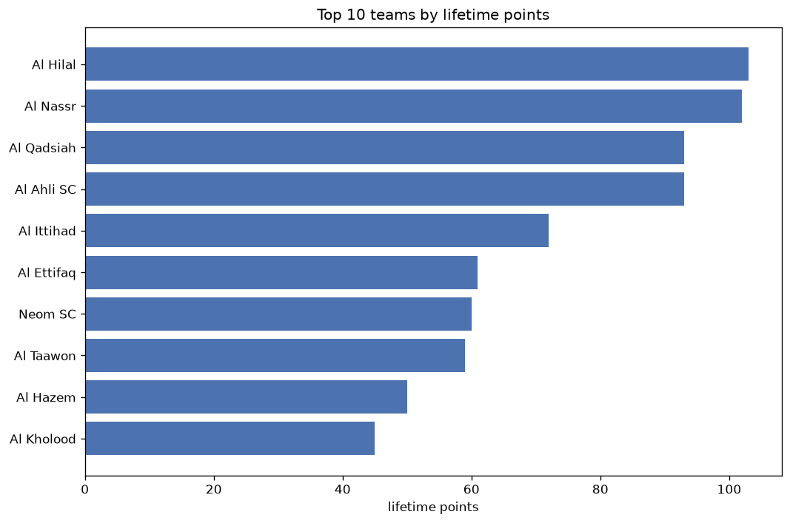
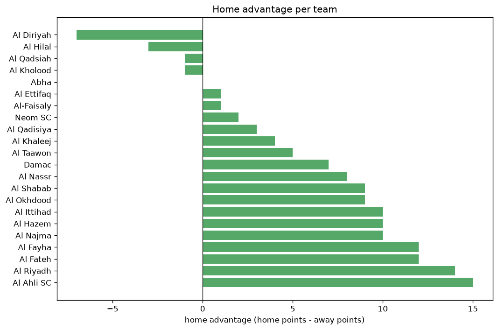

# Team Analysis
- Report: `teams_analysis`
- Generated: 2026-10-27T02:27:25+00:00
- Script: `backend/scripts/analyze_teams.py` v1.0.0
- League: Saudi Professional League (Saudi Arabia)
- Scope: league `saudi1`

- Teams: **29** | Seasons: **7** | Matches: **1737**

## 1. Team standings (lifetime)
| team | seasons | played | W | D | L | pts | GF | GA | GD | avg pts/season | best pos | worst pos | titles |
|---|---|---|---|---|---|---|---|---|---|---|---|---|---|
| Al Hilal | 7 | 203 | 143 | 41 | 19 | 470 | 490 | 186 | 304 | 67.14 | 1 | 3 | 4 |
| Al Nassr | 7 | 201 | 134 | 32 | 35 | 434 | 465 | 209 | 256 | 62.0 | 1 | 6 | 1 |
| Al Ittihad | 7 | 202 | 122 | 42 | 38 | 408 | 384 | 218 | 166 | 58.29 | 1 | 6 | 2 |
| Al Shabab | 7 | 201 | 89 | 50 | 62 | 317 | 343 | 264 | 79 | 45.29 | 3 | 13 | 0 |
| Al Ahli SC | 6 | 172 | 89 | 38 | 45 | 305 | 316 | 208 | 108 | 50.83 | 3 | 14 | 0 |
| Al Taawon | 7 | 204 | 80 | 60 | 64 | 300 | 288 | 251 | 37 | 42.86 | 4 | 17 | 0 |
| Al Ettifaq | 7 | 203 | 77 | 53 | 73 | 284 | 273 | 281 | -8 | 40.57 | 5 | 12 | 0 |
| Al Fateh | 7 | 204 | 67 | 46 | 91 | 247 | 303 | 334 | -31 | 35.29 | 6 | 16 | 0 |
| Damac | 6 | 192 | 55 | 56 | 81 | 221 | 227 | 285 | -58 | 36.83 | 5 | 16 | 0 |
| Al Fayha | 6 | 173 | 46 | 56 | 71 | 194 | 176 | 241 | -65 | 32.33 | 8 | 14 | 0 |
| Al Raed | 5 | 158 | 44 | 32 | 82 | 164 | 202 | 256 | -54 | 32.8 | 9 | 18 | 0 |
| Al Khaleej | 5 | 144 | 40 | 34 | 70 | 154 | 171 | 229 | -58 | 30.8 | 10 | 14 | 0 |
| Abha | 5 | 133 | 38 | 24 | 71 | 138 | 146 | 249 | -103 | 27.6 | 10 | 19 | 0 |
| Al Wehda | 4 | 128 | 36 | 25 | 67 | 133 | 153 | 230 | -77 | 33.25 | 13 | 16 | 0 |
| Al Qadisiya | 3 | 72 | 34 | 18 | 20 | 120 | 109 | 85 | 24 | 40.0 | 4 | 18 | 0 |
| Al Riyadh | 4 | 112 | 28 | 31 | 53 | 115 | 116 | 191 | -75 | 28.75 | 11 | 15 | 0 |
| Al Qadsiah | 2 | 45 | 31 | 9 | 5 | 102 | 109 | 46 | 63 | 51.0 | 2 | 4 | 0 |
| Al Taee | 3 | 94 | 29 | 15 | 50 | 102 | 108 | 158 | -50 | 34.0 | 6 | 17 | 0 |
| Al Hazem | 4 | 109 | 21 | 30 | 58 | 93 | 107 | 199 | -92 | 23.25 | 9 | 18 | 0 |
| Al Batin | 3 | 90 | 22 | 23 | 45 | 89 | 101 | 159 | -58 | 29.67 | 11 | 16 | 0 |
| Al Okhdood | 3 | 103 | 23 | 19 | 61 | 88 | 93 | 178 | -85 | 29.33 | 15 | 17 | 0 |
| Al Kholood | 3 | 78 | 24 | 13 | 41 | 85 | 93 | 147 | -54 | 28.33 | 9 | 14 | 0 |
| Al-Faisaly | 3 | 67 | 16 | 24 | 27 | 72 | 75 | 97 | -22 | 24.0 | 15 | 18 | 0 |
| Neom SC | 2 | 46 | 18 | 10 | 18 | 64 | 60 | 60 | 0 | 32.0 | 5 | 8 | 0 |
| Al Orubah | 1 | 34 | 9 | 3 | 22 | 30 | 31 | 74 | -43 | 30.0 | 17 | 17 | 0 |
| Al Adalah | 1 | 30 | 7 | 7 | 16 | 28 | 30 | 56 | -26 | 28.0 | 15 | 15 | 0 |
| Al Ain | 1 | 30 | 5 | 5 | 20 | 20 | 34 | 64 | -30 | 20.0 | 16 | 16 | 0 |
| Al Najma | 1 | 35 | 3 | 7 | 25 | 16 | 33 | 79 | -46 | 16.0 | 19 | 19 | 0 |
| Al Diriyah | 1 | 11 | 4 | 3 | 4 | 15 | 9 | 11 | -2 | 15.0 | 8 | 8 | 0 |

## 2. Home vs away split
| team | home P | H-W | H-D | H-L | H-pts | away P | A-W | A-D | A-L | A-pts | adv |
|---|---|---|---|---|---|---|---|---|---|---|---|
| Abha | 65 | 28 | 16 | 21 | 100 | 68 | 10 | 8 | 50 | 38 | 62 |
| Damac | 96 | 34 | 31 | 31 | 133 | 96 | 21 | 25 | 50 | 88 | 45 |
| Al Shabab | 101 | 53 | 21 | 27 | 180 | 100 | 36 | 29 | 35 | 137 | 43 |
| Al Ittihad | 101 | 70 | 13 | 18 | 223 | 101 | 52 | 29 | 20 | 185 | 38 |
| Al Taee | 47 | 20 | 8 | 19 | 68 | 47 | 9 | 7 | 31 | 34 | 34 |
| Al Ahli SC | 85 | 49 | 22 | 14 | 169 | 87 | 40 | 16 | 31 | 136 | 33 |
| Al Fayha | 86 | 27 | 31 | 28 | 112 | 87 | 19 | 25 | 43 | 82 | 30 |
| Al Batin | 45 | 16 | 11 | 18 | 59 | 45 | 6 | 12 | 27 | 30 | 29 |
| Al Nassr | 101 | 71 | 17 | 13 | 230 | 100 | 63 | 15 | 22 | 204 | 26 |
| Al Hazem | 55 | 15 | 14 | 26 | 59 | 54 | 6 | 16 | 32 | 34 | 25 |
| Al Qadisiya | 36 | 21 | 8 | 7 | 71 | 36 | 13 | 10 | 13 | 49 | 22 |
| Al Riyadh | 55 | 17 | 17 | 21 | 68 | 57 | 11 | 14 | 32 | 47 | 21 |
| Al Hilal | 102 | 76 | 17 | 9 | 245 | 101 | 67 | 24 | 10 | 225 | 20 |
| Al-Faisaly | 34 | 11 | 13 | 10 | 46 | 33 | 5 | 11 | 17 | 26 | 20 |
| Al Taawon | 102 | 42 | 30 | 30 | 156 | 102 | 38 | 30 | 34 | 144 | 12 |
| Al Kholood | 39 | 14 | 6 | 19 | 48 | 39 | 10 | 7 | 22 | 37 | 11 |
| Al Najma | 17 | 3 | 4 | 10 | 13 | 18 | 0 | 3 | 15 | 3 | 10 |
| Al Ain | 15 | 4 | 2 | 9 | 14 | 15 | 1 | 3 | 11 | 6 | 8 |
| Al Fateh | 103 | 35 | 22 | 46 | 127 | 101 | 32 | 24 | 45 | 120 | 7 |
| Al Okhdood | 51 | 13 | 8 | 30 | 47 | 52 | 10 | 11 | 31 | 41 | 6 |
| Al Adalah | 15 | 5 | 2 | 8 | 17 | 15 | 2 | 5 | 8 | 11 | 6 |
| Neom SC | 24 | 10 | 4 | 10 | 34 | 22 | 8 | 6 | 8 | 30 | 4 |
| Al Orubah | 17 | 5 | 1 | 11 | 16 | 17 | 4 | 2 | 11 | 14 | 2 |
| Al Wehda | 64 | 17 | 16 | 31 | 67 | 64 | 19 | 9 | 36 | 66 | 1 |
| Al Khaleej | 71 | 20 | 17 | 34 | 77 | 73 | 20 | 17 | 36 | 77 | 0 |
| Al Ettifaq | 102 | 38 | 27 | 37 | 141 | 101 | 39 | 26 | 36 | 143 | -2 |
| Al Raed | 79 | 22 | 15 | 42 | 81 | 79 | 22 | 17 | 40 | 83 | -2 |
| Al Diriyah | 6 | 1 | 3 | 2 | 6 | 5 | 3 | 0 | 2 | 9 | -3 |
| Al Qadsiah | 23 | 14 | 7 | 2 | 49 | 22 | 17 | 2 | 3 | 53 | -4 |

## 3. Top performers
### Best points per game (PPG)
| rank | team | PPG |
|---|---|---|
| 1 | Al Hilal | 2.31 |
| 2 | Al Qadsiah | 2.27 |
| 3 | Al Nassr | 2.16 |
| 4 | Al Ittihad | 2.02 |
| 5 | Al Ahli SC | 1.77 |

### Most goals scored
| rank | team | goals |
|---|---|---|
| 1 | Al Hilal | 490 |
| 2 | Al Nassr | 465 |
| 3 | Al Ittihad | 384 |
| 4 | Al Shabab | 343 |
| 5 | Al Ahli SC | 316 |

### Best goal difference
| rank | team | GD |
|---|---|---|
| 1 | Al Hilal | 304 |
| 2 | Al Nassr | 256 |
| 3 | Al Ittihad | 166 |
| 4 | Al Ahli SC | 108 |
| 5 | Al Shabab | 79 |

### Best defence (goals against per match, standings)
| rank | team | GA/match |
|---|---|---|
| 1 | Al Hilal | 0.916 |
| 2 | Al Diriyah | 1.000 |
| 3 | Al Qadsiah | 1.022 |
| 4 | Al Nassr | 1.030 |
| 5 | Al Ittihad | 1.080 |

## 4. Team consistency
- Teams present in all **7** seasons: **7**

Al Ettifaq, Al Fateh, Al Hilal, Al Ittihad, Al Nassr, Al Shabab, Al Taawon

## 5. Head-to-head dominance
- Distinct fixtures: **332** (showing the 15 most frequent)

| fixture | meetings | home wins | draws | away wins | home pct | draw pct | away pct |
|---|---|---|---|---|---|---|---|
| Al Ittihad vs Al Fateh | 13 | 7 | 4 | 2 | 53.8% | 30.8% | 15.4% |
| Al Nassr vs Al Fateh | 13 | 7 | 2 | 4 | 53.8% | 15.4% | 30.8% |
| Al Taawon vs Al Nassr | 13 | 7 | 2 | 4 | 53.8% | 15.4% | 30.8% |
| Al Ittihad vs Al Hilal | 13 | 6 | 3 | 4 | 46.2% | 23.1% | 30.8% |
| Al Ittihad vs Al Nassr | 13 | 6 | 2 | 5 | 46.2% | 15.4% | 38.5% |
| Al Shabab vs Al Fateh | 13 | 6 | 4 | 3 | 46.2% | 30.8% | 23.1% |
| Al Shabab vs Al Taawon | 13 | 6 | 3 | 4 | 46.2% | 23.1% | 30.8% |
| Al Ettifaq vs Al Fateh | 13 | 5 | 1 | 7 | 38.5% | 7.7% | 53.8% |
| Al Ettifaq vs Al Nassr | 13 | 4 | 5 | 4 | 30.8% | 38.5% | 30.8% |
| Al Hilal vs Al Taawon | 13 | 4 | 2 | 7 | 30.8% | 15.4% | 53.8% |
| Al Shabab vs Al Hilal | 13 | 4 | 4 | 5 | 30.8% | 30.8% | 38.5% |
| Al Ittihad vs Al Ettifaq | 13 | 3 | 2 | 8 | 23.1% | 15.4% | 61.5% |
| Al Taawon vs Al Fateh | 13 | 3 | 3 | 7 | 23.1% | 23.1% | 53.8% |
| Al Ittihad vs Damac | 12 | 8 | 4 | 0 | 66.7% | 33.3% | 0.0% |
| Al Hilal vs Al Ettifaq | 12 | 6 | 2 | 4 | 50.0% | 16.7% | 33.3% |

## 6. Position per season (classic view)
_Cells show final position; '-' when the team was absent from that season._

| team | 2020-2021 | 2021-2022 | 2022-2023 | 2023-2024 | 2024-2025 | 2025-2026 | 2026-2027 |
|---|---|---|---|---|---|---|---|
| Al Hilal | 1 | 1 | 3 | 1 | 2 | 2 | 1 |
| Al Nassr | 6 | 3 | 2 | 2 | 3 | 1 | 4 |
| Al Ittihad | 2 | 2 | 1 | 5 | 1 | 6 | 3 |
| Al Shabab | 3 | 4 | 4 | 8 | 6 | 13 | 12 |
| Al Ahli SC | 8 | 14 | - | 3 | 5 | 3 | 6 |
| Al Taawon | 4 | 11 | 5 | 4 | 8 | 5 | 17 |
| Al Ettifaq | 5 | 12 | 7 | 6 | 7 | 7 | 7 |
| Al Fateh | 7 | 7 | 6 | 7 | 10 | 12 | 16 |
| Damac | 9 | 5 | 8 | 10 | 14 | 16 | - |
| Al Fayha | - | 8 | 11 | 9 | 13 | 10 | 14 |
| Al Raed | 13 | 9 | 9 | 11 | 18 | - | - |
| Al Khaleej | - | - | 14 | 12 | 12 | 11 | 10 |
| Abha | 10 | 10 | 12 | 16 | - | - | 19 |
| Al Wehda | 14 | - | 13 | 13 | 16 | - | - |
| Al Qadisiya | 12 | - | - | - | 4 | 18 | - |
| Al Riyadh | - | - | - | 14 | 11 | 15 | 11 |
| Al Qadsiah | - | - | - | - | - | 4 | 2 |
| Al Taee | - | 6 | 10 | 17 | - | - | - |
| Al Hazem | - | 16 | - | 18 | - | 9 | 13 |
| Al Batin | 11 | 13 | 16 | - | - | - | - |
| Al Okhdood | - | - | - | 15 | 15 | 17 | - |
| Al Kholood | - | - | - | - | 9 | 14 | 9 |
| Al-Faisaly | 15 | 17 | - | - | - | - | 18 |
| Neom SC | - | - | - | - | - | 8 | 5 |
| Al Orubah | - | - | - | - | 17 | - | - |
| Al Adalah | - | - | 15 | - | - | - | - |
| Al Ain | 16 | - | - | - | - | - | - |
| Al Najma | - | - | - | - | - | 19 | - |
| Al Diriyah | - | - | - | - | - | - | 8 |

---
*All statistics are computed from PostgreSQL tables (read-only). Run with `python backend/scripts/analyze_teams.py` to regenerate.*

## Charts

