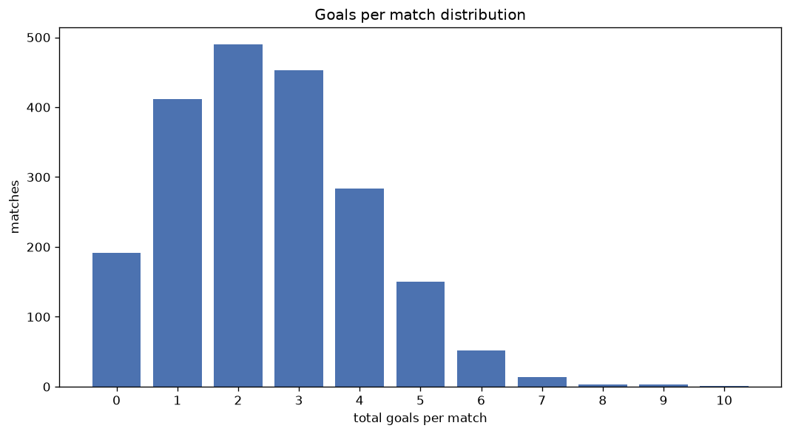
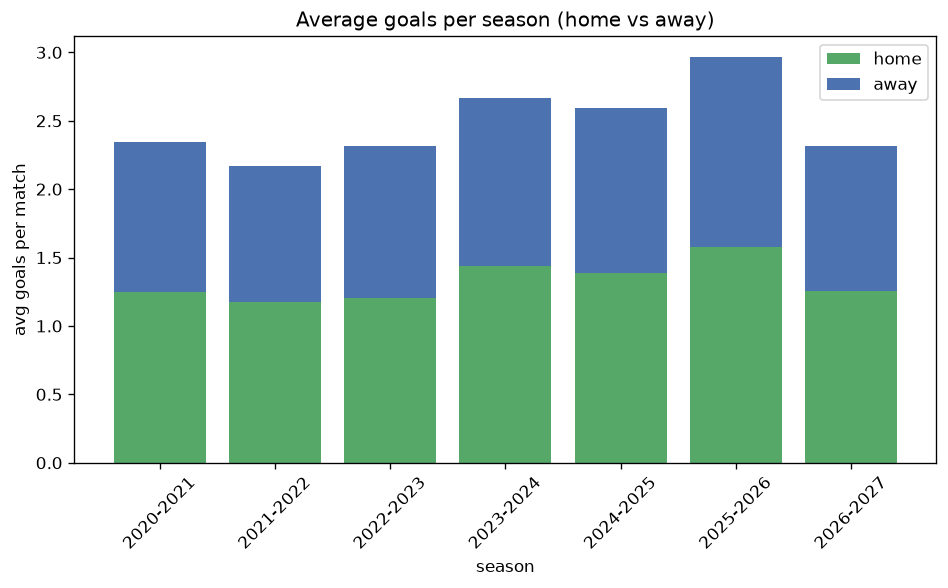

# Goal Analysis
- Report: `goals_analysis`
- Generated: 2026-10-26T01:45:39+00:00
- Script: `backend/scripts/analyze_goals.py` v1.0.0
- League: Division 1 (Saudi Arabia)
- Scope: league `saudi2`

## 1. Goals per match distribution
| goals | matches | pct |
|---|---|---|
| 0 | 192 | 9.3% |
| 1 | 412 | 20.1% |
| 2 | 490 | 23.9% |
| 3 | 453 | 22.1% |
| 4 | 284 | 13.8% |
| 5 | 150 | 7.3% |
| 6 | 52 | 2.5% |
| 7 | 14 | 0.7% |
| 8 | 3 | 0.1% |
| 9 | 3 | 0.1% |
| 10 | 1 | 0.0% |

## 2. Goals per match per season
| season | matches | total goals | avg home | avg away | avg total |
|---|---|---|---|---|---|
| 2020-2021 | 380 | 892 | 1.25 | 1.097 | 2.347 |
| 2021-2022 | 380 | 825 | 1.176 | 0.995 | 2.171 |
| 2022-2023 | 306 | 709 | 1.206 | 1.111 | 2.317 |
| 2023-2024 | 306 | 816 | 1.435 | 1.232 | 2.667 |
| 2024-2025 | 306 | 794 | 1.386 | 1.209 | 2.595 |
| 2025-2026 | 309 | 917 | 1.576 | 1.392 | 2.968 |
| 2026-2027 | 67 | 155 | 1.254 | 1.06 | 2.313 |

## 3. Home vs away goal share
- Home goals: **2725** (53.3%)
- Away goals: **2383** (46.7%)
- Home/away ratio: **1.144**

| season | home goals | away goals | total | home pct | away pct |
|---|---|---|---|---|---|
| 2020-2021 | 475 | 417 | 892 | 53.3% | 46.7% |
| 2021-2022 | 447 | 378 | 825 | 54.2% | 45.8% |
| 2022-2023 | 369 | 340 | 709 | 52.0% | 48.0% |
| 2023-2024 | 439 | 377 | 816 | 53.8% | 46.2% |
| 2024-2025 | 424 | 370 | 794 | 53.4% | 46.6% |
| 2025-2026 | 487 | 430 | 917 | 53.1% | 46.9% |
| 2026-2027 | 84 | 71 | 155 | 54.2% | 45.8% |

## 4. BTTS (Both Teams To Score)
- Overall: **1081** of `2054` (52.6%)

| season | matches | BTTS | pct |
|---|---|---|---|
| 2020-2021 | 380 | 189 | 49.7% |
| 2021-2022 | 380 | 182 | 47.9% |
| 2022-2023 | 306 | 157 | 51.3% |
| 2023-2024 | 306 | 169 | 55.2% |
| 2024-2025 | 306 | 160 | 52.3% |
| 2025-2026 | 309 | 192 | 62.1% |
| 2026-2027 | 67 | 32 | 47.8% |

## 5. Clean sheets
- Home clean sheets: **625** (30.4%)
- Away clean sheets: **540** (26.3%)
- Total clean sheets recorded: **1165**
- Matches with at least one clean sheet: **973** (47.4%)
- Both teams kept clean sheets (0-0): **192**

| season | matches | home CS | away CS | total CS | matches w/ CS |
|---|---|---|---|---|---|
| 2020-2021 | 380 | 120 | 113 | 233 | 191 (50.3%) |
| 2021-2022 | 380 | 138 | 111 | 249 | 198 (52.1%) |
| 2022-2023 | 306 | 98 | 77 | 175 | 149 (48.7%) |
| 2023-2024 | 306 | 87 | 73 | 160 | 137 (44.8%) |
| 2024-2025 | 306 | 90 | 79 | 169 | 146 (47.7%) |
| 2025-2026 | 309 | 70 | 63 | 133 | 117 (37.9%) |
| 2026-2027 | 67 | 22 | 24 | 46 | 35 (52.2%) |

## 6. Scoring intensity
- First-half goals: **2192** (43.1%)
- Second-half goals: **2895** (56.9%)
- Avg first-half goals per match: **1.071**
- Avg second-half goals per match: **1.414**
- Second-half-only scoring (HT 0-0, FT goals >= 1): **525** (25.6%)
- *7 match(es) excluded (no HT score recorded).*

| season | matches | 1st half | 2nd half | 1st half pct | 2nd half pct |
|---|---|---|---|---|---|
| 2020-2021 | 380 | 342 | 547 | 38.5% | 61.5% |
| 2021-2022 | 380 | 363 | 459 | 44.2% | 55.8% |
| 2022-2023 | 306 | 303 | 403 | 42.9% | 57.1% |
| 2023-2024 | 306 | 362 | 448 | 44.7% | 55.3% |
| 2024-2025 | 306 | 352 | 442 | 44.3% | 55.7% |
| 2025-2026 | 309 | 402 | 509 | 44.1% | 55.9% |
| 2026-2027 | 67 | 68 | 87 | 43.9% | 56.1% |

## 7. First-goal timing
- Matches with first-goal time recorded: `1855` of `2054` (90.3%)
- Goalless matches: `199`
- Min `1` | Max `99` | Mean `34.36` | Median (p50) `29`

| bucket | count | % of matches | % of scoring matches |
|---|---|---|---|
| 1-15 | 530 | 25.8% | 28.6% |
| 16-30 | 422 | 20.5% | 22.7% |
| 31-45 | 318 | 15.5% | 17.1% |
| 46-60 | 282 | 13.7% | 15.2% |
| 61-75 | 168 | 8.2% | 9.1% |
| 76-90 | 105 | 5.1% | 5.7% |
| 91-120 | 30 | 1.5% | 1.6% |

---
*All statistics are computed from PostgreSQL tables (read-only). Run with `python backend/scripts/analyze_goals.py` to regenerate.*

## Charts

