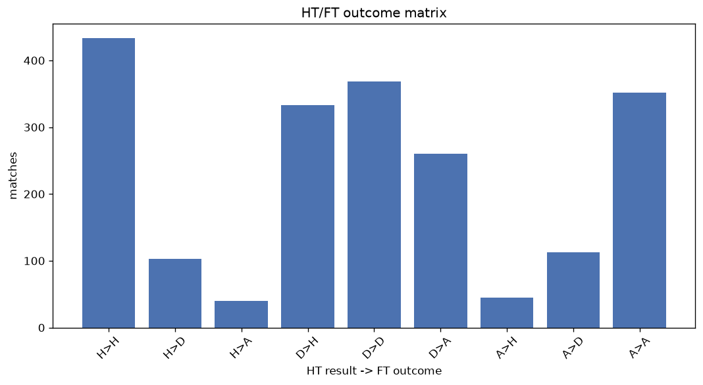
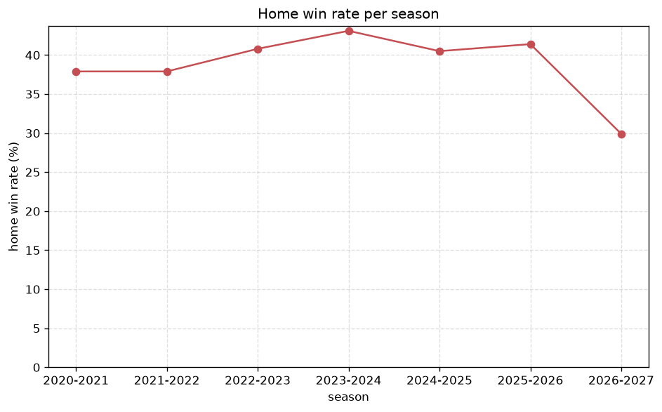

# Match Analysis
- Report: `matches_analysis`
- Generated: 2026-10-26T01:45:37+00:00
- Script: `backend/scripts/analyze_matches.py` v1.0.0
- League: Division 1 (Saudi Arabia)
- Scope: league `saudi2`

## 1. Overall summary
| metric | value |
|---|---|
| Matches | 2054 |
| Home wins | 817 (39.8%) |
| Draws | 584 (28.4%) |
| Away wins | 653 (31.8%) |
| Total goals | 5108 |
| Average goals per match | 2.487 |
| Goalless matches | 192 (9.3%) |

## 2. Per-season breakdown
| season | matches | home wins | draws | away wins | total goals | avg goals | goalless |
|---|---|---|---|---|---|---|---|
| 2020-2021 | 380 | 144 (37.9%) | 108 (28.4%) | 128 (33.7%) | 892 | 2.347 | 42 (11.1%) |
| 2021-2022 | 380 | 144 (37.9%) | 128 (33.7%) | 108 (28.4%) | 825 | 2.171 | 51 (13.4%) |
| 2022-2023 | 306 | 125 (40.8%) | 83 (27.1%) | 98 (32.0%) | 709 | 2.317 | 26 (8.5%) |
| 2023-2024 | 306 | 132 (43.1%) | 83 (27.1%) | 91 (29.7%) | 816 | 2.667 | 23 (7.5%) |
| 2024-2025 | 306 | 124 (40.5%) | 82 (26.8%) | 100 (32.7%) | 794 | 2.595 | 23 (7.5%) |
| 2025-2026 | 309 | 128 (41.4%) | 72 (23.3%) | 109 (35.3%) | 917 | 2.968 | 16 (5.2%) |
| 2026-2027 | 67 | 20 (29.9%) | 28 (41.8%) | 19 (28.4%) | 155 | 2.313 | 11 (16.4%) |

## 3. HT/FT outcome matrix
| HT result \ FT result | Home | Draw | Away | total |
|---|---|---|---|---|
| HT home lead | 433 (75.2%) | 103 (17.9%) | 40 (6.9%) | 576 |
| HT draw | 333 (34.7%) | 368 (38.3%) | 260 (27.1%) | 961 |
| HT away lead | 45 (8.8%) | 113 (22.2%) | 352 (69.0%) | 510 |
- *7 match(es) excluded (no HT score recorded).*

## 4. Comeback matches
- Home comebacks (trailing at HT, won at FT): **45** (2.2%)
- Away comebacks (trailing at HT, won at FT): **40** (1.9%)

### Home comebacks
| season | home | away | HT | FT |
|---|---|---|---|---|
| 2020-2021 | Najran | Al Thuqbah | 0-1 | 2-1 |
| 2020-2021 | Al Jabalain | Hajer | 0-1 | 2-1 |
| 2020-2021 | Al Thuqbah | Arar | 0-1 | 2-1 |
| 2020-2021 | Al Khaleej | Al Thuqbah | 0-1 | 3-1 |
| 2020-2021 | Al-Nahda | Najran | 1-2 | 3-2 |
| 2020-2021 | Jeddah | Al Thuqbah | 0-1 | 2-1 |
| 2020-2021 | Al Jabalain | Al Adalah | 0-1 | 3-1 |
| 2020-2021 | Al Bukiryah | Ohod | 0-1 | 2-1 |
| 2020-2021 | Al Taee | Al Diriyah | 0-1 | 3-2 |
| 2021-2022 | Al-Sahel | Jeddah | 0-1 | 2-1 |
| 2021-2022 | Al-Sahel | Bisha | 0-1 | 2-1 |
| 2021-2022 | Al-Sahel | Al Kholood | 0-1 | 3-1 |
| 2021-2022 | Al Jabalain | Al Diriyah | 0-1 | 3-2 |
| 2021-2022 | Al Adalah | Bisha | 0-1 | 2-1 |
| 2021-2022 | Al-Sahel | Al Jeel | 0-1 | 2-1 |
| 2021-2022 | Jeddah | Al Wehda | 0-1 | 2-1 |
| 2021-2022 | Al Jeel | Al-Nahda | 0-1 | 2-1 |
| 2022-2023 | Al Ahli SC | Najran | 0-1 | 2-1 |
| 2022-2023 | Al-Qaisumah | Najran | 0-1 | 2-1 |
| 2022-2023 | Al Jabalain | Al Qadisiya | 0-1 | 2-1 |
| 2022-2023 | Al Okhdood | Al Orubah | 0-1 | 4-2 |
| 2022-2023 | Al Hazem | Al-Sahel | 0-1 | 3-2 |
| 2023-2024 | Al Arabi | Jeddah | 0-1 | 2-1 |
| 2023-2024 | Al Taraji | Al Najma | 0-2 | 3-2 |
| 2023-2024 | Al Jandal | Al Najma | 0-2 | 3-2 |
| 2023-2024 | Al Taraji | Al Ain | 0-1 | 2-1 |
| 2023-2024 | Al Qadisiya | Al Bukiryah | 0-1 | 2-1 |
| 2023-2024 | Al Jabalain | Al Bukiryah | 0-1 | 2-1 |
| 2023-2024 | Al Orubah | Ohod | 0-1 | 2-1 |
| 2023-2024 | Al Bukiryah | Jeddah | 0-1 | 3-2 |
| 2023-2024 | Al Adalah | Al Bukiryah | 1-2 | 3-2 |
| 2024-2025 | Al Hazem | Al Zulfi | 0-1 | 2-1 |
| 2024-2025 | Al Safa | Al Jabalain | 0-2 | 3-2 |
| 2024-2025 | Al Ain | Al Safa | 1-2 | 3-2 |
| 2024-2025 | Al Arabi | Al Jubail | 0-1 | 3-1 |
| 2024-2025 | Al Adalah | Al Hazem | 0-1 | 3-1 |
| 2024-2025 | Al Jabalain | Al Safa | 1-2 | 4-2 |
| 2025-2026 | Al Jandal | Al Batin | 0-1 | 2-1 |
| 2025-2026 | Al Raed | Al Wehda | 0-1 | 2-1 |
| 2025-2026 | Al Raed | Al-Ula | 0-1 | 3-2 |
| 2025-2026 | Al Jabalain | Al Batin | 0-1 | 4-1 |
| 2025-2026 | Al Raed | Al Adalah | 2-3 | 6-3 |
| 2025-2026 | Al Jabalain | Al Bukiryah | 0-1 | 2-1 |
| 2025-2026 | Al Arabi | Al Jubail | 1-2 | 4-3 |
| 2025-2026 | Al Diriyah | Al-Ula | 0-1 | 2-1 |

### Away comebacks
| season | home | away | HT | FT |
|---|---|---|---|---|
| 2020-2021 | Al Thuqbah | Al-Kawkab | 1-0 | 1-2 |
| 2020-2021 | Jeddah | Al Jabalain | 1-0 | 1-2 |
| 2020-2021 | Arar | Al-Shoalah | 2-1 | 2-3 |
| 2020-2021 | Jeddah | Al-Kawkab | 1-0 | 1-2 |
| 2020-2021 | Arar | Al Jabalain | 1-0 | 1-2 |
| 2020-2021 | Al Khaleej | Al-Shoalah | 1-0 | 1-3 |
| 2020-2021 | Al-Nahda | Ohod | 2-0 | 2-3 |
| 2020-2021 | Al Thuqbah | Al Jeel | 1-0 | 1-2 |
| 2020-2021 | Al-Nahda | Al Khaleej | 1-0 | 1-2 |
| 2021-2022 | Al Jabalain | Al Khaleej | 1-0 | 1-2 |
| 2021-2022 | Bisha | Najran | 1-0 | 1-2 |
| 2021-2022 | Hajer | Al Jabalain | 1-0 | 1-2 |
| 2021-2022 | Al Jeel | Jeddah | 1-0 | 1-2 |
| 2021-2022 | Al Wehda | Bisha | 1-0 | 1-2 |
| 2021-2022 | Al-Kawkab | Al Orubah | 2-1 | 2-3 |
| 2021-2022 | Al Diriyah | Al Jeel | 1-0 | 1-2 |
| 2021-2022 | Bisha | Al Diriyah | 1-0 | 1-2 |
| 2022-2023 | Al Ain | Hajer | 1-0 | 1-2 |
| 2022-2023 | Al Jabalain | Al-Faisaly | 1-0 | 1-2 |
| 2023-2024 | Ohod | Al Orubah | 1-0 | 1-2 |
| 2023-2024 | Al Ain | Al-Faisaly | 2-1 | 3-4 |
| 2023-2024 | Al Orubah | Jeddah | 1-0 | 1-2 |
| 2024-2025 | Al Najma | Al Batin | 1-0 | 1-2 |
| 2024-2025 | Al Jandal | Al Arabi | 1-0 | 1-2 |
| 2024-2025 | Al Jubail | Al Najma | 1-0 | 1-2 |
| 2024-2025 | Al Bukiryah | Neom SC | 1-0 | 1-2 |
| 2024-2025 | Jeddah | Al-Faisaly | 1-0 | 2-3 |
| 2024-2025 | Al Jandal | Al Jabalain | 1-0 | 1-2 |
| 2025-2026 | Abha | Al Orubah | 1-0 | 2-3 |
| 2025-2026 | Al Batin | Al Zulfi | 1-0 | 1-2 |
| 2025-2026 | Al Wehda | Abha | 1-0 | 2-3 |
| 2025-2026 | Al Batin | Al Diriyah | 1-0 | 1-2 |
| 2025-2026 | Al Bukiryah | Al Taee | 1-0 | 1-2 |
| 2025-2026 | Al Zulfi | Al Orubah | 1-0 | 1-2 |
| 2025-2026 | Al Zulfi | Jeddah | 1-0 | 1-2 |
| 2025-2026 | Al Orubah | Abha | 1-0 | 1-2 |
| 2025-2026 | Al Jandal | Al-Ula | 1-0 | 1-2 |
| 2025-2026 | Al Raed | Al-Faisaly | 1-0 | 1-2 |
| 2025-2026 | Al Jabalain | Al Adalah | 1-0 | 1-2 |
| 2026-2027 | Hajer | Al Najma | 2-1 | 2-4 |

## 5. HT lead conversion
| HT state | matches | converted to win | held as draw | collapsed to loss |
|---|---|---|---|---|
| Home lead | 576 | 433 (75.2%) | 103 (17.9%) | 40 (6.9%) |
| Away lead | 510 | 352 (69.0%) | 113 (22.2%) | 45 (8.8%) |

### Matches level at half-time
| FT result | count | pct |
|---|---|---|
| Home win | 333 | 34.7% |
| Draw | 368 | 38.3% |
| Away win | 260 | 27.1% |
- *7 match(es) excluded (no HT score recorded).*

## 6. First-goal timing
- Matches with a first-goal time recorded: `1855` of `2054` (90.3%)

Outcome distribution by first-goal timing bucket:
| bucket | matches | % of matches | home | draw | away |
|---|---|---|---|---|---|
| 1-15 | 530 | 25.8% | 233 (44.0%) | 123 (23.2%) | 174 (32.8%) |
| 16-30 | 422 | 20.5% | 187 (44.3%) | 86 (20.4%) | 149 (35.3%) |
| 31-45 | 318 | 15.5% | 124 (39.0%) | 74 (23.3%) | 120 (37.7%) |
| 46-60 | 282 | 13.7% | 129 (45.7%) | 52 (18.4%) | 101 (35.8%) |
| 61-75 | 168 | 8.2% | 70 (41.7%) | 46 (27.4%) | 52 (31.0%) |
| 76-90 | 105 | 5.1% | 51 (48.6%) | 11 (10.5%) | 43 (41.0%) |
| 91-120 | 30 | 1.5% | 17 (56.7%) | 0 (0.0%) | 13 (43.3%) |

## 7. Goalless matches
- Overall: **192** of `2054` (9.3%)

| season | matches | goalless | pct |
|---|---|---|---|
| 2020-2021 | 380 | 42 | 11.1% |
| 2021-2022 | 380 | 51 | 13.4% |
| 2022-2023 | 306 | 26 | 8.5% |
| 2023-2024 | 306 | 23 | 7.5% |
| 2024-2025 | 306 | 23 | 7.5% |
| 2025-2026 | 309 | 16 | 5.2% |
| 2026-2027 | 67 | 11 | 16.4% |

---
*All statistics are computed from PostgreSQL tables (read-only). Run with `python backend/scripts/analyze_matches.py` to regenerate.*

## Charts

