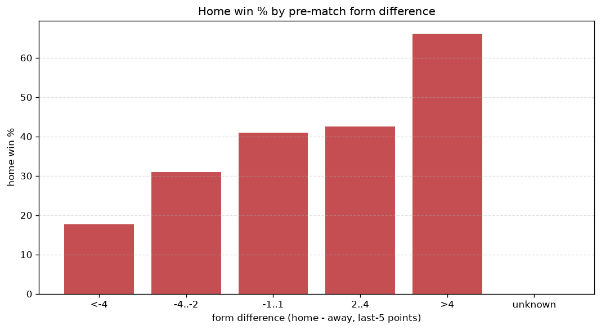
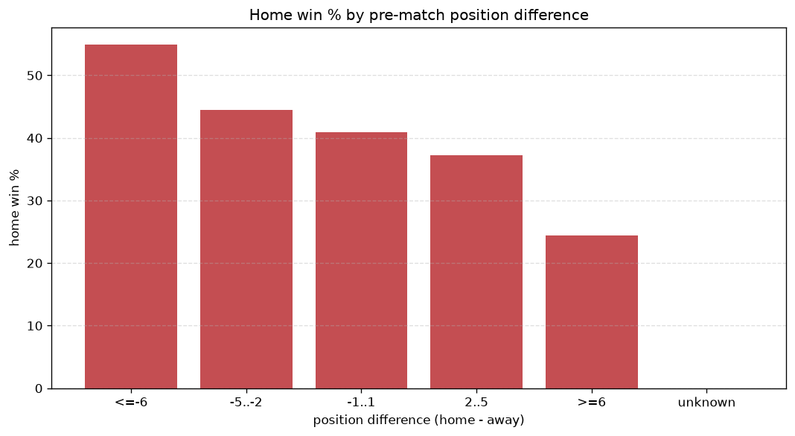

# Relationships Analysis
- Report: `relationships`
- Generated: 2026-10-30T04:09:03+00:00
- Script: `backend/scripts/analyze_relationships.py` v1.0.0
- League: Division 1 (Saudi Arabia)
- Scope: league `saudi2`

- Matches analysed: **1987** (23 leakage-safe pre-match features).

## 1. Correlation matrix
_Pearson correlation of each pre-match feature with observed goals; sorted by |corr(total goals)|._

| feature | corr(home) | corr(away) | corr(total) |
|---|---|---|---|
| home_team_goals_scored_last_5 | 0.136 | -0.036 | 0.075 |
| home_team_goals_conceded_last_5 | -0.032 | 0.142 | 0.073 |
| away_team_goals_scored_last_5 | -0.067 | 0.169 | 0.066 |
| away_team_away_goals_avg | -0.066 | 0.149 | 0.053 |
| home_team_home_conceded_avg | -0.019 | 0.094 | 0.050 |
| home_team_home_goals_avg | 0.135 | -0.079 | 0.045 |
| home_points_before_match | 0.104 | -0.051 | 0.041 |
| away_points_before_match | -0.072 | 0.124 | 0.031 |
| home_position_before_match | -0.171 | 0.139 | -0.030 |
| home_team_home_win_rate | 0.113 | -0.078 | 0.030 |
| away_team_goals_conceded_last_5 | 0.094 | -0.059 | 0.028 |
| away_team_wins_last_5 | -0.108 | 0.152 | 0.025 |
| away_team_points_last_5 | -0.104 | 0.148 | 0.025 |
| away_team_away_win_rate | -0.088 | 0.130 | 0.024 |
| home_team_wins_last_5 | 0.105 | -0.091 | 0.015 |
| position_difference | -0.218 | 0.213 | -0.015 |
| points_difference | 0.236 | -0.234 | 0.013 |
| away_team_away_conceded_avg | 0.083 | -0.070 | 0.013 |
| rest_days_difference | -0.039 | 0.027 | -0.011 |
| away_position_before_match | 0.133 | -0.157 | -0.010 |
| away_rest_days | -0.011 | 0.020 | 0.006 |
| home_team_points_last_5 | 0.102 | -0.101 | 0.006 |
| home_rest_days | -0.032 | 0.036 | 0.001 |

## 2. Form vs outcome
_Home win/draw/away % per bucket of `home_team_points_last_5 - away_team_points_last_5`._

| bucket | matches | home | draw | away | home % | draw % | away % |
|---|---|---|---|---|---|---|---|
| <-4 | 319 | 80 | 78 | 161 | 25.1% | 24.5% | 50.5% |
| -4..-2 | 394 | 138 | 110 | 146 | 35.0% | 27.9% | 37.1% |
| -1..1 | 591 | 248 | 169 | 174 | 42.0% | 28.6% | 29.4% |
| 2..4 | 372 | 172 | 101 | 99 | 46.2% | 27.2% | 26.6% |
| >4 | 311 | 159 | 98 | 54 | 51.1% | 31.5% | 17.4% |
| unknown | 0 | 0 | 0 | 0 | - | - | - |

## 3. Position vs outcome
_Home win/draw/away % per bucket of `position_difference` (home position - away position; negative favours the home team)._

| bucket | matches | home | draw | away | home % | draw % | away % |
|---|---|---|---|---|---|---|---|
| <=-6 | 468 | 257 | 124 | 87 | 54.9% | 26.5% | 18.6% |
| -5..-2 | 375 | 167 | 116 | 92 | 44.5% | 30.9% | 24.5% |
| -1..1 | 281 | 115 | 87 | 79 | 40.9% | 31.0% | 28.1% |
| 2..5 | 368 | 137 | 103 | 128 | 37.2% | 28.0% | 34.8% |
| >=6 | 495 | 121 | 126 | 248 | 24.4% | 25.5% | 50.1% |
| unknown | 0 | 0 | 0 | 0 | - | - | - |

## 4. Rest advantage
_Home win/draw/away % per bucket of `rest_days_difference` (home rest - away rest). Matches with unknown rest are bucketed separately._

| bucket | matches | home | draw | away | home % | draw % | away % |
|---|---|---|---|---|---|---|---|
| <-1 | 185 | 78 | 60 | 47 | 42.2% | 32.4% | 25.4% |
| -1..0 | 452 | 190 | 126 | 136 | 42.0% | 27.9% | 30.1% |
| 0 | 687 | 286 | 182 | 219 | 41.6% | 26.5% | 31.9% |
| 1..2 | 562 | 204 | 161 | 197 | 36.3% | 28.6% | 35.1% |
| >2 | 45 | 17 | 7 | 21 | 37.8% | 15.6% | 46.7% |
| unknown | 56 | 22 | 20 | 14 | 39.3% | 35.7% | 25.0% |
- *56 match(es) had unknown rest difference (missing rest data on at least one side).*

## 5. Home team quality
_Home win rate by `home_team_home_win_rate` tier (split at 0.5)._

- `< 0.5` tier: **36.9%** home win (486/1316)
- `>= 0.5` tier: **46.3%** home win (311/671)
- Home-win gap (>= split minus < split): **+9.4 pp**

| tier | label | matches | home | draw | away | home % |
|---|---|---|---|---|---|---|
| low | < 0.5 | 1316 | 486 | 355 | 475 | 36.9% |
| high | >= 0.5 | 671 | 311 | 201 | 159 | 46.3% |

## 6. Feature averages by result
_Mean feature value per outcome; `range` is home-minus-away spread of the group means._

| feature | home mean | draw mean | away mean | range |
|---|---|---|---|---|
| points_difference | 3.703 | 0.034 | -4.841 | 8.543 |
| position_difference | -1.974 | -0.041 | 2.929 | 4.903 |
| away_points_before_match | 21.583 | 23.180 | 26.331 | 4.748 |
| home_points_before_match | 25.286 | 23.214 | 21.491 | 3.796 |
| home_position_before_match | 9.075 | 10.293 | 11.573 | 2.497 |
| away_position_before_match | 11.049 | 10.335 | 8.644 | 2.405 |
| away_team_points_last_5 | 5.759 | 6.063 | 7.090 | 1.331 |
| away_team_goals_scored_last_5 | 5.276 | 5.477 | 6.372 | 1.096 |
| home_team_points_last_5 | 6.620 | 6.281 | 5.560 | 1.060 |
| home_team_goals_scored_last_5 | 5.970 | 5.637 | 5.174 | 0.796 |
| home_team_goals_conceded_last_5 | 5.343 | 5.660 | 6.103 | 0.760 |
| away_team_goals_conceded_last_5 | 5.883 | 5.701 | 5.205 | 0.678 |
| home_rest_days | 7.301 | 7.507 | 7.845 | 0.545 |
| away_team_wins_last_5 | 1.469 | 1.595 | 1.953 | 0.483 |
| home_team_wins_last_5 | 1.778 | 1.653 | 1.435 | 0.343 |
| rest_days_difference | -0.135 | -0.164 | 0.173 | 0.337 |
| away_rest_days | 7.436 | 7.672 | 7.673 | 0.236 |
| home_team_home_goals_avg | 1.316 | 1.233 | 1.119 | 0.197 |
| away_team_away_goals_avg | 0.978 | 1.024 | 1.173 | 0.195 |
| away_team_away_conceded_avg | 1.297 | 1.214 | 1.165 | 0.132 |
| home_team_home_conceded_avg | 1.012 | 1.046 | 1.124 | 0.112 |
| away_team_away_win_rate | 0.262 | 0.288 | 0.341 | 0.079 |
| home_team_home_win_rate | 0.410 | 0.390 | 0.339 | 0.072 |

---
*All features are leakage-safe pre-match values built by `ml.features.build_features.build_rows` from strictly prior matches. Run with `python backend/scripts/analyze_relationships.py` to regenerate.*

## Charts

