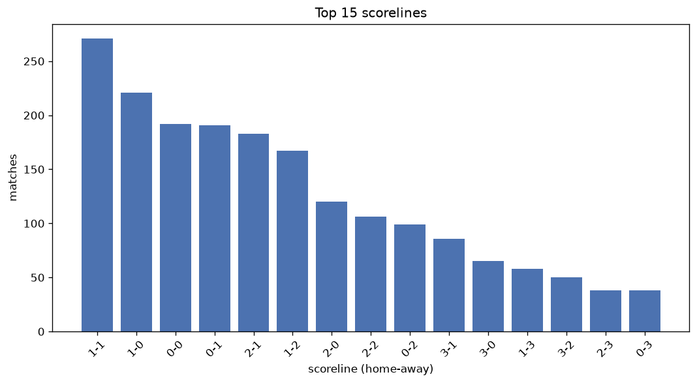
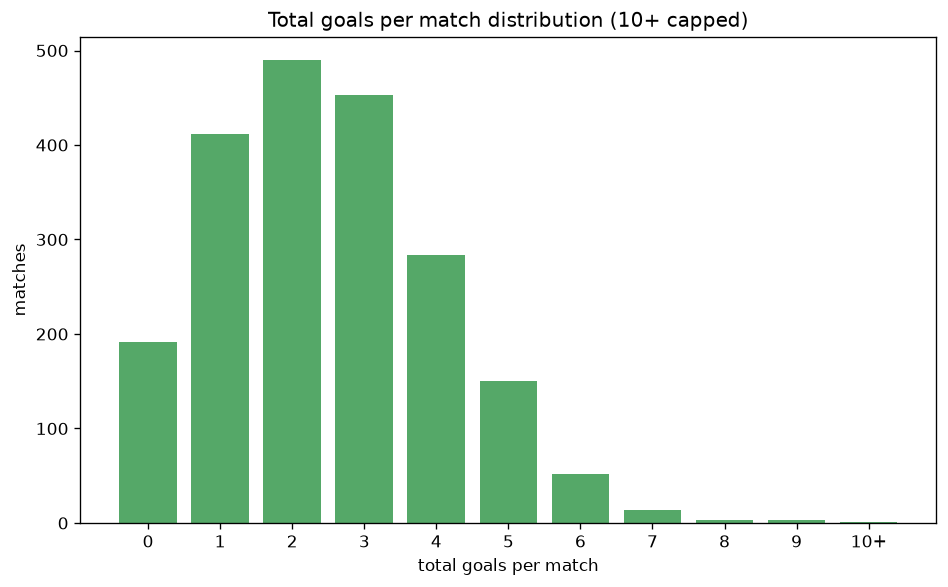

# Scoreline Analysis
- Report: `scoreline_analysis`
- Generated: 2026-10-26T01:45:44+00:00
- Script: `backend/scripts/analyze_scorelines.py` v1.0.0
- League: Division 1 (Saudi Arabia)
- Scope: league `saudi2`

## 1. Scoreline frequency
- Matches analysed: **2054** across **7** seasons.
- Distinct scorelines seen: **40**.

| scoreline | count | pct |
|---|---|---|
| 1-1 | 271 | 13.2% |
| 1-0 | 221 | 10.8% |
| 0-0 | 192 | 9.3% |
| 0-1 | 191 | 9.3% |
| 2-1 | 183 | 8.9% |
| 1-2 | 167 | 8.1% |
| 2-0 | 120 | 5.8% |
| 2-2 | 106 | 5.2% |
| 0-2 | 99 | 4.8% |
| 3-1 | 86 | 4.2% |
| 3-0 | 65 | 3.2% |
| 1-3 | 58 | 2.8% |
| 3-2 | 50 | 2.4% |
| 2-3 | 38 | 1.9% |
| 0-3 | 38 | 1.9% |
| 4-1 | 32 | 1.6% |
| 4-0 | 20 | 1.0% |
| 1-4 | 20 | 1.0% |
| 3-3 | 14 | 0.7% |
| 0-4 | 14 | 0.7% |

## 2. Scoreline frequency per season

### 2020-2021
| scoreline | count | pct |
|---|---|---|
| 1-1 | 51 | 13.4% |
| 0-1 | 47 | 12.4% |
| 1-0 | 43 | 11.3% |
| 0-0 | 42 | 11.1% |
| 1-2 | 30 | 7.9% |

### 2021-2022
| scoreline | count | pct |
|---|---|---|
| 1-1 | 58 | 15.3% |
| 0-0 | 51 | 13.4% |
| 1-0 | 44 | 11.6% |
| 2-1 | 35 | 9.2% |
| 0-1 | 33 | 8.7% |

### 2022-2023
| scoreline | count | pct |
|---|---|---|
| 1-0 | 42 | 13.7% |
| 1-1 | 39 | 12.7% |
| 1-2 | 30 | 9.8% |
| 2-1 | 30 | 9.8% |
| 0-1 | 27 | 8.8% |

### 2023-2024
| scoreline | count | pct |
|---|---|---|
| 1-1 | 38 | 12.4% |
| 1-0 | 36 | 11.8% |
| 2-1 | 30 | 9.8% |
| 0-1 | 26 | 8.5% |
| 0-0 | 23 | 7.5% |

### 2024-2025
| scoreline | count | pct |
|---|---|---|
| 1-1 | 36 | 11.8% |
| 1-0 | 31 | 10.1% |
| 0-1 | 30 | 9.8% |
| 1-2 | 25 | 8.2% |
| 2-1 | 24 | 7.8% |

### 2025-2026
| scoreline | count | pct |
|---|---|---|
| 1-1 | 36 | 11.7% |
| 2-1 | 34 | 11.0% |
| 1-2 | 31 | 10.0% |
| 0-1 | 21 | 6.8% |
| 1-0 | 20 | 6.5% |

### 2026-2027
| scoreline | count | pct |
|---|---|---|
| 1-1 | 13 | 19.4% |
| 0-0 | 11 | 16.4% |
| 0-1 | 7 | 10.4% |
| 0-2 | 5 | 7.5% |
| 1-0 | 5 | 7.5% |

## 3. Total-goal histogram
_10+ groups all matches with 10 or more total goals._

| total goals | matches | pct |
|---|---|---|
| 0 | 192 | 9.3% |
| 1 | 412 | 20.1% |
| 2 | 490 | 23.9% |
| 3 | 453 | 22.1% |
| 4 | 284 | 13.8% |
| 5 | 150 | 7.3% |
| 6 | 52 | 2.5% |
| 7 | 14 | 0.7% |
| 8 | 3 | 0.1% |
| 9 | 3 | 0.1% |
| 10+ | 1 | 0.0% |

## 4. Extreme scorelines
- Matches with 7+ total goals: **21**

| season | date | scoreline | total goals |
|---|---|---|---|
| 2023-2024 | 2024-01-10 | 4-6 | 10 |
| 2021-2022 | 2021-12-14 | 3-6 | 9 |
| 2024-2025 | 2025-04-08 | 2-7 | 9 |
| 2025-2026 | 2026-01-22 | 6-3 | 9 |
| 2020-2021 | 2021-05-25 | 8-0 | 8 |
| 2025-2026 | 2025-09-12 | 4-4 | 8 |
| 2025-2026 | 2026-01-01 | 5-3 | 8 |
| 2020-2021 | 2021-01-19 | 4-3 | 7 |
| 2020-2021 | 2021-03-21 | 5-2 | 7 |
| 2021-2022 | 2021-09-20 | 5-2 | 7 |
| 2023-2024 | 2023-11-29 | 3-4 | 7 |
| 2023-2024 | 2023-12-13 | 3-4 | 7 |
| 2023-2024 | 2024-03-03 | 5-2 | 7 |
| 2023-2024 | 2024-03-05 | 5-2 | 7 |
| 2024-2025 | 2025-03-15 | 3-4 | 7 |
| 2025-2026 | 2025-12-31 | 5-2 | 7 |
| 2025-2026 | 2026-02-04 | 4-3 | 7 |
| 2025-2026 | 2026-03-02 | 1-6 | 7 |
| 2025-2026 | 2026-05-01 | 4-3 | 7 |
| 2026-2027 | 2026-08-26 | 3-4 | 7 |
| 2026-2027 | 2026-10-12 | 6-1 | 7 |

## 5. Margin-of-victory distribution (decided matches)
- Decided matches: **1470** (draws: **584**)
- Average winning margin: **1.63**

| margin | matches | pct |
|---|---|---|
| 1 | 857 | 58.3% |
| 2 | 385 | 26.2% |
| 3+ | 228 | 15.5% |

## 6. Margin by outcome

### Home wins
- Matches: **817** | avg margin: **1.68** | max margin: **8**
| margin | matches | pct |
|---|---|---|
| 1 | 457 | 55.9% |
| 2 | 218 | 26.7% |
| 3+ | 142 | 17.4% |
- *Full match-by-match list available in `scoreline_analysis.json`.*

### Away wins
- Matches: **653** | avg margin: **1.57** | max margin: **6**
| margin | matches | pct |
|---|---|---|
| 1 | 400 | 61.3% |
| 2 | 167 | 25.6% |
| 3+ | 86 | 13.2% |
- *Full match-by-match list available in `scoreline_analysis.json`.*

## 7. Most common exact score by outcome type
| outcome | matches | most common score | count | pct |
|---|---|---|---|---|
| home | 817 | 1-0 | 221 | 27.1% |
| draw | 584 | 1-1 | 271 | 46.4% |
| away | 653 | 0-1 | 191 | 29.2% |

---
*All statistics are computed from PostgreSQL tables (read-only). Run with `python backend/scripts/analyze_scorelines.py` to regenerate.*

## Charts

